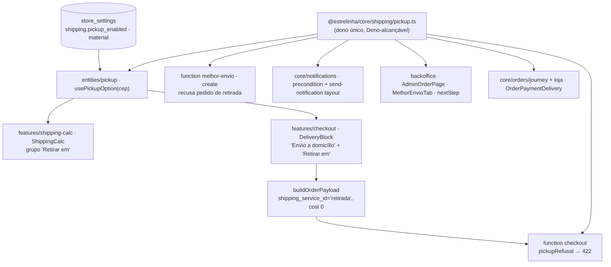

# 63 — Retirada no escritório · Design

**Spec**: `.specs/features/63-retirada-no-escritorio/spec.md`
**Status**: Draft

---

## Architecture Overview

**A retirada não é uma cotação.** Ela não passa pelo Melhor Envio, não entra em `ShippingQuote`
(`id: number`) e não toca em `ALLOWED_SHIPPING_SERVICE_IDS` (`services.test.ts` assere `[1, 2]`). Ela
é uma **segunda origem de opção**, derivada de `store_settings` (`shipping.pickup_enabled` +
`material`) e do CEP, com **um dono** em `core`, lido por quatro escritores:

### Abordagens consideradas

| Abordagem | Veredito |
| --- | --- |
| **(A) Opção sintética fora da cotação, dono em `core/shipping/pickup.ts`** | **Escolhida.** Não altera a cotação, o filtro `> 0`, o `cheapestQuoteId` nem o fallback SHP-05 — a retirada simplesmente não está na lista que eles leem (RET-08 por construção) |
| (B) A function `melhor-envio` devolve a retirada junto da cotação, com preço `0` | Recusada: o preço `0` é descartado por dois filtros (`useShippingQuote.ts:16`, `ShippingCalc.tsx:61`), venceria `cheapestQuoteId` e o frete grátis, e a falha da cotação esconderia a retirada (contra RET-04) |
| (C) Uma "transportadora" a mais em `services.ts` | Recusada: aquele arquivo é o dono de "que serviços **do Melhor Envio**", e o id é numérico da API |

---

## Code Reuse Analysis

| Componente | Local | Uso |
| --- | --- | --- |
| `addBusinessDays` | `core/shipping/estimate.ts` | data "Pronta para retirada a partir de" = hoje + `handling_days` úteis |
| `useShippingSettings`, `useMaterialSettings` | `core/hooks/useStoreSettings.ts:87,118` | entrada do hook da loja; leitura pública já existe |
| `stripCep` | `core/validators/cep.ts` | normalização do CEP antes da faixa |
| Padrão de migration aditiva | migrations da `27`/`37` (`value \|\| … WHERE NOT value ? '…'`) | `pickup_enabled = true` |
| `SWITCH_TAP_44`, `ToggleField` | backoffice `shared/ui` | interruptor no cartão Frete |
| Casco do bloco de opção | `DeliveryBlock.tsx:506-553` | a opção da retirada usa o mesmo botão `aria-pressed` |
| `checkout` — leitura de `store_settings` | novo, mesmo `deps.supabase` | a function hoje não lê settings; lê `shipping` e `material` só quando o pedido é de retirada |

### Integration Points

| Sistema | Integração |
| --- | --- |
| `orders` | **sem migration de coluna**: `shipping_service_id text` já existe (`20260727120000`). Pedido de retirada = `'retirada'` |
| `store_settings.shipping` | migration nova `20261011120000_63-retirada.sql`, aditiva e idempotente |
| `DbOrder` | ganha `shipping_service_id?: string \| null` (a coluna existe; o tipo não a declarava) |
| Leituras do pedido na loja | `useOrder` e a function `checkout` (`get-order`) já fazem `select('*, …')` — a coluna chega sem mudança de select |
| `send-notification` | `ORDER_COLUMNS` (`dispatch.ts:142`) ganha `shipping_service_id`; o endereço da retirada vem de `settings.material`, que ele já lê |

---

## Components

### `core/shipping/pickup.ts` — o dono (RET-13)

- **Deno-alcançável**: zero imports (ou só relativos com `.ts`); exportado pelo barrel com `.ts`.
- **Interfaces**:
  - `PICKUP_SERVICE_ID = 'retirada'`, `PICKUP_METHOD_NAME = 'Retirada no escritório'`, `PICKUP_CARRIER = 'Uma Estrelinha'`
  - `isRsCep(cep: string | null | undefined): boolean` — 8 dígitos após `replace(/\D/g,'')` e primeiro dígito `9`
  - `interface PickupAddress { street?; neighborhood?; city?; state? }` — estrutural, compatível com `MaterialSettings` sem importá-lo (o alias quebraria o Deno)
  - `pickupLocation(material: PickupAddress | null | undefined): string | null` — `Escritório - Uma Estrelinha - {rua}, {bairro}, {cidade}/{UF}` (sem `/UF` se vazio); `null` se rua, bairro ou cidade vazios após `trim`. **Nunca lê `number` nem `complement`** (RET-03)
  - `pickupAvailable(i: { enabled: boolean; material; cep }): boolean`
  - `pickupRefusal(i: { enabled; material; zip; cost }): 'pickup_unavailable' | null` — `string | null`, nunca união por booleano (`strictNullChecks: false`)
  - `isPickupOrder(o: { shipping_service_id?: string | null } | null | undefined): boolean`
- **Teste**: `pickup.test.ts` (faixa: `89999999` ✗, `90000000` ✓, `99999999` ✓, `9124001` ✗, máscara aceita), e `denoReach` estendido ao arquivo.

### `core/shipping/estimate.ts` — `formatPickupReady(date): string`

`"a partir de 14 de outubro"`, reaproveitando `MONTHS_PT_BR`. Não vai para `pickup.ts` porque `estimate.ts` não é Deno-alcançável e só a loja precisa da data.

### Configuração — `ShippingSettings.pickup_enabled`

`packages/supabase/src/types/settings.ts` (`pickup_enabled: boolean`, `DEFAULT_SHIPPING.pickup_enabled = true`), migration aditiva, e `storeSettingsDefaults.test.ts` passa a ler a migration da `63` e comparar o campo.

### `apps/store/src/entities/pickup` — `usePickupOption(cep)` (AD-033: dois features do mesmo app ⇒ `entities`)

- Retorna `{ location: string; readyLabel: string } | null`.
- Lê `useShippingSettings().pickup_enabled`, `handling_days`, `useMaterialSettings()`; chama `pickupAvailable`/`pickupLocation`; `today` memoizado por montagem.
- Barrel `index.ts`.

### `ShippingCalc` (RET-01..05)

Depois da lista dos Correios (ou da mensagem de erro/vazio), grupo com título `Retirar em` e um `<li>`: a linha de `location`, `Pronta para retirada {readyLabel}` e `Grátis`. Os títulos `Envio a domicílio` / `Retirar em` aparecem só quando há retirada (sem ela a tela fica idêntica à de hoje). A retirada é calculada a partir do CEP **consultado** (o mesmo enviado à cotação), não do digitado.

### `DeliveryBlock` (RET-06..11)

- `pickupOption: DeliveryOption | null` **separado** de `options` — `options`, `cheapestQuoteId`, `quoteFailed` e a pré-seleção não mudam (RET-08 por construção).
- Render: com retirada, os botões ficam em dois grupos rotulados; a opção da retirada mostra `location` no título, `Pronta para retirada {readyLabel}` e `Grátis` sem preço riscado.
- Efeito: `shipping?.serviceId === PICKUP_SERVICE_ID && !pickupOption` ⇒ `setShipping(null)` (rascunho restaurado com retirada desligada; CEP fora do RS já é coberto pelo reset de CEP).
- Recolhido (RET-11): com retirada escolhida, a faixa mostra `Retirada no escritório`, a `location` e `Grátis`, sem "Chega"/"Prazo confirmado".
- `canContinue`/`isDeliveryComplete` **sem mudança** (RET-09).

### `buildOrderPayload` (RET-07)

Nenhum código novo é estritamente necessário — o rascunho da retirada carrega `serviceId`, `serviceName`, `carrier`, `cost 0` e datas vazias (que viram `undefined`). A task fixa isso por teste.

### `checkout` function (RET-12)

Antes do `insert`, quando `body.shipping_service_id === PICKUP_SERVICE_ID`: lê `store_settings` (`shipping`, `material`), chama `pickupRefusal({ enabled, material, zip: body.address_zip, cost: Number(body.shipping_cost) })`, e recusa com `json({ error: 'pickup_unavailable' }, 422)` + `log`. Fica **depois** da idempotência (retentativa de pedido já gravado continua devolvendo o pedido) e **antes** de qualquer escrita. A tela trata o 422 como erro genérico de criação (o caminho já existe).

### `melhor-envio` function (RET-15)

`handleCreate` lê `shipping_service_id` junto do pedido e devolve 422 `pickup_order` antes da chamada à API. Não há `handlers.ts` testável; um guarda de fonte em `supabase/functions/_shared/__tests__/retiradaSemEtiqueta.test.ts` assere (sobre a AST/texto sem comentário) que `isPickupOrder(` é chamado em `index.ts` antes do primeiro `fetch(` de `handleCreate`, com sensor.

### Painel

- `ShippingMaterialSection` (RET-20/21): `ToggleField` "Retirada no escritório" no cartão Frete, salvo por `salvar('shipping', …)` que já existe; aviso quando ligado e `pickupLocation(material) === null`.
- `AdminOrderPage` (RET-14): cartão Entrega ganha a linha `Retirada no escritório` no topo quando `isPickupOrder`; `MelhorEnvioTab` recebe o pedido e, sendo retirada, mostra só "Pedido de retirada no escritório — sem etiqueta" (sem cotar).
- `nextStep` (RET-16): para retirada, `separating → delivered` com rótulo `Marcar como retirado`.

### Notificações (RET-17/18)

- `precondition.ts`: `order_shipped` ⇒ `isPickupOrder(order)` → `'pickup_order'` (antes das outras checagens). O tipo de entrada ganha `shipping_service_id`.
- `send-notification`: `ORDER_COLUMNS` + `shipping_service_id`; `EmailOrder` ganha o campo; `addressBlock`/texto recebem `pickupLocation` do contexto e, sendo retirada, escrevem `Retirada` + a linha (nunca o endereço da cliente). Import relativo com `.ts`.

### Loja — pedido (RET-19)

- `OrderPaymentDelivery`: sendo retirada, o bloco de entrega diz `Retirada no escritório` e a `location` (via `useMaterialSettings`), em vez do endereço da cliente.
- `core/orders/journey.ts`: `JourneyInput` ganha `shipping_service_id`; com retirada, a etapa `shipped` é omitida e `delivered` recebe o rótulo `Retirado no escritório` (o rótulo passa a ser resolvido por etapa, não só pelo mapa fixo).

---

## Error Handling Strategy

| Cenário | Tratamento | O que a cliente vê |
| --- | --- | --- |
| Cotação dos Correios falha, CEP do RS | Fallback SHP-05 + retirada | "Frete padrão" e "Retirar em" |
| `store_settings` não carregou | `useStoreSettings` devolve os defaults (`pickup_enabled: true`, `material` vazio) ⇒ `pickupLocation = null` | sem retirada até o settings chegar |
| Retirada forjada / desligada no servidor | 422 `pickup_unavailable`, sem gravação | mensagem genérica de falha de criação do pedido |
| Etiqueta pedida para retirada | 422 `pickup_order` | painel nem oferece o botão |

---

## Risks & Concerns

| Concern | Location | Impact | Mitigation |
| --- | --- | --- | --- |
| Servidor confia em `shipping_cost` do navegador | `checkout/handlers.ts:365` | Retirada forjada sairia sem frete | RET-12 fecha **só** a retirada; o resto fica como dívida declarada (Out of Scope) |
| `DbOrder` não declara `shipping_service_id` | `packages/supabase/src/types/index.ts:305` | `isPickupOrder` leria `undefined` em silêncio (AD-012) | tipo acrescentado + probe contra o banco local na validação |
| `melhor-envio/index.ts` sem teste | `supabase/functions/melhor-envio/index.ts` | Guarda de etiqueta não provado | guarda de fonte com sensor |
| `DEFAULT_MATERIAL` vazio enquanto settings carrega | `settings.ts:222` | Opção "pisca" ao aparecer | aceitável: aparece quando os dados reais chegam; nunca aparece errada |
| `freeShippingSingleOwner` | store `shared/lib/__tests__` | Nenhum: a retirada não lê `free_shipping_threshold` | — |

---

## Tech Decisions

| Decisão | Escolha | Razão |
| --- | --- | --- |
| Representação no pedido | `shipping_service_id = 'retirada'` | Coluna `text` já existe; ids do Melhor Envio são numéricos |
| Regra de RS | Faixa de CEP, síncrona | Mesma resposta na loja e no servidor, sem dependência externa |
| Dono único | `core/shipping/pickup.ts` → **`AD-049`** | Quatro superfícies + duas functions perguntam "é retirada?/está disponível?"; é o defeito 01 em potencial |
| Retirada fora de `options` | Lista separada no `DeliveryBlock` | Mantém intocados SHP-05, SHP-06 e ADR-02 |
