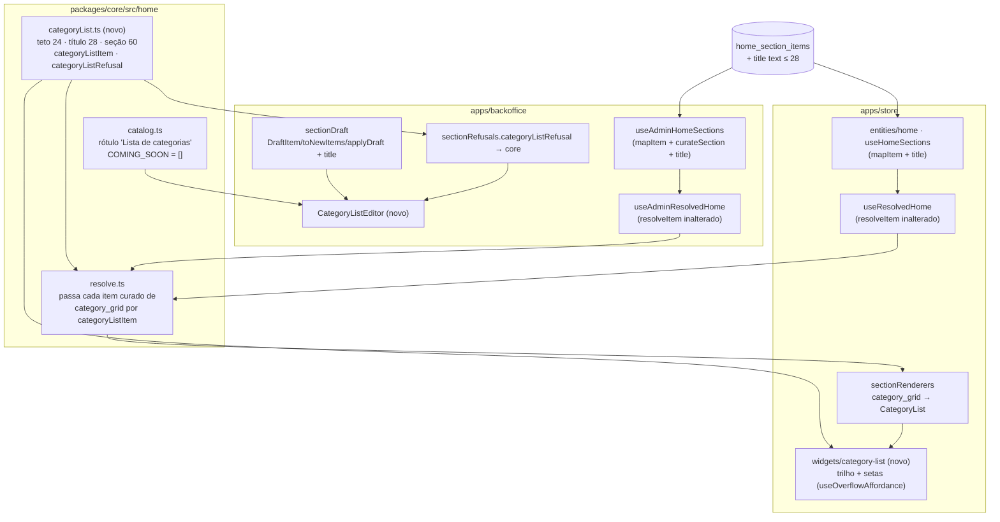

# 64 · Lista de categorias na Home — Design

**Spec**: `.specs/features/64-lista-de-categorias-na-home/spec.md`
**Status**: Draft r2 — revisada contra `reviews/design-r1.md` (R1..R7 incorporados)

---

## Architecture Overview

O tipo `category_grid` já está no `check` do banco, no catálogo de `core/home` e na bandeja do
painel — esmaecido. A feature dá corpo a ele nos três lugares que a feature `50` tocou para dar corpo
ao `product_carousel`, mais um que a `50` não precisou: **uma coluna** (`home_section_items.title`).

A decisão estrutural é **onde mora a regra do item** ("o rótulo é o título ou o nome da coleção; a
imagem é só a enviada, nunca o `banner_url` da coleção; destino que não é coleção não desenha"). Ela
é lida por **dois** resolvedores — `useResolvedHome` (loja) e `useAdminResolvedHome` (painel) —, e os
dois hoje fazem `label: item.alt || categoria.name` e `imageUrl: item.image_url || categoria.banner_url`.
Os dois estão errados para este tipo, do mesmo jeito.



### Abordagens consideradas para a regra do item

| | Abordagem | Custo | Veredito |
| --- | --- | --- | --- |
| **A** | **`resolveHomeSections` aplica `categoryListItem` a todo item curado de `category_grid`**, depois do `resolveItem` injetado | uma linha em `resolve.ts`; os dois resolvedores de app **não mudam** | **Recomendada** |
| B | cada `resolveItem` (loja e painel) ramifica por `section.type` e chama um helper de `core` | dois `if` de tipo em dois apps; o terceiro resolvedor que nascer esquece | recusada — é o "defeito 01" com o helper servindo só de álibi |
| C | o widget da loja calcula o rótulo a partir do item cru | o `ResolvedItem` não carrega `title`; o painel diria outra coisa na linha ("Coleção · …") | recusada — dois donos, e a linha do painel divergiria da loja |

**A** funciona porque `resolveHomeSections` já recebe o `HomeSectionItem` cru **e** o
`ResolvedItem` que o app devolveu: ele tem as duas metades para decidir sem conhecer catálogo.
`resolveItem` continua sendo a única coisa que sabe "a coleção está no ar?" — a A não toca nisso.

---

## Code Reuse Analysis

### Existing Components to Leverage

| Componente | Onde | Como |
| --- | --- | --- |
| `resolveHomeSections` | `packages/core/src/home/resolve.ts` | ganha o pós-processamento do tipo; `droppedCount` e `hiddenReason` saem de graça (LCT-11, LCT-12, LCT-24) |
| `featured.ts` (feature 50) | `packages/core/src/home/featured.ts` | **molde** de `categoryList.ts`: teto como recusa, ordem das cobranças, `string \| null` |
| `ordinal` | `packages/core/src/home/carousel.ts` | ganha o irmão `ordinalF` ("3ª") em `core`; o `ordinalF` do painel passa a **reexportar** o de `core` |
| `aspectRatioWarning` / `SlotSpec` | `core/home/layout.ts` (via `uploadHomeImage`) | a vaga 800 × 800 vira `CATEGORY_LIST_ART`; o aviso de proporção sai pronto (LCT-17) |
| `uploadHomeImage` | `backoffice/features/home-composition/lib` | upload, bucket `home-images`, erro como texto (LCT-25) |
| `CharCounter` | `backoffice/shared/ui` | os dois contadores (60 e 28), com o `maxLength` lendo a mesma constante (LCT-16, LCT-17) |
| select de coleção + congelamento do `label_snapshot` | `CollectionFeatureEditor.tsx:42-68` | **mesma forma** (ativas por `sort_order`, opção "(fora do ar)", snapshot no mesmo gesto) — ver Tech Decisions sobre não usar `DestinoDoItem` |
| arrasto nativo `draggable` + `soltar` | `HeroCarouselEditor.tsx:97-107` | **mesmo mecanismo** (LCT-21) |
| `useOverflowAffordance` | `apps/store/src/shared/lib` | estado das setas por posição real de rolagem + `rolar(±1)` a 0,8 da janela (LCT-31, LCT-32) |
| `TAP_44` | `apps/store/src/shared/lib/touchTarget` | alvo das setas, **primeiro** dentro do `cn(...)` (molde `HeroCarousel.tsx:175`) |
| `renditionUrl` / `renditionSrcSet` / `imagePriority` | `@estrelinha/core/media` | a foto no tamanho do círculo, prioridade pelo índice (LCT-06) |
| `categoryHref` | `@estrelinha/core/menu` | já chega montado em `ResolvedItem.href` pelo `resolveItem` da loja (LCT-03) |
| `applyDraft` / ponte da prévia | `backoffice/.../model/sectionDraft.ts` | ganha `title`, e a prévia reflete o rascunho sem recarregar (LCT-24, LCT-40) |

### Integration Points

| Sistema | Integração |
| --- | --- |
| Banco | migration **aditiva**: `alter table home_section_items add column if not exists title text` + `check (title is null or char_length(title) <= 28)`. Sem dado, sem `grant`, sem policy nova — as policies `has_role` e a leitura pública da 24 cobrem a coluna |
| Leitura (loja e painel) | `select('*, items:home_section_items(*, …)')` já traz a coluna; só os dois `mapItem` e o `DbHomeSectionItem` (`packages/supabase/src/types/home.ts`) ganham `title` |
| Escrita (painel) | `curateSection` monta o `insert` **coluna a coluna** (`useAdminHomeSections.ts:294`) — sem `title` ali, a coluna nunca seria gravada e **nenhum teste da tela pegaria** (dublê). Entra na lista e no teste de igualdade do payload |
| Prévia | `applyDraft` → `postMessage` → loja; nada novo no canal |

---

## Components

### `core/home/categoryList.ts` (novo)

- **Purpose**: tudo o que a loja e o painel precisam concordar sobre o bloco **Lista de categorias**.
- **Location**: `packages/core/src/home/categoryList.ts`, exportado pelo barrel. Imports **com `.ts`
  explícito** (convenção de `featured.ts`).
- **Interfaces**:
  - `CATEGORY_LIST_MAX_ITEMS = 24` (A-07, LCT-30)
  - `CATEGORY_LIST_ITEM_TITLE_MAX = 28` (A-02, LCT-27) — lida pelo guarda da migration
  - `CATEGORY_LIST_TITLE_MAX = 60` (A-08, LCT-16)
  - `CATEGORY_LIST_ART: SlotSpec = { width: 800, height: 800 }` (A-04)
  - `categoryListLabel(item: { title?: string | null; alt?: string | null }, collectionName: string): string` —
    **o dono único do rótulo** (LCT-02): `title?.trim() || alt?.trim() || collectionName`. A
    precedência **título > `alt` > nome** vale igual nos dois lados (R1): o editor deste tipo nunca
    grava `alt`, mas `toDraftItems` preserva um `alt` chegado por escrita direta, e a tela e a loja
    têm de dizer a mesma coisa sobre ele. O `label_snapshot` **não** entra no rótulo — ele é só o
    ramo de aviso do órfão. Chamada pelos **dois**
    lados — por `categoryListItem` na resolução (loja e prévia) e pela linha fechada do editor, que
    trabalha sobre o rascunho e não tem item resolvido (R1). Nenhuma tela escreve `title || nome`.
  - `categoryListItem(item: HomeSectionItem, resolved: ResolvedItem): ResolvedItem | null` —
    `null` quando o destino não é coleção (`resolved.categoryId` nulo); senão
    `{ ...resolved, label: categoryListLabel(item, resolved.label), imageUrl: item.image_url?.trim() || null, imageMobileUrl: null, description: null }`.
    `resolved.label` é o `alt || categoria.name` que o `resolveItem` já monta **ao vivo** — e o
    editor deste tipo nunca grava `alt`, então ele é o nome atual da coleção (LCT-02, LCT-39). Ver
    Tech Decisions, "o nome ao vivo".
  - `categoryListRefusal(config, items): string | null` — ordem: título da seção > 60 → teto de 24 →
    por item, na posição: **sem imagem** ("A 3ª categoria está sem imagem.") → **sem coleção**
    ("A 3ª categoria está sem coleção.", ou, com `label_snapshot`, "A 3ª categoria perdeu a coleção
    “Penas”, que foi apagada. Escolha outra ou remova a categoria.") → título do item > 28.
    Lista **vazia não é recusa** (o bloco nasce sem itens, LCT-15; quem diz que ele não aparece é o
    `hiddenReason`, LCT-24).
- **Dependencies**: `types.ts`, `resolve.ts` (tipo `ResolvedItem`), `layout.ts` (`SlotSpec`),
  `carousel.ts` (`ordinalF`).
- **Reuses**: molde de `featured.ts`.

### `core/home/resolve.ts` (alterado)

- `EMPTY_SOURCE_REASON.category_grid` → `'Não vai aparecer: nenhuma categoria escolhida.'` (LCT-24).
- No laço dos curados: `const resolvido = ctx.resolveItem(item, section)` e, **quando
  `section.type === 'category_grid'`**, `resolvido && categoryListItem(item, resolvido)`. O que vira
  `null` entra em `droppedCount` como qualquer órfão (LCT-12).
- `derive` continua devolvendo `[]` para o tipo nos dois apps — bloco **só por curadoria** (*Out of
  Scope*: derivação automática).

### `core/home/catalog.ts` (alterado)

- `LABELS.category_grid = 'Lista de categorias'` (A-01); `COMING_SOON = []` (LCT-14, LCT-29).
- `LIMITS` **não** ganha o tipo (LCT-30) — comentário atualizado dizendo por quê, no molde do
  parágrafo do `product_carousel`.

### Migration `supabase/migrations/20261012120000_64-lista-de-categorias.sql` (nova)

- Prefixo **único** e posterior a `20261011120000` (LCT-26). Conferir no momento de criar que não há
  outro `20261012…` na árvore (lição do merge `48`/`49`).
- `add column if not exists title text`; a constraint por `do $$ … if not exists (select … from
  pg_constraint where conname = 'home_section_items_title_len') … $$` — idempotente como a coluna.
- `comment on column` explicando por que não é `alt` nem `label_snapshot`.
- **Sem** `insert`/`update`/`delete`, **sem** `grant`.

### Loja — `widgets/category-list` (novo)

- **Purpose**: desenha a fileira de círculos.
- **Location**: `apps/store/src/widgets/category-list/{index.ts, ui/CategoryList.tsx}` — nome **novo**
  de propósito; `widgets/category-grid` (morto, A-15) não é tocado.
- **Interfaces**: `CategoryList({ section, items }: { section: HomeSection; items: ResolvedItem[] })`.
- **Estrutura** (mobile primeiro):
  - `<section className="bg-estrelinha-ground …">`; `<h2>` **só** quando
    `config.title?.trim()` (LCT-07) — Libre Baskerville 22/28 → `md:` 28/34, `tracking-[-0.02em]`.
  - Envolvedor `relative` (âncora das setas) → **rolador** `<nav ref={faixa.ref} aria-label="Categorias">` com
    `overflow-x-auto snap-x snap-mandatory scroll-smooth motion-reduce:scroll-auto` e a barra de
    rolagem escondida → `<ul className="flex …">` como **primeiro filho** → `<li>` com
    `w-24 md:w-[148px] shrink-0 snap-start`. O rolador é `<nav>` por dois motivos: o hook devolve
    `MutableRefObject<HTMLElement | null>`, e só um elemento cujo tipo É `HTMLElement` aceita esse
    `ref` — `<ul>` e `<div>` dão TS2322 (medido com `tsc` na revisão r2; `<nav>` é o que o
    `Header` usa); e o hook observa `firstElementChild` para notar a lista crescer, que passa a ser
    exatamente o `<ul>`. O `<nav>` é também semanticamente certo: é um bloco de navegação.
  - **Centralização quando cabe** (A-09, LCT-34): o `<ul>` é `flex`, e o primeiro e o último `<li>`
    recebem `ml-auto`/`mr-auto` — margem automática se resolve em **zero** quando há estouro, então
    nunca corta o começo. **Nunca `justify-center`** num contêiner rolável.
  - Gutter: `px-4` no celular (o rolador vai até a borda e o 4º item fica cortado, LCT-08/A-11);
    `md:container` com `md:px-12` no rolador — os 48px de cada lado são a **raia das setas**
    (R5): nas duas pontas da rolagem nenhum item fica debaixo de uma seta. Conta de 1440:
    o `container` do preset mede **1280px** (`packages/ui/tailwind.preset.ts:13-19`), e com
    `md:px-12` sobram 1184 ÷ (148 + 8) ≈ 7,6 ⇒ **7 círculos inteiros e ~62% do 8º** com 8 itens —
    o 8º parcial é esperado e é a pista de que há mais (tabela de medidas: "7 visíveis").
  - Item: um `<Link to={item.href}>` ocupando o `<li>` inteiro (LCT-03, LCT-04, LCT-09), coluna
    centralizada, `gap-2.5 md:gap-3.5`.
  - **Vaga**: `` —
    `width`/`height` declarados (80/104 não cabem num atributo só; usa-se `width={104} height={104}`
    com as classes mandando, para reservar a caixa e não deslocar o rótulo enquanto carrega, LCT-36).
    **Nenhuma** classe de fundo, borda, sombra, `rounded-*`, `overflow-hidden` ou `clip-path` na vaga
    (LCT-05, A-06).
  - `src = renditionUrl(url, 208)`, `srcSet = renditionSrcSet(url, [80, 104, 160, 208])`,
    `sizes="(min-width: 768px) 104px, 80px"`; **`loading` de `imagePriority(index).loading`**
    (LCT-06), e **`fetchPriority` NÃO é repassado** (R4): um círculo de 80px nunca é o candidato a
    LCP, e "high" no primeiro deles disputaria a dica com a arte do Banner principal logo acima —
    que é o LCP da Home. A régua de `renditionSingleOwner` (nada de `index < N` no widget) segue
    valendo: o `loading` continua vindo do dono. Como o atributo não é escrito, a grafia
    (`fetchpriority` minúsculo por spread no React 18.3, molde `ProductCard.tsx:143-150`) não entra
    em jogo. **Desvio de forma da LCT-06, declarado**: a AC pede a prioridade "de `imagePriority`" e
    o widget usa a metade `loading` dela; o item 6 de *O que só o navegador prova* mede o LCP com o
    bloco ligado para confirmar a escolha. **Sem** `animateIn` — o bloco não
    entra com opacidade (LCT-13).
  - **Item sem imagem** (só alcançável pela prévia de um rascunho não salvo, LCT-40, ou por escrita
    direta — o editor recusa salvar sem imagem): desenha a **vaga vazia do mesmo tamanho** e o
    rótulo, exatamente como a foto que falha (LCT-36). Nenhum ``, nenhum ícone (R6).
  - `onError` esconde só a imagem (`visibility: hidden` via estado), mantendo a caixa (LCT-36).
  - Rótulo: Outfit 500 14/18 → `md:` 16/21, `text-estrelinha-ink`, `text-center`, `line-clamp-2`,
    `[overflow-wrap:anywhere]` (LCT-10, LCT-37). Os itens alinham pelo topo (`items-start` no trilho).
  - **Setas** (P2): renderizadas só quando `faixa.antes`/`faixa.depois` (LCT-31), cada uma
    `cn(TAP_44, 'absolute top-[52px] -translate-y-1/2 left-1 | right-1 hidden md:flex h-9 w-9 items-center justify-center rounded-full border border-estrelinha-line bg-estrelinha-surface')`
    — **TAP_44 primeiro** (`alvoDeToqueNaoRoubaPosicao`), disco de 36px com área de 44. O centro
    vertical é **o centro do círculo de 104** (`top-[52px]` + `-translate-y-1/2`, R5), medido a
    partir do topo do rolador — o `<h2>` fica **fora** do envolvedor `relative`, para o título não
    deslocar a âncora. Horizontalmente, cada seta mora na raia de 48px do seu lado. Rótulos
    "Categorias anteriores" / "Próximas categorias" (LCT-33).
    `onClick={() => faixa.rolar(±1)}` (LCT-32).
  - `useOverflowAffordance(items.length)` é chamado **dentro** do componente, então cada seção tem o
    próprio estado (LCT-38).
- **Dependencies**: `@estrelinha/core/home` (tipos), `@estrelinha/core/media`, `useOverflowAffordance`,
  `TAP_44`, `react-router-dom` `Link`.
- **Registro**: `sectionRenderers.tsx` → `category_grid: ({ section, items }) => items.length ? <CategoryList …/> : null`
  (LCT-11). `HomeRenderer.test.tsx:95` (que assere `category_grid` **nulo**) é **invertido**, não
  apagado.

### Loja — mapeamento

- `entities/home/api/useHomeSections.ts` `mapItem` + `title: row.title ?? null`.
- `packages/supabase/src/types/home.ts` `DbHomeSectionItem.title?: string | null`.
- `HomeSectionItem.title?: string | null` em `core/home/types.ts`, com o comentário do porquê.

### Painel — `CategoryListEditor` (novo)

- **Location**: `apps/backoffice/src/features/home-composition/ui/CategoryListEditor.tsx`, registrado
  em `sectionEditors.tsx` com `refusal: categoryListRefusal` (de `model/sectionRefusals.ts`, que
  **só compõe** `core` + `configRefusal('category_grid', …)`).
- **Estrutura** (molde do `HeroCarouselEditor`, com **um item aberto por vez**, LCT-22):
  1. `FormCard` **"Título da seção"** — `<Input maxLength={CATEGORY_LIST_TITLE_MAX}>`, `CharCounter`,
     apoio "Vazio, a fileira aparece sem título." (LCT-16).
  2. `FormCard` **"Categorias"** — contador `n de 24`, lista `draggable` (LCT-21):
     - **fechado**: alça de arrasto, miniatura 40px (`object-contain` sobre `bg-muted`, LCT-23),
       rótulo `categoryListLabel(item, nome)` — **a mesma função de `core`**, com o mesmo `alt` (R1) — e a linha
       de destino. O `nome` e o estado saem de um `cruzar(item, categories)` **no molde literal de
       `CollectionRowsEditor.tsx:60-93`**, com os **quatro** estados (R2, A-12, LCT-22):
       | estado | `nome` | linha de destino |
       | --- | --- | --- |
       | ainda não escolhida (sem id, sem snapshot) | — | "Escolha a coleção" |
       | apagada (sem id **com** snapshot, ou id ausente do catálogo) | `label_snapshot` | "A coleção <nome> foi apagada — não aparece na loja" (tom de aviso) |
       | **desativada** (`active === false`) | nome atual | "A coleção <nome> está desativada em Categorias — não aparece na loja" (tom de aviso) |
       | no ar | nome atual | "Coleção · <nome>" |
       **Terceira escrita de "fora do ar" na mesma pasta** (as outras: `CollectionRowsEditor` e
       `CollectionFeatureEditor`). Extraí-la para `model/` mexeria em dois editores que a feature
       não toca, então ela é copiada no molde e **registrada como dívida no fecho** (`design-r2` R3).
       A regra "fora do ar = ausente do catálogo ou `active === false`" é a mesma que o
       `resolveItem` aplica; o `cruzar` existe porque o rascunho ainda não foi resolvido (o mesmo
       motivo escrito no `CollectionRowsEditor`). O `<select>` do item aberto mostra a coleção
       desativada como opção "(fora do ar)", molde do `CollectionFeatureEditor`. Clicar abre.
     - **aberto**: (a) **Imagem** — miniatura maior + `input type=file` + a orientação literal da
       LCT-17 + recado de proporção/erro (`uploadHomeImage(file, CATEGORY_LIST_ART)`); (b) **Leva
       para a coleção** — `<select>` de coleções ativas por `sort_order`, com o congelamento do
       `label_snapshot` no mesmo `onChange` (LCT-18); (c) **Título embaixo do círculo** —
       `<Input maxLength={CATEGORY_LIST_ITEM_TITLE_MAX}>` + `CharCounter` + "Vazio, usa o nome da
       coleção."; (d) "Remover categoria".
     - **"Adicionar categoria"**: no teto vira indisponível **com o motivo em texto** visível
       ("Até 24 categorias por bloco.") — a LCT-20 pede isso, e é diferente do Banner principal, que
       deixa o botão ativo e recusa no salvar. A recusa no salvar **também** existe (LCT-20, segunda
       metade). O item novo nasce aberto.
     - Lista vazia: o mesmo parágrafo explicativo do Banner principal ("Nenhuma categoria ainda…").
- **Nada desenha a fileira** (`AD-019`): nenhum `snap-*`, nenhum `rounded-full` na miniatura, nenhum
  `<ul>` horizontal — `previaUnica.test.ts` continua verde **sem edição de régua** (LCT-23).

### Painel — rascunho e escrita

- `DraftItem` + `title: string | null`; `emptyDraftItem`, `toDraftItems`, `applyDraft` carregam o
  campo; `toNewItems` o **mantém** (é coluna).
- `NewHomeSectionItem` + `title`; `curateSection` grava `title: item.title ?? null`.
- `toNewItems.test.ts`: lista literal passa de **sete para oito** colunas, igualdade de chaves (LCT-28).
- `useAdminHomeSections.test.ts`: o teste do payload do `insert` ganha `title` na igualdade.
- `HomeSectionRow.tsx` ícone do tipo: trocar `LayoutGrid` por um que leia "lista de círculos"
  (`CircleDot`/`GalleryHorizontal`, decidido na execução — lucide já é dependência).
- `HomeBlockTray.test.tsx` (que assere `category_grid` esmaecido e "em breve") é **invertido**.

---

## Data Models

```typescript
// core/home/types.ts — HomeSectionItem
/**
 * O título curto do item (feature 64), até 28 caracteres. Só `category_grid` o lê.
 * Não é `alt` (descrição da imagem) nem `label_snapshot` (nome congelado, lido só no órfão).
 * Vazio ⇒ o nome ATUAL da coleção de destino.
 */
title?: string | null
```

```sql
alter table public.home_section_items add column if not exists title text;
-- + check (title is null or char_length(title) <= 28), idempotente
```

`config` do bloco: só `title` (≤ 60). **Nenhuma** chave nova em `HomeSectionConfig`.

---

## Error Handling Strategy

| Cenário | Tratamento | O que a pessoa vê |
| --- | --- | --- |
| Salvar com item sem imagem / sem coleção / acima de 24 | `categoryListRefusal` antes de qualquer escrita; rascunho preservado | a frase com a posição ("A 3ª categoria está sem imagem.") no rodapé do editor (canal de recusa existente) |
| Upload falha | `uploadHomeImage` devolve `error`; o rascunho não muda | recado no item (LCT-25) |
| Arte não quadrada | `warning` junto com a `url` | aviso de proporção, sem recusa |
| `insert` falha depois do `delete` | `CURADORIA_PERDIDA` (já existente) | "A lista ficou vazia…" |
| Coleção apagada / desativada | `resolveItem` → `null` → `droppedCount` | loja pula; painel nomeia (LCT-12, LCT-22) |
| Item com destino de produto/endereço (escrita direta) | `categoryListItem` → `null` | loja pula; conta como "saiu do ar" |
| Foto 404 na loja | `onError` esconde a imagem, caixa mantida | círculo vazio, rótulo visível (LCT-36) |
| Título > 28 por escrita direta | o `check` do banco recusa | — |

---

## Risks & Concerns

| Concern | Location | Impact | Mitigation |
| --- | --- | --- | --- |
| **Alfa da arte se perder** no canvas → WebP ou na rendição do Storage (A-14) | `apps/backoffice/src/shared/lib/uploadImage.ts` (compressImage), `core/media/rendition.ts` | cantos da arte viram quadrado branco/preto em volta do círculo — só se vê renderizado | task de **prova em navegador** dedicada: subir um PNG circular transparente, conferir o objeto gravado (canal alfa) e a rendição servida, em 390 e 1440. Se cair, a correção é no upload (não preencher fundo / manter PNG) e entra como task, não como dívida |
| `curateSection` lista colunas à mão | `useAdminHomeSections.ts:294` | `title` some na gravação com todos os testes de tela verdes (dublê) — `AD-012` | `title` entra no teste de igualdade do payload **e** probe HTTP no banco local (Independent Test do P1 · dado) |
| `resolveItem` faz `alt \|\| name` e `image_url \|\| banner_url` | `useResolvedHome.ts:63-68`, `useAdminResolvedHome.ts:102-103` | sem o pós-processamento, a loja mostraria o banner largo da coleção num círculo de 80px | Abordagem A: `categoryListItem` em `core`, com caso que dá `banner_url` à coleção e prova que ele **não** aparece |
| `resolveHomeSections` corta por `config.limit` de **qualquer** tipo | `resolve.ts` (bloco do `HOME-42`) | uma linha com `limit` gravado por escrita direta cortaria a lista — segundo dono de "quantos aparecem" | o editor nunca escreve `limit`; não se mexe na regra geral (mudaria os outros tipos). Registrado, não consertado |
| Sexta cópia do arrasto `soltar` | Banner, Grade, Fileiras, Destaques, FAQ | o mecanismo diverge por cópia | copia-se o mecanismo (LCT-21 pede o **mesmo**); extrair o hook para os seis é refatoração fora do escopo → dívida registrada no fecho |
| `ordinalF` só existe no painel | `sectionRefusals.ts` | a recusa de `core` precisa do feminino | `ordinalF` nasce em `core` ao lado de `ordinal`; o do painel passa a reexportá-lo |
| `homeSections.test.ts` não tem a régua de `COMING_SOON` | spec LCT-29 cita o arquivo errado | a inversão iria para o lugar errado | quem assere "em breve" é `core/home/__tests__/catalog.test.ts:144` — ele é **invertido** (vazio). `homeSections.test.ts` continua verde sem edição |
| Guarda da migration | `apps/store/src/shared/lib/__tests__/categoryListSchema.test.ts` (novo) | limite 28 divergir entre SQL e TS | guarda no molde de `googleShoppingSchema`: lê o `.sql`, extrai o número do `check`, compara com `CATEGORY_LIST_ITEM_TITLE_MAX`; `mutar()` que **lança** sem alvo; sensores (sem `if not exists`, com `grant … anon`, com `insert`) |
| Painel e loja divergirem sobre o rótulo e o "fora do ar" | editor × `resolve.ts` | a linha fechada diria outro nome que a loja desenha, ou "no ar" para uma coleção desativada | `categoryListLabel` é o dono único do rótulo (R1); o `cruzar` do editor tem caso para **cada um dos quatro estados**, com a desativada nomeada (R2) |
| `fetchPriority` herdado de `imagePriority(0)` | widget | o 1º círculo disputaria a dica de LCP com o Banner principal | o widget repassa só `loading` (R4); caso de teste assere a **ausência** do atributo no primeiro `` |
| jsdom não mede nada desta feature visual | widget | 80/104, centralização, corte do 4º item, setas — todos proxy de classe | asserções por **token exato** no celular **e** no `md` (`L-029`, `L-034`); prova em navegador obrigatória em 390×844 e 1440 |

---

## Tech Decisions

| Decisão | Escolha | Motivo |
| --- | --- | --- |
| Onde mora a regra do item | `categoryListItem` aplicado **dentro** de `resolveHomeSections` (Abordagem A) | um dono para loja e painel sem mexer nos dois `resolveItem` |
| O nome ao vivo (LCT-02, LCT-39) | `categoryListLabel(item, nome)`: título > `alt` > nome; na loja o `nome` é o `resolved.label` (já `alt \|\| categoria.name`, ao vivo), no editor é o nome do catálogo cruzado | o editor nunca grava `alt`, então na prática o rótulo é o nome atual da coleção. Um `alt` de escrita direta vira rótulo **nos dois lados igualmente** — limitação declarada, com caso de teste da precedência chamado pelos dois consumidores |
| Seletor de coleção | `<select>` próprio no molde do `CollectionFeatureEditor`, **não** `DestinoDoItem` | `DestinoDoItem` oferece três ramos (coleção, peça, endereço) e o bloco usa só um (*Out of Scope*). Um prop "só coleção" no componente compartilhado mudaria cinco consumidores para servir um |
| Botão no teto | indisponível com **motivo em texto visível**, mais a recusa no salvar | é o que a LCT-20 escreve. O Banner principal fez o oposto (`BNR-13`), e a diferença fica declarada no comentário do editor |
| Nome do widget | `widgets/category-list` | o `category-grid` existente é código morto e não é tocado (A-15) |
| Setas | `useOverflowAffordance` + CSS `scroll-smooth motion-reduce:scroll-auto` | a LCT-32 pede `behavior` por JS; o dono único da afordância decidiu a suavização em CSS (`Header.tsx:270`). O resultado é o mesmo, e um segundo jeito de suavizar seria um segundo dono — **SPEC_DEVIATION** declarada na forma, não no efeito |
| Ícone do tipo no painel | trocar `LayoutGrid` | "grade" não é mais o nome do bloco |

> Nenhuma decisão aqui é de projeto (nenhum `AD-NNN` novo). Conforma com `AD-014` (referência em
> coluna com FK, valor em `config`), `AD-019` (a prévia é a loja), `AD-029` (a última seção ativa,
> sem mudança), `AD-030` (não se aplica — arte única) e `AD-033` (a regra compartilhada vai para
> `core`).

---

## Guardas tocados (gate: nenhum afrouxado)

| Guarda | Mudança |
| --- | --- |
| `core/home/__tests__/catalog.test.ts` | **invertido**: `comingSoon` vazio; rótulo "Lista de categorias" |
| `HomeRenderer.test.tsx` | **invertido**: `category_grid` tem renderer |
| `HomeBlockTray.test.tsx` | **invertido**: o bloco está disponível, sem "em breve" |
| `toNewItems.test.ts` | sete → **oito** colunas, igualdade de chaves |
| `previaUnica.test.ts` | **sem edição de régua**; o arquivo novo é alcançado pela varredura existente |
| `heroCarouselSemOpacidadeZero` (varre o registro) | o renderer novo entra no registro e é varrido; nenhuma opacidade zero |
| `alvoDeToqueNaoRoubaPosicao` | as setas usam `cn(TAP_44, 'absolute …')` na ordem certa |
| `renditionSingleOwner` | `srcset`/largura só via `core/media`; nenhum `index < N` |
| `contrast` / `accentText` / `arbitraryTextColor` | rótulo em `ink`, título em `ink`; nenhum texto `accent` |
| `animacaoRespeitaMovimento` (painel) | o editor novo **entra no escopo literal**, com as âncoras subidas na mesma task |
| `homeSections.test.ts` | inalterado e verde |
| **novo** `apps/store/src/shared/lib/__tests__/categoryListSchema.test.ts` | a migration contra `CATEGORY_LIST_ITEM_TITLE_MAX` — mora com os outros guardas de schema (`googleShoppingSchema`, `homeSections`), lendo o `.sql` do disco, com **âncora dupla** (arquivo lido + número extraído do `check`) e `mutar()` que lança sem alvo (R7) |

---

## O que só o navegador prova

Em **390×844** e **1440×900**, com o banco local (ou interceptação, `prova-em-navegador-sem-docker`):

1. A-14: PNG circular transparente → objeto no Storage com alfa → rendição servida com alfa → na loja,
   só o círculo, sem quadrado nos cantos.
2. 390: `document.body.scrollWidth === 390`; 3,5 itens visíveis; o 4º cortado; arrasto com snap.
3. 1440: 7 visíveis com 8 itens; seta esquerda ausente no início, aparece após o 1º clique; direita
   some no fim; com 4 itens, nenhuma seta e a fileira centrada.
4. Rótulo de 28 caracteres sem espaço quebrando em 2 linhas; itens alinhados pelo topo.
5. Painel: acrescentar o bloco, subir 3 artes, salvar — a prévia muda **sem recarregar o iframe**.
6. LCP/CLS da Home com o bloco logo abaixo do Banner principal.
