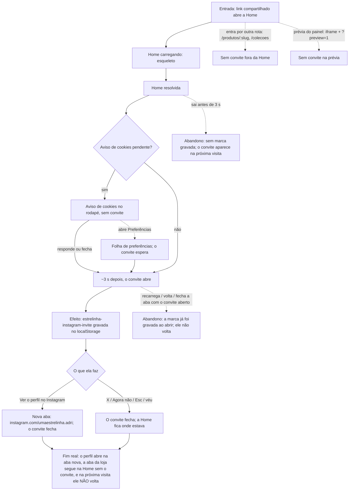

# J-conhecer-o-trabalho-no-instagram — Conhecer o trabalho da Adri no Instagram



```yaml
journey:
  id: J-conhecer-o-trabalho-no-instagram
  name: Conhecer o trabalho da Adri no Instagram
  value_statement: "Quem chega à loja descobre onde acompanhar a joia sendo feita, sem ser pressionada e sem ser incomodada de novo"
  personas: [Luciana, Carla, Teresa]
  entry_points:
    - url: http://localhost:8082/
      origin: external-share
    - url: http://localhost:8082/produtos/<slug>
      origin: search
  actions:
    - step: 1
      verb: abre a Home pela primeira vez
      expected_observable: a Home carrega; se o aviso de cookies aparece, o convite ainda não
    - step: 2
      verb: responde ao aviso de cookies
      expected_observable: o aviso some, e uns 3 s depois de a Home resolver o convite sobe do rodapé (celular) ou aparece no centro (computador), sobre um véu escuro
    - step: 3
      verb: lê o convite
      expected_observable: "NO INSTAGRAM", "Acompanhe de perto o meu trabalho", o texto da Adri, "@umaestrelinha.adri" e as duas ações; nenhuma foto e nenhuma exclamação
    - step: 4
      verb: toca em "Ver o perfil no Instagram" (ou fecha)
      expected_observable: abre uma aba nova no perfil e o convite fecha (ou ele simplesmente fecha)
    - step: 5
      verb: volta à loja outro dia
      expected_observable: a Home abre sem o convite
  goal:
    observable: o perfil https://www.instagram.com/umaestrelinha.adri aberto numa aba nova, ou o convite dispensado
    side_effects: [localStorage estrelinha-instagram-invite gravada ao abrir]
  true_end_state: o perfil abre na aba nova; a aba da loja segue na Home, no mesmo ponto, sem o convite; e ao recarregar ou voltar outro dia, ele não aparece de novo
  exit:
    natural: o perfil do Instagram numa aba nova, com a loja ainda aberta na outra
  abandonment:
    - at_step: 1
      how: sai da Home antes de o convite abrir (menos de 3 s, ou com o aviso de cookies ainda sem resposta)
      resume: na próxima visita à Home o convite aparece, porque ainda não foi visto
    - at_step: 3
      how: recarrega, aperta voltar ou fecha a aba com o convite aberto, sem fechar nada
      resume: o convite não volta (a marca foi gravada ao abrir)
  crosses: [aviso de cookies (feature 61), bolha do WhatsApp, MobileNav, link do rodapé, Instagram (externo)]
```
