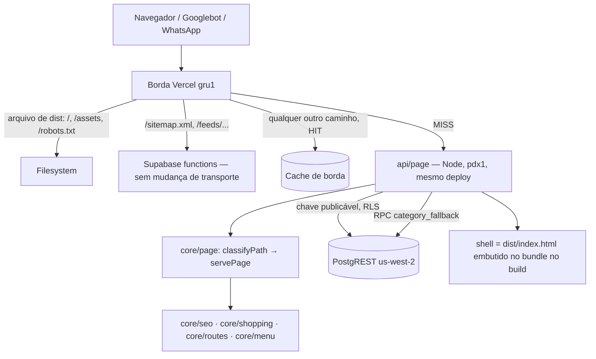

# 69 — Design

**Spec**: `.specs/features/69-seo-servido-na-vercel/spec.md`
**Context**: `.specs/features/69-seo-servido-na-vercel/context.md`
**Status**: Draft

---

## Architecture Overview

Escolha do usuário (2026-10-19): **função Node da Vercel dentro do deploy da loja** (`BL-017` como
escrito), empacotada com esbuild no build, em **`pdx1`** — o banco `hgkrsfpupypxtygjgthf` está em
**us-west-2 (Oregon)**, e a borda que atende o Brasil é `gru1`. Toda URL que não é arquivo estático
nem a home passa por **uma** função (`api/page`), que decide entre produto, categoria, página fixa,
rota de app, redirect e 404. A regra mora em `@estrelinha/core/page` (pura, testada em `core`); a
função só tem env, leitura e o shell.



### Decisão por caminho (`classifyPath` + `servePage`)

| Caminho | Resposta | Cache (`Cache-Control`) |
| --- | --- | --- |
| `/produtos/:slug` ativo | 200, `<head>` do produto (o de hoje, SSV-01/05) | `public, s-maxage=300` |
| `/produtos/:slug` em `product_redirects` | 301 `/produtos/<atual>` (SSV-31) | `public, s-maxage=300` |
| `/produtos/:slug` inexistente/inativo | 404, shell + `noindex` (SSV-07) | `public, s-maxage=60` |
| `/:slug`, `/:pai/:filha` — categoria ativa | 200 com `<head>` da categoria; pai errado ⇒ 301 à canônica (SSV-18/33) | `s-maxage=300` |
| … `category_redirects` para ativa | 301 à canônica (SSV-32) | `s-maxage=300` |
| … categoria inativa | 301 ao ancestral ativo, ou `/` (SSV-14..16) | `s-maxage=300` |
| … nada disso | 404 (SSV-08) | `s-maxage=60` |
| rota fixa indexável (`SITEMAP_STATIC_PATHS` − `/`) | 200 com `staticPageMeta` + canônica (SSV-22) | `s-maxage=3600` |
| rota de app (`/carrinho`, `/conta/dados`, `/pedido/:id/pagamento`, `/perguntas-frequentes/:p`…) | 200, shell intacto (SSV-10) | `s-maxage=3600` |
| 3+ segmentos não declarados, ou caminho com extensão (`/x.png`) | 404 (SSV-09) | `s-maxage=60` |
| erro de leitura | 200, shell intacto (SSV-06/13) | `no-store` |

O cache de borda da Vercel é **por deploy**: um deploy novo nasce sem cache, então nenhuma resposta
cacheada aponta para bundle de outro build (Edge Case, SSV-04).

---

## Code Reuse Analysis

### Existing Components to Leverage

| Component | Location | How to Use |
| --- | --- | --- |
| `handleProductPage` e auxiliares (`productHeadTags`, `injectIntoHead`, `jsonLdScript`, `imagePreloadLink`, `escapeHtmlAttr`, `dadoEstruturado`, `OG_IMAGE_WIDTH`) | `supabase/functions/product-page/handlers.ts` | **Movidos** para `packages/core/src/page/` — o produto passa a ser um ramo de `servePage`, com o mesmo resultado byte a byte. Os testes (`handlers.test.ts`, `productHead.test.ts`) mudam de casa junto |
| `productHead`, `indexableOptions`, `publicOptionMarks` | `packages/core/src/seo/variant.ts` | sem mudança |
| `categoryPageMeta`, `staticPageMeta`, `notFoundPageMeta` | `packages/core/src/seo/pages.ts` | o `<head>` de categoria, de página fixa e da 404 |
| `resolveCategoryRoute` | `apps/store/src/entities/category/lib/resolveCategoryRoute.ts` | **Movido** para `packages/core/src/page/categoryRoute.ts` (dois consumidores em runtimes diferentes ⇒ `core`, `AD-033`); o slice da loja reexporta |
| `categoryHref`, `categoryPath`, `productPath`, `ROUTE_SLUGS`, `SITEMAP_STATIC_PATHS`, `LEGACY_REDIRECTS` | `core/menu`, `core/routes` | classificação e canônicas |
| `resolveOffer`, `representativeVariant`, `offerImages`, `renditionUrl` | `core/shopping`, `core/media/rendition.ts` | o `og:image` e as fotos do sitemap |
| `sitemapUrls`, `renderSitemapXml` | `core/sitemap` | ganham imagens |

### Integration Points

| System | Integration Method |
| --- | --- |
| Supabase PostgREST | `@supabase/supabase-js` com a **chave publicável** (`VITE_SUPABASE_URL`, `VITE_SUPABASE_PUBLISHABLE_KEY`, já no projeto da Vercel), `persistSession: false` |
| Banco | RPC nova `category_fallback(p_slug text)` — migration `20261020120000_69-categoria-inativa.sql` |
| Vercel | `apps/store/api/page.mjs` + `vercel.json` (`regions`, `functions`, `rewrites`) |
| Supabase `sitemap` function | passa a ler `products.images` e as imagens das variações |

---

## Components

### C1 — `packages/core/src/page/` (novo módulo, puro)

- **Purpose**: decidir e montar a resposta HTML de qualquer caminho servido pela loja.
- **Interfaces**:
  - `classifyPath(path: string): PathKind` — `{ kind: 'product', slug } | { kind: 'category', slug, parentSlug } | { kind: 'static', path } | { kind: 'app' } | { kind: 'notfound' }`. Rota de app vem de `APP_ROUTE_PATTERNS` (C2).
  - `applyHead(shell: string, head: ServedHead): string` — generalização de `productHeadTags`: substitui, nunca duplica (SSV-20); `ogType: 'product' | 'website'`; `noindex?: true` injeta `<meta name="robots" content="noindex">`; `extra?: string` (preload + JSON-LD do produto).
  - `servePage(deps: PageDeps, url: URL): Promise<ServedResponse>` — `{ status, headers: Record<string,string>, body }`, sem dependência de `Response` (testável sem runtime).
  - `productPageImages(product, variants): string[]` — `[imageLink, ...additionalImageLinks]` da representante, cada um por `renditionUrl(…, OG_IMAGE_WIDTH)`. **Dono único** de "a foto que a página declara"; o `og:image` do produto é `[0]` e o sitemap usa a lista (SSV-26).
  - `resolveCategoryRoute(input)` — movida, com um acréscimo: `inactiveFallbackId?: string | null` ⇒ `{ kind: 'redirect', to: categoryHref(ancestral) }` ou `'/'`, na precedência de SSV-34.
- **PageDeps**: `shell`, `origin`, `readProduct(slug)`, `readOptionMarks(productId)`, `readProductRedirect(slug)`, `readCategories()` (árvore ativa), `readCategoryRedirect(slug)`, `readInactiveFallback(slug)`, `readSettings()`, `log(entry)`.
- **Reuses**: tudo da tabela acima. **Sem React, Supabase ou Node** — `purity.test.ts` do módulo, no molde de `core/shopping`.

### C2 — `APP_ROUTE_PATTERNS` em `packages/core/src/routes/routes.ts`

- **Purpose**: a lista de rotas de app (com segmentos) que respondem 200 com o shell.
- **Guarda**: bidirecional com o `App.tsx` (no molde de `reservedSlugs.test.ts`): rota declarada no
  `App.tsx` sem classificação reprova, padrão sem rota reprova.

### C3 — `apps/store/server/page.ts` (wiring Node)

- **Purpose**: env, client publicável, as leituras de `PageDeps`, e o handler `fetch` da Vercel.
- **Interfaces**: `export default { fetch(request: Request): Promise<Response> }`.
- O shell entra **no build**: `scripts/build-server.mjs` lê `dist/index.html` depois do `vite build` e
  o injeta como constante (`define`) no bundle — o mesmo build por construção (SSV-04), sem `fs` nem
  HTTP em runtime.
- Recebe o caminho original por `?__path=` do rewrite (o spike confirma se a Vercel o entrega em
  `request.url` diretamente) e preserva o resto da query (`?variant=`).

### C4 — Build e plataforma

- `apps/store/package.json`: `"build": "vite build && node scripts/build-server.mjs"`.
- `scripts/build-server.mjs`: esbuild, `platform: node`, `format: esm`, `bundle: true`, entrada
  `server/page.ts`, saída `api/page.mjs` (gitignored) **ou** `.server/page.mjs` reexportado por um
  `api/page.mjs` versionado — **o spike T01 decide qual a Vercel detecta**.
- `vercel.json`: `"regions": ["pdx1"]`; remove o `rewrite` externo de `/produtos/:slug` **e** o
  override de `Content-Type` dele (o tipo passa a ser nosso — `AD-021` deixa de precisar dele);
  o catch-all deixa de ser `/index.html` e passa a ser a função; `/sitemap.xml` e o feed ficam.

### C5 — Sitemap com imagens

- `core/sitemap`: `SitemapUrl.images?: string[]`; `sitemapUrls` preenche só para produto via
  `productPageImages`, até 1.000 (SSV-24/28/30); `renderSitemapXml` declara o namespace e emite
  `<image:image><image:loc>` escapado (SSV-25/29); sem foto ⇒ sem bloco (SSV-27).
- `supabase/functions/sitemap/index.ts`: `products.images` e `product_variants.image_url` no `select`.
  **`core/page/images.ts` precisa ser alcançável pelo Deno** (extensão `.ts` em todo import; entra no
  `denoReach`).

### C6 — Migration `category_fallback`

```sql
create or replace function public.category_fallback(p_slug text)
returns uuid            -- o ancestral ativo mais próximo; null = não há categoria inativa com esse slug
language sql stable security definer set search_path = ''
-- … sobe parent_id enquanto active = false; devolve o id da primeira ativa, ou o uuid nulo
--     sentinela quando a cadeia não tem ativa (⇒ '/')
```

- Devolve **id**, nunca nome, descrição ou arte (SSV-17). Quem monta o caminho é `categoryHref` sobre
  a árvore ativa que a função já leu — um dono só da canônica.
- `grant execute … to anon, authenticated`; `revoke` de `public`. Guarda `categoryFallbackSchema.test.ts`
  (molde `checkoutSchema`): `security definer`, `search_path = ''`, não lê colunas além de
  `id`/`parent_id`/`active`/`slug`, sem escrita de dado, `mutar()` que lança.
- Contrato do sentinela: o design de T05 fixa `00000000-0000-0000-0000-000000000000` para "inativa
  sem ancestral ativo".

---

## Error Handling Strategy

| Error Scenario | Handling | User Impact |
| --- | --- | --- |
| Leitura de produto/categoria falha | shell intacto, 200, `no-store`, log `{fn:'page', erro, path}` | SPA resolve sozinha; nada sai do índice |
| Leitura de marcações de opção falha | `<head>` da peça (SVR-21 de hoje) | sem página de opção nessa resposta |
| RPC `category_fallback` falha | trata como "sem inativa" ⇒ segue a precedência; se o resto também não achou, **200 shell `no-store`**, nunca 404 (SSV-13) | — |
| Env faltando no deploy | 200 shell `no-store` + log; o build **falha** se `dist/index.html` não existir | — |
| Exceção inesperada | 200 shell `no-store` + log | — |

---

## Risks & Concerns

| Concern | Location | Impact | Mitigation |
| --- | --- | --- | --- |
| A Vercel pode não detectar/empacotar uma função gerada no build | `apps/store/api/` | a feature inteira não sobe | **T01 é um spike num deploy de preview**, antes de qualquer migração de código; plano B documentado: Build Output API (`.vercel/output`) |
| Rewrite pode não entregar o caminho original nem `?variant=` à função | `vercel.json` | produto abre na variação errada | o spike mede `request.url` com `?variant=` |
| Plano Hobby limita região/funções | conta Vercel | sem `pdx1`, MISS mais lento | o spike confere a região no header `x-vercel-id` |
| Guardas que nomeiam `product-page` | `paginaDeOpcaoComDonoUnico.test.ts`, `vercelRedirects.test.ts`, `wiringResolve.test.ts` (âncora derivada), `seo/denoReach.test.ts` (exatamente 15 arquivos) | suíte vermelha ou guarda medindo o nada | atualizados na mesma task que move o código; cada um com a asserção POSITIVA no endereço novo (`PRF-05`) |
| A `product-page` hospedada continua no ar depois do deploy | projeto `hgkrsfpupypxtygjgthf` | nenhum (ninguém a chama) | passo de operação pós-deploy, fora do código |
| O cliente continua tratando categoria inativa como 404 | `CategoryPage.tsx` | navegação interna para inativa vê 404 enquanto o servidor daria 301 | só acontece por link interno, e o menu só lista ativas; espelhar no cliente exigiria a RPC no navegador (`L-027`) — declarado, não consertado |
| `pnpm lint` não olha `packages/` | `core/page` | código novo sem ESLint | conhecido (`BL-002`); `tsc` + testes |
| Função entra no caminho de TODA rota de app | `vercel.json` | invocações a mais | `s-maxage=3600` por deploy; rotas de app são poucas e o shell é idêntico |

---

## Tech Decisions

| Decision | Choice | Rationale |
| --- | --- | --- |
| Uma função para tudo, não uma por tipo | `api/page` | a Vercel recomenda uma entrada; decidir o tipo é a própria regra (`classifyPath`) |
| Shell embutido no bundle | `define` do esbuild a partir de `dist/index.html` | mesmo build por construção; elimina `createShellCache` e o risco de quadro branco |
| Leitura pela chave publicável | supabase-js sem sessão | `AD-034` + `chaveDeServidorForaDoNavegador`; a RLS já esconde inativo |
| Categoria inativa por RPC que devolve id | `category_fallback` | a única informação que vaza é que o slug existiu; a canônica continua com `categoryHref` |
| Supabase `product-page` | código **removido** do repositório nesta feature; a function hospedada é apagada depois do deploy | dois donos do `<head>` de produto seria o defeito 01 |

**Project-level** (vai para o `STATE.md` na aprovação): **`AD-053`** — o HTML servido de qualquer
rota sai de `api/page` no deploy da loja, com regra em `core/page`; **supera a parte de transporte da
`AD-020`**, torna o override de `Content-Type` da `AD-021` desnecessário (a regra "prova é o tipo
entregue" continua) e troca o segundo escritor da `AD-048` de `product-page` para `core/page`.
