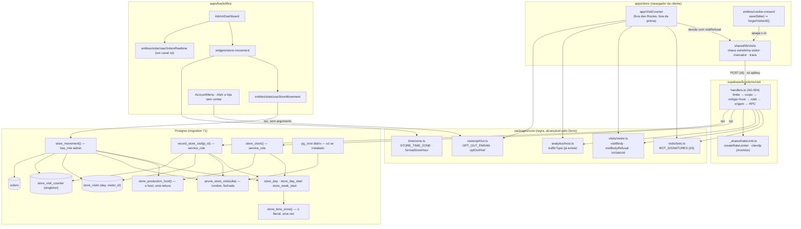

# 71 · Visitas únicas no Dashboard — Design

**Spec**: `.specs/features/71-visitas-unicas-no-dashboard/spec.md` (terceira escrita, 44 ACs — `VIS-44`
nasceu da revisão adversarial deste design)
**Status**: Draft, revisão 2 — passou por três revisões adversariais (segurança e banco; correção no
cliente e testabilidade; encaixe e guardas). O que foi aplicado está na seção 13; o que foi recusado,
na seção 14. Aguarda o usuário: as linhas `n — confirmar` da spec (agora cinco, com a dos pedidos da
Nuvemshop) e o texto do Apêndice A com a Adri.

---

## 0. O que este design mudou na spec, e por quê

Lido o código, alguns pontos da spec não fechavam do jeito que estavam escritos. Na primeira escrita
do design eles viraram `SPEC_DEVIATION`; na revisão, **a spec foi editada** para dizer o que o código
vai fazer (a rastreabilidade está no bloco *Revisão 3* da spec). Sobra **um** desvio de forma, D5.

| # | A spec dizia | O código mostra | Onde ficou |
| --- | --- | --- | --- |
| D1 | `VIS-34`: o literal do fuso só **dentro de `store_day`** | O bloco precisa também do caminho inverso (dia ⇒ instante): `ate`, `expira_em` e o intervalo meio-aberto de `paid_at`. Escrever o fuso em duas funções SQL seria o defeito 01 dentro da migration | Spec editada: o literal mora **uma vez**, em `public.store_time_zone()`; `store_day` e `store_day_start` o chamam |
| D2 | `VIS-34`: "hoje são **três** declarações do fuso em TypeScript" | São **cinco**: `core/orders/situation.ts:141`, `backoffice/.../google-analytics/model/copy.ts:5`, `backoffice/.../google-analytics/ui/AnalyticsSecretField.tsx:23`, `store/.../order/lib/orderMeta.ts:30` e `tools/catalog-import/src/csv/parse.ts` | Spec editada. O dono é `packages/core/src/time/zone.ts`; as **quatro** de `apps/` e `packages/` passam a importá-lo (uma linha cada), e o guarda nasce **sem allowlist**. A do importador fica fora do escopo do guarda, declarada (o importador roda à mão, em Node, e não importa `@estrelinha/core` por alias) |
| D3 | `VIS-24`: o apagamento chega "por um efeito injetado, no molde de `setConsentReader`" | O molde existe para o sentido **proibido** (`shared` lendo `entities`). Apagar é o sentido **permitido**: `entities/cookie-consent` importa de `shared/lib/visits`, como já importa `clearGaCookies` | Spec editada: `save(false)` chama `forgetVisitorId()` direto |
| D4 | `VIS-22`: "a leitura de `store_settings` falhou ⇒ não conta" | `fetchAllSettings` (`packages/core/src/hooks/useStoreSettings.ts:59`) engole o erro e devolve `DEFAULTS` com status de sucesso. A primeira escrita do design propunha `isSettingsFallback` por **identidade de objeto** — e o compartilhamento estrutural do React Query (`replaceEqualDeep`) devolve um objeto **novo** quando uma releitura falha depois de um sucesso, então a identidade some exatamente no caso que ela existia para pegar | Spec editada: a loja **espera** a leitura terminar e não tenta distinguir falha. **Quem decide é o servidor** (portão 4 da function, que lê o host do banco). O pior caso de uma falha na loja é uma chamada a mais por dia, respondida `interno` com `ate`. O hook compartilhado pelos dois apps **não muda** |
| D5 | `VIS-31`/`VIS-34`: `store_day(paid_at)` no predicado de venda | Comparar `paid_at` contra `store_day_start(dia)` é a mesma régua (a função inversa da mesma zona) e deixa o predicado indexável | **`SPEC_DEVIATION` de forma**, declarada no código. O guarda cobra `store_day_start` no predicado de `orders` e recusa `paid_at::date` |

E dois pontos em que a **tarefa** que abriu este design divergia da spec — vale a spec:

- **Retenção.** A tarefa pedia "retenção de 90 dias". A spec (`VIS-30`, *Assumptions*, Apêndice A)
  fixa **8 dias**, e o texto da política diz "apagados depois de 8 dias". Noventa dias guardariam um
  código persistente por mais de dez vezes o período mais longo que o bloco lê.
- **`pg_cron`.** A primeira escrita dizia "disponível e não instalada" no banco local. **Estava
  errado** (achado da revisão de segurança, medido): `pg_extension` mostra `pg_cron 1.6.4`, e
  `cron.job` já tem `expire-pending-orders`, criado pelo precedente
  `20260718235214_payment_approval_rpc.sql:86-108`. O design agora usa **as três vias** (T-07): a
  poda dentro da gravação (`VIS-30`, a que a spec exige), dentro da leitura, e um job diário de
  `pg_cron` **só se a extensão já estiver instalada**, no molde do precedente. No hospedado não dá
  para conferir sem `--linked`; a migration segue em silêncio quando a extensão falta, e as duas
  primeiras vias continuam valendo.

---

## 1. Architecture Overview

Três caminhos, e só um deles escreve.



**O princípio que organiza tudo**: o **dia de Brasília é decidido em um lugar só, o banco**
(`store_time_zone()` → `store_day` / `store_day_start`). O navegador da cliente nunca calcula dia
(ele guarda o **prazo** que o servidor devolveu, convertido em duração); o painel nunca calcula dia
(ele recebe `hoje`, `ontem`, `inicio_semana` e os `*_dia` como texto e só os formata). O TypeScript
usa `STORE_TIME_ZONE` só para **escrever a hora** de um instante que o banco devolveu ("15h32"),
nunca para decidir a que dia ele pertence.

**O segundo princípio, que a revisão acrescentou**: **"qual é o host de produção do contador?" tem
uma leitura só no servidor**, `public.store_production_host()`, chamada por `store_clock` (que a
function usa no portão 4) e por `store_movement` (que o painel usa para o texto de `VIS-39`). Assim
o servidor e o painel nunca discordam. A loja continua lendo pelo hook com default, e a diferença
custa no máximo uma chamada por dia, respondida `interno` — declarado em D4.

---

## 2. Code Reuse Analysis

### Existing Components to Leverage

| Componente | Onde | Como |
| --- | --- | --- |
| `trafficType` | `packages/core/src/analytics/host.ts` (folha, sem import) | Cliente **e** servidor, a mesma função que o GA4 usa. O servidor importa por caminho com `.ts` |
| `isPreviewWindow` / `previewMode` | `apps/store/src/app/App.tsx:68` | O `VisitCounter` é montado sob o mesmo `!previewMode &&` dos outros três |
| `useAnalyticsSettings` / `useStoreSettings` | `packages/core/src/hooks/useStoreSettings.ts` | `production_host` e `isFetched` na loja. **Sem mudança no hook** (D4) |
| `useCookieConsentStore` | `apps/store/src/entities/cookie-consent/model/cookieConsentStore.ts` | Ganha `syncFromStorage()` (`VIS-25`) e a chamada a `forgetVisitorId()` em `save(false)` (`VIS-24`) |
| `corsHeaders` / `json` / `preflight` | `supabase/functions/_shared/http.ts` | Importados, nunca redeclarados (`http.test.ts`) |
| `createRateLimiter` / `clientIp` | `supabase/functions/checkout/handlers.ts:73,102` | **Movidos** para `_shared/rateLimit.ts`; `checkout/handlers.ts` reexporta (`toBe`) — `VIS-27`. **A forma de uso também é copiada**: `const ip = clientIp(req); if (ip && !limiter.hit(ip))` — sem IP, libera |
| Dublês de `supabase-js` | `supabase/functions/_shared/testing/fakes.ts:538` | **Conferido: já registra `{ fn, args }` em `rpcs`** e responde por nome (`rpcByFn`) |
| `SUPABASE_URL` / chave publicável | `packages/supabase/src/client.ts:3-4` | Passam a ser **exportados** dali (`SUPABASE_URL`, `SUPABASE_PUBLISHABLE_KEY`), e `send.ts` os importa. Continua havendo um leitor só de `import.meta.env.VITE_SUPABASE_*` e o "lança sem env" |
| `StatCard` | `apps/backoffice/src/shared/ui/StatCard.tsx` | Props **aditivas e opcionais**: `loading`, `info`. `value` alarga para `ReactNode` **de frase** (só `span`). Carregando, o esqueleto é um `<div>` **no lugar** do `<p>` do valor, nunca dentro dele. Os outros três consumidores não mudam |
| `Tabs` / `Popover` | `packages/ui/src/tabs.tsx`, `popover.tsx` | `TabsList` com `h-auto`, `TabsTrigger` com `min-h-11` (a `TabsList` base é `h-10`, ver `AdminSettingsPage`, feature `53`) |
| `formatPrice` | `@estrelinha/core/formatters` | Faturamento e ticket, sem arredondar (o banco arredonda) |
| `storeOrigin()` | `apps/backoffice/src/shared/lib/storeOrigin` | "Abrir a loja sem contar" (`VIS-43`), pelo construtor `optOutHref` de `core` |
| Botão de 44px sem auxiliar | `apps/backoffice/src/widgets/admin-layout/ui/NavRail.tsx:44,91` (`h-11 w-11`) | Molde do gatilho do ⓘ: `h-11 w-11` com margem negativa, para o desenho do card não crescer |
| Guarda de migration com `mutar()` que lança | `apps/store/src/shared/lib/__tests__/minhaContaSchema.test.ts` | Molde do `visitasSchema.test.ts` |
| Guarda de chave com dono único | `orderAccessSingleOwner.test.ts` | Molde do `visitanteComDonoUnico.test.ts` (`VIS-12`), com escopo **ampliado** a testes (seção 8) |
| Guarda de alcance do Deno | `packages/core/src/checkout/__tests__/denoReach.test.ts` | Molde do `denoReach.test.ts` de `core/visits` |
| Guarda de "montado" | `apps/store/src/app/__tests__/scrollToTop.test.tsx` | Molde da prova de que o `VisitCounter` está no `App.tsx`, fora das `Routes` e sob `!previewMode` |
| Agendamento com `pg_cron` só se existir | `20260718235214_payment_approval_rpc.sql:86-108` | Molde do job diário da poda (T-07), mais estreito: **não** cria a extensão, só agenda se ela já estiver instalada |
| `animacaoRespeitaMovimento.test.ts` | `apps/backoffice/src/shared/lib/__tests__` | Os arquivos de UI novos e o `StatCard` entram no escopo literal, com as âncoras subindo junto (molde da `51`/`56`) |
| `resetAnalyticsForTests` | `apps/store/src/shared/lib/analytics/index.ts:264` | Molde de `resetVisitCounterForTests` |

### Integration Points

| Sistema | Como a feature se liga |
| --- | --- |
| Postgres | Migration nova `20261021120000_71-visitas-unicas.sql` (maior que `20261020120000`, a última; conferir o prefixo de novo antes do merge, lição da `48`/`49`). Duas tabelas, **nove** funções, um `do $$` que agenda a poda só se `pg_cron` existir, **nenhuma escrita de dado** |
| Edge functions | Function nova `supabase/functions/visit` (`index.ts` só wiring, `handlers.ts` com a lógica); `[functions.visit] verify_jwt = false` no `config.toml` com a justificativa. `wiringResolve.test.ts` a alcança sozinho (âncora derivada do disco); o `index.ts` importa `createRateLimiter` de `../_shared/rateLimit.ts` |
| Realtime | **Nenhuma inscrição nova** (`VIS-10 d`). O canal `admin-orders-realtime`, hoje dentro de `useAdminStats` (`useAdminStats.ts:116-117`), sobe para `entities/order/api/useOrdersRealtime(onChange)`, chamado uma vez pelo `AdminDashboard` |
| Política de Privacidade | Quarto parágrafo de "Medição de audiência" (`PrivacyPolicyPage.tsx:174`), texto do Apêndice A |
| Folha de cookies | `widgets/cookie-notice/ui/CookiePreferencesSheet.tsx`: a linha 28 deixa de ler `enabled`, e a linha 130 passa a `save(estatisticas)` (`VIS-26`) |
| Menu da conta do painel | `AccountMenu` ganha o item; `AccountMenu.test.tsx` muda (seção 9b) |
| Deploy | `supabase-deploy.yml` sobe a function nova sozinho. **Ordem**: migration antes do bundle da loja e do painel — mesmo aviso de `AD-050` |

---

## 3. Components

### C1 · O fuso, o host e a régua do dia (SQL)

- **Purpose**: o único lugar do sistema que decide "que dia de Brasília é este instante" e "qual é o
  host de produção do contador".
- **Location**: migration `20261021120000_71-visitas-unicas.sql`, seção 1.
- **Interfaces** (toda referência interna é **qualificada por `public.`**):
  - `public.store_time_zone() returns text` — `language sql immutable`, corpo
    `select 'America/Sao_Paulo'`. **O literal aparece uma vez na migration.**
  - `public.store_day(p timestamptz) returns date` — `language sql stable`,
    `(p at time zone public.store_time_zone())::date`.
  - `public.store_day_start(p date) returns timestamptz` — `language sql stable`,
    `p::timestamp at time zone public.store_time_zone()`.
  - `public.store_week_start(p date) returns date` — `language sql immutable`,
    `p - (extract(isodow from p)::int - 1)`. **Sobre a data local**, nunca `date_trunc('week', …)`.
  - `public.store_production_host() returns text` — `language sql stable`, `set search_path = ''`,
    `coalesce((select value->>'production_host' from public.store_settings where key = 'analytics'), '')`.
    Linha ou chave ausente ⇒ `''` ⇒ tudo `interno` — a mesma semântica de
    `mercado-pago/analytics.ts:216` (`?? null`), que é o outro leitor de servidor.
- **Grants**: `revoke execute … from public, anon, authenticated` nas cinco, **sem** `grant`. Elas
  são chamadas de dentro das funções `security definer`, que rodam como o dono.
- **Sem `set search_path` nas quatro funções de dia, e é escolha declarada** (achado da revisão): o
  linter do Supabase avisa `function_search_path_mutable`, mas elas não são `security definer`, o
  corpo é todo qualificado, e uma função `language sql` com `set` **deixa de ser inlinada** — o que
  custaria o índice no predicado de `paid_at`. O comentário no SQL diz isso.
- **Por que `stable` e não `immutable`** em `store_day`/`store_day_start`: `at time zone` com nome de
  fuso depende da base `tzdata`, que muda entre versões do Postgres.

### C2 · `store_visits` e `store_visit_counter` (SQL)

```sql
create table if not exists public.store_visits (
  day        date not null,
  visitor_id uuid not null,
  primary key (day, visitor_id)
);
create table if not exists public.store_visit_counter (
  id               boolean primary key default true check (id),
  started_at       timestamptz not null,
  last_recorded_at timestamptz not null,
  capped_day       date                    -- o último dia em que o teto de 5.000 foi atingido (VIS-44)
);
```

- **A chave começa por `day`**, de propósito: as três leituras (teto do dia, contagem dos períodos e
  poda) são recortes por `day`, e o índice da PK as atende.
- **Exatamente duas colunas** em `store_visits` — sem `created_at`, IP, UA, página (`VIS-28`).
- `store_visit_counter` é **singleton** (`check (id)`) e **não é semeado** — a linha nasce na primeira
  gravação, por upsert. Semear seria escrita de dado na migration, que o guarda recusa.
- **`last_recorded_at` e `capped_day` são instantes da LOJA, não de um navegador**: nenhum deles está
  ligado a id. Declarado no `AD-055` (achado da revisão: a política diz "esse código e a data — e nada
  mais", e isso continua verdade sobre o que se guarda **de você**).
- Nas duas: `enable row level security`, **nenhuma policy**, `revoke all … from public, anon,
  authenticated`. Sem o `revoke`, `anon` leria zero linhas (RLS sem policy) em vez de receber
  `42501` — e `VIS-28` pede `42501`.
- Nenhuma das duas entra na publicação do Realtime (conferido: `supabase_realtime` não é `FOR ALL
  TABLES`).

### C3 · `prune_store_visits` (SQL) — a oitava função que a primeira escrita não contava

- **Interface**: `public.prune_store_visits(p_dia date) returns void` — `language plpgsql`,
  **`security invoker`** (o padrão, escrito por extenso), `set search_path = ''`, corpo
  `delete from public.store_visits where day < p_dia - 7`.
- **Grants**: `revoke execute … from public, anon, authenticated`, sem `grant`. Chamada de fora, ela
  esbarra **duas vezes**: não há `execute`, e mesmo se houvesse, o invoker não tem `delete` na tabela
  (`revoke all` de C2). Chamada de dentro de `record_store_visit` / `store_movement` (definer) ou do
  job do `pg_cron` (superusuário), roda como o dono.
- **Por que isto é alto**: a primeira escrita a chamava de dois lugares e não dizia nada sobre ela.
  Nascida `security definer` sem `revoke`, `rpc('prune_store_visits', { p_dia: '2999-01-01' })` com a
  chave publicável apagaria a tabela inteira.

### C4 · `record_store_visit` (SQL)

- **Purpose**: grava `(store_day(agora), id)` uma vez, poda, e devolve o desfecho e o relógio.
- **Interface**: `public.record_store_visit(p_id uuid, p_agora timestamptz default now()) returns jsonb`
  — `security definer`, `set search_path = ''`, `volatile`.
- **Grants**: `revoke execute … from public, anon, authenticated` **e** `grant execute … to
  service_role`. A concessão explícita é obrigatória: o `revoke … from public` tira também o
  `service_role` (medido na revisão em `customer_order_events`, que ficou
  `{postgres=X,authenticated=X}`), e o precedente concede por extenso
  (`20260913130000_49-checkout-sem-conta.sql:112-115`). Sem ela, **toda visita daria 500**.
- **Corpo, nesta ordem**:
  1. `v_dia := public.store_day(p_agora)`; `v_ate := public.store_day_start(v_dia + 1)`.
  2. `perform public.prune_store_visits(v_dia)` (`VIS-30`).
  3. Se `(v_dia, p_id)` já existe ⇒ `desfecho = 'repetida'`.
  4. Senão, se `count(*) where day = v_dia >= 5000` ⇒ `desfecho = 'teto'` e
     `update public.store_visit_counter set capped_day = v_dia` (`VIS-27`, `VIS-44`).
  5. Senão `insert … on conflict do nothing`; se inseriu (`found`) ⇒ `'gravada'` e upsert em
     `store_visit_counter` (`started_at` só no insert, `last_recorded_at = greatest(…)`); se não
     inseriu (corrida) ⇒ `'repetida'`.
  6. Devolve `{ desfecho, dia: v_dia::text, ate: (extract(epoch from v_ate) * 1000)::bigint,
     agora: (extract(epoch from p_agora) * 1000)::bigint }`. **`::bigint`** porque sem ele o JSON sai
     `1792638000000.000000` (medido na revisão). `agora` existe para o navegador medir o prazo como
     **duração** (C10, `VIS-16`).
- **`p_agora` existe só para probe**: o handler chama `rpc('record_store_visit', { p_id })` e o teste
  do handler assere as chaves **exatas** desse objeto.
- **O teto pode passar um pouco sob concorrência** (passos 4 e 5 não são atômicos). Declarado.

### C5 · `store_clock` (SQL)

- **Purpose**: `{ dia, ate, agora, production_host }` sem gravar nada. É a leitura que a function faz
  **antes** de decidir robô e origem, e a que dá `ate` às respostas que não chegam à gravação.
- **Interface**: `public.store_clock(p_agora timestamptz default now()) returns jsonb` — `stable`,
  `security definer`, `search_path = ''`. **Grants** iguais aos de `record_store_visit` (revoke dos
  três + `grant … to service_role`).
- `production_host` vem de `public.store_production_host()` — **a cada chamada, sem cache**.

### C6 · `store_movement` (SQL)

- **Purpose**: os três períodos × quatro medidas, numa chamada, só para admin (`VIS-33`).
- **Interface**: `public.store_movement(p_agora timestamptz default now()) returns jsonb` —
  `security definer`, `search_path = ''`, `volatile` (poda). Primeira linha:
  `if not public.has_role(auth.uid(), 'admin') then raise exception … using errcode = '42501'`.
  `revoke execute … from public, anon`; `grant execute … to authenticated`.
- **Corpo** (toda chamada qualificada — sem isso o plpgsql resolve na **execução** e a primeira
  chamada do painel cai com `42883`, com a migration aplicando limpa):
  - `v_hoje := public.store_day(p_agora)`, `v_ontem := v_hoje - 1`,
    `v_semana := public.store_week_start(v_hoje)`, `v_desde := least(v_ontem, v_semana)`.
  - **Visitas**: uma varredura de `public.store_visits where day between v_desde and v_hoje`, com
    `count(distinct visitor_id) filter (where day = v_hoje)`, `… = v_ontem` e
    `… between v_semana and v_hoje`. **Distinto por período, nunca soma de dias** (`VIS-15`).
  - **Vendas e faturamento**: uma varredura de `public.orders where payment_status = 'approved' and
    status <> 'cancelled' and paid_at >= public.store_day_start(v_desde) and paid_at <= p_agora`,
    com `filter` por intervalo meio-aberto (D5). Faturamento é
    **`coalesce(sum(total) filter (…), 0)`** — sem o `coalesce`, `sum` sobre zero linhas devolve
    `null` (medido na revisão) e `VIS-07` pede `R$ 0,00`.
  - **Ticket**: `case when n > 0 then round(soma / n, 2) end` — `NULL` sem venda.
  - **Poda na leitura**: `perform public.prune_store_visits(least(v_hoje, public.store_day(now())))`.
    O `least` impede que um `p_agora` futuro passado à mão por um admin apague linhas do presente.
- **Resposta** (texto para datas, número para medidas, `null` quando não há):

```ts
interface StoreMovement {
  hoje: string                        // 'AAAA-MM-DD'
  ontem: string
  inicio_semana: string
  expira_em: string                   // ISO, a próxima 00:00 de Brasília
  lido_em: string                     // ISO, o p_agora desta leitura
  production_host: string             // public.store_production_host() — '' quando vazio (VIS-39)
  contagem_desde: string | null
  contagem_desde_dia: string | null   // store_day(contagem_desde)  (VIS-38)
  ultima_visita: string | null
  ultima_visita_dia: string | null    // store_day(ultima_visita)   (VIS-40)
  teto_dia: string | null             // capped_day, só quando >= v_desde (VIS-44)
  periodos: Record<'hoje' | 'ontem' | 'semana', {
    visitas: number; vendas: number; faturamento: number; ticket: number | null
  }>
}
```

  Os campos `*_dia` existem para o painel **não decidir dia**. `production_host` vem daqui para o
  texto de `VIS-39` dizer o mesmo host que o servidor usa (achado da revisão: lido pelo hook do
  painel, uma falha de leitura mostraria o default). Tudo isso está na spec (`VIS-33`, revisão 3).

### C7 · `pg_cron` — o terceiro caminho da poda

```sql
do $$
begin
  if exists (select 1 from pg_extension where extname = 'pg_cron') then
    perform cron.schedule(
      'prune-store-visits',
      '15 3 * * *',                     -- 03:15 UTC = 00:15 de Brasília
      $job$ select public.prune_store_visits(public.store_day(now())) $job$
    );
  else
    raise notice 'pg_cron ausente: a poda de store_visits roda só na gravação e na leitura';
  end if;
end $$;
```

- **Não cria a extensão** — mais estreito que o precedente. `cron.schedule` com nome é upsert,
  então a migration é idempotente.
- O job chama a função, nunca um `delete` literal: a régua de "escrita de dado fora de corpo de
  função" do guarda continua valendo sem exceção.
- Com isso a frase da política ("apagados depois de 8 dias") vale também numa semana sem visita e
  sem a dona abrir o Dashboard — **onde o `pg_cron` existir**. No hospedado isso se confere no log do
  `db push` (o `notice`), sem `--linked`.

### C8 · `packages/core/src/visits/` (regra compartilhada loja × function × painel)

Três arquivos-folha, **sem import nenhum** (a function os importa por caminho com `.ts`), mais o barril.

- `bots.ts`
  - `BOT_SIGNATURES: readonly string[]` — as 20 da spec, por extenso.
  - `isBotUserAgent(ua: string | null | undefined): boolean` — substring sem diferenciar maiúsculas.
    **Nunca `/bot/i`**: `CUBOT_X30` é um aparelho Android, e é sensor inverso.
- `visitor.ts`
  - `isVisitorId(s: unknown): boolean` — UUID v4, sem diferenciar maiúsculas.
  - `visitBody(id: string): { id: string }` — o construtor do corpo, chamado pela loja.
  - `visitBodyRefusal(body: unknown): string | null` — chamado pelo servidor. `null` ⇒ aceito; texto
    ⇒ motivo (`json`, `chave`, `id`). `string | null` porque `strictNullChecks: false` não estreita
    união por booleano.
- `optOut.ts` (achado da revisão: o parâmetro tinha dois donos em dois apps que não se importam)
  - `OPT_OUT_PARAM = 'nao-contar'`.
  - `optOutHref(origin: string, on: boolean): string` — `` `${origin}/?${OPT_OUT_PARAM}=${on ? 1 : 0}` ``.
  - `readOptOutParam(search: string): 'on' | 'off' | null` — discriminante de **string**.
- `index.ts` — barril com `.ts` explícito. Subpath novo `"./visits"` no `package.json` de `core`.

### C9 · `packages/core/src/time/`

- `zone.ts` — `export const STORE_TIME_ZONE = 'America/Sao_Paulo'`. Folha, sem import.
- `format.ts` — `formatStoreHour(iso: string): string` ⇒ `"15h32"` (`Intl.DateTimeFormat` com
  `timeZone: STORE_TIME_ZONE`, `hourCycle: 'h23'`), e `formatDayMonth(dia: 'AAAA-MM-DD'): string` ⇒
  `"21/10"` **por corte de texto**, nunca `new Date`. Um dono da hora escrita pelo bloco: a primeira
  escrita misturava `HH:MM` (`VIS-10`) e `HHhMM` (`VIS-38`/`VIS-40`) no mesmo bloco; a spec agora diz
  `HHhMM` nos três.
- Subpath `"./time"`. As quatro declarações do fuso em `apps/` e `packages/` passam a importar
  `STORE_TIME_ZONE` (D2). O `.ts` explícito no import de `situation.ts` vem do
  `orders/__tests__/purity.test.ts` — **não** de o Deno alcançar `situation.ts` (ele alcança só
  `orders/format.ts`, por `send-notification/render/vars.ts:17` e `layout.ts:10`; a justificativa da
  primeira escrita estava errada, a conclusão não).
- O guarda de `VIS-34` lê o literal da migration e o compara **com a constante importada**.

### C10 · Edge function `visit`

- **Location**: `supabase/functions/visit/{index.ts,handlers.ts}`.
- **`index.ts`** (só wiring): env, client service-role, `createRateLimiter(30, 60_000, now)`
  (importado de `../_shared/rateLimit.ts`), `createClockCache()`, `Deno.serve`.
- **`handlers.ts`**:

```ts
export interface Clock { dia: string; ate: number; agora: number }
export interface ClockCache { get(now: number): Clock | null; set(c: Clock): void }
export interface Deps {
  supabase: any                 // service-role; dublê no teste
  now: () => number
  limiter: RateLimiter          // de ../_shared/rateLimit.ts
  clock: ClockCache             // injetado — estado de módulo vazaria entre testes
  log: (linha: Record<string, unknown>) => void
}
export type Desfecho =
  'gravada' | 'repetida' | 'robô' | 'interno' | 'inválido' | 'limite' | 'teto' | 'erro'
export function createClockCache(): ClockCache   // vale até o próprio `ate`
export function route(deps: Deps, req: Request): Promise<Response>
```

- **Ordem dos portões** (cada resposta registra **uma** linha `{ fn: 'visit', desfecho }`, exceto o
  preflight):

| # | Portão | Resposta | Grava? |
| --- | --- | --- | --- |
| 0a | `OPTIONS` ⇒ `preflight()` | — (sem log: preflight não é resposta a uma visita, `VIS-29` revisado) | não |
| 0b | outro método que não `POST` | `405`, `inválido` | não |
| 1 | `const ip = clientIp(req); if (ip && !limiter.hit(ip))` | `429 { dia, ate, agora }` do cache; **sem cache válido, tenta `store_clock`; se ela falhar, `429` sem relógio** — o desfecho continua `limite` | não |
| 2 | `visitBodyRefusal(await req.json())` (JSON inválido incluso) | `400`, `inválido` | não |
| 3 | `rpc('store_clock')` — falha ⇒ `500`, `erro` | (alimenta o cache) | não |
| 4 | `isBotUserAgent(req.headers.get('user-agent'))` | `200 { desfecho:'robô', dia, ate, agora }` | não |
| 5 | sem `Origin`, `Origin` ilegível ou `trafficType(new URL(origin).host, clock.production_host) === 'internal'` | `200 { desfecho:'interno', dia, ate, agora }` | não |
| 6 | `rpc('record_store_visit', { p_id })` — falha ⇒ `500`, `erro` | `200 { desfecho, dia, ate, agora }` | sim, ou `repetida`/`teto` |

- **Sem IP, libera** — a forma exata da `checkout` (`checkout/handlers.ts:127-128`). A primeira
  escrita deste design usava `clientIp(req) ?? 'sem-ip'`, que põe todo mundo sem IP **no mesmo
  balde**: 30 visitantes sem cabeçalho no mesmo minuto bastariam para a loja inteira receber `429`.
  Teste: sem IP, a 31ª chamada responde `200`.
- **O limitador vem antes do corpo** porque é o portão mais barato e não toca o banco.
- **O cache do relógio só serve ao `429`**. Os portões 4–6 leem `store_clock` fresco a cada
  requisição (volume esperado ~50/dia), e é essa leitura que traz o `production_host` sem cache
  (memória do projeto: frescor acima de cache).
- **`429` sem relógio é resposta válida**: a loja trata resposta sem `ate` numérico como falha
  (`VIS-18`: mais uma tentativa na próxima navegação). Achado da revisão — a primeira escrita
  transformava a falha do relógio no caminho do `429` em `500 erro`, e o desfecho `limite` se perdia.
- **O handler não lê `Authorization`** (`VIS-29`): o teste entrega um `Request` cujo `headers.get`
  **lança** para `authorization`.
- **O log nunca leva id, IP nem UA**: o teste varre cada linha registrada procurando os três valores.
- `verify_jwt = false`, com o comentário no `config.toml`.

### C11 · `_shared/rateLimit.ts`

- `createRateLimiter`, `RateLimiter`, `clientIp` **movidos** de `checkout/handlers.ts` sem mudança de
  corpo. `checkout/handlers.ts` reexporta os três.
- Teste novo em `_shared/__tests__/rateLimit.test.ts`: a reexportação é a **mesma referência**
  (`toBe`), e uma segunda **declaração** de `createRateLimiter` nas functions reprova.

### C12 · Loja — `shared/lib/visits/` e `app/VisitCounter.tsx`

**`shared/lib/visits/visitor.ts`** — o **único** arquivo que cita `estrelinha-visitor` e
`estrelinha-nao-contar` (`VIS-12`).

```ts
export const VISITOR_KEY = 'estrelinha-visitor'      // { v: 1, id: string|null, ate: number|null, em: number|null }
export const OPT_OUT_KEY = 'estrelinha-nao-contar'   // '1'
export type MarkerRead =
  | { estado: 'ausente' } | { estado: 'presente'; marker: VisitorMarker } | { estado: 'indisponivel' }
export function readMarker(): MarkerRead              // discriminante de string (strictNullChecks false)
export function markerAllowsCall(m: VisitorMarker | null, agora: number): boolean
export function saveClock(ateServidor: number, agoraServidor: number): void
export async function ensureVisitorId(): Promise<string | null>
export function forgetVisitorId(): void
export function setOptOut(on: boolean): void
export function isOptedOut(): boolean
```

- **O marcador guarda o prazo no relógio LOCAL, convertido por duração** (achado da revisão,
  `VIS-16` revisado): `saveClock` grava `ate = Date.now() + (ateServidor − agoraServidor)` e
  `em = Date.now()`. Com o aparelho adiantado X horas, a primeira escrita (`ate` do servidor contra
  `Date.now()` local) faria **toda navegação** das últimas X horas do dia virar um POST. Isso é
  duração, não cálculo de dia: o cliente continua sem saber que dia é.
- `markerAllowsCall`: `em ≤ agora < ate` ⇒ não chama; `agora ≥ ate` ou `agora < em` ⇒ chama.
- **`saveClock` relê o marcador no instante da escrita e só toca `ate`/`em`** — nunca restaura um
  `id`. Uma resposta que chega **depois** de uma recusa (`VIS-24`) ou de `?nao-contar=1` (`VIS-42`)
  feitas durante o voo não ressuscita o código.
- `ensureVisitorId`: sem `crypto.randomUUID` ⇒ `null`. Com `navigator.locks` ⇒
  `request(VISITOR_KEY, …)` e **relê dentro da trava** antes de criar. Grava e **relê** o que gravou:
  se não confere (ou lançou), devolve `null` e **não** guarda id em memória (`VIS-19`). `readMarker`
  `indisponivel` ⇒ `null`; `ausente` ⇒ cria. Id armazenado que não passa em `isVisitorId` é tratado
  como ausente.
- `resetVisitCounterForTests()` — zera o estado de módulo ("uma em voo", contador de falhas).

**`shared/lib/visits/refusal.ts`** — a decisão pura de `VIS-22`:

```ts
export interface VisitContext {
  production: boolean; preview: boolean
  settingsLoaded: boolean; productionHost: string; hostname: string
  statistics: boolean; optedOut: boolean; webdriver: boolean; userAgent: string
}
export function visitRefusal(ctx: VisitContext): string | null
```

- `settingsLoaded` falso ⇒ `'esperando'` (o `VisitCounter` tenta de novo quando `isFetched` muda).
- Não recebe `enabled`, `measurement_id` nem `canMeasure` — **por construção**. O guarda de fonte
  recusa os três nomes no módulo.

**`shared/lib/visits/send.ts`** — `postVisit(id): Promise<{ status: number; ate?: number; agora?: number }>`:
`fetch(\`${SUPABASE_URL}/functions/v1/visit\`, { method: 'POST', credentials: 'omit', headers: {
'Content-Type': 'application/json', apikey: SUPABASE_PUBLISHABLE_KEY }, body:
JSON.stringify(visitBody(id)) })`, com `SUPABASE_URL`/`SUPABASE_PUBLISHABLE_KEY` importados de
`@estrelinha/supabase` (o único leitor das duas env). **Sem `keepalive`**: a chamada é agendada fora
do descarregamento, e `keepalive` com preflight tem suporte irregular. **Não usa
`supabase.functions.invoke`**, que anexa o JWT da sessão (`VIS-13`). `ate`/`agora` só são devolvidos
quando os dois são números finitos; senão a resposta conta como falha.

**`app/VisitCounter.tsx`** — montado no `App.tsx` **fora das `Routes`, sob `!previewMode`**, ao lado
de `AnalyticsLoader`:

1. Efeito em `location.search`: `readOptOutParam` (de `core`) trata `on`/`off` (`setOptOut`,
   `forgetVisitorId`, toast do sonner) e tira o parâmetro com `navigate({ search }, { replace: true })`,
   preservando os outros (`VIS-42` revisado: o router fica em sincronia, e não nasce entrada nova no
   histórico).
2. Efeito em `pathname` (+ `isFetched`): agenda `tentar()` **fora do caminho crítico** (`VIS-17`):
   - `requestIdleCallback` existe ⇒ `requestIdleCallback(tentar, { timeout: 5000 })`;
   - senão, `document.readyState === 'complete'` ⇒ `setTimeout(tentar, 0)`;
   - senão ⇒ `addEventListener('load', () => setTimeout(tentar, 0), { once: true })`.

   O segundo ramo é o que a primeira escrita não tinha (achado da revisão): sem `requestIdleCallback`
   — o caso do Safari, a meu conhecimento, e ~90% dos acessos são de celular —, uma troca de rota da
   SPA acontece **depois** do `load`, e um ouvinte novo de `load` nunca dispararia. Nada síncrono na
   montagem.
3. `tentar()`: `useCookieConsentStore.getState().syncFromStorage()` → monta `VisitContext` →
   `visitRefusal` → `markerAllowsCall` → trava de "uma em voo" (módulo) → `ensureVisitorId` →
   **`visitRefusal` de novo** (a recusa pode ter chegado enquanto a trava esperava) → `postVisit`.
   `200`/`429` com `ate` ⇒ `saveClock`. `400`/`5xx`/rede/sem `ate` ⇒ conta uma falha; **a mesma aba
   tenta no máximo mais uma vez**, na próxima navegação (`VIS-18`).

**`entities/cookie-consent`** ganha:

- `syncFromStorage()` — relê `notice`/`statistics` **só quando `ler()` devolve um registro válido**;
  quando devolve `null` (ausente **ou** armazenamento que lança), **mantém o que está em memória** e
  não fecha a folha. Achado da revisão: aplicar `null` viraria `statistics ?? true` (`:69`) e
  **desfaria uma recusa que só existe em memória** — aba privada antiga, onde `setItem` lança e a
  escolha "vale em memória, nesta sessão" (`:46-47`) —, religando o GA4 pelo `AnalyticsLoader`.
  `hydrate()` continua como é (ele **zera** para o padrão, que é o que os testes e a abertura da folha
  pedem); as duas funções respondem perguntas diferentes, e o comentário de cada uma diz qual.
- **Um mecanismo só para a outra aba: `syncFromStorage()` no instante da decisão.** A primeira
  escrita juntava ainda um ouvinte de `storage`, e dois mecanismos redundantes mascaram um ao outro
  (lição da `48`). O ouvinte saiu; o efeito colateral de "consertar o GA4 de graça" fica registrado
  como observação, fora do escopo.
- `save(false)` chama `forgetVisitorId()` ao lado de `clearGaCookies()` (D3).

**Folha de cookies** — `widgets/cookie-notice/ui/CookiePreferencesSheet.tsx`: a linha 28 deixa de
ler `enabled` e a linha 130 passa a `save(estatisticas)`. Estatísticas aparece sempre, com a frase
nova do Apêndice A. Inversão declarada de `AVS-02` (`VIS-26`).

**Política** — `PrivacyPolicyPage.tsx`, seção "Medição de audiência", quarto parágrafo do Apêndice A,
**palavra por palavra** (`VIS-36`). Aprovação da Adri é pré-condição do deploy.

### C13 · Painel — `entities/stats`, `entities/order` e `widgets/store-movement`

- `entities/order/api/useOrdersRealtime.ts` — `useOrdersRealtime(onChange: () => void)`: **o**
  canal `admin-orders-realtime`. O callback mais recente fica num `ref`, e o efeito tem dependência
  vazia: com uma seta inline no Dashboard, depender de `onChange` desfaria e recriaria o canal a cada
  render. `useAdminStats` deixa de se inscrever. O dono natural de "assinar mudanças em pedidos" é
  `entities/order` (achado da revisão); o segundo canal, em `useAdminOrders.ts:99`, é de outra tela e
  **não** é migrado aqui (seção 14).
- `entities/stats/api/useStoreMovement.ts` — React Query, `queryKey: STORE_MOVEMENT_KEY`
  (`['store-movement']`, exportada pelo barril), `queryFn: async () => { const { data, error } =
  await supabase.rpc('store_movement'); if (error) throw error; return data }` (**sem segundo
  argumento**, `VIS-04`; o `throw` é o que faz o estado de erro existir — o supabase-js não rejeita),
  `staleTime: 0`, `refetchOnWindowFocus: true`, `retry: 1`.
  - **O timer da virada do dia mede DURAÇÃO do servidor**: `duracao = Date.parse(expira_em) −
    Date.parse(lido_em)`, agendado a partir de `dataUpdatedAt`, com piso de **1 s** e teto de
    2³¹−1 ms; `NaN` ⇒ não agenda. A primeira escrita usava `expira_em − Date.now()`, e com o relógio
    da dona adiantado o atraso ficava negativo e a RPC era chamada **sem parar** até a meia-noite do
    servidor.
- O `AdminDashboard` chama `useOrdersRealtime(() => { refetchStats(); queryClient.invalidateQueries({
  queryKey: STORE_MOVEMENT_KEY }) })` — uma assinatura, duas releituras, e o widget continua sendo o
  único dono da consulta.
- `entities/stats/model/storeMovement.ts` — o tipo `StoreMovement` (C6). **Tipo escrito à mão é
  afirmação** (`AD-012`): o probe contra o banco local é a verificação.
- `useAdminStats` perde `ordersToday`, `revenueToday` e a consulta `todayOrders` (`VIS-35`, pendente
  de confirmação). Some com eles o `(sum, o: any)` de `useAdminStats.ts:100` e os imports de
  `ShoppingCart`/`DollarSign` em `AdminDashboard.tsx:1` — a baseline de lint do painel deve **cair**
  (provável 24 → 23 erros), e cai anotada.
- `widgets/store-movement/model/labels.ts` — puro, testável sem DOM, usando `formatDayMonth` e
  `formatStoreHour` de `core/time`:
  - `periodLine(aba, m)` — "Hoje, 21/10" · "Ontem, 20/10" · "De 19/10 a 21/10" · "Semana iniciada
    hoje, 19/10".
  - `countingSinceLine(aba, m)` — quando `inicioDoPeriodo <= contagem_desde_dia` (texto contra texto).
  - `lastVisitLine(m)` — "hoje/ontem/em DD/MM às HHhMM", comparando `ultima_visita_dia` com `hoje` e
    `ontem` **do banco**.
  - `updatedAtLine(m)` — "Atualizado às HHhMM", de `lido_em`.
  - `emptyCounterLine(m)` — os dois textos de `VIS-39`, a partir de **`m.production_host`**.
  - `cappedLine(m)` — o texto de `VIS-44`, quando `teto_dia` não é nulo.
  - `VISIT_INFO_TEXT` — o texto exato do ⓘ (`VIS-08`), constante única.
- `widgets/store-movement/ui/StoreMovement.tsx` — `<section aria-labelledby>` com `h2` "Movimento da
  loja", `Tabs` (`aria-label="Período"`, `TabsList h-auto`, gatilhos `min-h-11`), a linha do período,
  a grade `grid-cols-2 lg:grid-cols-4` com quatro `StatCard`, e as linhas de rodapé do bloco (abaixo
  da grade, `text-xs`, `[overflow-wrap:anywhere]` — o host sem espaço não pode empurrar a largura).
  - **Três estados, decididos assim**: `isLoading` (primeira carga, sem `data`) ⇒ esqueleto e
    `aria-busy="true"`; `isError && !data` ⇒ a mensagem e "Tentar de novo" (`h-11`); com `data` ⇒ os
    valores, **mesmo se uma releitura estiver no ar ou tiver falhado** — "Atualizado às" continua com
    a hora da última leitura boa, que é o que diz a idade do número. Uma releitura por foco, timer ou
    tempo real nunca vira esqueleto (o defeito da `50`).
  - ⓘ: `Popover` (nunca `Tooltip`), gatilho `<button aria-label="O que conta como visita única"
    className="h-11 w-11 -m-3.5 …">` — o molde do `NavRail` (`h-11 w-11`), com margem negativa para o
    ícone de 16px não fazer o cabeçalho do card crescer. A primeira escrita propunha um pseudo "no
    molde de `SWITCH_TAP_44`", que só estende 10px na vertical e não dá 44×44 num ícone de 16px.
- `widgets/store-movement/index.ts` — barril do widget. `entities/stats/index.ts` passa a exportar
  `useStoreMovement`, `STORE_MOVEMENT_KEY` e o tipo; `entities/order/index.ts`, `useOrdersRealtime`.
- `AdminDashboard` — o bloco é a **primeira seção depois do `PageHeader`**; a grade antiga perde os
  dois cards e passa a `grid-cols-2 lg:grid-cols-4`.
- `AccountMenu` — item "Abrir a loja sem contar" (`optOutHref(storeOrigin(), true)`), some sem
  `VITE_STORE_URL` como "Abrir a loja" (`VIS-43`).

---

## 4. Data Models

Ver C2 (tabelas) e C6 (`StoreMovement`). Marcador do navegador:

```ts
interface VisitorMarker { v: 1; id: string | null; ate: number | null; em: number | null }
// `ate` está no relógio LOCAL: Date.now() + (ate do servidor − agora do servidor), no instante da resposta
```

**Relações**: `store_visits` não referencia nada (o id não tem dono no banco, de propósito).
`store_movement` lê `orders` só por `payment_status`, `status`, `paid_at`, `total`.

**Pedidos importados da Nuvemshop entram em Vendas** (achado da revisão: no banco local, 40 dos 44
pedidos `approved` têm `nuvemshop_id`). É o mesmo critério de dinheiro da tela de Clientes, que também
os conta, e eles **são** vendas da loja. Até o dia do DNS, se o importador rodar, o bloco pode
mostrar vendas com Visitas em `—`; o texto de `VIS-39` já diz por quê. Registrado como assunção `n —
confirmar` na spec, com o padrão "contam" (seção 14 tem o motivo de não filtrar).

---

## 5. Error Handling Strategy

| Cenário | Tratamento | O que se vê |
| --- | --- | --- |
| Gravação: rede/5xx/400/resposta sem `ate` | sem marcador; mais **uma** tentativa na aba, na próxima navegação | nada |
| Gravação: 429 com `ate` | grava o prazo; não tenta mais naquele dia | nada |
| `localStorage` lança / sem `randomUUID` | não conta, sem id em memória | nada |
| `store_settings` carregando | espera | nada |
| `store_settings` falhou na loja | a loja decide com o default; **o servidor** decide `interno` se o host do banco não casar (D4) | nada |
| Function: falha de `store_clock` no `429` | `429` sem relógio, log `limite` | nada |
| Function: falha de `store_clock` ou de `record_store_visit` | `500`, log `erro` | nada |
| Leitura do bloco: primeira carga falha | uma mensagem + "Tentar de novo" (44px), nenhum valor | `VIS-06` |
| Leitura do bloco: releitura falha com dados | mantém os valores; "Atualizado às" segue com a última hora boa | — |
| Leitura do bloco: carregando (primeira) | esqueleto em cada card, `aria-busy` | `VIS-05` |
| `contagem_desde` nulo | Visitas = `—` + texto de `VIS-39` | `VIS-39` |
| Teto atingido num dia do período | linha de `VIS-44` | `VIS-44` |
| Não-admin chama `store_movement` | `42501` | o painel já está atrás de `RequireAdmin` |

---

## 6. Risks & Concerns

| Concern | Location | Impact | Mitigation |
| --- | --- | --- | --- |
| Função chamável direto apagando a tabela | `prune_store_visits` | `anon` apagaria tudo | Invoker + `revoke` dos três + `revoke all` na tabela; régua própria no guarda (C3) |
| `revoke … from public` tira o `service_role` | `record_store_visit`, `store_clock` | toda visita daria 500 | `grant … to service_role` explícito, com asserção **positiva** e mutante no guarda |
| Nomes sem `public.` com `search_path = ''` | corpos plpgsql | migration aplica limpa e a primeira chamada cai com `42883` | Guarda exige `public.` em toda chamada dentro das três RPCs; o probe chama de verdade |
| Ids forjados enchendo o teto | `record_store_visit` | contagem real para no dia; `ultima_visita` segue parecendo saudável | `capped_day` + `teto_dia` na leitura + `VIS-44` no painel. O teto por IP continua contornável (`x-forwarded-for`), declarado |
| Relógio do aparelho errado | loja e painel | laço de chamadas | Prazos medidos como **duração** do servidor (C12, C13), com piso |
| `requestIdleCallback` ausente depois do `load` | `VisitCounter` | navegação de SPA nunca contaria | Ramo `readyState === 'complete'` (C12) |
| Recusa em memória desfeita | `syncFromStorage` | GA4 e contador religados em aba privada | Aplica só registro válido (C12) |
| Cinco declarações do fuso em TS | D2 | âncora errada | Dono em `core/time`, quatro importam, guarda sem allowlist; a do importador fica fora, declarada |
| Limitador em memória, por isolate | `createRateLimiter` | vários isolates multiplicam o teto | Declarado na spec; teto diário no banco |
| "Hoje" do Dashboard em UTC, teto de 1.000 no gráfico | `useAdminStats.ts:40-60` | gráfico e "Fat. do Mês" seguem noutra régua | Fora de escopo; `BL-046` (gráfico e Fat. do Mês) e `BL-047` (Pendentes) no backlog |
| Poda sem `pg_cron` no hospedado | C7 | sem visita e sem leitura, linha passa de 8 dias | Poda nos três caminhos; o `notice` do `db push` diz se o job existe |
| Gateway hospedado com só `apikey` e `verify_jwt = false` | `config.toml` | toda gravação falha em silêncio | Probe local; após deploy, `ultima_visita` no bloco |
| `navigator.locks` ausente em alguns WebViews | C12 | duas abas no primeiro instante ⇒ 2 ids | Limite declarado (`VIS-20`) |
| Navegador interno do Instagram pode apagar armazenamento | — | mesma pessoa conta mais de uma vez | Medir em aparelho real |
| Guarda de fonte varrendo bundle | guardas novos | `apps/*/dist` já contém o literal do fuso, e conteria `estrelinha-visitor` | Escopo `apps/*/src` + `apps/store/server`, excluindo `dist` e `.server` (molde `orderAccessSingleOwner.test.ts:23`) |
| Guarda quebrado pela prosa que explica o defeito | guardas novos | comentário reprova o dono | Descrever, não escrever; remover comentário com CRLF/LF/glob na mesma varredura |
| Bundler do `supabase start` lê comentário | `core/visits/*`, `core/time/*` | comentário com import sem `.ts` derruba o ambiente local | Mesma regra |
| `page_view` do GA4 com `?nao-contar=1` | `PageViewTracker` | a visita da dona chega ao GA4 com o parâmetro uma vez | Declarado; ver seção 14 |

---

## 7. Tech Decisions

| Decisão | Escolha | Por quê |
| --- | --- | --- |
| T-01 · onde mora o fuso | `store_time_zone()` no SQL, `STORE_TIME_ZONE` em `core/time` | D1, D2 |
| T-02 · ordem da PK | `(day, visitor_id)` | As três leituras são por `day` |
| T-03 · estado do contador | Tabela singleton `store_visit_counter`, sem semente | `min(day)` de tabela podada anda sozinho; `store_settings` é legível por `anon` e editável pela dona |
| T-04 · desfecho no SQL | `gravada`/`repetida`/`teto` decididos na RPC | A corrida entre duas chamadas só o banco enxerga |
| T-05 · relógio e host na function | `store_clock()` fresco nos portões 4–6; cache injetado só para o `429` | Host sem cache; o `429` não lê o banco a cada recusa |
| T-06 · contrato do corpo e do parâmetro | `visitBody`/`visitBodyRefusal` e `OPT_OUT_PARAM`/`optOutHref` em `core/visits` | Dois lados de cada contrato, um dono |
| T-07 · poda | Gravação **e** leitura (`least(p_agora, now())`) **e** `pg_cron` diário só se instalado — sempre por `prune_store_visits` | Uma função, três chamadores; a política vale também sem tráfego onde houver `pg_cron` |
| T-08 · consentimento entre abas | **Só** `syncFromStorage()` no instante da decisão, aplicando apenas registro válido | Um mecanismo, testável; não desfaz recusa em memória |
| T-09 · campos a mais na resposta | `lido_em`, `production_host`, `contagem_desde_dia`, `ultima_visita_dia`, `teto_dia` | O painel não decide dia nem host |
| T-10 · leitura do painel | React Query, `staleTime: 0`, `retry: 1`, timer por duração do servidor | Foco e virada do dia sem código próprio de foco, sem laço |
| T-11 · `?nao-contar` | `navigate(..., { replace: true })` | Mantém o `location` do router em sincronia |
| T-12 · prazo no navegador | `ate` local = `Date.now() + (ate − agora)` do servidor | Relógio adiantado não vira uma chamada por navegação |
| T-13 · hora escrita | `formatStoreHour` ⇒ `15h32` nos três textos do bloco | Um formato só no mesmo bloco |

---

## 8. Guardas novos (com âncora e sensores)

**Escopo de varredura dos guardas de fonte**: `apps/*/src`, `apps/store/server` (quando o assunto
alcança a função da Vercel), `packages/*/src`, `supabase/functions` — **nunca** `dist`, `.server` ou
`node_modules`. A âncora de escopo escreve os diretórios **literalmente**.

| Guarda | Onde | O que derruba | Âncora | Sensores |
| --- | --- | --- | --- | --- |
| `visitasSchema.test.ts` | store `shared/lib/__tests__` (lê a migration `71`) | Uma régua **por comando** (`L-033`): `store_visits` com coluna além das duas, sem PK nas duas, sem RLS, sem `revoke all` de `public/anon/authenticated`, com `create policy`; `store_visit_counter` com coluna fora das quatro, idem RLS/revoke/policy; **`prune_store_visits` `security definer`, ou sem `revoke` dos três, ou com qualquer `grant`**; `record_store_visit` e `store_clock` sem `security definer`, sem `search_path = ''`, sem `revoke` dos três, **sem `grant execute … to service_role`** (asserção positiva), ou com `grant` a outro papel; `store_movement` sem `has_role(auth.uid(), 'admin')` **no corpo** (aceitando a forma `public.has_role`), com `execute` a `anon`, sem `grant … to authenticated`; as cinco funções de régua (quatro de dia + `store_production_host`) sem `revoke` dos três ou com `grant`; **chamada sem `public.` dentro dos corpos das três RPCs** (às funções da feature, a `has_role` e às tabelas); `sum(` sem `coalesce(` no faturamento; `::bigint` ausente em `ate`/`agora`; o literal do fuso fora de `store_time_zone`, mais de uma vez, ou diferente de `STORE_TIME_ZONE` (**importado**); `current_date`; `now()::date`; `paid_at::date`; `date_trunc('week'`; offset `-03`; `5000` ausente do teto; `- 7` ausente da poda; `store_day_start` ausente do predicado de `orders` (D5); o agendamento do `pg_cron` fora de `if exists (… pg_extension … 'pg_cron')`, com `create extension`, ou com corpo que não seja a chamada a `public.prune_store_visits`; `insert`/`update`/`delete` **fora dos corpos de função** | arquivo lido + 2 tabelas + **9 funções** encontradas por nome + o bloco do `pg_cron` encontrado | `mutar()` que **lança** sem alvo; um mutante por asserção, inclusive o `grant … to service_role` apagado e o `public.` tirado de uma chamada |
| `visitanteComDonoUnico.test.ts` | store `shared/lib/__tests__` (varre `apps/*/src`, **testes inclusos**) | `estrelinha-visitor` ou `estrelinha-nao-contar` fora de `shared/lib/visits/visitor.ts`; os testes **importam** `VISITOR_KEY`/`OPT_OUT_KEY` | arquivos lidos + o dono encontrado com as duas chaves + um arquivo de cada app (`L-035`) | CRLF, LF, glob de dois asteriscos (`BL-027`), e o inverso: um teste irmão com o literal **seria** acusado. **Allowlist de um** além do dono: o próprio guarda, escrito literalmente |
| `parametroNaoContarComDonoUnico.test.ts` | idem (varre `apps/*/src` e `packages/*/src`) | o literal do parâmetro (`nao-contar` como chave de query, nas formas `'nao-contar'`, `nao-contar=` e `?nao-contar`) fora de `core/visits/optOut.ts`. **Metade positiva**: `VisitCounter` chama `readOptOutParam` e `AccountMenu` chama `optOutHref` | arquivos lidos + o dono + os dois consumidores | inverso: `estrelinha-nao-contar` (a chave do armazenamento) **não** é acusado pela régua do parâmetro; CRLF/LF |
| `contadorSemGa.test.ts` | idem (lê `shared/lib/visits/**` e `app/VisitCounter.tsx`) | `enabled`, `measurement_id` ou `canMeasure` em código desses arquivos (`VIS-22`) | arquivos lidos + `visitRefusal` encontrado | o par: `analytics/index.ts` **seria** acusado pela mesma régua |
| `fusoComDonoUnico.test.ts` | idem (varre `apps/*/src`, `apps/store/server`, `packages/*/src`, `supabase/functions`, só produção) | o literal do fuso fora de `core/time/zone.ts` — **sem allowlist** (D2) | arquivos lidos + o dono encontrado + `situation.ts`, `copy.ts`, `AnalyticsSecretField.tsx` e `orderMeta.ts` **importando** `STORE_TIME_ZONE` | CRLF/LF/glob; a escrita antiga reinjetada num dos quatro reprova |
| `politicaDoContador.test.ts` | store `pages/__tests__` | `shared/lib/visits/visitor.ts` existe e `PrivacyPolicyPage.tsx` não contém o parágrafo do Apêndice A (`VIS-37`) | os dois arquivos lidos | o par: parágrafo com uma palavra trocada reprova |
| `denoReach.test.ts` (visits) | `packages/core/src/visits/__tests__` | `bots.ts`, `visitor.ts`, `optOut.ts`, `time/zone.ts` com qualquer import; `index.ts` com especificador sem `.ts` | exatamente os arquivos nomeados | `import type` sem extensão; CRLF |
| `bots.test.ts` | idem | lista diferente de **20**; assinatura sem fixture; um dos cinco inversos classificado como robô | contagem 20 | um `/bot/i` ingênuo **reprova** na mesma régua (pega o Cubot) |
| `rateLimit` reexport | `supabase/functions/_shared/__tests__` | `checkout` deixar de reexportar a **mesma** referência (`toBe`); segunda declaração de `createRateLimiter` nas functions | functions lidas | o par `toEqual` com cópia passaria — por isso a régua é `toBe` |
| `contadorMontado.test.tsx` | store `app/__tests__` | `VisitCounter` fora do `App.tsx`, dentro das `Routes`, ou sem `!previewMode` | `App.tsx` lido + o elemento encontrado | sintaxe que a régua não lê derruba a âncora |
| `umCanalDePedidos` | backoffice `pages/admin/AdminDashboard.test.tsx` | mais de um `supabase.channel(` com o Dashboard montado (incluindo re-render); o aviso não disparar as **duas** releituras | chamada encontrada | re-render com seta nova não recria o canal |
| `semPessoas.test.ts` | backoffice `widgets/store-movement/**/__tests__` | "pessoas" ou "usuários" nos literais do bloco (`VIS-41`) | arquivos lidos + `VISIT_INFO_TEXT` encontrado | inverso: "Visitas únicas" passa |
| `animacaoRespeitaMovimento.test.ts` (ampliado) | backoffice `shared/lib/__tests__` | `animate-pulse` do esqueleto e o `transition-colors` do `StatCard` sem par `motion-reduce:` | os arquivos novos e o `StatCard` no escopo literal, **âncoras subindo junto** | os sensores existentes |

---

## 9. Matriz de testes por AC

Legenda: **U** unidade (vitest) · **C** componente (jsdom) · **G** guarda de fonte · **P** probe no
banco local (psql na 54442 / PostgREST na 54441) · **N** navegador real (390 e 1440).

**Regras dos probes (P)** — achado da revisão: do jeito que estavam, estragavam o banco local sem volta.

- **Todo probe roda em `begin … rollback`**, inclusive os que injetam `p_agora`: `started_at` é
  gravado uma vez e nunca recalculado, e um `p_agora` futuro poda as linhas do presente.
- **Leitura como admin**: `set local role authenticated; set local request.jwt.claims =
  '{"sub":"<id do admin do seed>","role":"authenticated"}'` — como `postgres` puro, `auth.uid()` é
  nulo e `store_movement` cai em `42501`. O id é lido do banco no início do probe, nunca cravado.
- **Fixturas de pedido passam `order_number` explícito** (prefixo `PROBE-`): sequência não volta com
  `rollback`, e o `default nextval(…)` consumiria `orders_number_seq`.
- **O probe concorrente de `VIS-14`** (dois `psql` em paralelo) não cabe numa transação: ele usa um
  id próprio, apaga as linhas que gravou e restaura `store_visit_counter` ao estado lido antes
  (apaga a linha se ela não existia).
- **Cada probe começa provando contagem zero** no período da fixtura (hoje dá zero: nenhum pago desde
  12/10, o último é de 10/10).
- A prova da gravação pelo caminho real (function → RPC) usa `supabase functions serve` com o banco
  local; nada com `--linked`.

| AC | Onde | Tipo | O que prova (e o mutante que tem de morrer) |
| --- | --- | --- | --- |
| VIS-01 | `StoreMovement.test.tsx`, `pages/admin/AdminDashboard.test.tsx` | C | `h2`, ordem das abas, Hoje selecionada, ordem dos cards; o bloco é o primeiro irmão depois do `PageHeader`, com a **página real e o widget real** (só `SalesChart`, `AlertsPanel`, `TopProductsCard`, `QuickActions`, `AdminTable` e o client dublados) — mutante: bloco abaixo da grade |
| VIS-02 | `StoreMovement.test.tsx` | C | trocar de aba mantém `rpc` em 1 chamada; exatamente um `aria-selected="true"`; `aria-label="Período"`; setas ←/→ |
| VIS-03 | probe | P | as três fixturas de fronteira por `store_day` e `store_week_start` |
| VIS-04 | `useStoreMovement.test.ts` | U | `rpc.mock.calls[0]` é exatamente `['store_movement']` (comprimento 1) |
| VIS-05 | `StoreMovement.test.tsx` | C | resposta segurada: esqueleto ×4, `aria-busy`, ausência de `0`, `R$ 0,00`, `—`; **releitura segurada com dados ⇒ valores continuam, sem `aria-busy`** |
| VIS-06 | idem | C | dublê devolve `{ error }` (**não** promessa rejeitada — é o que o supabase-js faz): uma mensagem, um botão, nenhum valor; clique chama `rpc` de novo; `h-11` por token exato; `QueryClient` de teste com `retry: false`; **releitura que falha com dados mantém os valores** |
| VIS-07 | `labels.test.ts`, `StoreMovement.test.tsx` | U+C | `1.234`; `formatPrice`; ticket do banco **sem** recálculo; `—` + `sr-only` sem venda; faturamento `0` ⇒ `R$ 0,00` |
| VIS-08 | `StoreMovement.test.tsx` | C | `<button>` com `aria-label` e `aria-expanded`; Popover abre por clique/Enter/Espaço, fecha com Esc devolvendo foco; texto **literal inteiro**; `h-11 w-11` por token exato |
| VIS-09 | `labels.test.ts` | U | as quatro linhas; **o arquivo roda num `describe.each` de fusos** (`UTC`, `America/Sao_Paulo`, `Asia/Tokyo`), trocando `process.env.TZ` em `beforeAll`, com o sensor de que a troca pegou (`new Date(0).getTimezoneOffset()` difere entre os ramos). Um só fuso deixava cada mutante morrer numa máquina só: a local está em São Paulo, o CI em UTC |
| VIS-10 | `useStoreMovement.test.ts`, `AdminDashboard.test.tsx` | U+C | montagem; foco; relógio falso no `expira_em` ⇒ nova chamada e "Hoje, 22/10"; **relógio da dona adiantado 2 h em relação a `lido_em` ⇒ exatamente uma chamada no instante da virada, não um laço**; `NaN` ⇒ não agenda; aviso do canal ⇒ as duas releituras; trocar de aba ⇒ zero chamadas; "Atualizado às 15h32" |
| VIS-11 | `StoreMovement.test.tsx` | C (proxy) + N | `grid-cols-2`, `lg:grid-cols-4`, `TabsList h-auto`, `min-h-11` por token exato; **medida só em N** |
| VIS-12 | `visitor.test.ts` (store), `visitanteComDonoUnico` | U+G | formato `{v:1,id,ate,em}`; id de `randomUUID`; chave só no dono |
| VIS-13 | `send.test.ts` | U | corpo com chaves **iguais** a `['id']`; com sessão ativa no client, `Authorization` ausente e diferente do token; não chama `functions.invoke`; sem `keepalive` |
| VIS-14 | `handlers.test.ts` (functions) + P | U+P | handler devolve `{dia, ate, agora}` da RPC; probe: duas chamadas simultâneas deixam 1 linha; `ate`/`agora` inteiros no JSON exato |
| VIS-15 | P | P | fixture seg/ter/qua ⇒ 2/1/**2**; fixture dom/seg ⇒ 1/1/1 |
| VIS-16 | `marker.test.ts` | U | `em ≤ agora < ate` ⇒ não chama; `agora ≥ ate` ⇒ chama; `agora < em` ⇒ chama; 429 grava o prazo; **relógio adiantado 2 h + 5 navegações depois de um 200 ⇒ no máximo 1 chamada** |
| VIS-17 | `VisitCounter.test.tsx` | C | agendador dublado: zero `fetch` antes de disparar; **sem `requestIdleCallback` e `readyState === 'complete'` ⇒ navegar dá 1 chamada**; sem `requestIdleCallback` e `readyState === 'loading'` ⇒ espera o `load` |
| VIS-18 | idem | C | 500 ⇒ sem marcador, uma tentativa a mais na próxima navegação, depois nenhuma; 429 ⇒ marcador e nenhuma; 200 sem `ate` ⇒ conta como falha |
| VIS-19 | `visitor.test.ts` | U | `localStorage` que lança na leitura (⇒ `indisponivel`) e na escrita; sem `randomUUID` ⇒ `null` e nenhum `fetch` |
| VIS-20 | idem | U | dublê de `navigator.locks` que **segura** a trava: entre o `request` e a execução do callback, outra escrita grava um id; espera-se esse id e **zero** chamadas a `randomUUID` |
| VIS-21 | `handlers.test.ts` | U | JSON inválido, id não-v4, maiúsculas aceitas, chave extra (`force`, `day`, `dia`…), um caso por corpo; RPC **não** chamada; método `GET` ⇒ `405` com log `inválido` |
| VIS-22 | `refusal.test.ts`, `VisitCounter.test.tsx`, `contadorSemGa` | U+C+G | uma recusa por condição; `enabled=false`+`measurement_id=''` ⇒ **chama**; `localhost` com host de produção ⇒ não chama; carregando ⇒ espera e chama depois |
| VIS-23 | `bots.test.ts`, `handlers.test.ts` | U | 20 fixturas, 5 inversos; servidor: UA de robô ⇒ `robô` sem `record_store_visit`; sem `Origin` ⇒ `interno`; origem de homologação ⇒ `interno`; `production_host` vem de `store_clock` (dublê responde por nome) |
| VIS-24 | `VisitCounter.test.tsx` (store **real**), `cookieConsentStore.test.ts` | C+U | store: `save(false)` apaga o `id`, mantém `ate`/`em`. **A prova de "nenhuma chamada depois" monta o `VisitCounter`** com a store real: `save(false)`, navegar, zero `fetch` (mutante: `VisitCounter` que não consulta `statistics`); e POST segurado ⇒ `save(false)` ⇒ resposta 200 ⇒ `id` continua `null` |
| VIS-25 | `cookieConsentStore.test.ts`, `VisitCounter.test.tsx` | U+C | escrever a recusa no `localStorage` **sem** disparar evento ⇒ `syncFromStorage()` a aplica e a próxima decisão não chama; **gravação que lança + `save(false)` + navegar ⇒ `statistics` continua `false`** |
| VIS-26 | `CookieNotice.test.tsx` | C | o caso de `AVS-02` **invertido** (`:228`, não apagado) + a escolha gravada com a medição desligada; a frase nova |
| VIS-27 | `handlers.test.ts`, `rateLimit` | U | 31ª chamada no minuto ⇒ `429 {dia, ate, agora}` sem RPC de gravação; **sem IP, a 31ª ⇒ 200**; `store_clock` falhando no `429` ⇒ `429` sem relógio e log `limite`; `teto` repassado; reexport `toBe` |
| VIS-28 | `visitasSchema` + P | G+P | as réguas do schema; probe: `anon` e `authenticated` não-admin recebem `42501` na tabela, em `record_store_visit`, em `store_clock` **e** em `prune_store_visits`; `service_role` executa as duas primeiras |
| VIS-29 | `handlers.test.ts`, `wiringResolve` | U+G | uma linha por resposta (exceto `OPTIONS`), com um dos 8 desfechos; nenhuma contém id, IP ou UA; `headers.get('authorization')` lança e nada quebra; o `ClockCache` injetado não vaza entre casos |
| VIS-30 | P | P | gravação com `p_agora` injetado (em `rollback`): nada com mais de 7 dias, os 8 dias ficam; o job `prune-store-visits` existe em `cron.job` no banco local |
| VIS-31 | P | P | fixturas (a)–(f) |
| VIS-32 | P | P | 33,33; 10,01; ticket `NULL` **e faturamento `0`** sem venda (mutante: o `coalesce` tirado) |
| VIS-33 | P + `visitasSchema` | P+G | só escalares; não-admin `42501`; `anon` recusado; >1.000 visitas e >1.000 pedidos pagos ⇒ contagens exatas; `production_host` igual ao de `store_clock` |
| VIS-34 | `visitasSchema`, `fusoComDonoUnico` | G | as réguas do fuso (D1/D2) |
| VIS-35 | `pages/admin/AdminDashboard.test.tsx`, `entities/stats/api/useAdminStats.test.ts` | C+U | os dois rótulos ausentes; grade por token exato; `ordersToday`/`revenueToday` fora do tipo (o `tsc` acha o leitor). Arquivos **novos**, com `QueryClientProvider` |
| VIS-36 | `PrivacyPolicyPage.test.tsx` | C | quatro parágrafos (`:285` passa de três para quatro); o literal do novo; os três antigos ao lado |
| VIS-37 | `politicaDoContador` | G | com o parágrafo apagado, reprova |
| VIS-38 | `labels.test.ts` | U | a fixture: Ontem e Semana com a linha, Hoje sem; `15h32` |
| VIS-39 | `labels.test.ts`, `StoreMovement.test.tsx` | U+C | `—` e não `0`; os dois textos por `m.production_host` (não pelo hook de settings) |
| VIS-40 | `labels.test.ts` | U | hoje/ontem/em DD/MM a partir dos `*_dia` do banco, nos três fusos do `describe.each` |
| VIS-41 | `semPessoas` | G | varredura dos literais |
| VIS-42 | `VisitCounter.test.tsx`, `optOut.test.ts` (core) | C+U | `=1` grava a marca, apaga o id, tira o parâmetro preservando os outros, sem entrada nova no histórico, mostra o aviso; `=0` desfaz; com a marca, zero chamadas |
| VIS-43 | `AccountMenu.test.tsx` | C | o item, o `href` (`optOutHref`), e a ausência sem `VITE_STORE_URL` |
| VIS-44 | P + `labels.test.ts` + `StoreMovement.test.tsx` | P+U+C | probe: 5.000 linhas no dia (em `rollback`) + uma chamada nova ⇒ `teto` e `capped_day` gravado; `store_movement` devolve `teto_dia`; a linha aparece no período que contém o dia e some fora dele |

**Gate**: um workspace por vez, `--testTimeout=20000` sem `--`, exit code fora de pipe — core,
functions, store **e** backoffice (a suíte da loja carrega os guardas que varrem o painel). Tipos em
store, backoffice e `apps/store/tsconfig.server.json`. Lint com a queda do painel anotada.
`packages/core/src/payment/**` com zero arquivos alterados.

### 9b · Âncoras, testes existentes e documentos que mudam junto

| O que | Mudança esperada |
| --- | --- |
| `AccountMenu.test.tsx:95-99` | a lista de `menuitem` (`toEqual`) passa a ter quatro itens |
| `AccountMenu.test.tsx:113,123` | `{ name: /abrir a loja/i }` passa a casar dois itens e lança "multiple elements" — o nome vira exato (`'Abrir a loja(abre em nova aba)'`) |
| `CookieNotice.test.tsx:228` | o caso de `AVS-02` é **invertido**, não apagado |
| `PrivacyPolicyPage.test.tsx:285` | três ⇒ quatro parágrafos |
| `wiringResolve.test.ts` | ganha os casos derivados da function `visit` (cerca de +2 em functions) |
| `animacaoRespeitaMovimento.test.ts` | escopo e âncoras sobem |
| `CLAUDE.md` raiz | chaves `estrelinha-visitor` e `estrelinha-nao-contar` em "Chaves em uso"; "A próxima é a `71`" ⇒ `72`; as linhas dos guardas novos; as baselines; a decisão `AD-055` |
| `apps/backoffice/CLAUDE.md` | o bloco "Movimento da loja", a tabela do menu da conta, a saída dos dois cards |
| `apps/store/CLAUDE.md` | o contador (`VisitCounter`, marcador, recusa, `?nao-contar`), a folha de cookies |
| `supabase/CLAUDE.md` | a function `visit` na tabela, o `pg_cron` da poda, a contagem de functions |
| `packages/core/CLAUDE.md` | os subpaths `./visits` e `./time` |
| `.specs/BACKLOG.md` | `BL-046` (gráfico e Fat. do Mês na régua de dia de Brasília e venda paga) e `BL-047` (Pendentes conta pedido pago) |

---

## 10. O que só o navegador prova

jsdom devolve 0 para toda medida de layout e não implementa `requestIdleCallback`, `navigator.locks`,
`storage` entre abas reais nem o gateway. Fica para a prova em navegador (390×844 primeiro, depois
1440), com a loja servida por `pnpm build` + `vite preview` (o contador só conta em build de
produção, `VIS-22`) e `production_host` = `localhost` **semeado só no banco local**.

**O robô do Playwright é recusado pelo próprio filtro**, e isso tem de estar no roteiro (achado da
revisão): no Chromium do Playwright `navigator.webdriver === true`, e no headless o user agent contém
`HeadlessChrome` — as duas coisas estão em `VIS-22`/`VIS-23`. A prova:

- **neutraliza** com um script de inicialização (`Object.defineProperty(navigator, 'webdriver', { get:
  () => false })`) e um user agent comum no contexto;
- **e roda o par sem neutralização**, provando zero chamadas no cliente e, chamando a function direto
  com `HeadlessChrome` no UA, o desfecho `robô` no servidor.

Sem isso, o "zero visitas" convida alguém a afrouxar o filtro.

1. **Bloco**: `R$ 99.999,99` e `9.999` sem quebrar nem passar da borda; rótulos em no máximo duas
   linhas; o cabeçalho do card com rótulo, ⓘ e ícone em 390 sem empurrar a largura; o texto de
   `VIS-39` com o host sem espaço; zero rolagem horizontal do `body`; abas, ⓘ e "Tentar de novo" com
   44px medidos (`getBoundingClientRect` + clique 5px fora do desenho, molde da `53`).
2. **Popover por toque** em viewport móvel, fechando com toque fora.
3. **Ponta a ponta**: navegar 5 rotas ⇒ **1** `POST /functions/v1/visit`; recarregar ⇒ 0; avançar o
   relógio do navegador além do prazo ⇒ 1. O Dashboard mostra 1 visita.
4. **Duas abas abertas juntas** (Chromium tem `navigator.locks`) ⇒ um id só.
5. **Recusa em uma aba** ⇒ a outra não chama mais.
6. **`?nao-contar=1`**: a barra de endereço perde o parâmetro, o aviso aparece, nenhuma chamada.
7. **Prévia do painel**: a loja no iframe de `/admin/home` não chama.
8. **Gateway**: a requisição real chega à function com só `apikey` (probe local com
   `supabase functions serve`). Hospedado: só depois do deploy, conferindo `ultima_visita` no bloco.
9. **Navegador interno do Instagram/WhatsApp** em aparelho real.
10. **Safari de iPhone** (ou WebKit do Playwright) sem `requestIdleCallback`: navegar depois do
    `load` gera a chamada.
11. **Interceptar o GA por caminho** (`**/g/collect*`), nunca por domínio — lição da `68`.

---

## 11. Decisões que viram `AD-055` (não escritas no `STATE.md` ainda)

- **Decision**: **"Que dia de Brasília é?" tem um dono, o banco** (`store_time_zone()` →
  `store_day`/`store_day_start`/`store_week_start`), e **"qual é o host de produção do contador?"
  tem uma leitura no servidor** (`store_production_host()`, lida pela function por `store_clock` e
  pelo painel por `store_movement`). O TypeScript tem **um** dono do nome do fuso
  (`@estrelinha/core/time`), usado só para **escrever** hora de instante que o banco devolveu.
- **Decision**: **Visita única é contada por um contador próprio**, independente do GA4: id aleatório
  por navegador em `localStorage` (`estrelinha-visitor`), gravado no máximo uma vez por dia pela edge
  function `visit` (pública, `verify_jwt = false`, sem ler `Authorization`) na tabela
  `store_visits(day, visitor_id)`, fechada a `anon`/`authenticated` e podada para 8 dias na gravação,
  na leitura e por `pg_cron` onde ele existir. Períodos contam `count(distinct)` — nunca soma de dias.
  A leitura é **uma** RPC admin (`store_movement`).
- **Decision**: **Venda, no bloco, é lista positiva**: `payment_status = 'approved'` e `status <>
  'cancelled'`, no dia de Brasília de `paid_at` — **inclusive pedidos importados da Nuvemshop**
  (pendente de confirmação). Ticket médio é `round(soma/n, 2)` no banco, `NULL` sem venda.
- **Decision**: o filtro de robô, o contrato do corpo e o parâmetro `nao-contar` são folhas de
  `core/visits`, lidas pela loja, pela function e pelo painel.
- **Reason**: pedido do usuário (2026-10-21); defeito 01 aplicado ao dia, ao host e aos contratos.
- **Trade-off**: o número é de navegadores, não de pessoas; o teto por IP é cortesia; ids forjados
  podem encher o teto do dia — o painel diz quando isso acontece (`VIS-44`), mas não recupera a
  contagem; `last_recorded_at` e `capped_day` são instantes da loja, guardados fora da tabela de
  visitas e sem ligação a id; a loja decide com o default de `store_settings` quando a leitura falha,
  e o servidor corrige.
- **Supera**: `AVS-02` da feature `61` (Estatísticas sempre visível na folha) — inversão declarada.
- **Scope**: `supabase/migrations/20261021120000_71-*.sql`, `supabase/functions/{visit,_shared/rateLimit.ts}`,
  `packages/core/src/{visits,time}/**`, `packages/supabase/src/client.ts`,
  `apps/store/src/{shared/lib/visits,app/VisitCounter.tsx,entities/cookie-consent,widgets/cookie-notice}`,
  `apps/backoffice/src/{entities/stats,entities/order,widgets/store-movement,widgets/admin-layout}`.

---

## 12. Pendências antes de `tasks.md`

1. As linhas `n — confirmar com o usuário` da spec: remover "Pedidos Hoje"/"Fat. Hoje" (`VIS-35`
   segue o padrão), gráfico e Fat. do Mês, pedido marcado como pago à mão, ticket `—`, **e pedidos
   da Nuvemshop em Vendas** (padrão: contam).
2. O texto do Apêndice A, com a Adri (pré-condição do deploy, não do código).

---

## 13. Revisões aplicadas (2026-10-22)

Três revisões adversariais deste design: **S** (segurança e banco), **K** (correção no cliente e
testabilidade), **E** (encaixe e guardas). Achados repetidos entre elas aparecem uma vez.

| Achado | Revisões | Onde ficou |
| --- | --- | --- |
| `prune_store_visits` sem modo de segurança nem grants; contagem de funções errada | S1, E1 | C3; âncora 9 funções; régua própria |
| `revoke … from public` tira o `service_role` | S2 | C4, C5; asserção positiva + mutante |
| Balde `'sem-ip'` contradiz a regra citada | S3, K-A1, E4 | C10 (forma da `checkout`); caso "sem IP, 31ª ⇒ 200" |
| 5.000 ids forjados param a contagem real sem sinal | S4 | `capped_day`, `teto_dia`, **`VIS-44` novo** |
| Faturamento `null` sem venda | S5 | C6 `coalesce`; mutante no probe |
| Nomes sem `public.` com `search_path = ''` | S6 | C1, C6; régua no guarda |
| Evidência errada sobre `pg_cron` | S7 | seção 0; C7 (agenda só se instalado) |
| Pedidos da Nuvemshop em Vendas não declarados | S8 | seção 4; assunção nova na spec; `AD-055` |
| Probes estragam o banco local | S9, K-M11 | regras dos probes na seção 9 |
| `ate` com casas decimais | S10, K-B5 | `::bigint`; JSON exato no teste |
| Guardas lendo `dist` | S11 | escopo da seção 8 |
| Funções de dia sem `search_path` | S12 | declarado em C1 |
| `last_recorded_at` não declarado | S13 | C2; `AD-055` |
| `OPTIONS`/`405` sem log; falha de relógio no `429` virando `500` | S14 | C10; `VIS-29` revisado |
| Cache do relógio em estado de módulo | S15 | `ClockCache` em `Deps` |
| Três leitores de `production_host` com três padrões | S16, K-M2, E14 | `store_production_host()`; painel lê de `store_movement`; loja declarada (D4) |
| Justificativa errada do `.ts` em `situation.ts` | S17, E20 | C9 |
| Timer do painel com relógio local | K-A2 | C13 (duração do servidor, piso de 1 s) |
| Marcador da loja com relógio local | K-A3 | C12 (`ate` local por duração); `VIS-14`/`VIS-16` revisados |
| Recuo do `requestIdleCallback` só pelo `load` | K-A4 | C12 (ramo `readyState`) |
| `syncFromStorage` desfaz recusa em memória | K-A5, E3 | C12 (aplica só registro válido) |
| Playwright recusado pelo próprio filtro | K-A6 | seção 10 (neutralização + par) |
| `isSettingsFallback` não sobrevive ao compartilhamento estrutural | K-M1, E2 | D4 removido; `VIS-22` revisado |
| Dois mecanismos para a outra aba | K-M3 | só `syncFromStorage` (T-08) |
| `VIS-24` "nenhum fetch" testado na store | K-M4 | matriz: `VisitCounter` com a store real |
| Resposta tardia ressuscita o id | K-M5 | `saveClock` relê e nunca restaura `id` |
| Fixture de fuso que não discrimina | K-M6 | `describe.each` de fusos com sensor |
| `queryFn` que não lança | K-M7 | C13 (`if (error) throw`) |
| Releitura × esqueleto × erro | K-M8, E10 | C13 (três estados); `retry: 1` |
| Trava dublada que não segura | K-M9 | matriz `VIS-20` |
| `readMarker` juntando ausente e indisponível | K-M10 | `MarkerRead` com discriminante de string |
| Testes citados que não existem; convenção de pasta | K-B1, E7 | matriz (arquivos novos em `pages/admin/`) |
| `keepalive` sem função | K-B2 | removido |
| Estado de módulo sem reset | K-B3 | `resetVisitCounterForTests` |
| Guarda de chave e testes | K-B4, E16 | testes importam as constantes; escopo inclui testes |
| `<p>` com esqueleto `<div>` dentro | K-B5 | `StatCard`: esqueleto no lugar do `<p>` |
| Quinta declaração do fuso | K-B6 | D2 |
| Parâmetro `nao-contar` com dois donos | E5 | `core/visits/optOut.ts` + guarda |
| `AccountMenu.test.tsx` vai reprovar | E6 | seção 9b |
| Baseline de lint muda | E8 | C13; gate |
| Canal recriado a cada render; dono do canal | E9 | C13 (`ref`, `entities/order`, `invalidateQueries`) |
| Alvo de 44px do ⓘ | E11 | C13 (`h-11 w-11 -m-3.5`, molde `NavRail`) |
| `animacaoRespeitaMovimento` não alcança os arquivos novos | E12 | seção 8 |
| `SPEC_DEVIATION`s fora da tabela | E13 | spec editada; D5 é o único desvio |
| `send.ts` lendo `import.meta.env` | E15 | `@estrelinha/supabase` exporta as duas |
| Allowlist de três no guarda do fuso | E17 | as quatro escritas importam o dono; guarda sem allowlist |
| Formatos de hora divergentes | E18 | `formatStoreHour` (`15h32`); `VIS-10` revisado |
| `CookiePreferencesSheet.tsx:130` | E19 | C12 |
| Âncoras e documentos que mudam | E20 | seção 9b |

---

## 14. Revisões recusadas

| Proposta | Revisão | Por que foi recusada |
| --- | --- | --- |
| Filtrar `nuvemshop_id is null` em Vendas | S8 (uma das duas saídas) | Os pedidos importados **são** vendas da loja, e a tela de Clientes os conta pelo mesmo critério de dinheiro (`CLI-04`). Filtrar daria duas respostas para "quanto vendi nesta semana?" entre duas telas do mesmo painel. A outra saída que a revisão ofereceu — declarar — foi a aplicada, como assunção `n — confirmar` |
| Ouvinte de `storage` no store "conserta o GA4 de graça" | (proposta da primeira escrita deste design, questionada em K-M3) | O GA4 lê `statistics` por `setConsentReader` a cada evento, e a aba A segue medindo depois da recusa na aba B — é um defeito **da feature `61`**, fora do escopo. Consertá-lo aqui seria um segundo mecanismo ao lado de `syncFromStorage()`, e dois mecanismos mascaram um ao outro. Registrar como observação no handoff |
| Migrar o segundo canal de `orders` (`useAdminOrders.ts:99`) para `useOrdersRealtime` | E9 (citado como "dono natural") | O hook novo mora em `entities/order`, que é o dono apontado; o segundo canal é de **outra tela** (a lista de pedidos), e migrá-lo muda o comportamento dela sem pedido. Fica como dívida nomeada no handoff |
| Corrigir o `page_view` do GA4 que leva `?nao-contar=1` | K-B6 | É a visita da própria dona, uma vez por navegador, com um parâmetro inofensivo no `page_location`. Evitar exigiria o `PageViewTracker` conhecer o parâmetro do contador — um acoplamento entre dois medidores que a spec separa de propósito (`VIS-22`). Declarado na seção 6 |
| Pôr `set search_path` nas funções de dia | S12 (sugeria declarar) | Aplicado como **declaração**, não como mudança: com `set`, uma função `language sql` deixa de ser inlinada e o predicado de `paid_at` perde o índice. Elas não são `security definer`, então não há o que explorar |
| Constante nova em `shared/ui` para o alvo de 44px do ⓘ | E11 (uma das duas saídas) | `h-11 w-11` declarado no próprio botão é o molde do `NavRail`, e **é** o alvo — não é segunda escrita de uma medida derivada. Uma constante com um consumidor só seria abstração antes da hora |
| Deixar a falha de `store_settings` lançar no hook compartilhado | K-M1 (uma das saídas) | Muda o comportamento dos dois apps (o hook engole o erro de propósito, "para não quebrar a loja") por um caso que o servidor já decide. D4 removido é a saída de menor alcance |
