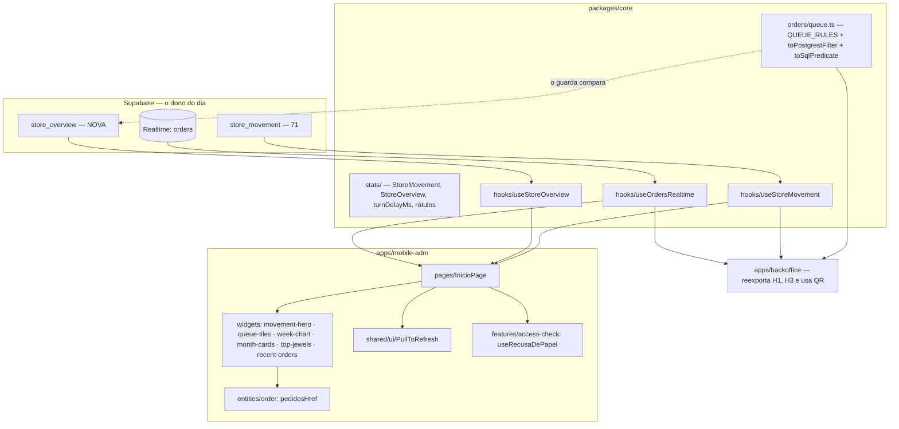

# 73 — mobile-adm: Início · Design

**Spec**: `.specs/features/73-mobile-adm-inicio/spec.md`
**Status**: Approved — abordagem **A** escolhida pelo usuário (2026-10-22), registrada como `AD-057`

Decisões ativas que este desenho segue: `AD-055` (o dia de Brasília tem um dono, o banco; venda é
lista positiva), `AD-056` (PWA só-casca, mesmo acesso do Backoffice), `AD-033` (regra de dois apps
vai a `packages/core`), `AD-012` (tipo escrito à mão é afirmação: o contrato da RPC é provado por
probe). Lições aplicadas: `L-033` (régua por comando na migration), `L-043`/`L-054` (um caso de erro
e um de pendura **por leitura**), `L-046` (a spec é emendada junto com o desenho), `L-055` (dublê com
os eventos do client real — vale para o Realtime), `L-030` (mocks totais de quem monta o Dashboard).

---

## 1. A escolha: de onde vêm as contagens de "Precisa de você"

O problema é `MAI-23`. A RLS de `orders` devolve **os pedidos da própria conta** a quem não é
admin — não erro. Uma contagem `head: true` feita pelo PostgREST por uma conta que perdeu o papel
desenha um número **plausível e falso** (os pedidos dela como cliente, quase sempre `0`), e nada
acusa. As RPCs com `has_role` não têm esse problema: elas levantam `42501`.

### A — tudo da Início vem de RPC admin (recomendada)

A Início faz **duas** leituras: `store_movement` (já existe) e uma RPC nova, `store_overview`, que
devolve os 7 dias, o mês, as clientes novas, as joias, **as contagens da fila, a idade do mais
antigo e os 4 últimos pedidos**. As duas começam por `has_role(auth.uid(), 'admin')` ⇒ `42501`.

- **A favor**: nenhum número da Início pode vir de uma conta sem papel, por construção. Uma leitura
  só para o bloco de baixo, então a tela inteira tem dois estados de erro e não seis.
- **Contra**: a regra "o que é cada bloco da fila" passa a ter **duas escritas** — o filtro do
  PostgREST que a lista de pedidos (`74`) e o painel usam, e o `where` em SQL dentro da RPC. É cópia
  deliberada, e o molde dela já existe (`materialTransitions.test.ts`: a máquina de estado em SQL e
  em TypeScript, comparada transição a transição). A régua passa a ser **dado em `core`**
  (`QUEUE_RULES`), com dois tradutores (`toPostgrestFilter` e `toSqlPredicate`), e um guarda lê a
  migration e exige, para cada bloco, **exatamente** o SQL que `toSqlPredicate` produz.

### B — contagens pelo PostgREST, com a regra num lugar só

As contagens continuam `head: true` pelo PostgREST, com a regra em `core` (um dono, sem cópia
SQL). A RPC nova fica só com os 7 dias, o mês, as clientes e as joias.

- **A favor**: zero cópia da regra.
- **Contra**: `MAI-23` vira proteção **por coincidência de tempo**: a tela só desenha a contagem se a
  RPC do mesmo ciclo respondeu como admin, mas a perda do papel entre as duas leituras desenha o
  número falso até a próxima releitura. E são seis leituras por ciclo, com seis estados de erro.

**Recomendação: A.** A cópia tem guarda que a lê do disco; a janela de B não tem guarda nenhum. O
restante deste documento descreve A.

---

## 2. Architecture Overview



**O ciclo de uma leitura.** Ao montar a Início, as duas RPCs saem em paralelo. Releem: o aviso do
Realtime (`MAI-20`), a volta ao primeiro plano (`refetchOnWindowFocus` + `visibilitychange`), o
puxar (`MAI-19`), o "Tentar de novo" de cada bloco e a virada do dia (o timer por **duração do
servidor**, `turnDelayMs`, um por RPC). Cada RPC tem a sua chave no React Query, então uma falha não
apaga a outra (`MAI-17`), e a releitura falha mantém o dado anterior (`MAI-18`) — é o comportamento
padrão do React Query (o `data` sobrevive ao `error` da releitura).

---

## 3. Code Reuse Analysis

| O que existe | Onde | Como a `73` usa |
| --- | --- | --- |
| `store_movement` | migration da `71` | sem mudança, lida pelo hook que sobe para `core` |
| `store_day`, `store_day_start`, `store_week_start`, `store_time_zone` | migration da `71` | a RPC nova os chama; nenhum dia é calculado de outro jeito |
| `useStoreMovement`, `turnDelayMs`, `STORE_MOVEMENT_KEY` | `apps/backoffice/src/entities/stats/api/useStoreMovement.ts` | **sobem** para `core/hooks/useStoreMovement.ts` (o molde de `useStoreSettings`); o painel **reexporta** (`toBe`) |
| `StoreMovement` (tipo) | `apps/backoffice/src/entities/stats/model/storeMovement.ts` | sobe para `core/stats/movement.ts`; o painel reexporta |
| `useOrdersRealtime`, `ORDERS_REALTIME_CHANNEL` | `apps/backoffice/src/entities/order/api/useOrdersRealtime.ts` | sobe para `core/hooks/useOrdersRealtime.ts`; o painel reexporta. O canal do app tem **outro nome** (`atelie-orders-realtime`): o Supabase deduplica canal por nome **dentro de um client**, e os dois apps têm clients diferentes, mas um nome distinto deixa o canal identificável no inspetor |
| Os 4 blocos da fila (`fetchTiles`), `PRECISA_ACAO_OR`, `MATERIAL_NAO_SEGURA_LISTA`, `QUEUE_TILES` (rótulo, frase, acento) | `apps/backoffice/src/entities/order/api/{orderQuery,useAdminOrderList}.ts` | a **regra** sobe para `core/orders/queue.ts` como dado; o painel passa a montar o filtro com `toPostgrestFilter`. Rótulo e frase sobem junto (o app desenha os mesmos textos). O `apply` (o filtro que o clique aplica na tela do painel) **fica** no painel: é estado da tela dele |
| `queueAge`, `queueAgeLabel` | `packages/core/src/material/aging.ts` | a idade do mais antigo ("há 9 dias"). **Emenda à spec**: é duração, não dia de Brasília (`MAI-05`, ver §8) |
| `formatOrderNumber`, `orderSituation` | `@estrelinha/core/orders` | número e selo de "Últimos pedidos" |
| `formatPrice` / formatadores | `@estrelinha/core/formatters` | dinheiro com e sem centavos (conferir na task se já existe o "sem centavos"; se não, nasce lá) |
| `STORE_TIME_ZONE` | `@estrelinha/core/time` | **só para escrever** a hora de um instante que o banco devolveu (a saudação, "Atualizado às") — `AD-055` permite exatamente isso |
| `SEM_ACESSO` + a tela de recusa com "Sair" | `apps/mobile-adm/src/pages/LoginPage.tsx` | a tela de `MAI-22` **é esta**: a `73` chama `retryAdminCheck()` e o `RequireAdmin` leva ao Login com a recusa. Nenhuma frase nova de recusa (ver §8) |
| `retryAdminCheck`, `adminStatus` | `@estrelinha/auth` | idem |
| `QueryClientProvider` | `apps/mobile-adm/src/app/App.tsx` | já montado na `72`; ganha as opções de `retry` (§6) |
| `AcessoNaoConferido`, `TelaDeEntrada` | `features/access-check` | não muda; falha de rede de uma leitura **não** vai para lá (`MAI-24`), fica no bloco |
| Tokens, `TAP_44`-equivalente da `72` (`min-h-12`) | `packages/ui/src/tokens/estrelinha.ts`, `widgets/tab-bar` | cores e alvos |
| Arnês da `72` | `test/fakeSupabase.ts`, `test/clientReal.ts`, `test/montarApp.tsx` | o dublê ganha `rpc()` e `channel()` (§9) |

### Integration Points

| Sistema | Como a `73` se liga |
| --- | --- |
| Banco | uma migration nova, `20261023120000_73-resumo-do-atelie.sql`: só a função `store_overview` + `revoke`/`grant`. Sem tabela, sem coluna, sem escrita de dado |
| Realtime | o canal de `orders` já é publicado (o Dashboard usa). A RLS do Realtime filtra por `has_role` para admin — nada a abrir |
| Painel | três reexportações (`useStoreMovement`, `StoreMovement`, `useOrdersRealtime`) e o `fetchTiles`/`PRECISA_ACAO_OR` montados a partir de `core`. **Sem mudança visível** |
| `74` | lê `pedidosHref` e `QUEUE_RULES`. A `73` só escreve o endereço |

---

## 4. Components

### `core/orders/queue.ts` — a regra da fila, como dado

- **Purpose**: responder "este pedido está em qual bloco da fila?" num lugar só, para o PostgREST e
  para o SQL.
- **Interfaces**:
  - `QUEUE_BLOCKS: readonly QueueBlock[]` — `{ id: 'aguardando' | 'a-separar' | 'sem-rastreio' | 'pix-aguardando'; label; hint; accent; rule: QueueRule }`, na ordem do painel.
  - `NEEDS_ACTION_BLOCKS = ['aguardando', 'a-separar', 'sem-rastreio']` — a união é "Precisa de ação".
  - `type QueueRule = QueueCond[]` (E entre as condições); `QueueCond = { col; op: 'eq' | 'in' | 'is_null'; value? }`, com `{ any: QueueCond[] }` para o "ou" de `material_status is null OR in (…)`.
  - `toPostgrestFilter(rule): string` — a forma `and(...)` aceita por `.or()`; e `needsActionOrFilter(): string`, o `or=` da visão (substitui `PRECISA_ACAO_OR`).
  - `toSqlPredicate(rule, alias = 'o'): string` — a forma que a migration carrega **byte a byte**.
- **Dependencies**: nenhuma (alcançável pelo Deno por construção, molde de `shipping/pickup.ts`).
- **Reuses**: os valores de hoje do painel. **A regra não muda de comportamento** (ver o risco R1).

### `core/stats/` — os tipos e o tempo das duas leituras

- `movement.ts`: `StoreMovement`, `MovementPeriod`, `MovementPeriodKey` (movidos da `71`).
- `overview.ts`: `StoreOverview` (§5) e `overviewKeys` — a lista de chaves cobrada contra a saída
  **real** da RPC, por `Record<keyof StoreOverview, true>` (molde de `useStoreMovement.test.ts`).
- `turn.ts`: `turnDelayMs` (movido), usado pelos dois hooks.
- `labels.ts`: `greetingFor(hourInStoreZone)`, `monthName('AAAA-MM')`, `weekdayShort(isodow)`,
  `piecesLabel(n)`, `paidOrdersLabel(n)`, `relativeAge(desde, agora)` ("há 12 min", "há 3 h", "há 2
  dias" — duração, nunca calendário). Nenhum `new Date('AAAA-MM-DD')`.

### `core/hooks/useStoreMovement.ts`, `useStoreOverview.ts`, `useOrdersRealtime.ts`

- `useStoreMovement` — o hook da `71`, inteiro, com o timer da virada.
- `useStoreOverview` — o mesmo molde: `rpc('store_overview')` sem argumento, `throw error`, timer por
  `turnDelayMs`, chave `STORE_OVERVIEW_KEY`.
- `useOrdersRealtime(channelName, onChange)` — o hook da `71` com o nome do canal por parâmetro (o
  painel passa `ORDERS_REALTIME_CHANNEL`, o app passa o dele). Um canal por montagem; fecha ao
  desmontar.

### `apps/mobile-adm/src/pages/InicioPage.tsx`

- Compõe os seis widgets, o `PullToRefresh`, o Realtime (`invalidateQueries` das duas chaves) e a
  vigia de recusa. Nenhuma regra de número.

### Widgets (`apps/mobile-adm/src/widgets/…`)

| Widget | Recebe | Desenha |
| --- | --- | --- |
| `movement-hero` | `StoreMovement` + estado | a faixa escura do protótipo: saudação, data, os três períodos (`aria-pressed`, troca **sem leitura**), os quatro números; `—` no ticket sem venda |
| `queue-tiles` | `overview.fila` | a faixa que rola **dentro de si** com os 4 blocos (`QUEUE_BLOCKS`), o primeiro com acento e idade; "Ver pedidos" |
| `week-chart` | `overview.semana` | 7 barras; altura proporcional ao maior (piso de 4 px), `—` sem venda, "hoje" na última com a cor de destaque; total no cabeçalho; legenda "Pedidos pagos, em R$ mil." |
| `month-cards` | `overview.mes`, `overview.clientes_novas` | os dois cards lado a lado (`grid-cols-2` com `minmax(0,1fr)`) |
| `top-jewels` | `overview.joias` | até 4 linhas, "N peças"; vazio explicado |
| `recent-orders` | `overview.recentes`, `overview.lido_em` | 4 linhas de texto (não links), selo de `orderSituation`; "Ver todos" |

Cada widget tem três estados — esqueleto (primeira carga, `aria-busy`), erro sem dado (frase +
"Tentar de novo"), dado (com releitura no ar ou falhada sem trocar por esqueleto). Os quatro de baixo
compartilham **um** estado, o de `store_overview`; o primeiro tem o de `store_movement`.

### `shared/ui/PullToRefresh.tsx`

- Gesto de puxar no topo (`touchstart`/`touchmove`/`touchend`, limiar de 64 px), indicador com
  `role="status"` "Atualizando…", chama `onRefresh(): Promise`, some ao terminar. Sem biblioteca.
- `overscroll-behavior-y: contain` no `body` do app: sem ele o Chrome em **aba** (não instalado)
  recarrega a página no mesmo gesto. Instalado (standalone) o gesto nativo já não existe.
- `motion-reduce:` no indicador.

### `features/access-check/model/useRecusaDePapel.ts`

- Observa os erros das duas queries; o **primeiro** `42501` chama `retryAdminCheck()` uma vez.
  O `AuthProvider` relê o papel, o `RequireAdmin` leva ao Login com `SEM_ACESSO` + "Sair". Enquanto
  isso, nenhum bloco desenha número: o erro `42501` é tratado como "sem dado" (`MAI-22`).
- `42501` não passa pelo `retry` do React Query (§6).

### `entities/order/model/pedidosHref.ts`

- `pedidosHref({ visao: OrderViewId } | { bloco: QueueBlockId })` ⇒ `/pedidos?visao=precisa-acao`
  ou `/pedidos?bloco=aguardando`. O vocabulário vem de `core`. A `74` lê o mesmo arquivo.

---

## 5. Data Model — `store_overview(p_agora timestamptz default now())`

`volatile`? Não: `stable security definer set search_path = ''`, `has_role` ⇒ `42501`, `revoke` de
`public`/`anon`, `grant execute` a `authenticated` (o molde exato de `store_movement`).

```typescript
interface StoreOverview {
  hoje: string            // 'AAAA-MM-DD', de store_day(p_agora)
  mes: string             // 'AAAA-MM'
  lido_em: string         // ISO, p_agora
  expira_em: string       // ISO, store_day_start(hoje + 1)
  semana: { dia: string; dow: number; vendas: number; faturamento: number }[]  // 7, do mais antigo a hoje
  mes_resumo: { vendas: number; faturamento: number }
  clientes_novas: number
  joias: { chave: string; nome: string; pecas: number }[]   // ≤ 4
  fila: {
    aguardando: number; a_separar: number; sem_rastreio: number; pix_aguardando: number
    precisa_acao: number              // a UNIÃO dos três primeiros, count com OR — nunca a soma
    aguardando_desde: string | null   // created_at do mais antigo aguardando material
  }
  recentes: {
    id: string; order_number: string; customer_name: string; total: number; created_at: string
    status: string; payment_status: string; material_status: string | null
    shipping_service_id: string | null; delivery_estimate_max: string | null
  }[]                                   // 4, por created_at desc
}
```

Regras SQL (todas com `store_day_start` sobre `paid_at`, a forma indexável da `71`):

- **Venda** = `payment_status = 'approved' and status <> 'cancelled'`. Escrita **uma** vez na função,
  num `with vendas as (…)`, e o guarda exige o mesmo par de predicados de `store_movement` (régua
  por comando, `L-033`).
- **Semana**: `generate_series(hoje - 6, hoje, 1)` à esquerda das vendas, para o dia sem venda vir
  com `0` (o `coalesce`).
- **Mês**: `paid_at >= store_day_start(date_trunc('month', hoje)::date) and paid_at <= p_agora`.
- **Clientes novas**: a pessoa é a do `customer_directory` (o vínculo de `customer_stats`:
  `o.customer_id = d.id or lower(o.customer_email) = lower(d.email)`); conta `d.id` cuja **menor**
  `paid_at` entre as vendas cai no mês. Sem `customer_stats.first_order_at`: aquela coluna é
  `approved` sem o recorte de `cancelled` e por `created_at`, que é outra régua.
- **Joias**: `order_items` das vendas do mês, chave = `product_id` quando é uuid de um `products`
  existente, senão `'nome:' || product_name`; nome = o de `products` quando existe, senão o
  `product_name`; `sum(quantity)`, `order by pecas desc, nome`, `limit 4`.
- **Fila**: os quatro `count(*) filter (where <toSqlPredicate(bloco)>)` sobre `orders`, mais o
  `precisa_acao` com o `or` dos três. **Sem recorte de data** — é o painel de hoje.
- **Recentes**: `order by created_at desc, id desc limit 4`.

---

## 6. Error Handling Strategy

| Cenário | Tratamento | O que a Adri vê |
| --- | --- | --- |
| Uma RPC falha na primeira carga | `error` sem `data` naquela chave | o(s) bloco(s) dela: "Não consegui carregar." + "Tentar de novo"; os outros normais (`MAI-17`) |
| A releitura falha | `data` mantido | os números, "Atualizado às 14h32" e "Não consegui atualizar agora." (`MAI-18`) |
| `42501` | sem `retry`; `useRecusaDePapel` ⇒ `retryAdminCheck()` | splash curta e o Login com "Esta conta não tem acesso ao painel." + "Sair" (`MAI-22`) |
| Rede fora no meio | `retry: 1` (o do Dashboard), depois erro de leitura | o bloco com a falha — nunca a recusa (`MAI-24`); sem conexão nenhuma, a tela da `72` (`MAI-26`) |
| Resposta fora de ordem | o React Query cancela a anterior por chave (`cancelRefetch`) | nada (`MAI-25`) |
| O canal Realtime cai | a volta ao primeiro plano relê; o "Atualizado às" diz a hora do dado | a hora certa do número na tela |
| Logout com a tela aberta | `RequireAdmin` desmonta a Início; o efeito fecha o canal; o React Query descarta | o Login |

`retry` no `QueryClient` do app: `(n, e) => e?.code !== '42501' && n < 1`.

**Decisões da T18** (o orquestrador, respondendo às pendências do Lote 2):

- **"Atualizado às" é `formatStoreHour(lido_em)`** ("14h32"), o formatador que já existe em
  `core/time`: um dono só da hora escrita vale mais que o exemplo "14:32" da spec (emendada). A hora é
  a do `lido_em` do SERVIDOR, nunca o `dataUpdatedAt` do aparelho; com as duas leituras na tela, vale a
  MAIS ANTIGA (a hora do número mais velho que a Adri lê). A linha está sempre presente quando há dado,
  e "Não consegui atualizar agora." entra nela quando uma releitura falhou com dado na tela.
- **O cache sobrevive a offline → online.** O `QueryClient` é criado por `useState` no `<App />`
  ANTES do ramo de "sem conexão", então ele não é recriado quando a árvore desmonta sem rede. Ao
  voltar a rede, a Início remonta mostrando o dado anterior com "Atualizado às" e relê (`staleTime:
  0`) — exatamente `MAI-18`. Decidido: não recriar o cliente.
- **A recusa (`42501`) é reconferida UMA vez por episódio, e não por montagem.** `retryAdminCheck`
  põe `loading`, o `RequireAdmin` troca a página pelo `fallback` e a página desmonta; um `useRef`
  morreria com ela, e com o papel ainda `admin` a tela entrava em laço (achado da T18). A marca mora
  fora do React (`features/access-check/model/useRecusaDePapel.ts`, molde de `tentativa.ts`) e se
  desfaz quando nenhuma leitura está mais recusada ou a conta muda.

---

## 7. Risks & Concerns

| # | Concern | Onde | Impacto | Mitigação |
| --- | --- | --- | --- | --- |
| R1 | **O bloco "Pago, a separar" e a visão "Precisa de ação" já discordam sobre `material_status` nulo**: o bloco conta `in (nao_aplicavel, material_recebido, em_producao)`; a visão conta `is null or in (…)` | `useAdminOrderList.ts` (`fetchTiles`) × `orderQuery.ts:240` | um pago com material nulo entra na união e em nenhum bloco: "Precisa de você: 4" com blocos somando 3 | a `73` **preserva** as duas formas como estão (mudar é comportamento do painel); a task 1 **mede** quantos pedidos pagos têm `material_status` nulo no banco local e em produção (`db query --linked`), e o resultado vai ao usuário antes de escolher unificar. **Medido na T01 (2026-10-22): 0 no local e 0 em produção** (`baseline.md`) — medido, comportamento preservado; unificar é decisão à parte |
| R2 | O "Pix aguardando" do painel não recorta `status` | `fetchTiles` | um Pix pendente com o pedido cancelado à mão conta | preservado; medido junto com R1. **T01: 0 no local e 0 em produção** — medido, comportamento preservado; unificar é decisão à parte |
| R3 | **Mover três hooks do painel para `core` toca o Dashboard** | `AdminDashboard.tsx` e testes que fazem `vi.mock` de `@/entities/stats/api/useStoreMovement` e `@/entities/order` | `L-030`: mock total quebra no render | o painel **reexporta** pelos mesmos caminhos (`toBe`); antes de mover, listar os `vi.mock` que alcançam os três e rodar a suíte inteira do painel na task |
| R4 | **Toda RPC nova quebra `marcacaoSoPorAcao.test.ts` (loja)** | lista literal de RPCs | gate vermelho | `store_overview` entra na lista com o `it.each` do `create function` (aconteceu duas vezes na `71`) |
| R5 | A cópia SQL da regra da fila | a migration × `core/orders/queue.ts` | divergência silenciosa | o guarda `filaComDonoUnico.test.ts` (suíte da loja, onde moram os de migration) exige `toSqlPredicate(bloco)` **byte a byte** em cada `filter`, o `or` dos três no `precisa_acao`, âncora (os 4 blocos achados), sensor por bloco com `mutar()` que lança |
| R6 | O puxar recarrega a página no Chrome em aba | `body` | a Adri perde a tela | `overscroll-behavior-y: contain`; prova em navegador em aba **e** instalado |
| R7 | O jsdom não mede layout | toda a tela | estouro em 360 passa na suíte | prova em navegador no build servido, 360×800 e 412×915, com o banco local; `minmax(0,…)` nas grades |
| R8 | O dublê da `72` não tem `rpc` nem `channel` | `test/fakeSupabase.ts` | testes que não enxergam o filtro (`duble-que-nao-enxerga`) | o dublê registra cada `rpc` (nome **e** args — a régua de "sem argumento") e cada `channel` (nome, `postgres_changes`, `removeChannel`), com um `emitir()` para o aviso |
| R9 | O índice de `paid_at` | `orders` | a RPC lê o mês inteiro a cada aviso do Realtime | conferir na task da migration (`\d orders` local); com ~700 pedidos o custo é desprezível — registrar, não otimizar sem medida |
| R10 | `customer_directory` tem duplicatas por e-mail (`same_email_count > 1`) | a view da `34` | uma pessoa com dois cadastros conta duas vezes como nova | mesmo comportamento da tela de Clientes; declarado no comentário da função |

---

## 8. Emendas à spec (no mesmo movimento, `L-046`)

- **`MAI-05`, a idade do mais antigo**: a assunção dizia "dias inteiros pelo dia de Brasília, no
  banco". O dono da idade já existe e é `queueAge` (duração em blocos de 24 h desde `created_at`,
  piso 0), o mesmo que o painel usa ao lado do mesmo bloco. Uma segunda régua daria "há 9 dias" no
  painel e "há 10 dias" no celular. Passa a ser `queueAge(aguardando_desde, lido_em)`, com o `lido_em`
  do servidor no lugar do relógio do aparelho.
- **`MAI-22`, a tela de recusa**: é a da `72` (`SEM_ACESSO`, "Esta conta não tem acesso ao painel.",
  com "Sair"), alcançada por `retryAdminCheck()`. Uma frase nova ("o acesso foi removido") seria um
  segundo dono da recusa.
- **`MAI-23`**: resolvido por construção na abordagem A (nenhuma leitura PostgREST na Início). Se B
  for escolhida, a AC vira a regra de "só desenha com a RPC do mesmo ciclo admin", com a janela
  declarada.
- **`MAI-04`, a saudação**: a hora é a de `store_movement.lido_em` escrita com `STORE_TIME_ZONE`
  (`AD-055` permite escrever a hora de um instante do banco). A RPC não precisa devolver a hora.

---

## 9. Tech Decisions

| Decisão | Escolha | Por quê |
| --- | --- | --- |
| Hooks em `core/hooks` e não em `packages/` novo | `core/hooks` (precedente: `useStoreSettings`, `useCoupons`) | é onde já moram hooks de leitura dos dois apps |
| Duas RPCs, não uma | `store_movement` fica como está | ela é do painel também, e a `71` a provou em três rodadas; fundir obrigaria a reverificar |
| Sem argumento de data em nenhuma chamada | `p_agora` só para probe | `AD-055` |
| Gráfico sem biblioteca | `div`s com altura proporcional | 7 barras; o protótipo é isso |
| Puxar sem biblioteca | eventos de toque | um gesto; biblioteca para isso pesa mais que a tela |
| Linhas de pedido como texto | até a `75` | decisão do usuário |

**Decisão de projeto** (vai para o `STATE.md` como `AD-057` ao aprovar): *"o que é cada bloco da
fila" é dado em `core/orders/queue.ts`, traduzido para o PostgREST e para o SQL; toda leitura dele
em SQL é cópia guardada byte a byte*. E: *a Início do app só lê RPC admin* — nenhuma tela do app que
mostre agregado da loja lê `orders` pelo PostgREST, pela razão de `MAI-23`.

---

## 10. Testes e provas (o que cada camada prova)

| Camada | Prova |
| --- | --- |
| `core/orders/queue.ts` | os dois tradutores, por caso; o `needsActionOrFilter()` **igual** ao `PRECISA_ACAO_OR` de hoje (paridade antes de apagar o antigo) |
| `core/stats/labels.ts` | saudação nas bordas (04:59, 05:00, 11:59, 12:00, 17:59, 18:00), mês, dia, plurais, `relativeAge` |
| Migration | guarda `overviewSchema.test.ts` (régua por comando: `has_role`, `42501`, `security definer`, `search_path = ''`, `revoke anon`, venda = o par do `AD-055`, `store_day_start` em todo recorte, nenhum `current_date`/`now()::date`/`date_trunc('month', now())`, `limit 4`, sem escrita) + `filaComDonoUnico.test.ts` |
| SQL semântico | `probes/*.sql` contra o banco local, como admin e como cliente: virada de mês e de dia às 21h–24h, convidada em dois meses, pago e cancelado, item órfão, a união da fila, `42501` para cliente e anon |
| Hooks | pelo client **real** (`clientReal.ts`) para o `42501` e o `throw`; o timer por duração |
| Página | o `<App />` real em `/` (`montarApp`) com o dublê: uma chamada de cada RPC, **sem argumento**; troca de período sem leitura; erro por bloco; releitura sem esqueleto; `42501` ⇒ Login com `SEM_ACESSO`; um canal, fechado ao sair da aba; o aviso relê as duas; o puxar relê; resposta fora de ordem |
| Painel | suíte inteira (as reexportações e o `fetchTiles` por `core`), sem asserção tocada |
| Navegador | build servido, 360×800 e 412×915, banco local, sem rolagem horizontal, `R$ 99.999` numa linha, o puxar em aba e instalado |
