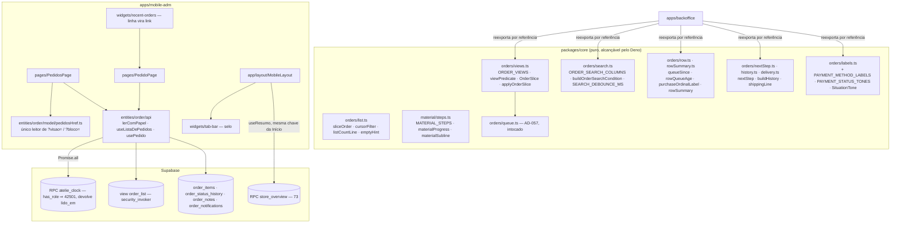

# 74 — mobile-adm: Pedidos — Design

**Spec**: `.specs/features/74-mobile-adm-pedidos/spec.md` (aprovada no gate do Specify, 2026-10-23)
**Status**: Aprovado no gate do Design (2026-10-23), com as emendas de §13 — elas valem sobre o texto das seções anteriores onde divergirem
**Escopo**: Large (≈ 55 requisitos, 4 camadas: `packages/core`, migration, `apps/mobile-adm`, guardas
em três suítes). Decisões ativas respeitadas: `AD-012`, `AD-017`, `AD-033`, `AD-055`, `AD-056`,
`AD-057`. Decisão nova: **`AD-058`** (registrada em `.specs/STATE.md`).

Código lido antes de escrever (além do que a spec lista): `apps/backoffice/src/entities/order/api/
{orderQuery,useAdminOrderList,useAdminOrder,useAdminOrders}.ts`, `features/order-list/model/
{rowSummary,filterChips}.ts`, `features/order-detail/model/{nextStep,history}.ts` e os consumidores
de cada símbolo no painel; `packages/core/src/{orders,material,stats,paging,shipping,notifications,
hooks}`; a view `order_list` (migration da `35`, linhas 245–263 — ela já expõe **todas** as colunas
do detalhe, inclusive endereço, descontos e `shipping_method`); as migrations da `71`/`73` (molde de
RPC admin); `apps/mobile-adm/src/{app,pages,entities,features,widgets,shared}`; os guardas
`abasSaoAsRotas`, `rotasSobGuarda`, `marcacaoSoPorAcao`, `situacaoComDonoUnico`,
`notificationSingleOwner` e `core/orders/__tests__/purity.test.ts`. Lições aplicadas: `L-059`
(semântica só por probe), `L-060` (o recorte é SÓ a regra do dono — medir a cadeia, não a presença),
`L-061` (gesto com limiar), `L-063` (três estados com exclusividade).

---

## 1. Architecture Overview



**A ideia em uma frase**: toda pergunta sobre um pedido ("está em qual recorte?", "o que o segura?",
"qual o próximo passo?", "o que aconteceu?") tem **um** dono em `core/orders`, que o painel passa a
reexportar sem mudar comportamento; o app só **traduz** a descrição desses donos para o supabase-js e
desenha — e nenhuma linha é desenhada sem que a **mesma leitura** tenha passado por `atelie_clock()`.

### 1.1 Abordagens para o motor da lista (Large ⇒ exploração)

As três entregam a mesma coisa (lista paginada por chave, releitura sem pular nem repetir, cache para
o voltar). **Recomendação: B.**

| | Abordagem | Prós | Contras |
| --- | --- | --- | --- |
| A | `useInfiniteQuery` do React Query, `pageParam` = cursor | idiomático; descarte por chave grátis | a releitura do infinite query **relê página a página com os cursores antigos**: um pedido novo no topo empurra a 25ª linha da página 1 para fora e a página 2 começa depois dela — **pula** um pedido. Viola `MAP-14` e G-A11 (uma leitura só) |
| **B** | **"janela"**: um `useQuery` cuja `queryFn` lê do início com `limit = max(25, linhas já carregadas)`; "carregar mais" busca a página seguinte pelo cursor e **anexa** por `setQueryData`, só se a janela não mudou desde que saiu | releitura numa ida só, a partir do topo (G-A11); cursor nunca repete nem pula (`MAP-14`); cache em memória para o voltar (G-A28); `refetchOnWindowFocus`, cancelamento e descarte por chave do React Query continuam valendo | o anexar é código nosso (o "geração" contra resposta velha, `MAP-40`) — pequeno, testável |
| C | estado local no hook (molde de `useAdminOrderList`) | sem dependência do React Query | perde o cache para o voltar (G-A28 exigiria um segundo cache), o foco e o dedupe; reescreve o que o React Query já faz |

---

## 2. Code Reuse Analysis

### 2.1 Reaproveitado sem mudança

| O quê | Onde | Uso na `74` |
| --- | --- | --- |
| `QUEUE_BLOCKS`, `queueBlock`, `toPostgrestFilter`, `needsActionOrFilter` | `core/orders/queue.ts` (`AD-057`) | o recorte `?bloco=` (A3) e a visão "Precisa de ação" |
| `ORDER_STATUS_LABELS`, `ORDER_PAYMENT_STATUS_LABELS` | `core/orders/labels.ts` | `nextStep`, `buildHistory`, selo de pagamento |
| `orderSituation(…, 'atelie')`, `formatShortDate`, `formatOrderNumber`, `stripOrderNumberPrefix` | `core/orders` | selo da linha e do cabeçalho, número |
| `relativeAge`, `formatStoreHour` | `core/stats/labels.ts`, `core/time` | "há N", "Atualizado às" — sempre contra `lido_em` do servidor |
| `queueAge`, `queueAgeLabel`, `toMaterialStatus`, `MATERIAL_STATUS_LABELS` | `core/material` | idade da espera, título do material |
| `escapeSearchTerm` | `core/paging/pageMath.ts` | a busca (já usado pelo painel) |
| `isPickupOrder` | `core/shipping/pickup.ts` | `MAP-27`, `nextStep` |
| `normalizeBrPhone` | `core/notifications/phone.ts` | o `wa.me` (A21) |
| `NOTIFICATION_EVENT_LABELS`, `isNotificationEvent` | `core/notifications/events.ts` | `buildHistory` |
| `formatPrice` | `core/formatters` | totais com centavos |
| `useOrdersRealtime(nome, onChange)` | `core/hooks/useOrdersRealtime.ts` | um canal por montagem (`MAP-39`) |
| `useStoreOverview` (= `useResumo`), `STORE_OVERVIEW_KEY`, `retryUnlessDenied`, `ACCESS_DENIED_CODE` | `core/hooks/useStoreOverview.ts`, `entities/stats` | o selo da aba (`MAP-31`), a regra de repetição |
| `useRecusaDePapel`, `ehRecusaDePapel` | `features/access-check` | `MAP-36` (uma reconferência por episódio) |
| `Leitura<T>`, `FALHA_DE_LEITURA`, `TENTAR_DE_NOVO`, `FalhaDoBloco`, `Traco` | `shared/ui/leitura.tsx` | os três estados de cada bloco (`MAP-30`, `MAP-34`, `MAP-44`) |
| `PullToRefresh` | `shared/ui/PullToRefresh.tsx` | `MAP-39` |
| `SituacaoDoPedido` | `entities/order/ui` | selo da linha e do cabeçalho (A14) |
| `criarQueryClient` | `app/queryClient.ts` | `42501` não repete |
| arnês de teste: `fakeSupabase.ts`, `clientReal.ts`, `montarApp.tsx`, `resumo.ts` | `apps/mobile-adm/src/test` | estendidos (abaixo), nunca copiados |

### 2.2 O que SOBE para `packages/core` (`MAP-47`, `MAP-48`, `MAP-50`)

Regra única de mudança: **o texto e a lógica saem byte a byte**; a assinatura troca o tipo do
`@estrelinha/supabase/types` (que `core/orders` não pode importar — `purity.test.ts` recusa
`@estrelinha/*`) por uma **interface estrutural mínima** com as colunas lidas. O painel continua
passando `DbOrder`/`AdminOrderRow`, que satisfazem a interface. Todo especificador relativo com
`.ts`. Nenhum import de React, Supabase ou alias.

| Símbolo | De (painel) | Para (`core`) | Entrada estrutural | O painel passa a |
| --- | --- | --- | --- | --- |
| `OrderViewId`, `ORDER_VIEWS`, `ViewPredicate`, `viewPredicate`, `MATERIAL_QUEUE_STATES` | `entities/order/api/orderQuery.ts` | `orders/views.ts` (importa `./queue.ts`) | — | `export { … } from '@estrelinha/core/orders'` no mesmo arquivo |
| `ORDER_SEARCH_COLUMNS`, `buildOrderSearchCondition`, `SEARCH_DEBOUNCE_MS` | `orderQuery.ts` | `orders/search.ts` (importa `../paging/pageMath.ts`, `./format.ts`) | — | reexporta |
| `PAYMENT_METHOD_LABELS` | `orderQuery.ts` | `orders/labels.ts` | — | reexporta |
| `purchaseOrdinalLabel` | `orderQuery.ts` | `orders/row.ts` | — | reexporta |
| `queueSince`, `rowQueueAge` | `orderQuery.ts` | `orders/row.ts` (importa `../material/aging.ts`) | `{ created_at; material_received_at; material_status }` | reexporta |
| `rowSummary`, `RowSummary`, `PrimaryActionId` | `features/order-list/model/rowSummary.ts` | `orders/rowSummary.ts` (importa `../material/material.ts`) | `RowSummaryInput = { material_status; status; tracking_code; payment_method }` | o arquivo vira `export { … } from '@estrelinha/core/orders'` |
| `nextStep`, `NextStep`, `PICKUP_DONE_ACTION` | `features/order-detail/model/nextStep.ts` | `orders/nextStep.ts` (importa `./labels.ts`, `../material/material.ts`, `../shipping/pickup.ts`) | `NextStepInput = { status; material_status; payment_status; tracking_code; shipping_service_id }` | reexporta |
| `buildHistory`, `HistoryEvent`, `HistoryKind` | `features/order-detail/model/history.ts` | `orders/history.ts` (importa `./labels.ts`, `../notifications/events.ts`) | `HistoryStatusRow`, `HistoryNotificationRow`, `HistoryNoteRow` | `history.ts` reexporta `buildHistory` e os tipos; **`HISTORY_FILTERS` e `filterHistory` ficam no painel** (só ele filtra por tipo, Out of Scope) |

Notas:

- `STATUS_LABELS` do painel **já é** `ORDER_STATUS_LABELS` por referência (QA da `73`), então
  `nextStep`/`buildHistory` em `core` lendo `ORDER_STATUS_LABELS` produzem as mesmas palavras.
- `SituationTone` **muda de casa dentro de `core`**: de `situation.ts` para `labels.ts`, e
  `situation.ts` passa a importá-lo de lá e reexportar — sem isso, `labels.ts → situation.ts →
  labels.ts` seria um ciclo só para um tipo. O nome no barrel não muda.
- `orderQuery.ts` do painel **fica com** o que é da tela dele: `OrderFilters`, `OrderQuery`,
  `emptyOrderFilters`, `defaultOrderQuery`, `ORDER_SORT_COLUMN`, `QUEUE_TILES`, `MATERIAL_TILES`,
  `AdminOrderRow`, `ORDER_LIST_FROM`/`ORDER_LIST_SELECT`, `activeOrderFilterCount`.
- `filterChips.ts` **não é tocado** (G-MAP51).
- `applyView` (privado de `useAdminOrderList`) passa a **delegar** a `applyOrderSlice` (abaixo). A
  sequência de chamadas ao builder é idêntica (`.or` antes de cada `.in`, na ordem de `Object.entries`),
  e `useAdminOrderList.test.ts` — que registra a cadeia — fecha verde sem asserção tocada. Sem a
  delegação, "como um `ViewPredicate` vira filtro" teria duas escritas.

### 2.3 O que NASCE em `packages/core` (regra nova com leitor no app; `MAP-49` proíbe declará-la no app)

| Símbolo | Arquivo | O que responde |
| --- | --- | --- |
| `OrderSlice = { visao: OrderViewId } \| { bloco: QueueBlockId }`, `DEFAULT_ORDER_SLICE` (`{ visao: 'precisa-acao' }`, A5) | `orders/views.ts` | "qual recorte" — o tipo que `pedidosHref` lê e escreve |
| `applyOrderSlice<B extends SliceBuilder<B>>(b, slice)` | `orders/views.ts` | traduz visão (`viewPredicate`) ou bloco (`toPostgrestFilter(queueBlock(id).rule)`) para um builder **estrutural** `{ or(f): B; in(c, v): B }` — sem importar supabase |
| `sliceOrder(slice): 'asc' \| 'desc'` | `orders/list.ts` | A8/G-A8: "Precisa de ação" e qualquer bloco ⇒ `asc`; o resto ⇒ `desc` |
| `cursorFilter(cursor, dir): string` | `orders/list.ts` | o `or=` da página seguinte: `created_at.gt."<c>",and(created_at.eq."<c>",id.gt.<id>)` (`lt` em `desc`). Valor **entre aspas duplas** e **a string crua devolvida pelo PostgREST** (microssegundos), nunca passada por `Date` — `Date` trunca para milissegundos e a igualdade do desempate falharia |
| `ORDER_PAGE_SIZE = 25` | `orders/list.ts` | o mesmo número de `defaultOrderQuery().pageSize`; o painel passa a ler daqui (`pageSize: ORDER_PAGE_SIZE`) — único toque de comportamento-neutro na factory |
| `listCountLine(total, slice, comBusca)`, `emptyHint(slice, termo)`, `EMPTY_TITLE` | `orders/list.ts` | as frases de `MAP-08`/`MAP-09` (dependem do id da visão, logo não podem morar no app — `MAP-49`) |
| `PAYMENT_STATUS_TONES: Record<AdminPaymentStatus, SituationTone>` | `orders/labels.ts` | A15: pending `wait`, approved `done`, rejected `alert`, refunded `neutral`, expired `neutral`, cancelled `alert` |
| `shippingLine(o)` | `orders/delivery.ts` | `MAP-26`: "Rastreio <código>" · "Enviado sem código de rastreio" · "Ainda não postado" · "Sem rastreio"; `null` na retirada (`MAP-27`) |
| `MATERIAL_STEPS`, `materialProgress(material_status, status)`, `materialSubline(o, agora)`, `MATERIAL_USED_TITLE` | `material/steps.ts` | A22/A23/`MAP-23`: quatro passos (Aguardando · A caminho · Recebido · Em produção), estado de cada (`feito`/`atual`/`depois`), todos feitos com `shipped`/`delivered` e o título "Material usado na joia"; a linha sob o título |
| `ATELIE_CLOCK_RPC = 'atelie_clock'` | `orders/list.ts` | o nome da RPC, um dono para o app e o guarda da loja |

`orders/index.ts` exporta tudo isso; `material/index.ts` ganha `export * from './steps.ts'`. A âncora
de `orders/__tests__/purity.test.ts` passa a listar os arquivos novos (`views.ts`, `search.ts`,
`list.ts`, `row.ts`, `rowSummary.ts`, `nextStep.ts`, `history.ts`, `delivery.ts`) e o piso sobe de
`≥ 8` para `≥ 16`. `material/` já é varrido por outro guarda de pureza? **Não** — `steps.ts` ganha
pureza pela mesma régua ao entrar no grafo de `orders` (`delivery.ts` não o importa, então o Design
pede um caso em `material/__tests__/steps.test.ts` que lê o próprio arquivo e recusa especificador
sem `.ts` — molde de `shipping/__tests__/denoReach.test.ts`).

### 2.4 Integration Points

| Sistema | Integração |
| --- | --- |
| Postgres | migration nova `20261024120000_74-relogio-do-atelie.sql` com `atelie_clock()`; nenhuma tabela, view ou policy muda |
| PostgREST | `order_list` (lista e cabeçalho do detalhe), `order_items`, `order_status_history`, `order_notes`, `order_notifications` (detalhe) — as mesmas que o painel lê, colunas **nomeadas** |
| Realtime | `useOrdersRealtime('atelie-pedidos-realtime', …)` na lista e `('atelie-pedido-realtime', …)` no detalhe; nunca as duas montadas juntas (rotas irmãs) |
| React Query | chaves `['atelie-pedidos', slice, termo]` e `['atelie-pedido', id]`; o selo usa `STORE_OVERVIEW_KEY` (a da Início) |
| Painel | só reexportações e a delegação de `applyView`; suíte do painel verde **sem asserção tocada** |

---

## 3. A leitura

### 3.1 A RPC `atelie_clock()` (`MAP-53`, G-A1, `AD-058`)

```sql
create or replace function public.atelie_clock()
returns jsonb
language plpgsql
stable
security definer
set search_path = ''
as $$
begin
  if not public.has_role(auth.uid(), 'admin') then
    raise exception 'acesso restrito ao painel' using errcode = '42501';
  end if;
  return jsonb_build_object('lido_em', now());
end;
$$;
revoke execute on function public.atelie_clock() from public, anon;
grant execute on function public.atelie_clock() to authenticated;
```

Sem leitura de tabela (a única chamada é `has_role`), sem escrita de dado, sem argumento (nenhum
`p_agora`: não há semântica de dia a provar, só a recusa e o instante). Aplicada **só no local**.
Guarda `atelieClockSchema.test.ts` (suíte da loja, molde de `overviewSchema.test.ts`, uma régua por
comando, `mutar()` que lança) e `'atelie_clock'` na lista literal de `marcacaoSoPorAcao.test.ts` com o
`create function` conferido. Probe `.specs/features/74-mobile-adm-pedidos/probes/01-relogio.sql`:
admin recebe `lido_em`; conta sem papel recebe `42501`; `anon` recebe `42501`/`permission denied`.

### 3.2 `lerComPapel` — a confirmação na mesma leitura (`MAP-36`, `MAP-37`, `MAP-38`)

`entities/order/api/lerComPapel.ts`:

```ts
/** Roda a consulta e a confirmação de papel EM PARALELO; devolve o dado só se a confirmação passou. */
export const lerComPapel = async <T>(consulta: () => PromiseLike<{ data: T; error: unknown; count?: number | null }>)
  : Promise<{ data: T; count: number | null; lido_em: string }>
```

- `Promise.all([supabase.rpc(ATELIE_CLOCK_RPC), consulta()])`.
- **A recusa vence**: se a RPC devolveu `{ error }`, lança **esse** erro (com `code: '42501'` ou sem
  código, se rede) — mesmo que a consulta tenha trazido linhas (que são as da cliente, `MAI-23`).
- Senão, se a consulta devolveu `{ error }`, lança o dela. Senão devolve `{ data, count, lido_em }`.
- `useRecusaDePapel([erro])` na página: `42501` ⇒ reconferência única por episódio e recusa da `72`;
  qualquer outro erro ⇒ falha de leitura (`MAP-38`).
- Nenhum outro arquivo do app chama `supabase.from(`: guarda `leituraSoComPapel.test.ts` (§7).

### 3.3 A lista — `useListaDePedidos(slice, termo)` (`entities/order/api/useListaDePedidos.ts`)

Abordagem B (§1.1). Chave `['atelie-pedidos', slice, termo.trim()]`.

**A consulta** (uma função, `consultaDaLista(slice, termo, { limite, cursor, contar })`):

```
supabase.from('order_list').select(COLUNAS_DA_LISTA, contar ? { count: 'exact' } : undefined)
  → applyOrderSlice(·, slice)                 // core: visão ou bloco — o MESMO que o painel
  → .or(buildOrderSearchCondition(termo))     // core: só se não for null
  → .or(cursorFilter(cursor, dir))            // core: só nas páginas seguintes
  → .order('created_at', { ascending }) .order('id', { ascending })   // dir = sliceOrder(slice)
  → .limit(limite)
```

- Três `or=` lado a lado: o PostgREST os combina com **E** (o painel já combina dois). G-A9(b): o
  Design exige um **probe HTTP contra o PostgREST local** (`probes/02-lista.sh`) que manda os três
  juntos — visão "Precisa de ação" (que é `or` com `and(...)` aninhado) + busca + cursor — e confere o
  conjunto de ids contra uma consulta SQL de referência. Sem ele, a combinação é suposição (`AD-012`).
- `COLUNAS_DA_LISTA`: `id, order_number, customer_name, customer_email, status, payment_status,
  payment_method, total, tracking_code, material_tracking_code, material_status,
  material_received_at, shipping_service_id, created_at, purchase_ordinal` — nomeadas, sem
  `nuvemshop_*` (`provenanceNotRead`), sem `notes`. O tipo `LinhaDaLista` é declarado ao lado e
  **provado** pelo probe (a resposta tem exatamente essas chaves), nunca só pelo `tsc` (`AD-012`).
- `queryFn` (primeira leitura e toda releitura — Realtime, foco, puxar, voltar):
  `limite = max(ORDER_PAGE_SIZE, ⌈carregadas / 25⌉ × 25)` com `carregadas` lido do cache **desta
  chave**; `contar = true`; sem cursor. Devolve `JanelaDaLista = { linhas, total, lido_em, fim }`,
  `fim = linhas.length < limite`. É G-A11: relê a janela numa ida, do topo, **sem** voltar o scroll.
- `carregarMais()` (fora da `queryFn`): só com `!fim`, sem outra no ar; cursor = (`created_at`,
  `id`) da última linha **como string do servidor**; `limite = 25`, `contar = false` (G-A9(a): o
  total vem só da leitura sem cursor). Ao chegar, anexa por `setQueryData` **apenas se**
  `dataUpdatedAt` da chave ainda é o do início (`MAP-40`): uma releitura que terminou no meio torna a
  página velha, e ela é descartada. Falha ⇒ `proximaFalhou = true`, as linhas ficam, o fim oferece
  "Tentar de novo" (`MAP-35`); `42501` ⇒ vai à vigia como erro da lista (`MAP-36`).
- Opções: `staleTime: 0`, `refetchOnWindowFocus: true`, `retry: retryUnlessDenied`, sem
  `placeholderData` — trocar de recorte ou de termo mostra esqueleto, nunca a lista do recorte
  anterior com a contagem errada.
- `gcTime` padrão (5 min): é o cache do voltar (G-A28). Ele só existe porque veio de uma leitura
  confirmada; no voltar, `refetchOnMount` revalida, e se a revalidação recusar, `useRecusaDePapel`
  apaga o desenho (`dado: recusada ? undefined : …`, molde da Início).

**Descarte de resposta velha** (`MAP-11`, `MAP-40`): termo e recorte estão na chave, e o React Query
desenha só a chave atual; o anexar tem a régua do `dataUpdatedAt`. A busca entra na chave **depois**
do debounce (`SEARCH_DEBOUNCE_MS` de `core`), então uma tecla não dispara consulta.

### 3.4 O detalhe — `usePedido(id)` (`entities/order/api/usePedido.ts`)

Chave `['atelie-pedido', id]`. Uma `queryFn`, **uma** confirmação de papel para tudo (`MAP-37`):

```
lerComPapel(() => Promise.all([
  order_list.select(COLUNAS_DO_DETALHE).eq('id', id).maybeSingle(),    // pedido + purchase_ordinal
  order_items.select('id, product_name, variant_label, engraving_text, quantity, unit_price').eq('order_id', id),
  order_status_history.select('id, from_status, to_status, note, created_at').eq('order_id', id),
  order_notes.select('id, note, created_by, created_at').eq('order_id', id),
  order_notifications.select('id, event, channel, status, attempts, delivery_status, error, created_at, sent_at').eq('order_id', id),
]))
```

- O pedido vem da **view** `order_list` (ela tem endereço, descontos, `shipping_method`,
  `shipping_service_id`, `coupon_code`, `customer_phone` e `purchase_ordinal`) — uma leitura em vez
  de `orders` + uma segunda para o ordinal. As colunas exatas de `order_items` e de
  `order_status_history` são conferidas no `information_schema` local na task (`AD-012`); a lista
  acima é a do tipo `DbOrderItem`/`DbOrderStatusHistory` e pode precisar de ajuste.
- Erro na leitura do **pedido** ⇒ a tela inteira em falha (`MAP-34`). Pedido `null` ⇒ "Não encontrei
  este pedido." (`MAP-29`) — e um id que não é uuid é recusado **antes** da rede (o mesmo `UUID` de
  `catalogProductIds`, levado a `core/orders/list.ts` como `isOrderId`), senão o PostgREST devolve
  `22P02` e a tela diria "não consegui carregar" de um endereço que simplesmente não existe.
- Erro em itens, histórico, notas ou notificações **não** lança: cada bloco recebe
  `{ estado: 'ok', dado } | { estado: 'falhou' }` (discriminado por string, `strictNullChecks: false`),
  e "Tentar de novo" do bloco relê o detalhe inteiro (`MAP-30`) — uma ida, e a confirmação junto.
  Histórico com falha numa das três fontes ⇒ o bloco Histórico inteiro em falha (fundir um fio
  faltando contaria uma história errada).
- Mesmas opções de `useListaDePedidos`. Realtime de `orders` invalida esta chave (`MAP-39`, e o
  edge case "o pedido sai do recorte enquanto ela olha").

### 3.5 O selo da aba (`MAP-31`..`MAP-33`, A24, A25, G-A24)

- `MobileLayout` chama `useResumo()` (a MESMA chave `STORE_OVERVIEW_KEY` da Início — dedupe do
  React Query, sem segunda leitura) e passa a `TabBar` um prop `selos: Partial<Record<Tab['path'],
  number | null>>`. `TabBar` continua apresentacional.
- O número: `resumo.isError || !resumo.data ? null : resumo.data.fila.precisa_acao`. Em erro **com**
  dado (releitura falhou) também `null` (`MAP-32`: "nunca número de cache"). **Sem** `useRecusaDePapel`
  (G-A24): no `42501` o selo só some.
- Regra pura em `widgets/tab-bar/model/selo.ts`: `textoDoSelo(n)` (`null` em 0/`null`, `"99+"` acima
  de 99) e `nomeDaAbaComSelo(label, n)` ("Pedidos, 1 precisa de você" / "Pedidos, N precisam de
  você"). O nome acessível vai em `aria-label` do `NavLink`, o rótulo visível não muda e o selo é
  `aria-hidden` posicionado `absolute` sobre o ícone (não muda o alvo — `MAP-33`).
- Relê com a Início, ao montar o layout, no foco (`refetchOnWindowFocus` do hook) e quando a lista ou
  o detalhe recebem o aviso do Realtime: o `onChange` deles invalida também `STORE_OVERVIEW_KEY`
  (A25). Nenhum canal próprio.

### 3.6 Frescor e ordem das releituras

| Gatilho | Lista | Detalhe | Selo |
| --- | --- | --- | --- |
| Realtime `orders` | `invalidate(['atelie-pedidos'])` + `STORE_OVERVIEW_KEY` | `invalidate(['atelie-pedido', id])` + `STORE_OVERVIEW_KEY` | via a invalidação |
| Primeiro plano | `refetchOnWindowFocus` | idem | idem |
| Puxar no topo (`PullToRefresh`) | `refetch()` da janela | `refetch()` | — |
| Voltar à lista | `refetchOnMount` (G-A28) | — | — |

---

## 4. Estrutura FSD em `apps/mobile-adm`

```
src/
  app/
    App.tsx                         + <Route path="/pedidos/:id" element={<PedidoPage />} />, dentro do RequireAdmin
    layout/MobileLayout.tsx         + useResumo() → <TabBar selos={{ '/pedidos': n }} />; título por rota (abaDoCaminho
                                      ou a página define o seu); scroll ao topo ao entrar no detalhe
  pages/
    PedidosPage.tsx                 reescrita: compõe busca + recorte + lista; Realtime; PullToRefresh; vigia
    PedidoPage.tsx                  NOVA: cabeçalho + próximo passo + blocos; Realtime; PullToRefresh; vigia
  widgets/
    order-list/ui/ListaDePedidos.tsx          estados (esqueleto, falha, vazio, dado), contagem, sentinela, fim
    order-list/model/useSentinela.ts          IntersectionObserver com margem (carrega "perto do fim", MAP-13)
    order-detail/ui/{CabecalhoDoPedido, ProximoPasso, BlocoCliente, BlocoMaterial, BlocoItens,
                     BlocoValores, BlocoEntrega, Historico}.tsx
    recent-orders/ui/RecentOrders.tsx         a linha vira <Link to={pedidoHref(id)}> (MAP-52)
    tab-bar/ui/TabBar.tsx                     + prop selos; tab-bar/model/selo.ts (puro)
  features/
    order-slice/ui/{ChipsDeRecorte, FaixaDoBloco}.tsx   chips (aria-pressed, rola dentro de si) e "Filtro: … ×"
    order-search/ui/BuscaDePedidos.tsx                  campo + debounce (SEARCH_DEBOUNCE_MS); termo é estado da página (A13)
  entities/order/
    model/pedidosHref.ts            AMPLIADO: seis visões de ORDER_VIEWS (o SPEC_DEVIATION da 73 sai);
                                     DestinoDePedidos = OrderSlice (core); + recorteDoEndereco(search) com o
                                     padrão de A5; + pedidoHref(id) = `/pedidos/${id}`
    model/linha.ts                  LinhaDaLista, COLUNAS_DA_LISTA, COLUNAS_DO_DETALHE (tipos de leitura — só formato)
    api/lerComPapel.ts · api/useListaDePedidos.ts · api/usePedido.ts
    ui/SituacaoDoPedido.tsx         passa a usar shared/ui/Selo
    ui/LinhaDoPedido.tsx            NOVA: a linha (MAP-16..19), Link inteiro, nome acessível "Pedido #0244, <cliente>"
  shared/
    ui/Selo.tsx                     NOVA: pílula por SituationTone (extraída de SituacaoDoPedido — o selo de
                                     pagamento usa a mesma régua de cor, sem segundo mapa tom→classe)
    lib/useRolagemRestaurada.ts     NOVA: guarda window.scrollY por location.key (Map em módulo) e restaura
                                     depois que a lista desenha dado; nada em storage
    lib/useDebounce.ts              NOVA (se não houver uma no repo — conferir na task)
```

Fronteiras: páginas compõem widgets/features/entities; `widgets/order-list` usa
`entities/order/ui/LinhaDoPedido`; nenhum widget importa outro (o selo entra pelo `app/layout`).
`entities/order/index.ts` exporta o público do slice.

### 4.1 Como a lista lê `pedidosHref` (`MAP-03`..`MAP-06`)

- `PedidosPage` lê `useLocation().search` e chama **só** `recorteDoEndereco(search)`:
  `lerDestinoDePedidos(search) ?? DEFAULT_ORDER_SLICE`. Bloco vence visão (já é a régua), valor fora
  do vocabulário ⇒ padrão.
- Chip tocado ⇒ `navigate(pedidosHref({ visao }), { replace: true })` (A6, `MAP-06`): o bloco sai
  porque o endereço novo não o tem.
- "Limpar filtro" ⇒ `navigate(pedidosHref({ visao: 'tudo' }), { replace: true })` (A4, `MAP-05`).
- `VISOES` some de `pedidosHref.ts`: o vocabulário passa a ser `ORDER_VIEWS.map(v => v.id)`; o
  `pedidosHref` da Início (`precisa-acao`, `tudo`) continua válido e `MAI-07` não muda.
- Guarda `enderecoDePedidosComDonoUnico.test.ts` (§7) recusa qualquer outro arquivo lendo
  `visao`/`bloco`.

### 4.2 A linha e o detalhe — de onde vem cada texto

| Tela | Texto | Dono |
| --- | --- | --- |
| Linha | número | `formatOrderNumber` |
| Linha / cabeçalho | selo | `SituacaoDoPedido` (`orderSituation(·, 'atelie')`) |
| Linha | nome (ou e-mail sem nome) | coluna |
| Linha | "3ª compra · há 2 dias" | `purchaseOrdinalLabel` + `relativeAge(created_at, lido_em)` |
| Linha | frase com ponto + idade | `rowSummary(row).blocker` (vazio em `delivered`/`cancelled` pela própria regra); idade só com `aguardando_material`: `queueAgeLabel(rowQueueAge(row, new Date(lido_em)))`; cor do ponto: acento (material espera), alerta (`shipped` sem rastreio), primário (resto) — decidida por `rowSummary(row).action` (`registrar-recebimento` / `salvar-rastreio`), não por status cru (`MAP-49`) |
| Detalhe | próximo passo | `nextStep(o).label` (sem `blockedReason`, G-A18) |
| Detalhe | título/linha/passos do material | `MATERIAL_STATUS_LABELS`, `materialSubline`, `materialProgress` |
| Detalhe | meio · selo de pagamento | `PAYMENT_METHOD_LABELS`, `ORDER_PAYMENT_STATUS_LABELS`, `PAYMENT_STATUS_TONES` + `shared/ui/Selo` |
| Detalhe | entrega | `isPickupOrder` + `PICKUP_METHOD_NAME`; senão endereço + `shippingLine` |
| Detalhe | histórico | `buildHistory(status, notificações, notas)` + `formatShortDate` · `relativeAge` |
| Detalhe | WhatsApp | `normalizeBrPhone(customer_phone)` ⇒ `https://wa.me/<n>`, `target="_blank" rel="noopener noreferrer"` |
| Lista | "N pedidos…" / "Nada por aqui." / dica | `listCountLine`, `EMPTY_TITLE`, `emptyHint` |
| Ambas | "Atualizado às" / "Não consegui atualizar agora." | `formatStoreHour(lido_em)`, `NAO_ATUALIZOU` (hoje em `InicioPage.tsx`; sobe para `shared/ui/leitura.tsx` para as três páginas lerem o mesmo) |

### 4.3 Navegação, título e foco (`MAP-20`, `MAP-28`, `MAP-46`, `MAP-55`)

- `LinhaDoPedido` navega com `state: { daLista: true }`. "Voltar" do detalhe: com `daLista` ⇒
  `navigate(-1)` (volta ao recorte e à posição, G-A28); sem (link colado, F5, Últimos pedidos) ⇒
  ver Q1 abaixo.
- O `NavLink` de `/pedidos` já casa descendentes (sem `end`), então `/pedidos/:id` marca Pedidos e só
  ela (`MAP-55`) — provado por teste, não suposto.
- Título: `MobileLayout` põe o título das abas; o detalhe põe `Pedido <#0244> · Ateliê` ao ter o dado
  (`document.title`), e "Pedido · Ateliê" enquanto carrega. O foco ao `h1` já é do layout (troca de
  `pathname`).
- `useRolagemRestaurada`: a lista guarda `scrollY` por `location.key` na desmontagem e restaura ao
  desenhar o dado do cache; o detalhe abre no topo (`scrollTo(0,0)` ao montar).

---

## 5. Data Models

```ts
// core/orders/views.ts
export type OrderSlice = { visao: OrderViewId } | { bloco: QueueBlockId }
export interface SliceBuilder<B> { or(filtro: string): B; in(coluna: string, valores: readonly string[]): B }

// core/orders/list.ts
export interface OrderCursor { created_at: string; id: string }   // strings DO SERVIDOR

// apps/mobile-adm/src/entities/order/model/linha.ts
export interface LinhaDaLista {
  id: string; order_number: string; customer_name: string | null; customer_email: string
  status: string; payment_status: AdminPaymentStatus; payment_method: string; total: number
  tracking_code: string | null; material_tracking_code: string | null
  material_status: string; material_received_at: string | null
  shipping_service_id: string | null; created_at: string; purchase_ordinal: number
}
export interface JanelaDaLista { linhas: LinhaDaLista[]; total: number; lido_em: string; fim: boolean }

export type Bloco<T> = { estado: 'ok'; dado: T } | { estado: 'falhou' }
export interface DetalheDoPedido {
  pedido: PedidoDoDetalhe | null           // null ⇒ "Não encontrei este pedido."
  itens: Bloco<ItemDoPedido[]>
  historico: Bloco<HistoryEvent[]>         // buildHistory já aplicado
  lido_em: string
}
```

`PedidoDoDetalhe` = `LinhaDaLista` + `subtotal, shipping_cost, discount, pix_discount,
promotion_discount, coupon_code, shipping_method, address_street, address_number,
address_complement, address_neighborhood, address_city, address_state, address_zip,
customer_phone`.

---

## 6. Error Handling Strategy

| Cenário | Tratamento | O que a Adri vê |
| --- | --- | --- |
| Primeira leitura falha (rede, 5xx) | `isError && !data` | "Não consegui carregar." + "Tentar de novo"; nunca "Nada por aqui." (`MAP-34`) |
| Releitura falha com dado | `isError && data` | o dado fica, "Atualizado às HHhMM" + "Não consegui atualizar agora." (`MAP-35`) |
| Próxima página falha | `proximaFalhou` | linhas ficam; no fim, "Não consegui carregar." + "Tentar de novo" |
| `atelie_clock` recusa (`42501`) | `lerComPapel` lança o erro da RPC; `useRecusaDePapel` | nenhuma linha, nem a de antes; reconferência única; recusa da `72` (`MAP-36`/`37`) |
| `atelie_clock` falha por rede | erro sem `code` | falha de leitura, nunca recusa (`MAP-38`) |
| Pedido inexistente / id não-uuid | `pedido: null` / recusa local | "Não encontrei este pedido." + "Voltar aos pedidos" (`MAP-29`) |
| Itens ou histórico falham | `Bloco` `falhou` | só aquele bloco em falha, o resto desenha (`MAP-30`) |
| Página antiga chega depois da releitura | régua `dataUpdatedAt` | descartada em silêncio (`MAP-40`) |
| Termo antigo responde depois do novo | chave do React Query | descartado (`MAP-11`) |
| Sem conexão | `OfflineScreen` da `72`; SW sem `runtimeCaching` | "Sem conexão" (`MAP-41`) |
| Selo: erro, recusa, sem leitura | `null` | sem selo, nunca zero nem cache (`MAP-32`) |
| Logout com a lista aberta | `RequireAdmin` desmonta a página ⇒ canal fechado; ver R6 | nada desenhado |

---

## 7. Guardas novos e alterados

| Guarda | Suíte / local | Mede | Âncora / sensores |
| --- | --- | --- | --- |
| `regrasDoPedidoNoCore.test.ts` (NOVO) | backoffice `entities/order/api/__tests__` | `MAP-47`: cada símbolo da §2.2 reexportado pelo painel **é** (`toBe`) o de `core` | lista literal dos símbolos; sensor: uma cópia com o mesmo valor reprova |
| `orders/__tests__/purity.test.ts` (ALTERADO) | core | `MAP-50`: os arquivos novos entram na âncora; piso `≥ 16` | já tem os sensores |
| `material/__tests__/stepsDenoReach.test.ts` (NOVO) | core | `steps.ts` sem import de pacote e com `.ts` em todo relativo | molde `shipping/denoReach` |
| `atelieClockSchema.test.ts` (NOVO) | store `shared/lib/__tests__` | `MAP-53`: `has_role` ⇒ `42501` no corpo antes de tudo, `security definer`, `search_path = ''`, `stable`, sem `from public.` (nenhuma tabela), sem `insert/update/delete`, `execute` só `authenticated`, revoke de `public, anon` | uma régua por comando, `mutar()` que lança |
| `marcacaoSoPorAcao.test.ts` (ALTERADO) | store | `'atelie_clock'` na lista literal `RPCS` | o `it.each` confere o `create function` |
| `regraDePedidoSoNoCore.test.ts` (NOVO) | mobile-adm `shared/lib/__tests__` | `MAP-49`: nenhum arquivo de produção do app declara entrada de mapa/`case` com chave do vocabulário de visão (`ORDER_VIEWS` ids), status, pagamento ou meio — **e** nenhum literal de predicado PostgREST (`.eq.`, `.in.(`, `.is.null`, `.in('status'`, `.eq('material_status'`…) | **lido do disco**: os vocabulários vêm de `core` (importados), âncora no número de arquivos e em ao menos uma ocorrência legítima (a chamada a `applyOrderSlice`); sensores CRLF/LF/glob, o inverso (`rowSummary(row).action === 'salvar-rastreio'` não é acusado). Complementa `situacaoComDonoUnico` (loja), que já varre o app |
| `leituraSoComPapel.test.ts` (NOVO) | mobile-adm `entities/order/api/__tests__` | `MAP-37`: `supabase.from(` só em `useListaDePedidos.ts`/`usePedido.ts`, e toda ocorrência dentro de uma função passada a `lerComPapel(` (AST) | allowlist de dois, literal; sensor: um `from` fora do `lerComPapel` reprova |
| Comportamento de `lerComPapel` (NOVO) | mobile-adm, **client real** (`clientReal.ts`) + `fetch` falso | `MAP-37`: RPC `42501` + consulta com linhas ⇒ lança `42501`, `data` nunca devolvido; rede na RPC ⇒ erro sem `code` | é o teste que o Success Criterion pede "contra o supabase-js real, não por dublê" no app; a parte "e o banco local" é probe (§9) |
| A cadeia da consulta (NOVO, `L-060`) | mobile-adm | `MAP-01`/`02`/`10`: o dublê **registra a cadeia inteira** entre `from` e `limit`, e para cada recorte ela é **igual** a `[select, …applyOrderSlice, or(busca)?, or(cursor)?, order, order, limit]` — um `.neq('status','cancelled')` encadeado ao lado reprova | `fakeSupabase.ts` ganha registro de `.in/.or/.order/.limit/.eq/.maybeSingle` (hoje só `rpc`/`channel`) |
| `enderecoDePedidosComDonoUnico.test.ts` (NOVO) | mobile-adm | `MAP-04`: `PARAM_VISAO`/`PARAM_BLOCO`, `'visao'`/`'bloco'` como literal de código e `useSearchParams` só em `pedidosHref.ts` | metade positiva: `PedidosPage` chama `recorteDoEndereco` |
| `abasSaoAsRotas.test.ts` (ALTERADO) | mobile-adm | `MAP-54`: `/pedidos/:id` aceita como **subrota** de uma aba (`/<aba>/…`); âncora passa a "4 abas, 4 rotas de aba, 1 subrota"; sensores: `/estoque/:id` (pai não é aba) e `/relatorios` (rota de 1º nível sem aba) continuam acusados | sem afrouxar o sentido "rota sem aba" |
| `rotasSobGuarda.test.ts` (ALTERADO) | mobile-adm | `/pedidos/:id` dentro do bloco do `RequireAdmin` | já mede posição; ganha a rota na lista esperada |
| `situacaoComDonoUnico` | store | sem mudança — já varre `apps/mobile-adm/src` e pega o selo de pagamento se alguém mapear tom à mão | — |
| Movimento | mobile-adm | `MAP-45`: toda `animate-*`/`transition-*` dos arquivos novos com `motion-reduce:` na mesma linha | escopo literal dos arquivos novos (molde `animacaoRespeitaMovimento`) |

O guarda `swSemDadosDaLoja.test.ts` já cobre `MAP-41` sem mudança (nenhum `runtimeCaching`).

---

## 8. Mapa requisito → componente (para a fase Tasks)

| Requisitos | Onde |
| --- | --- |
| `MAP-01`..`03`, `07`, `08` | `core/orders/{views,list}.ts`; `useListaDePedidos`; `ChipsDeRecorte` |
| `MAP-04`..`06` | `pedidosHref.ts` (`recorteDoEndereco`); `PedidosPage`; `FaixaDoBloco`; guarda do endereço |
| `MAP-09` | `core/orders/list.ts` (`EMPTY_TITLE`, `emptyHint`); `ListaDePedidos` |
| `MAP-10`..`12` | `core/orders/search.ts`; `BuscaDePedidos`; chave do React Query |
| `MAP-13`..`15` | `cursorFilter`, `carregarMais`, `useSentinela` |
| `MAP-16`..`19` | `LinhaDoPedido`; `core/orders/{row,rowSummary}.ts` |
| `MAP-20`..`30` | `PedidoPage` + `widgets/order-detail/*`; `usePedido`; `core/orders/{nextStep,history,delivery}.ts`; `core/material/steps.ts`; `PAYMENT_STATUS_TONES`; `shared/ui/Selo` |
| `MAP-31`..`33` | `MobileLayout` + `TabBar` + `tab-bar/model/selo.ts` |
| `MAP-34`..`41` | `lerComPapel`; `useRecusaDePapel`; `leitura.tsx`; `useOrdersRealtime`; `PullToRefresh` |
| `MAP-42`..`46` | todas as telas; prova em navegador (§9) |
| `MAP-47`..`51` | §2.2/§2.3; `regrasDoPedidoNoCore`, `purity`, `regraDePedidoSoNoCore`; G-MAP51 |
| `MAP-52` | `RecentOrders` (linha vira `Link`); as réguas da `73` continuam |
| `MAP-53` | migration + `atelieClockSchema` + `marcacaoSoPorAcao` + probe |
| `MAP-54`, `MAP-55` | `App.tsx`; `abasSaoAsRotas`; `rotasSobGuarda`; `TabBar.test.tsx` |

---

## 9. O que só o navegador (e o banco) prova

jsdom devolve 0 para toda medida de layout e não implementa `IntersectionObserver`; o dublê do
supabase não é o PostgREST. Fica para a prova (`prova-navegador.md`) e para os probes:

1. **Probes contra o banco local** (`probes/`, rodados no gate da feature — não rodam no CI, `L-059`):
   - `01-relogio.sql`: `atelie_clock` admin ⇒ `lido_em`; sem papel ⇒ `42501`.
   - `02-lista.sh` (HTTP contra o PostgREST, com o JWT de um admin semeado): para as **seis visões,
     os quatro blocos e `#0244`/`0244`/`244`**, o conjunto de ids do app (a mesma URL que o
     supabase-js monta, inclusive os três `or=` e o cursor) é igual ao do painel e ao da consulta SQL
     de referência; a contagem do bloco é igual a `store_overview.fila` **no mesmo instante**
     (Success Criteria 1 e 2), com a fixtura R1 (pago com material nulo) e R2 (Pix pendente com
     `status ≠ pending`); paginar 60 pedidos de 25 em 25 com um `insert` no meio não repete nem pula.
   - `03-cliente-sem-papel.sh`: uma conta sem papel com pedidos próprios: `order_list` devolve as
     linhas DELA (a premissa de `MAI-23`) e `atelie_clock` devolve `42501` — o par que torna
     `lerComPapel` necessário.
2. **Navegador** (build servido, Chromium, banco local), em 360×800, 390×844 e 412×915:
   - `scrollWidth == innerWidth` na lista, no detalhe e com a faixa de chips rolada; todo alvo ≥ 44 px
     (chips, linha, "Limpar filtro", "Voltar", "WhatsApp", "Tentar de novo");
   - fonte do sistema a 130 % e 200 %: linha e detalhe sem sobreposição, selo sem corte, número e
     total quebrando (a régua do `BUG-20261023`);
   - rolagem real até o fim com 60 pedidos: a sentinela dispara, nenhum id repetido no DOM;
   - percurso Início → bloco → lista filtrada (número igual) → detalhe → voltar no mesmo recorte e
     **na mesma posição**; voltar do Android (histórico) idem;
   - Realtime: alterar um pedido no banco com o detalhe aberto e ver o estado novo sem tocar em nada;
   - o selo da aba igual ao "Precisa de ação" da Início, sumindo em 0;
   - `prefers-reduced-motion`: esqueletos e troca de recorte parados.

---

## 10. Risks & Concerns

| # | Concern | Local | Impacto | Mitigação |
| --- | --- | --- | --- | --- |
| R1 | **Cursor com `Date` perde microssegundos** | `cursorFilter` | `created_at` tem µs; um cursor por `new Date(...).toISOString()` cortaria para ms, o desempate `created_at.eq` nunca casaria e a página seguinte **pularia** os pedidos do mesmo milissegundo ou **repetiria** | o cursor carrega a string do servidor, aspas duplas no `or=`; teste de unidade com µs; probe `02` com dois pedidos no mesmo segundo |
| R2 | `order_list` não empurra filtro para baixo do `row_number()` | view `order_list` (migration da `35`) | cada leitura (até a do detalhe por `id`) varre `orders` inteira e calcula a janela — hoje ~centenas de linhas, barato; cresce linearmente | aceito e declarado (o painel já paga o mesmo); se medir lento, `BL` para uma view sem ordinal no detalhe |
| R3 | Três `or=` combinados nunca foram medidos juntos | PostgREST | se o PostgREST tratasse o segundo `or` como substituto, a busca ou o cursor sumiria em silêncio | probe `02` (G-A9(b)) antes de qualquer tela |
| R4 | Delegar `applyView` do painel a `core` | `useAdminOrderList.ts` | mudar a ordem das chamadas reprovaria o teste do painel que registra a cadeia | a delegação reproduz a ordem; a suíte do painel é o gate, sem asserção tocada |
| R5 | `SituationTone` muda de arquivo em `core` | `situation.ts`/`labels.ts` | um import antigo quebraria | `situation.ts` reexporta; o barrel não muda de nome; `tsc` de core/painel/app/store |
| R6 | **Cache do React Query sobrevive ao logout** | `app/queryClient.ts` | outra conta no mesmo aparelho, dentro de 5 min, poderia ver por um instante a lista/detalhe cacheados antes da revalidação (G-A28 só desenha cache confirmado — mas confirmado para OUTRA conta) | `MobileLayout`/`App` removem `['atelie-pedidos']` e `['atelie-pedido']` (e o resumo) quando `user.id` muda; teste de troca de conta (molde de `MAI-22`) |
| R7 | `IntersectionObserver` ausente no jsdom | `useSentinela` | sem dublê, o carregar-mais não tem teste | dublê de `IntersectionObserver` no `setup.ts` com disparo manual; a rolagem real fica na prova |
| R8 | O selo monta `useResumo` em todas as abas | `MobileLayout` | uma RPC a mais por abertura fora da Início | a mesma chave da Início (dedupe); aceito por A24/A25 |
| R9 | `fakeSupabase.ts` não registra filtros | `src/test/fakeSupabase.ts` | sem isso, "o recorte é a regra de `core`" é inauditável (`L-060`, memória "dublê que não enxerga") | estender o dublê para registrar a cadeia **antes** de escrever a lista |
| R10 | Colunas de `order_items`/`order_status_history` escritas de memória | `usePedido` | `PGRST204`/coluna inexistente derruba o detalhe (`AD-012`) | conferir no `information_schema` local na task; o probe `02` cobre também o detalhe |
| R11 | `NavLink` sem `end` marca a aba no detalhe "por acidente" | `TabBar` | se alguém puser `end` para corrigir outra coisa, `MAP-55` cai em silêncio | teste explícito de `aria-current` em `/pedidos/:id` |
| R12 | A frase de bloqueio de `rowSummary` para `pending` não-Pix ("Pagamento pendente") não está em "Precisa de ação" | `rowSummary` | nenhuma — é texto da linha em "Tudo" | — (registrado para não parecer divergência) |

---

## 11. Tech Decisions

| Decisão | Escolha | Razão |
| --- | --- | --- |
| Motor da lista | janela (`useQuery` + anexar), abordagem B | a única que relê sem pular nem repetir numa ida só (G-A11, `MAP-14`) |
| Leitura do detalhe | **uma** `queryFn` com tudo + `atelie_clock`, blocos com estado próprio | uma confirmação de papel por leitura (`MAP-37`) e falha por bloco (`MAP-30`) sem cinco queries |
| Pedido do detalhe | da **view** `order_list` | ela já tem endereço, descontos e o ordinal; uma leitura a menos |
| Tradução de recorte | `applyOrderSlice` estrutural em `core`, painel delega | "como um `ViewPredicate` vira filtro" com um dono; `core` sem supabase |
| Frases da lista, da entrega e do material | em `core` | dependem do vocabulário (visão, status, material) — no app seriam o mapa que `MAP-49` proíbe |
| Selo de pagamento | `shared/ui/Selo` extraído de `SituacaoDoPedido` | um mapa tom → classe; o de pagamento não ganha cor própria |
| `atelie_clock` | sem argumento, `jsonb { lido_em }` | sem semântica de dia; a forma de `lido_em` é a das outras RPCs do app |
| Cache ao trocar de conta | remover as chaves de pedido | G-A28 só vale para a mesma conta |

> Decisão de projeto registrada: **`AD-058`** (`.specs/STATE.md`) — tela do app que **lista linhas**
> lê pelo PostgREST **pareada** com `atelie_clock()` na mesma leitura, e só desenha o que veio com a
> confirmação; complementa `AD-057` (agregado só por RPC admin).

---

## 12. Questões para o gate do Design

| # | Questão | Padrão proposto | Peso |
| --- | --- | --- | --- |
| Q1 | "Voltar" do detalhe aberto **sem** vir da lista (Últimos pedidos da Início, link colado, F5) | `navigate(-1)` quando há entrada anterior no app (`history.state.idx > 0`) — de Últimos pedidos volta à Início; sem histórico (link colado/F5) ⇒ `/pedidos` (Precisa de ação). O rótulo é "Voltar" nos dois | alto — `MAP-20` diz "volta à lista", o que, a rigor, mandaria quem veio da Início para a lista |
| Q2 | Abordagem do motor da lista (§1.1) | B (janela) | alto — muda o que se testa em `MAP-14`/`40` |
| Q3 | Trocar de recorte ou de termo: esqueleto ou manter a lista anterior esmaecida | esqueleto (sem `placeholderData`) — a lista anterior viria com a contagem errada | médio |
| Q4 | Frases da lista/entrega/material em `core` (§2.3) em vez do app | `core`, pela régua de `MAP-49` | médio — aumenta `core` com cópia só do app |
| Q5 | Delegar `applyView` do painel a `applyOrderSlice` (toca um arquivo de produção do painel, sem mudar comportamento) | delegar | médio — `AD-056` permite mover sem mudar comportamento; a alternativa é a duplicação de 4 linhas |
| Q6 | Histórico com uma das três fontes em falha: bloco inteiro em falha, ou desenhar as fontes boas com aviso | bloco inteiro em falha | baixo |
| Q7 | Id que não é uuid em `/pedidos/:id` | "Não encontrei este pedido." sem ir à rede (`isOrderId` em `core`) | baixo |
| Q8 | Limpar o cache de pedidos na troca de conta (R6) | sim, por `user.id` | baixo — não está na spec, fecha um vazamento entre contas |
| Q9 | O título do detalhe enquanto carrega | "Pedido · Ateliê", depois "Pedido #0244 · Ateliê" | baixo |

---

## 13. Gate do Design — validação independente (2026-10-23)

> Validador ≠ autor. Lido contra o código e o banco local, não só contra a spec: `orderQuery.ts` e
> `useAdminOrderList.ts` do painel (o `applyView`, a contagem dos blocos por
> `toPostgrestFilter(bloco.rule)` em `orders` e a lista em `order_list`), `rowSummary.ts`,
> `nextStep.ts` e `history.ts` (os campos que cada um lê), `core/orders/{labels,situation}.ts` e o
> `purity.test.ts`, `core/hooks/useStoreOverview.ts`, `pedidosHref.ts`, `useRecusaDePapel.ts`,
> `MobileLayout.tsx`, `widgets/tab-bar/model/tabs.ts`, `app/queryClient.ts`, e o
> `marcacaoSoPorAcao.test.ts` da loja. No banco local: `information_schema` das cinco relações do
> detalhe e `pg_policies` de `orders`/`order_items`/`order_status_history`/`order_notes`/
> `order_notifications`. **Veredito: aprovado para Tasks, com as emendas abaixo** (obrigatórias —
> cada uma entra numa task com o seu "done when").

### 13.1 O que foi medido (não suposto)

| # | Pergunta | Medida | Resultado |
| --- | --- | --- | --- |
| M1 | Dois `or=` no mesmo pedido ao PostgREST combinam com E (`R3`, G-A9(b)) | `curl` contra `:54441/rest/v1/order_list` com dois `or=` | **sim**: só as linhas que satisfazem os dois. O supabase-js usa `searchParams.append('or', …)`, e o painel já manda dois (visão + busca). O probe `02` continua obrigatório para os **três** juntos e para a visão "Precisa de ação" (`or` com `and(…)` aninhado) |
| M2 | O cursor por string do servidor com microssegundos, entre aspas, casa por igualdade (`R1`) | `or=(created_at.lt."2026-10-05T23:34:12.017605+00:00",and(created_at.eq."…",id.lt.<uuid>))` | **sim**: 200, a linha do mesmo instante voltou pelo ramo `eq` e as seguintes pelo `lt`. Paginação por chave é viável sem pular nem repetir |
| M3 | As colunas do detalhe existem (`R10`, `AD-012`) | `information_schema` local | **todas existem**: `order_list` tem endereço, `pix_discount`, `promotion_discount`, `coupon_code`, `shipping_method`, `shipping_service_id`, `customer_phone`, `purchase_ordinal`; `order_items` tem `product_name, variant_label, engraving_text, quantity, unit_price`; `order_status_history` tem `from_status, to_status, note, created_by, created_at`; `order_notifications` tem `event, channel, status, attempts, delivery_status, error, created_at, sent_at`. `R10` fica fechado; o probe `02` ainda confere as chaves da resposta |
| M4 | RLS que torna `lerComPapel` necessário (`MAP-37`) | `pg_policies` | `orders` e `order_items` têm `users read own …` para `authenticated` (a cliente lê os dela); `order_status_history`, `order_notes` e `order_notifications` são **só admin**. Logo a conta sem papel veria lista e itens dela e histórico vazio — a confirmação por leitura é necessária, como G-A1 decidiu |
| M5 | Os campos que as regras movidas leem (entrada estrutural, §2.2) | leitura de `rowSummary.ts`/`nextStep.ts` | `rowSummary`: `material_status, status, tracking_code, payment_method`; `nextStep`: `status, material_status, payment_status, tracking_code` **+ `shipping_service_id`** (via `isPickupOrder`). As interfaces de §2.2 batem |
| M6 | O título do detalhe é sobrescrito pelo layout? | `abaDoCaminho` é igualdade exata | **não**: `/pedidos/:id` devolve `null` e o layout não toca no título; a página do detalhe é dona do dela |
| M7 | Alcance do Deno | `send-notification` importa só `core/orders/format.ts` por caminho; os novos arquivos importam folhas (`material/material.ts`, `paging/pageMath.ts`, `notifications/events.ts`, `shipping/pickup.ts`, `stats/labels.ts → time/zone.ts`), todas com `.ts` | sem risco novo; `purity.test.ts` com os arquivos novos na âncora basta |

### 13.2 Emendas obrigatórias (defeitos do Design achados no gate)

| # | Emenda | Por quê |
| --- | --- | --- |
| E1 | **A RPC é chamada com o nome LITERAL**: `supabase.rpc('atelie_clock')`, uma única vez, dentro de `lerComPapel.ts`. **`ATELIE_CLOCK_RPC` não nasce** (sai de §2.3) | `marcacaoSoPorAcao.test.ts` (regra 4) exige `X.rpc(nome)` com `nome` **literal** em todo `apps/**` e `packages/**`, e compara o conjunto por igualdade. Com uma constante, o guarda reprova — e afrouxá-lo é proibido. O "um dono para o nome" fica com o próprio `lerComPapel.ts` (único chamador), com o `create function` conferido pelo guarda e por `atelieClockSchema` |
| E2 | **A assinatura de `lerComPapel` muda**: `lerComPapel<T>(consulta: () => Promise<T>): Promise<{ resultado: T; lido_em: string }>`, com `Promise.allSettled([rpc, consulta()])`. Ordem de decisão: (1) a RPC devolveu `{ error }` ou rejeitou ⇒ lança **o erro da RPC** (recusa vence, mesmo que a consulta tenha trazido linhas ou falhado); (2) a consulta rejeitou ⇒ lança o dela; (3) devolve. **A consulta é quem lança o próprio erro**: a lista monta `{ linhas, total }` e lança se `error`; o detalhe lança só no erro do **pedido** e converte o dos blocos em `Bloco 'falhou'` | a forma de §3.2 (`{ data, error, count }`) não serve ao detalhe, que é um `Promise.all` de cinco leituras (§3.4). Com `Promise.all`, uma consulta que rejeita primeiro esconderia o `42501` da RPC e a tela diria "não consegui carregar" a uma conta sem papel (`MAP-36` × `MAP-38`). O teste do client real cobre os dois ramos: RPC `42501` + consulta com linhas, **e** RPC `42501` + consulta com erro de rede ⇒ ambos `42501` |
| E3 | **A página que chegou depois de uma releitura é descartada por GERAÇÃO, não por `dataUpdatedAt`**: um contador por chave (`Map` em módulo do hook) é incrementado no **início** de cada `queryFn`; `carregarMais` guarda o valor ao sair e só anexa se ele não mudou. `carregarMais` também não sai com a chave em `isFetching` | `dataUpdatedAt` só muda quando a releitura **termina**: uma releitura em voo durante o anexar, com `limite` calculado antes dele, devolveria a janela sem a página anexada (a lista "encolhe" e a sentinela fica parada). A geração cobre a releitura em voo e a terminada; é o mesmo padrão de `geracao` do `AuthProvider` (`72`) |
| E4 | **A sentinela se rearma**: o `IntersectionObserver` de `useSentinela` é recriado quando muda o tamanho da janela, `fim` ou `proximaFalhou`; e, se ao rearmar ela já está visível e `!fim`, chama `carregarMais` (o observer dispara na observação inicial) | o observer só avisa em **mudança** de interseção: após um anexar descartado (E3) ou uma página curta, a sentinela continua visível e nada mais dispararia — a lista pararia no meio sem botão e sem erro (`MAP-13`). Teste com o dublê de `IntersectionObserver` (R7): descartar um anexar e conferir que a página seguinte sai |
| E5 | **O `h1` existe em todos os estados das duas páginas**, inclusive esqueleto, falha e "não encontrei" (no detalhe, "Pedido" enquanto carrega e "Pedido #0244" depois) | o foco ao `h1` do `MobileLayout` roda **uma vez**, no efeito da troca de `pathname`; se o detalhe abrir em esqueleto sem `h1`, o foco se perde e `MAP-46`/`MAF-29` falham em silêncio. Teste: entrar no detalhe com a leitura pendente e conferir `document.activeElement` |
| E6 | **Troca de conta limpa o cache inteiro**: em `App`, quando `user.id` muda de um valor não nulo (para outro id ou para `null`), `queryClient.clear()`. Não só as chaves de pedido | substitui a mitigação de R6/Q8: `STORE_OVERVIEW_KEY` também não é por usuário (`['store-overview']`), e o selo leria o número da conta anterior. `clear()` é a forma mais simples de não esquecer chave nenhuma; o `SIGNED_IN` da volta da aba (mesmo id, `72`) não limpa. Teste: troca de conta com lista e selo em cache, molde de `MAI-22` |
| E7 | **O "Voltar" do detalhe (Q1)** decide por estado de navegação próprio, não por `history.state.idx` (interno do react-router): `LinhaDoPedido` e a linha de "Últimos pedidos" (`MAP-52`) navegam com `state: { doApp: true }`; com ele ⇒ `navigate(-1)` (volta à lista no mesmo recorte e posição, ou à Início); sem ele (link colado, F5) ⇒ `navigate('/pedidos', { replace: true })`. O rótulo é "Voltar" nos dois. **`MAP-20` passa a ler "volta de onde veio dentro do app; sem histórico do app, à lista"** | quem veio de "Últimos pedidos" espera voltar à Início; mandar para a lista seria o voltar que não volta. Um contrato nosso não quebra numa atualização do react-router |
| E8 | **`regraDePedidoSoNoCore.test.ts` não acusa os filtros de identidade do detalhe** (`.eq('id', id)`, `.eq('order_id', id)`): a régua de predicado literal recusa só colunas de **recorte** (`status`, `material_status`, `payment_status`, `payment_method`, `tracking_code`), com o inverso no sensor | sem o recorte, o guarda nasce reprovando `usePedido.ts`, que é o arquivo certo, e alguém o desliga |

### 13.3 Respostas às questões de §12

| # | Decisão | Razão |
| --- | --- | --- |
| Q1 | **E7** (estado próprio `doApp`; fallback `/pedidos`) | ver E7 |
| Q2 | **B (janela)**, com E3 e E4 | A pula pedido na releitura (`MAP-14`); C perde o cache do voltar (G-A28) e o dedupe. B é a única que cumpre G-A11 numa ida |
| Q3 | **Esqueleto** ao trocar de recorte ou de termo, sem `placeholderData` | a lista anterior sob o chip novo viria com contagem e conjunto errados — é o "piso que afirma conteúdo" que a Home pagou com CLS e hero fantasma |
| Q4 | **Em `core`** (`listCountLine`, `emptyHint`, `EMPTY_TITLE`, `shippingLine`, `materialSubline`, `materialProgress`) | dependem do vocabulário de visão/status/material, e `MAP-49` proíbe esse mapa no app; a `75` (mesmo app) e um futuro painel em cartão vão lê-las |
| Q5 | **Delegar** `applyView` a `applyOrderSlice` | duas escritas de "como um `ViewPredicate` vira filtro" é o defeito 01 no tamanho de quatro linhas; `AD-056` permite mover sem mudar comportamento, e o gate é `useAdminOrderList.test.ts` verde **sem asserção tocada**. A ordem `.or` antes dos `.in` e `Object.entries` é preservada |
| Q6 | **Bloco Histórico inteiro em falha** se qualquer das três fontes falhar | fundir com um fio faltando contaria uma história errada ("nenhum e-mail saiu") sem aviso |
| Q7 | **`isOrderId` em `core/orders/list.ts`**; id não-uuid ⇒ "Não encontrei este pedido." sem ir à rede, nem para a confirmação de papel | um endereço que não pode existir não é dado de ninguém; não há o que vazar. Conta sem papel vê o "não encontrei" — aceito, não revela pedido |
| Q8 | **Sim, por E6** (`clear()` inteiro) | ver E6 |
| Q9 | **"Pedido · Ateliê" ao carregar, "Pedido #0244 · Ateliê" com o dado** | o layout não sobrescreve (M6) |

### 13.4 Confirmações do que o Design propôs

- **Dono único**: as regras de §2.2 sobem byte a byte e o painel reexporta por referência;
  `regrasDoPedidoNoCore.test.ts` usa `toBe` para cada símbolo e um sensor com cópia de valor igual.
  `HISTORY_FILTERS`/`filterHistory` ficam no painel (só ele filtra por tipo). `filterChips.ts` não é
  tocado (G-MAP51). `SituationTone` muda para `labels.ts` com reexport em `situation.ts` (R5).
- **Nenhuma cópia nasce**: as frases novas nascem em `core`; o app só traduz e desenha. O gate da
  fase de execução inclui a suíte da **loja** (`situacaoComDonoUnico`, `marcacaoSoPorAcao`,
  `atelieClockSchema`), porque os guardas de lá varrem o app e `packages/`.
- **RLS**: nenhuma policy, view ou tabela muda; `atelie_clock` sem leitura de tabela, `execute` só a
  `authenticated`. O probe `03` prova o par (a view devolve as linhas da cliente **e** a RPC recusa).
- **Caminho de prova por requisito**: §8 + §9 cobrem os 55; acrescentem-se os testes de E2–E7. Os
  probes `01`–`03` rodam contra o banco local antes da primeira tela (R3/`AD-012`) e são registrados
  no `validation.md` — não rodam no CI (`L-059`).
- **Selo**: `useResumo` no layout com a mesma chave (dedupe), sem vigia da recusa (G-A24).
