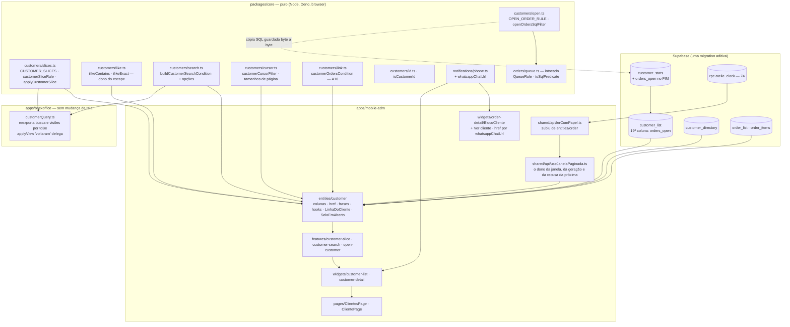

# 76 — mobile-adm: Clientes — Design

**Spec**: `.specs/features/76-mobile-adm-clientes/spec.md` (38 requisitos, `MAC-01`..`MAC-38`) ·
**Contexto**: `context.md` (Q1, Q2b, Q3, A8, A13 respondidas, `AD-060`)
**Status**: **IMPLEMENTADO** (2026-10-24). O portão do Design (§13) foi aprovado (Q1–Q8 respondidas pelo validador em 2026-10-24); `AD-060` e `AD-061` aceitas. Código, migration, probes e prova em navegador entregues nas T01–T33.
dependem de uma resposta estão em §13 com a recomendação; nenhuma bloqueia as Tasks, porque cada uma
tem uma saída padrão escrita.
**Escopo**: Large — 38 requisitos, cinco camadas (`supabase/migrations` — **uma** migration aditiva —,
`packages/core` — um módulo novo e um acréscimo —, `apps/backoffice` (delegação, sem mudança de tela),
`apps/mobile-adm`, guardas em três suítes).
**Decisões ativas respeitadas**: `AD-012` (tipo à mão é afirmação ⇒ probe), `AD-017` (migration aplicada
é imutável ⇒ a `76` só acrescenta), `AD-033` (qual camada abaixo), `AD-055` (a régua de "pago"),
`AD-056` (o programa; toda regra que o app lê e o painel já tem sobe para `core`), `AD-057`, `AD-058`
(`lerComPapel`), `AD-059` (só um escritor — a `76` não escreve), `AD-060` (as cinco respostas do
Specify). **Decisão nova proposta**: `AD-061` (§11) — o `ilike` com dado do usuário tem dono único em
`core`, e a janela paginada tem dono único no app. Registrada em `.specs/STATE.md` junto com este
arquivo.

**Código e banco lidos antes de escrever** (além do que a spec lista): `core/orders/{queue,views,list,
search,index}.ts` (`QueueRule`, `toSqlPredicate`, `applyOrderSlice`, `cursorFilter`, `isOrderId`,
`buildOrderSearchCondition`), `core/paging/pageMath.ts` (`escapeSearchTerm` troca só `( ) ,`),
`core/notifications/phone.ts`, `core/stats/labels.ts` (`relativeAge`, por **duração**), o
`customerQuery.ts`, o `useAdminCustomerList.ts` e o `useAdminCustomer.ts` do painel, as migrations `34`
e `35` (`customer_directory`, `customer_stats`, `customer_list`); no app: `entities/order/api/
{lerComPapel,useListaDePedidos,usePedido}.ts`, `entities/order/{model/{linha,pedidosHref}.ts,ui/
{LinhaDoPedido,SituacaoDoPedido}.tsx}`, `widgets/order-list`, `widgets/order-detail/ui/BlocoCliente.tsx`,
`features/{order-search,order-slice,access-check}`, `pages/{PedidosPage,PedidoPage,ClientesPage}.tsx`,
`app/App.tsx`, `app/layout/MobileLayout.tsx`, `widgets/tab-bar`, `shared/lib/{useTermoDaEntrada,
useRolagemRestaurada,useTecladoVirtual}.ts`, `shared/ui/{leitura,campo,Selo}.tsx`, os guardas
`leituraSoComPapel`, `abasSaoAsRotas`, `rotasSobGuarda`; o `tasks.md` da `75` (molde de formato).
**Banco local lido** (`baseline.md`): 48 pessoas, 4 com `last_activity_at` nulo, nenhum empate de data,
54 pedidos, 18 pessoas com pedido em aberto pela Q2b, 3 que compraram mais de uma vez. **Probe do
PostgREST feito na abertura** (tabela em `baseline.md`): o `ilike` entre aspas aceita `\_` como literal;
o cursor com nulos monta e executa.
**Lições**: nenhuma *confirmed* no arquivo; aplicadas como cautela as candidatas `L-030`, `L-033` (uma
régua por comando), `L-034` (token exato), `L-050` (o passo do meio), `L-055` (o dublê tem de reproduzir
os eventos do client real), `L-057` (re-entrada), `L-060` (exclusividade), `L-063` (estados exclusivos);
e as memórias "teste não monta a árvore que prova", "amostra que filtra o defeito para fora", "dublê que
não enxerga torna a regra inauditável".

---

## 1. Architecture Overview



**A ideia em uma frase**: "quem é uma cliente em aberto, quem voltou, como se busca, como se pagina e
como se liga um pedido a uma pessoa" são **regra pura** em `core/customers`, lida pelo app **e** pelo
painel; "em aberto" ganha uma coluna no banco cujo SQL é gerado do mesmo dado (`toSqlPredicate`) e
guardado byte a byte; o app só lê — sempre pareado com a RPC do papel (`lerComPapel`) —, desenha, e
trata erro de leitura como falha, nunca como zero.

### 1.1 Abordagem para a paginação por cursor (Large ⇒ exploração)

As três entregam o mesmo escopo (lista de 25 em 25 sem repetir nem pular, releitura da janela, falha da
próxima página sem apagar a tela, recusa que vence). **Recomendação: A** — a janela vira um hook
genérico em `shared/api`, e `useListaDePedidos` passa a usá-lo **sem asserção tocada**. Pendente de
confirmação (§13, Q1); a saída padrão se for recusada é B, com o custo escrito.

| | Abordagem | Prós | Contras |
| --- | --- | --- | --- |
| **A** | **`useJanelaPaginada` em `shared/api`**: recebe `chave`, `consultar(limite, cursor, contar)`, `cursorDe(linha)`, `pagina` e devolve o mesmo objeto de hoje (`...query`, `carregarMais`, `carregandoMais`, `proximaFalhou`, `erroDaProxima`). Pedidos e clientes são duas **chamadas** com a consulta injetada | a máquina (a geração `E3`, a recusa da próxima presa ao `dataUpdatedAt` — `D2` da rodada 4 da `74`, a releitura da janela inteira) tem **uma escrita**: foram quatro rodadas de verificação para acertá-la, e uma segunda cópia herdaria os defeitos já consertados **e** os que ainda não foram achados; o dublê e os testes da `74` seguem de rede de segurança | mexe num arquivo que a `74` fechou; se a extração mudar um comportamento, a suíte da `74` acusa — e é esse o ponto |
| B | cópia de `useListaDePedidos` para `useListaDeClientes`, trocando a consulta | nenhum toque no hook da `74` | **o defeito 01 do tamanho de 100 linhas de concorrência**: `geracoes`, `recusasDaProxima`, `tamanhoDaJanela`, o `finally` do `emVoo`. Cada correção futura precisa de duas edições; nenhum teste veria uma só |
| C | `useInfiniteQuery` do React Query | idiomático, menos código nosso | a releitura de uma janela inteira, a geração, a recusa presa ao `dataUpdatedAt` e a descartada-por-`id` teriam de ser reescritas por cima dele; a `74` descartou esta abordagem (A-janela) por isso. **Não verificado** aqui se `refetch` de `useInfiniteQuery` repagina em ordem estável — afirmar seria `AD-012` |

### 1.2 Abordagem para "Ver cliente" (A11 da spec, decidida; registrada)

O id da convidada é `md5(lower(email))::uuid`, derivado **no banco**. Reescrevê-lo em JS seria a segunda
escrita da regra do id. O botão **lê**: `customer_directory`, `ilike` exato do e-mail (via `ilikeExact`,
§3.1), pareado com `lerComPapel`. Com A18 (duas contas com o mesmo e-mail) a linha escolhida é a **com
conta** (`has_account` desc), depois a mais antiga (`created_at` asc), `limit 1` — determinística, e a
mesma que a Adri veria primeiro no painel.

---

## 2. Code Reuse Analysis

### 2.1 Reaproveitado sem mudança

| O quê | Onde | Uso na `76` |
| --- | --- | --- |
| `toSqlPredicate`, `QueueRule`, `QueueCond` | `core/orders/queue.ts` | `OPEN_ORDER_RULE` é uma `QueueRule` (as colunas `status` e `payment_status` já estão em `QueueColumn`); o SQL da migration sai de `toSqlPredicate(OPEN_ORDER_RULE, 'v')`. **Nenhum tradutor novo** |
| `cursorFilter(cursor, 'desc')` | `core/orders/list.ts` | "Ver mais pedidos" da ficha (`created_at`, `id`, as strings do servidor — R1 da `74`) |
| `isOrderId` | `core/orders/list.ts` | `isCustomerId` é o **mesmo** predicado (uuid), reexportado com o nome do assunto (`toBe`) |
| `escapeSearchTerm` | `core/paging/pageMath.ts` | continua o saneamento do painel; o app não o usa (entre aspas, `( ) ,` valem como texto) |
| `normalizeBrPhone`, `maskPhone` | `core/notifications`, `core/validators` | telefone mascarado e portão do WhatsApp |
| `formatOrderNumber`, `orderSituation(…, 'atelie')` | `core/orders` | número e situação do pedido na ficha |
| `formatPriceWhole`, `formatPrice` | `core/formatters` | total da linha (inteiro) e o ticket (`R$ 80,00`) |
| `relativeAge`, `monthName`, `storeHour` | `core/stats` | "há 12 dias" por **duração** contra o `lido_em` do servidor; mês do "cliente desde"; "Atualizado às" |
| `calendarParts` | `core/orders/situation.ts` | mês e ano do "cliente desde", no fuso da loja |
| `isAccessDenied`, `retryUnlessDenied` | `core/hooks/useStoreOverview.ts` | "é recusa?" e o `retry` das leituras |
| `lerComPapel`, `conferirPapel` | `entities/order/api/lerComPapel.ts` | **sobem** para `shared/api` (§3.5, T11) |
| `useRecusaDePapel` | `features/access-check` | a vigia: lista, ficha e "Ver cliente" entram nos mesmos erros |
| `Selo`, `SituacaoDoPedido` | `shared/ui`, `entities/order/ui` | o selo "Em aberto" (tom `progress`) e a situação do pedido na ficha |
| `PullToRefresh`, `LinhaDeFrescor`, `FalhaDoBloco`, `Traco` | `shared/ui` | puxar, "Atualizado às", falha com "Tentar de novo", esqueleto |
| `useRolagemRestaurada`, `useTermoDaEntrada`, `useDebounce`, `useTecladoVirtual` | `shared/lib` | posição, busca em memória, 300 ms, folga do teclado |
| `CAMPO`, `BOTAO_SECUNDARIO`, `AVISO_DE_ERRO` | `shared/ui/campo.ts` | o campo de busca, "Ver cliente", o erro na linha |
| `shared/config/whatsapp.ts` | cores | "Conversar no WhatsApp" |
| arnês: `fakeSupabase.ts`, `clientReal.ts`, `montarApp.tsx` | `apps/mobile-adm/src/test` | estendidos (§8), nunca copiados |

### 2.2 O que SOBE para `packages/core`, byte a byte (`MAC-23`, `MAC-25`)

| Símbolo | De (painel) | Para | O painel passa a |
| --- | --- | --- | --- |
| `CUSTOMER_SEARCH_COLUMNS` (`name`, `email`, `phone`, `cpf`), `buildCustomerSearchCondition(search)` | `customerQuery.ts` | `core/customers/search.ts`, com um **segundo parâmetro opcional** (§3.1) cujo default é a saída de hoje | `export { … } from '@estrelinha/core/customers'` no mesmo arquivo; `toBe` |
| `CUSTOMER_SEARCH_DEBOUNCE_MS` (300) | idem | `core/customers/search.ts` | reexporta; `toBe` |
| o predicado de `voltaram` (`orders_paid ≥ 2`) | `applyView`, `case 'voltaram'` | `core/customers/slices.ts` (`RETURNING_CUSTOMER_RULE`) | `applyView` chama `applyCustomerSlice(builder, 'recorrentes')` **só** nesse `case`; os outros cinco `case` ficam como estão |
| `CUSTOMER_VIEWS` (as 6 visões) | idem | **não sobe** — fica no painel byte a byte. O app tem três recortes próprios (`CUSTOMER_SLICES`); duas listas com rótulos diferentes não são o mesmo dado | — |

`CUSTOMER_VIEWS` fica de fora de propósito (o spec diz "byte a byte e reexportada por `toBe`"; ela
**já** é do painel e não tem segundo consumidor). Só `voltaram` tem dois leitores, e é ela que sobe.
`SPEC_DEVIATION` leve de redação, não de comportamento: a spec (MAC-23) lê "reexportada por `toBe`"
como exigência sobre a lista, e a lista simplesmente não se mexe. A suíte do painel prova.

### 2.3 O que NASCE em `packages/core`

`core/customers/` (todo especificador relativo com `.ts`; **sem import de pacote**; `purity.test.ts` e
`denoReach.test.ts` cobram), subpath novo `"./customers": "./src/customers/index.ts"` no `exports`:

| Arquivo | Símbolo | Responde |
| --- | --- | --- |
| `slices.ts` | `CustomerSliceId` (`'todas' \| 'recorrentes' \| 'em-aberto'`), `CUSTOMER_SLICES` (id + rótulo, na ordem do protótipo), `DEFAULT_CUSTOMER_SLICE`, `isCustomerSliceId`, `CustomerRule` (`{ col, min }`), `customerSliceRule(id)`, `applyCustomerSlice(builder, id)` | "qual recorte é este e que filtro ele é?" — o **único** tradutor |
| `open.ts` | `OPEN_ORDER_RULE: QueueRule`, `openOrdersSqlFilter(alias)` | "o que é um pedido em aberto?" (Q2b) e a **forma SQL** que a migration carrega |
| `like.ts` | `escapeLike`, `ilikeContains(valor)`, `ilikeExact(valor)` | o **dono** do escape de `ilike` (`\`, `%`, `_`) e das aspas do PostgREST (`\`, `"`) |
| `search.ts` | `CUSTOMER_SEARCH_COLUMNS`, `buildCustomerSearchCondition(search, opts?)`, `APP_CUSTOMER_SEARCH`, `buildAppCustomerSearch(search)`, `CUSTOMER_SEARCH_DEBOUNCE_MS` | a busca do painel (inalterada) e a do app |
| `cursor.ts` | `CustomerCursor`, `customerCursorFilter(cursor)`, `CUSTOMER_PAGE_SIZE = 25`, `CUSTOMER_ORDERS_PAGE_SIZE = 20` | a página seguinte da lista, com nulo e empate |
| `link.ts` | `customerOrdersCondition(id, email)`, `directoryEmailCondition(email)` | A10: "estes pedidos são desta pessoa" — `customer_id` **ou** e-mail exato, sem curinga; e a pessoa do diretório por e-mail |
| `id.ts` | `isCustomerId` | "este endereço pode ser uma cliente?" (uuid) |
| `index.ts` | barril | — |

E em `core/notifications/phone.ts` (já alcançável pelo Deno, sem import): `whatsappChatUrl(telefone)`.

### 2.4 O que NASCE no app

Ver §3.5–3.9. Nada disto é regra: é formato (colunas, tipos), endereço, frase, e composição.

---

## 3. Components

### 3.1 `core/customers` — as regras

**`slices.ts`**

```ts
export type CustomerSliceId = 'todas' | 'recorrentes' | 'em-aberto'
export const CUSTOMER_SLICES: readonly { id: CustomerSliceId; label: string }[] = [
  { id: 'todas', label: 'Todas' },
  { id: 'recorrentes', label: 'Compraram mais de uma vez' },
  { id: 'em-aberto', label: 'Com pedido em aberto' },
]
export interface CustomerRule { col: 'orders_paid' | 'orders_open'; min: number }
export const RETURNING_CUSTOMER_RULE: CustomerRule = { col: 'orders_paid', min: 2 }       // = "Voltaram" do painel
export const OPEN_CUSTOMER_RULE: CustomerRule = { col: 'orders_open', min: 1 }
export const customerSliceRule = (id: CustomerSliceId): CustomerRule | null => …           // 'todas' ⇒ null
export const applyCustomerSlice = <B extends { gte(col: string, v: number): B }>(b: B, id: CustomerSliceId): B => …
```

O builder é **estrutural** (`gte` só), como `SliceBuilder` da `74`: este diretório não importa o
supabase-js. O rótulo "Compraram mais de uma vez" é do protótipo e **diferente** de "Voltaram" do
painel: o rótulo não é regra, o predicado é, e é um só (`MAC-08`).

**`open.ts`** — "em aberto" como **dado**, no molde de `QUEUE_BLOCKS`:

```ts
export const OPEN_ORDER_STATUSES = ['pending', 'paid', 'separating', 'shipped'] as const
export const OPEN_ORDER_RULE: QueueRule = [
  { col: 'payment_status', op: 'eq', value: 'approved' },
  { col: 'status', op: 'in', value: OPEN_ORDER_STATUSES },
]
/** `count(v.order_id) filter (where v.payment_status = 'approved' and v.status in (…))` — a forma que a migration carrega. */
export const openOrdersSqlFilter = (alias = 'v'): string =>
  `count(${alias}.order_id) filter (where ${toSqlPredicate(OPEN_ORDER_RULE, alias)})`
```

Importa `type QueueRule` e `toSqlPredicate` de `../orders/queue.ts` — arquivo-folha, sem import, já
alcançável pelo Deno. **Por que `approved` é obrigatório** (Q2b, medido): 9 dos 54 pedidos locais estão
`pending` com pagamento `expired`/`rejected`/`cancelled` e ficam `pending` para sempre; sem o par, quem
teve um Pix expirado seria "Em aberto" indefinidamente, dizendo à Adri que há peça em andamento que não
existe. O Pix ainda aguardando também fica fora (`payment_status = 'pending'`), pelo mesmo motivo que
o painel o tira de "Precisa de ação".

**`like.ts`** — o dono do escape (`AD-061`):

```ts
/** Só o escape de LIKE: `\` `%` `_`. */
export const escapeLike = (valor: string): string => valor.replace(/[\\%_]/g, '\\$&')
/** O valor de um filtro do PostgREST entre aspas: `\` e `"` escapados. */
const quote = (valor: string): string => `"${valor.replace(/[\\"]/g, '\\$&')}"`
export const ilikeContains = (valor: string): string => quote(`%${escapeLike(valor)}%`)
export const ilikeExact = (valor: string): string => quote(escapeLike(valor))
```

O valor sai **sempre entre aspas**: dentro delas `( ) , .` são texto, então o saneamento por espaço
(`escapeSearchTerm`) não é necessário no app — e é ele que fazia `%`, `_` e `\` serem curinga ou perderem
o sentido. A ordem importa e é testada: o LIKE escapa primeiro, o PostgREST escapa o resultado (porque o
`\` do LIKE também é um `\` para o parser do filtro). **`*` é o ponto aberto**: o PostgREST trata `*`
como `%` nos operadores `like`/`ilike`; o probe da T02 decide, com fixtura que **contém** um `*`, se o
`\*` chega como literal. Se não chegar, `escapeLike` troca `*` por espaço, e o caso fica nos testes com a
razão escrita. Idem `"` e `\` literais no nome (fixtura).

**`search.ts`**

```ts
export const CUSTOMER_SEARCH_COLUMNS = ['name', 'email', 'phone', 'cpf'] as const                 // byte a byte
export interface CustomerSearchOptions {
  columns?: readonly string[]
  /** Valor entre aspas, com `\` `%` `_` escapados (`like.ts`). Sem isto: o comportamento de hoje do painel. */
  literal?: boolean
  /** Termo "com cara de telefone" ⇒ acrescenta `phone` por dígitos. */
  phoneDigits?: boolean
}
export const buildCustomerSearchCondition = (search: string, opts?: CustomerSearchOptions): string | null
export const APP_CUSTOMER_SEARCH: CustomerSearchOptions = { columns: ['name', 'email', 'phone'], literal: true, phoneDigits: true }
export const buildAppCustomerSearch = (search: string) => buildCustomerSearchCondition(search, APP_CUSTOMER_SEARCH)
```

- **Sem `opts`, a saída é a de hoje, caractere a caractere** (`escapeSearchTerm`, as quatro colunas, sem
  aspas): `customerQuery.test.ts` do painel passa sem asserção tocada, e um caso novo compara a saída com
  uma cópia literal da função antiga.
- **`phoneDigits`**: o termo tem "cara de telefone" quando só tem dígitos, espaço, `+`, `-`, `.`, `(`, `)`
  **e** ao menos um dígito (`/^[\d\s().+-]+$/`). Só então entra `phone.ilike."%<dígitos>%"` **a mais**, além
  das colunas pelo termo literal — assim "(51) 99812-4471" acha o telefone gravado como `51998124471`, e
  "joao2" **não** vira busca por telefone `%2%` (falso positivo em massa). Com `+55`/`55` na frente e 12+
  dígitos, os dois primeiros saem (o telefone é gravado sem o DDI, `ADR-05`).
- Termo vazio ou só de espaços ⇒ `null` ("sem busca", `MAC-06`).

**`cursor.ts`** — a página seguinte de uma lista ordenada por `last_activity_at desc nulls last, id asc`:

```ts
export interface CustomerCursor { last_activity_at: string | null; id: string }       // as strings do servidor (R1)
export const customerCursorFilter = (c: CustomerCursor): string => {
  const id = c.id
  if (c.last_activity_at === null) return `and(last_activity_at.is.null,id.gt.${id})`
  const t = `"${c.last_activity_at}"`
  return `last_activity_at.lt.${t},and(last_activity_at.eq.${t},id.gt.${id}),last_activity_at.is.null`
}
```

Três ramos quando o cursor tem data: **mais antigo**, **mesma data com `id` maior** (o desempate
estável), e **todos os nulos** (que vêm depois de toda data com `nulls last`). Com o cursor já nos nulos,
só o desempate por `id`. O `id` é um uuid que **o servidor devolveu**, nunca digitado — mesmo assim o
guarda `semFiltroMontadoAMao` (§7) exige que ele passe por `isCustomerId` antes de entrar numa string de
`or()`. O probe da T02 prova os quatro desfechos com fixtura (empate de data, dois nulos, data nula no
corte, página cheia exata).

**`link.ts`** — A10:

```ts
/** `email.ilike."<exato>"` — a pessoa de `customer_directory` por e-mail ("Ver cliente"). */
export const directoryEmailCondition = (email: string): string => `email.ilike.${ilikeExact(email)}`
export const customerOrdersCondition = (id: string, email: string): string =>
  `customer_id.eq.${requireCustomerId(id)},customer_email.ilike.${ilikeExact(email)}`
```

`requireCustomerId` lança para id que não é uuid (a string vai para um `or()`: dado externo nunca entra
sem validar). O e-mail exato é **sem curinga** (`VROSA_RJ` não puxa `VROSAXRJ`) e **sem caixa** (o banco
liga por `lower(email)`; `ilike` sem `%` é a comparação exata insensível a caixa).

> **O painel tem o defeito que A10 evita** (`customer_email.ilike.<email cru>` em `useAdminCustomer.ts`):
> `_` e `%` valem como curinga e a ficha de uma pessoa pode puxar o pedido de outra. **Não é consertado
> aqui** (a spec proíbe tocar o comportamento do painel e "nenhuma asserção tocada"); entra em
> `BACKLOG.md` como **`BL-052`** na T33, com a recomendação de o painel passar a chamar
> `customerOrdersCondition`.

### 3.2 A migration — `supabase/migrations/20261025120000_76-clientes-em-aberto.sql`

```sql
-- customer_stats: orders_open no FIM (CREATE OR REPLACE VIEW só aceita coluna nova ao final)
CREATE OR REPLACE VIEW public.customer_stats WITH (security_invoker = true) AS
WITH vinculo AS ( … igual à migration 34 … ), materiais AS ( … igual … )
SELECT … (as 11 colunas de hoje, na ordem) …,
  count(v.order_id) filter (where v.payment_status = 'approved' and v.status in ('pending','paid','separating','shipped'))
                                                                   AS orders_open
FROM vinculo v LEFT JOIN materiais m ON m.customer_id = v.customer_id GROUP BY v.customer_id, m.material_kinds;

-- customer_list: a 19ª coluna, depois de same_email_count
CREATE OR REPLACE VIEW public.customer_list WITH (security_invoker = true) AS
SELECT … (as 18 colunas de hoje, na ordem) …, coalesce(s.orders_open, 0) AS orders_open
FROM public.customer_directory d LEFT JOIN public.customer_stats s ON s.customer_id = d.id;
```

- **Cópia, não reescrita**: o corpo das duas views é o da migration `34` com a coluna acrescentada. A
  T08 copia do arquivo, não da memória, e o guarda (§7, G11) prova que as 18 colunas anteriores estão
  na mesma ordem e com o mesmo texto.
- **O predicado SQL é `openOrdersSqlFilter('v')`**, e o guarda compara **a string byte a byte** com o que
  a migration contém, e que o `OPEN_ORDER_RULE` de `core` é a fonte (molde `filaComDonoUnico.test.ts`).
  O `v.` já existe: `vinculo` expõe `payment_status` e `status`. Para a pessoa sem pedido nenhum, o
  `LEFT JOIN` dá `v.order_id` nulo e `count(v.order_id)` dá 0 — **sem** `coalesce` na view de stats;
  `customer_list` usa `coalesce(s.orders_open, 0)` como faz com `orders_paid`.
- **`security_invoker = true` preservado** nas duas; **nenhum `grant`** (as colunas herdam a policy das
  tabelas, como a `34` e a `35` fizeram); **nenhuma escrita de dado**; `COMMENT ON VIEW` atualizado com a
  frase "orders_open: pedido pago e ainda em andamento (Q2b)".
- **Ordem de publicação: migration → bundle** (`CLAUDE.md` raiz). Com o bundle antes da migration o
  `select` da lista pede `orders_open` e o PostgREST responde `42703`: a lista cai em "Não consegui
  carregar as clientes". O painel não é afetado em nenhuma ordem (`select('*')`).
- **Aplicada só no banco local** (`supabase migration up` na faixa 54440–54449; nunca `db push`).
- **Desempenho (R4)**: o `vinculo` tem `ON o.customer_id = d.id OR lower(o.customer_email) = lower(d.email)`;
  é um laço aninhado por construção, **herdado** da `34` e já pago pelo painel. A `76` acrescenta um
  `FILTER` ao mesmo agrupamento (custo desprezível), mas **ordenar por `last_activity_at` obriga o
  servidor a calcular todas as pessoas** antes de devolver 25. A T10 mede com 3.000 pessoas e 6.000
  pedidos de fixtura numa transação desfeita e registra o tempo; acima de 1 s abre uma entrada no
  `BACKLOG.md` (a saída, se vier, é índice funcional em `lower(orders.customer_email)`, fora desta
  feature).

### 3.3 `whatsappChatUrl` (`MAC-26`)

```ts
// core/notifications/phone.ts, ao lado de normalizeBrPhone — sem import novo
export const whatsappChatUrl = (telefone: string | null | undefined): string | null => {
  const numero = normalizeBrPhone(telefone)
  return numero ? `https://wa.me/${numero}` : null
}
```

`BlocoCliente` passa a `href={whatsappChatUrl(pedido.customer_phone)}` e **continua** chamando
`normalizeBrPhone` para o telefone mascarado (`maskPhone(numero.slice(2))`). Sem texto, sem `?text=`: a
mensagem pronta é a cobrança do material (`75`) e é do pedido. `chargeMaterialUrl` fica intocado (sobe
byte a byte, o painel o reexporta por `toBe`). O teste de **saída idêntica** monta o `BlocoCliente`
real com cinco telefones (`+55 (51) 99812-4471`, `5551998124471`, `(51) 3012-3456`, `123`, `null`) e
compara o `href` com uma cópia literal do `whatsappDe` antigo (`https://wa.me/${numero}`), lida do
disco antes de o arquivo mudar (hash em `baseline.md`).

### 3.4 Painel — delegação (T07)

`customerQuery.ts` troca três declarações por reexportação (`export { … } from '@estrelinha/core/customers'`)
e `applyView` chama `applyCustomerSlice(builder, 'recorrentes')` no `case 'voltaram'`. **Nenhuma outra
linha do painel muda.** O gate é a suíte inteira do painel (3696/212) verde, a contagem de arquivos igual,
e `git diff` dos testes antigos **vazio**. O guarda novo `regrasDeClienteNoCore.test.ts` (`app/__tests__`
do painel) prova por `toBe` as três reexportações e que `voltaram` e o recorte `recorrentes` produzem a
**mesma** chamada ao builder (dublê que registra a cadeia).

### 3.5 App — `shared/api`

**`lerComPapel.ts`** sobe de `entities/order/api` (A5). Conteúdo **idêntico**, só muda o caminho.
`entities/order` e `entities/customer` o importam de `@/shared/api/lerComPapel` — um import lateral
`entities/customer → entities/order` é o que o `CLAUDE.md` raiz proíbe. Os testes dele
(`lerComPapel.test.ts`, `lerComPapelComClientReal.test.ts`) acompanham; os guardas que citam o caminho
(`leituraSoComPapel`, `escritaSoPelaPorta`, `regraDePedidoSoNoCore`, `marcacaoSoPorAcao` da loja) ganham
o caminho novo **sem mudar régua nem âncora** — a igualdade de importadores do client (hoje 4) passa a
**8**: `shared/api/lerComPapel.ts`, os dois hooks de pedido, `gravarAcao.ts` e os **quatro** de cliente
(`useListaDeClientes`, `useCliente`, `usePedidosDoCliente`, `buscarClientePorEmail` — ver §3.6). O
`entities/order/index.ts` deixa de exportar `conferirPapel`; `gravarAcao.ts` o importa de `shared/api`.

**`useJanelaPaginada.ts`** (abordagem A, §1.1, T12):

```ts
useJanelaPaginada<L extends { id: string }, C>({
  chave: readonly unknown[],                     // ['atelie-pedidos', slice, termo] · ['atelie-clientes', slice, termo]
  tamanhoDaPagina: number,                       // 25 · 25
  consultar: (p: { limite: number; cursor?: C; contar: boolean }) => Promise<{ linhas: L[]; count: number | null }>,
  cursorDe: (ultima: L) => C,
  desduplicar?: boolean,                         // clientes: descarta `id` repetido ao anexar (MAC-05)
})
```

Devolve **o mesmo objeto** que `useListaDePedidos` devolve hoje (`...query`, `carregarMais`,
`carregandoMais`, `proximaFalhou`, `erroDaProxima`). Dentro dele, **sem mudar uma linha de
comportamento**: `lerComPapel` em torno de cada consulta, `staleTime: 0`, `refetchOnWindowFocus`,
`retry: retryUnlessDenied`, a geração por chave (`E3`), a recusa da próxima presa ao `dataUpdatedAt`
(`D2`), o `tamanhoDaJanela` e o `emVoo`. `useListaDePedidos` vira ~25 linhas que passam a consulta e o
`cursorDe`. Os exports de hoje (`LISTA_DE_PEDIDOS_KEY`, `chaveDaLista`, `tamanhoDaJanela`) ficam onde
estão. **O gate da T12 é a suíte inteira do app verde, com o diff de testes vazio.** `desduplicar` é o
único acréscimo de comportamento e é inerte para pedidos (`false`): a T12 prova isso com o teste de
pedidos e a T15 com o de clientes.

**`shared/lib/useSentinela.ts`** sobe de `widgets/order-list/model` (dois widgets precisam do observador
de interseção; nenhum pode importar o do outro) e **`shared/ui/CampoDeBusca.tsx`** é extraído de
`BuscaDePedidos` (debounce, `inicial` não reemitido, `role="search"`, rótulo `sr-only`, 48 px): o
`BuscaDePedidos` vira um invólucro de 8 linhas com **o mesmo id, rótulo e placeholder**, e seu teste
passa sem uma asserção tocada. As duas escritas do debounce seriam o defeito 01 em miniatura.

### 3.6 App — `entities/customer`

```
entities/customer/
  api/    useListaDeClientes.ts   useCliente.ts   usePedidosDoCliente.ts   buscarClientePorEmail.ts
  model/  linha.ts  clientesHref.ts  identidade.ts  frases.ts
  ui/     LinhaDoCliente.tsx  SeloEmAberto.tsx  Inicial.tsx
  index.ts
```

**`model/linha.ts`** — só formato (nenhuma regra), cada lista de colunas **nomeada uma a uma** e igual ao
`select` por igualdade de chaves com o probe (`AD-012`):

| Constante | Colunas | Lê |
| --- | --- | --- |
| `COLUNAS_DA_LISTA` | `id, name, email, phone, created_at, orders_paid, total_spent, last_order_at, last_activity_at, orders_open` | `customer_list` |
| `COLUNAS_DA_FICHA` | `id, name, email, phone, created_at, orders_paid, orders_total, total_spent, avg_ticket, orders_open` | `customer_list` (`.eq('id').maybeSingle()`) |
| `COLUNAS_DO_PEDIDO` | `id, order_number, status, payment_status, shipping_service_id, material_status, total, created_at` | `order_list` (a view já traz `customer_id` e `customer_email` para o vínculo) |
| `COLUNAS_DOS_ITENS` | `order_id, product_name` | `order_items` (`.in('order_id', ids)`) |
| `COLUNAS_DA_CIDADE` | `address_city, address_state` | `order_list`, `.not('address_city','is',null)` |
| `COLUNAS_DO_ACHADO` | `id` | `customer_directory` ("Ver cliente") |

**Nenhuma** destas contém `cpf`, `material_kinds`, `orders_with_material`, `same_email_count`,
`address_street…zip`, `customer_document`, `customer_phone`, `notes`, nem coluna `nuvemshop_*`
(`semDadoSensivelDeClienteNoApp`, §7). O que a lista **não** precisa não é pedido: quanto menos coluna,
menos o que vazar no aparelho. Tipos: `LinhaDeCliente`, `FichaDeCliente` (a linha + `lido_em`),
`PedidoDaFicha` (`order_list` + `item: string | null`), `JanelaDeClientes = { linhas, total, lido_em,
fim }` (a forma de `JanelaDaLista`).

**`model/clientesHref.ts`** — o **dono do endereço** da aba, molde de `pedidosHref.ts`:

```ts
export const CLIENTES_PATH = '/clientes'
const PARAM_RECORTE = 'recorte'
export const clientesHref = (id: CustomerSliceId): string        // 'todas' ⇒ '/clientes' (sem query); lança para fora do vocabulário
export const lerRecorteDeClientes = (search: string): CustomerSliceId | null
export const recorteDeClientesDoEndereco = (search: string): CustomerSliceId   // ?? DEFAULT_CUSTOMER_SLICE
export const clienteHref = (id: string): string                  // '/clientes/<uuid>'; lança para id que não é uuid
```

O vocabulário vem de `CUSTOMER_SLICES` (`core`); `enderecoDeClientesComDonoUnico.test.ts` recusa o nome
`recorte` como parâmetro, o `useSearchParams` e a montagem do endereço em qualquer outro arquivo do app.
**`todas` não escreve `?recorte=todas`**: o endereço limpo é o padrão, e o chip "Todas" volta a
`/clientes` por substituição.

**`model/identidade.ts`** — `nomeDoCliente(c)` (nome aparado, ou o e-mail se vazio/só espaços),
`inicialDoCliente(c)` (primeira letra **do que `nomeDoCliente` devolve**, em maiúscula; `?` nunca — o
e-mail sempre existe), `telefoneDoCliente(c)` → `{ mascarado, whatsapp } | null` (um só cálculo para a
lista e a ficha: `normalizeBrPhone` uma vez, `maskPhone(n.slice(2))`, `whatsappChatUrl(c.phone)`).

**`model/frases.ts`** — **todas** as frases fixas e as funções de frase, num arquivo só (`MAC-35`):

| Símbolo | Texto (singular/plural nos dois sentidos) |
| --- | --- |
| `contagemDaLista(total, comFiltro)` | `1 cliente · das atividades mais recentes para as mais antigas` / `12 clientes · …`; sem filtro, mesma frase |
| `subtituloDaLinha(c, lidoEm)` | `1 compra · última há 3 dias` / `4 compras · última há 12 dias` / `Sem compra paga ainda` (A8: N = `orders_paid`, "última" = `last_order_at` por `relativeAge`) |
| `VAZIO_SEM_CLIENTE`, `VAZIO_EM_ABERTO`, `vazioDaBusca(termo)` | `Ainda não há clientes.`, `Ninguém com pedido em aberto agora.`, `Não achei ninguém com “<termo>”.` (aspas curvas; o termo **não** é o que alimenta nenhuma URL) |
| `FALHA_DA_LISTA`, `FALHA_DOS_PEDIDOS`, `NAO_ENCONTREI_CLIENTE`, `FALHA_AO_ABRIR_CLIENTE` | `Não consegui carregar as clientes.`, `Não consegui carregar os pedidos.`, `Não encontrei esta cliente.`, `Não consegui abrir agora. Tente de novo.` |
| `clienteDesde(c)` | `<cidade>/<UF> · cliente desde outubro 2026`, ou só `cliente desde outubro 2026` (sem cidade e sem separador) |
| `LEGENDA_DOS_NUMEROS` | `Contam só os pedidos pagos.` (A9) |
| `tituloDosPedidos(total)` | `Pedidos · 5`; `Nenhum pedido ainda.` com 0 |
| `rotuloDoPedido(p)` | `#0244 · Pingente Gota` (`formatOrderNumber`, 1º item; sem item: só o número) |

Nenhuma frase contém emoji, `!`, "VIP/melhores/top", urgência nem o nome do material (`tomMemorial…`, §7).
**O gênero**: "a cliente" no feminino, como o resto do repositório. **O termo da busca vai na frase vazia
e na memória do app, nunca no endereço** (`MAC-28`).

**`api/useListaDeClientes.ts`**: `useJanelaPaginada` com `chave = ['atelie-clientes', slice, termo.trim()]`
e a consulta, **a única cadeia de leitura da lista**:

```
supabase.from('customer_list').select(COLUNAS_DA_LISTA, { count: 'exact' })   // sem contar na página seguinte
  → applyCustomerSlice(q, slice)
  → buscaDoApp ? .or(buildAppCustomerSearch(termo)) : q
  → cursor ? .or(customerCursorFilter(cursor)) : q
  → .order('last_activity_at', { ascending: false, nullsFirst: false })
  → .order('id', { ascending: true })
  → .limit(limite)
```

O teste compara a cadeia registrada pelo dublê **por igualdade** com a que `core` produz (`L-060`); nenhum
filtro escrito aqui. `desduplicar: true`: ao anexar a página seguinte, o `id` que já está na janela é
**descartado** (a cliente que mudou de posição entre duas leituras — `MAC-05`). Saída: `JanelaDeClientes`.

**`api/useCliente.ts`** — o **cabeçalho**, **uma** `queryFn`, **uma** confirmação de papel (molde de
`usePedido`, A22):

1. `isCustomerId(id)` falso ⇒ `{ cliente: null }` **sem rede e sem RPC** (`MAC-14`);
2. `lerComPapel(async () => …)` com duas leituras em paralelo, cada uma na forma `{ data, error }` que não
   lança (`ler()` de `usePedido`): o cabeçalho (`customer_list`, `.eq('id', id).maybeSingle()`) e a
   **cidade** (A6: `order_list`, `.or(customerOrdersCondition(id, email))`, `.not('address_city', 'is',
   null)`, `created_at desc`, `limit 1` — o e-mail vem do cabeçalho, então a cidade é a **segunda onda**,
   depois do cabeçalho);
3. erro **no cabeçalho** ⇒ a query falha (a ficha inteira em falha com "Tentar de novo"); cabeçalho `null`
   ⇒ `{ cliente: null }` ("Não encontrei esta cliente."); erro **na cidade** ⇒ a cidade é omitida;
4. a recusa da RPC vence tudo: nada sai, nem o do cache (`MAC-11`).

**`api/usePedidosDoCliente.ts`** — os **pedidos**, uma segunda query com `useJanelaPaginada` (a mesma
máquina da lista, sem segunda escrita): `chave = ['atelie-cliente-pedidos', id]`, `enabled` só com o
cabeçalho lido (o e-mail vem dele), 20 por página (`CUSTOMER_ORDERS_PAGE_SIZE`), `consultar` =
`order_list` com `.or(customerOrdersCondition(id, email))`, o cursor `cursorFilter(…, 'desc')`
(`created_at`, `id`) e `order(created_at desc).order(id desc)`; **dentro do `consultar`**, uma leitura
`order_items` `.in('order_id', ids)` para os nomes (uma por janela, não uma por linha), cuja falha
**não** derruba a janela — as linhas saem sem o item (`MAC-18`). O "Ver mais pedidos" é o `carregarMais`
do hook; a falha da próxima fica **no rodapé do bloco**, com as linhas, e a falha da janela inteira é só
o bloco (`FALHA_DOS_PEDIDOS`): o cabeçalho e o contato continuam na tela (`MAC-22`). As **duas** queries
passam por `lerComPapel`, cada uma com a sua RPC — duas confirmações pequenas em vez de uma máquina
própria de "anexar ao cache da ficha". O `count: 'exact'` da janela é a contagem real dos pedidos desta
pessoa; o título do bloco usa o `orders_total` do **cabeçalho** (`customer_list`), e a divergência entre
os dois é defeito que o probe da T30 acusa — o app **não** a reconcilia na tela (`MAC-19`).

**`api/buscarClientePorEmail.ts`** — "Ver cliente": `lerComPapel(() => supabase.from('customer_directory')
.select('id').or(directoryEmailCondition(email))` — o `core` devolve `email.ilike.<ilikeExact>`, **sem
`%`**, e o app **não** escreve `ilike` — `.order('has_account', { ascending: false }).order('created_at',
{ ascending: true }).limit(1)` → `{ id } | null`. Lança o erro (o supabase-js não rejeita) para a RPC e
para a leitura.

**`ui/LinhaDoCliente.tsx`**: a linha inteira é um `<Link to={clienteHref(id)} state={{ doApp: true }}>`
de 44 px no mínimo, com `aria-label` = `nomeDoCliente`. Conteúdo: `Inicial` (círculo, decorativo), o nome
(`[overflow-wrap:anywhere]`), o subtítulo, o total (`formatPriceWhole(total_spent)`) e, só com
`orders_open ≥ 1`, o `SeloEmAberto`. **Quebra, nunca trunca**: sem `truncate`, sem `whitespace-nowrap`, sem
`shrink-0` no selo ou no total; a coluna do total tem piso em `rem` e a do nome cede (a régua de Últimos
pedidos da `73`).

**`ui/SeloEmAberto.tsx`**: `Selo` do tom `progress` ("em andamento"), texto `Em aberto`. **Nunca** o âmbar
de alerta: pedido em andamento não é alarme.

### 3.7 App — features

- **`features/customer-slice/ui/ChipsDeClientes.tsx`** — três chips de `CUSTOMER_SLICES`, no molde de
  `ChipsDeRecorte` (`aria-pressed`, `min-h-11`, a faixa rola **dentro de si** com `overflow-x-auto min-w-0`
  e a afordância de que há mais — o degradê à direita enquanto houver conteúdo além da dobra). Quem navega
  é a página; o toque só emite o id.
- **`features/customer-search/ui/BuscaDeClientes.tsx`** — invólucro de `CampoDeBusca`: id `busca-de-clientes`,
  rótulo `Buscar cliente`, placeholder `Nome, e-mail ou telefone`. **Enter fecha o teclado** (`blur`).
- **`features/open-customer/`** — `useAbrirCliente(email)` (estado `ocioso | abrindo | nao-achou |
  falhou`, trava de duplo toque **síncrona** — um `useRef`, não `useState` — e a recusa devolvida a quem
  chamou, como `aoRecusa` do `BotaoDaAcao`) e `VerCliente.tsx` (botão `BOTAO_SECUNDARIO`, 44 px, largura
  inteira): ocioso `Ver cliente`; abrindo `Abrindo…` (o botão **não muda de tamanho**: `min-w` e a mesma
  altura); `nao-achou` ⇒ `Não encontrei esta cliente.` na própria linha (`role="status"`) e **não** navega;
  `falhou` ⇒ `Não consegui abrir agora. Tente de novo.` (`role="alert"`). Sucesso ⇒ `navigate(clienteHref(id),
  { state: { doApp: true } })`.

### 3.8 App — widgets e páginas

- **`widgets/customer-list/ui/ListaDeClientes.tsx`** — quatro estados **exclusivos** (`L-063`, no molde de
  `ListaDePedidos`): **falha** sem dado (`FALHA_DA_LISTA` + "Tentar de novo", nunca um zero),
  **esqueleto** da primeira leitura (`aria-busy`, nenhum texto que afirme conteúdo), **vazio**
  (um texto por causa: base vazia, recorte `em-aberto`, busca — `MAC-10`; "Limpar" quando há filtro ou
  busca) e **dado** (a linha de contagem do servidor, `aria-live="polite"`; a lista; a sentinela; a falha
  da próxima **no rodapé**, sem apagar as linhas). Usa `useSentinela` de `shared/lib`.
- **`widgets/customer-detail/ui/`** — `CabecalhoDaCliente` (inicial, nome, `clienteDesde`),
  `NumerosDaCliente` (três números em `auto-fit` com piso em `rem`, o ticket com travessão quando
  `null`, a `LEGENDA_DOS_NUMEROS`), `ContatoDaCliente` (e-mail, telefone mascarado e o botão — `<a
  target="_blank" rel="noopener noreferrer">`, `href` de `whatsappChatUrl`, 44 px, largura inteira, as
  cores de `shared/config/whatsapp.ts`; **sem telefone válido o botão e a linha do telefone não
  existem**, o e-mail fica), `PedidosDaCliente` (título, as linhas, "Ver mais pedidos", o estado de falha
  do bloco) e `LinhaDoPedidoDaCliente` (`<Link to={pedidoHref(id)} state={{ doApp: true }}>`, 44 px,
  `rotuloDoPedido`, "<data curta> · há N dias" por `relativeAge` contra o `lido_em`, `formatPrice(total)`,
  `SituacaoDoPedido`).
- **`pages/ClientesPage.tsx`** troca o `EmConstrucao`. Compõe, na ordem: `h1` ("Clientes", `tabFor`),
  `BuscaDeClientes`, `ChipsDeClientes`, `LinhaDeFrescor`, `ListaDeClientes`, tudo sob `PullToRefresh`.
  Lê o recorte **só** de `recorteDeClientesDoEndereco`; chip troca o endereço por **substituição**
  (`navigate(clientesHref(id), { replace: true })`); o termo é `useTermoDaEntrada()` (memória por
  entrada do histórico: o voltar da ficha devolve a busca, e `useRolagemRestaurada` a posição). A recusa
  vai para `useRecusaDePapel([lista.error, lista.erroDaProxima])`; com recusa, **nenhuma linha**, nem a do
  cache. O espaço do teclado: o `<section>` dos resultados recebe `paddingBottom = useTecladoVirtual()`
  (o teclado não cobre a última linha). **Sem Realtime** (Out of Scope): a lista relê por foco, puxar e
  volta da rede.
- **`pages/ClientePage.tsx`** — `useParams` → `useCliente`; o `h1` existe em todo estado ("Cliente");
  **o título do documento é fixo**, `Cliente · Ateliê` (o nome da pessoa **não** vai ao título, `MAC-28`);
  `window.scrollTo(0, 0)` ao montar; o "Voltar" é `navigate(-1)` quando a entrada veio de dentro do app
  (`state.doApp`) e `navigate(CLIENTES_PATH)` quando não (link direto); a recusa pela mesma vigia.
  Blocos: cabeçalho, contato, números, pedidos.
- **`App.tsx`**: `<Route path="/clientes/:id" element={<ClientePage />} />` **dentro** do `RequireAdmin`,
  logo depois de `/clientes`. A aba Clientes fica marcada na subrota porque o `NavLink` casa por prefixo
  (a Início só casa a raiz exata). `abasSaoAsRotas` passa a esperar **duas** subrotas
  (`/pedidos/:id`, `/clientes/:id`); `rotasSobGuarda` continua com **um** `</Route>`.

### 3.9 Realtime, rolagem, teclado

Sem canal Realtime (decidido no Specify). Rolagem restaurada pela lista do cache (`useRolagemRestaurada(!!janela)`)
e pela ficha ao voltar do pedido. O teclado: a folga é o `useTecladoVirtual()` somada ao fim dos
resultados; o voltar do Android com o teclado aberto é comportamento do sistema (fecha o teclado antes de
sair da página) — **provado só em Android real**, pendente do usuário como na `75` (TQ10), com a
emulação (`visualViewport` reduzido) e `history.back()` na T32.

---

## 4. Data Models

### 4.1 Linhas

```ts
interface LinhaDeCliente {            // customer_list, COLUNAS_DA_LISTA
  id: string; name: string | null; email: string; phone: string | null
  created_at: string | null           // "cliente desde"
  orders_paid: number; total_spent: number
  last_order_at: string | null        // a última compra PAGA (A8)
  last_activity_at: string | null     // a ordem e o cursor — string do servidor, com microssegundos
  orders_open: number                 // o selo e o recorte leem a MESMA coluna
}
```

`orders_paid`, `orders_total` e `orders_open` voltam do PostgREST como **número** (o `bigint` das views
chega como número JSON no tamanho real do banco); o probe da T02 confere o `typeof` — `Number()` na
leitura é aceitável só se o probe mostrar string. `total_spent` e `avg_ticket` são `numeric` (o
PostgREST os devolve como número; o probe confere).

### 4.2 Estado de cada leitura

| Leitura | Chave | Corpo | Corte |
| --- | --- | --- | --- |
| lista | `['atelie-clientes', slice, termo]` | `JanelaDeClientes` | `tamanhoDaJanela(carregadas)` na releitura; 25 na próxima |
| ficha (cabeçalho) | `['atelie-cliente', id]` | `{ cliente \| null, cidade \| null, lido_em }` | — |
| ficha (pedidos) | `['atelie-cliente-pedidos', id]` | `JanelaDePedidosDaFicha` | 20 por página; "Ver mais" 20 |
| achar por e-mail | (mutação local, sem cache) | `{ id } \| null` | `limit 1` |

Resposta velha que chega depois da nova é descartada pela **chave** (o React Query cancela por chave) e,
na página seguinte, pela **geração** (`E3`). Tudo em memória do React Query; **nada** em storage.

### 4.3 O que cada recorte filtra, na ordem em que a cadeia monta

`select` → recorte (`gte`) → busca (`or`) → cursor (`or`) → `order(last_activity_at desc nulls last)` →
`order(id asc)` → `limit`. A busca e o cursor são **dois** `or()` — o PostgREST os combina com **E**.

---

## 5. Fluxos e estados

### 5.1 A lista — quatro estados exclusivos

| Estado | Condição | Desenha |
| --- | --- | --- |
| recusa | qualquer erro da lista ou da próxima é `42501` | **nada** (a vigia leva à recusa da `72`); nem o cache |
| falha | erro e **sem** dado | `FALHA_DA_LISTA` + "Tentar de novo" (`role="alert"` no texto) |
| carregando | `pending` | quatro esqueletos, `aria-busy="true"` |
| vazio | janela sem linha | o texto do caso (`MAC-10`) + "Limpar" se houver recorte ≠ `todas` ou busca |
| dado | janela com linha | contagem do servidor, lista, sentinela; `naoAtualizou` quando a releitura falhou com dado |

### 5.2 A ficha

| Bloco | Falha | Efeito |
| --- | --- | --- |
| cabeçalho (`customer_list`) | erro | ficha inteira em falha com "Tentar de novo" |
| (cabeçalho `null`, ou `:id` que não é uuid) | — | `NAO_ENCONTREI_CLIENTE`, **sem RPC** no uuid inválido |
| pedidos | erro | só o bloco: `FALHA_DOS_PEDIDOS` + "Tentar de novo"; cabeçalho e contato ficam |
| itens | erro | as linhas saem sem o nome do item |
| cidade | erro | cidade omitida |
| "Ver mais pedidos" | erro | falha **no rodapé do bloco**, as linhas ficam |

### 5.3 "Ver cliente"

`ocioso → abrindo → (nao-achou | falhou | navegou)`. O toque duplo é uma navegação só: a trava é um
`useRef` lido e escrito **no mesmo tique** (`useState` não basta — o segundo toque ainda vê `ocioso`). A
recusa (`42501`) sobe pela vigia da página do pedido; a rede cai em `falhou`.

---

## 6. Error Handling Strategy

| Cenário | Tratamento | O que a Adri vê |
| --- | --- | --- |
| Rede/500 na primeira leitura da lista | falha sem dado | `Não consegui carregar as clientes.` + "Tentar de novo" |
| Rede/500 numa releitura com dado | `naoAtualizou` | a lista fica; `Não consegui atualizar agora.` na linha do "Atualizado às" |
| Rede/500 na próxima página | `proximaFalhou` | as linhas ficam; falha no rodapé com "Tentar de novo" |
| `42501` (conta sem papel) em qualquer leitura | a vigia reconfere o papel **uma** vez por episódio; o `RequireAdmin` leva à recusa da `72` | "Esta conta não tem acesso ao painel." com "Sair"; **nenhuma** linha |
| RPC `atelie_clock` sem rede | falha de leitura, **nunca** recusa | `Não consegui carregar.` |
| RPC 200 sem `lido_em` | falha de leitura | idem |
| `:id` malformado / sem linha | sem rede / sem linha | `Não encontrei esta cliente.` |
| "Ver cliente" sem linha | `nao-achou` | `Não encontrei esta cliente.` na linha, sem navegar |
| Troca de conta com a ficha aberta | `resetQueries()` do `LimparCacheNaTrocaDeConta` + `esquecerTermos()` | nada da conta anterior |
| Resposta velha depois da nova | descartada por chave/geração | — |
| Sem conexão | `OfflineScreen` da `72`; ao voltar relê | "Sem conexão" |

---

## 7. Guardas

Cada um com **âncora dupla** (arquivos lidos e a forma encontrada), **sensor** por régua (CRLF, LF, o
glob de dois asteriscos — `BL-027` —, o inverso que prova que o certo não é acusado) e `mutar()` que
**lança** quando o alvo não existe. Onde a régua é de **uso**, pela AST do TypeScript.

| Id | Guarda | Onde | O que derruba |
| --- | --- | --- | --- |
| G1 | `enderecoDeClientesComDonoUnico.test.ts` | app `entities/customer/__tests__` | o nome `recorte` como parâmetro, o fragmento `?recorte=`, `useSearchParams` ou a montagem de `/clientes/…` fora de `clientesHref.ts` — allowlist de UM; metade positiva: a página lê o recorte por `recorteDeClientesDoEndereco` e os chips trocam por `clientesHref` |
| G2 | `leituraSoComPapel.test.ts` (ampliado) | app `shared/api/__tests__` (acompanha o arquivo) | importador do client fora da lista de **oito** (igualdade); `.from(` fora de uma função passada a `lerComPapel(` **ou** a `useJanelaPaginada(`; nos quatro arquivos de cliente, **nenhum** `.insert(`/`.update(`/`.upsert(`/`.delete(`/`.rpc(` (`MAC-30`); `useJanelaPaginada.ts` com uma consulta injetada chamada fora de `lerComPapel(`. **A régua de "função passada a `lerComPapel(`" ganha o segundo ponto de pareamento** — a consulta injetada num hook que a embrulha é o mesmo contrato |
| G3 | `regraDeClienteSoNoCore.test.ts` | app `shared/lib/__tests__` | entrada de mapa ou `case` com as chaves de `CUSTOMER_SLICES` ou os rótulos; `.gte(`/`.eq(` sobre `orders_paid`/`orders_open`; **qualquer** `ilike` montado à mão (`.ilike(` e a string `ilike.`) em produção do app — o escape tem dono; `or(` montado por template com `customer_id`/`last_activity_at` fora de `core`. Âncora: 3 recortes + os 6 arquivos de cliente |
| G4 | `semDadoSensivelDeClienteNoApp.test.ts` | app `shared/lib/__tests__` | `cpf`, `material_kinds`, `customer_notes`, `addresses`, `customer_document`, `nuvemshop_` ou `same_email_count` em **produção** do app; cada `COLUNAS_*` ≠ a lista de chaves esperada **por igualdade** (a mesma que o probe da T02 confere no banco); `select('*')`/`select()` sem colunas em qualquer arquivo de cliente |
| G5 | `whatsappComDonoUnico.test.ts` | app `shared/lib/__tests__` | o literal `wa.me` em `apps/mobile-adm/src`, comentário removido, fora de `core/notifications/phone.ts` (o dono) e de `core/orders/charge.ts` (allowlist literal de um); **nos testes só como valor esperado** (linha com `expect(`) — três asserções de hoje (`CabecalhoClienteMaterial.test.tsx`, `acoesDoPedido.test.tsx`) citam o literal e seguem sem edição; `SPEC_DEVIATION` de redação em relação a "testes inclusos" da spec (`MAC-27`), declarada; metade positiva: `BlocoCliente` e `ContatoDaCliente` chamam `whatsappChatUrl`; sensores com interpolação, concatenação, CRLF, LF, glob, e o inverso (o `href` já montado não é acusado) |
| G6 | `semDadoDeClienteNoAparelho.test.ts` | app `shared/lib/__tests__` | nos arquivos de cliente (entidade, features, widgets, páginas): `localStorage`, `sessionStorage`, `indexedDB`, `console.`, `document.title =` com valor que não seja literal, `state:` de `navigate`/`Link` diferente de `{ doApp: true }`, `history.pushState`/`replaceState`, e `navigate(` com string que não venha de `clientesHref`/`clienteHref`/`pedidoHref`/`PEDIDOS_PATH`. É o `MAC-28` na parte que a leitura do fonte alcança; o resto é a varredura em navegador (T32) |
| G7 | `tomMemorialDeClientes.test.ts` | app `shared/lib/__tests__` | emoji (`\p{Extended_Pictographic}`), `!`, "VIP", "melhor(es)", "top", "ranking", "atenção", "urgente", "últim(a|o)s unidades" e o nome dos materiais (`cinzas`, `leite`, `cabelo`, `pelo`, `dente`, `coto`, `pena`) em qualquer literal dos arquivos de cliente; inverso: "Em aberto" e "cliente desde" passam |
| G8 | `movimentoDeClientes.test.ts` | app `shared/lib/__tests__` | classe de `transition-*`/`animate-*` sem par `motion-reduce:` que **desligue** movimento, na mesma linha, nos arquivos de UI da `76` (escopo literal, a régua estreita da `59`/`74`); âncora de tokens e pares medida com a própria régua |
| G9 | `clientesSchema.test.ts` | **loja** `shared/lib/__tests__` | **uma régua por comando** (`L-033`) sobre a migration: `CREATE OR REPLACE VIEW` das duas; `security_invoker = true` nas duas; `orders_open` é a **última** coluna de cada uma (as 11 e as 18 anteriores, na mesma ordem e com o mesmo texto da `34`); `coalesce(s.orders_open, 0)`; nenhum `grant`, `drop`, `insert`, `update`, `delete`; o `COMMENT`. `mutar()` que lança |
| G10 | `emAbertoComDonoUnico.test.ts` | **loja** `shared/lib/__tests__` (importa `core/customers`) | a migration não contém **exatamente** `openOrdersSqlFilter('v')` (byte a byte); o `OPEN_ORDER_RULE` divergir do dito pela Q2b (`approved` **e** os quatro status); um mutante em `open.ts` (tirar `separating`) derruba a suíte |
| G11 | `regrasDeClienteNoCore.test.ts` | **painel** `app/__tests__` | `buildCustomerSearchCondition`, `CUSTOMER_SEARCH_COLUMNS` e `CUSTOMER_SEARCH_DEBOUNCE_MS` do painel deixarem de ser `toBe` os de `core`; `applyView('voltaram')` e `applyCustomerSlice('recorrentes')` produzirem cadeias diferentes no dublê; `CUSTOMER_VIEWS` mudar (6 itens, na ordem) |
| G12 | `denoReach.test.ts` + `purity.test.ts` | `core/customers/__tests__` | especificador relativo sem `.ts` (`import type` incluso) no **grafo transitivo** de `core/customers` (que inclui `orders/queue.ts`, `orders/list.ts`, `orders/views.ts`, `paging/pageMath.ts`); import de pacote, React, Supabase, `node:` ou Deno; âncora: o número de arquivos do grafo lido do disco e pelo menos 7 no diretório |
| G13 | `abasSaoAsRotas` e `rotasSobGuarda` (ampliados) | app | a âncora de subrotas passa de 1 para **2** (`/pedidos/:id`, `/clientes/:id`); rota nova do app fora do bloco guardado |
| G14 | `marcacaoSoPorAcao` (loja) | loja | **continua com a lista literal de RPCs** (`atelie_clock` etc.): a `76` não chama RPC nova. Só o caminho de `lerComPapel` muda |
| G15 | `trocaDeContaLimpaCache` (ampliado) | app `app/__tests__` | com a ficha e a lista no cache, a troca de conta (A → B) e o sair não deixam **nenhuma** das chaves `atelie-clientes`/`atelie-cliente` (`getQueryCache().getAll()`) nem o termo de busca guardado |

**G3 + o escape** (`AD-061`): a regra "todo `ilike` com dado do usuário passa por `ilikeContains` /
`ilikeExact`" se prova por (a) o teste de `like.ts` com as quatro classes de entrada e (b) G3, que
proíbe a forma à mão no app. No painel o `ilike` cru continua (o escape é do app) e entra no `BL-052`.

---

## 8. Testes

> A Test Coverage Matrix com camada, tipo, local e comando está em `tasks.md`.

- **`core/customers/__tests__`** — `slices` (os três recortes, o rótulo, o vocabulário fechado,
  `applyCustomerSlice` com dublê que registra a chamada), `open` (a regra por extenso; a saída de
  `openOrdersSqlFilter` **escrita por extenso** no teste), `like` (as quatro classes: `\`, `%`, `_`, `"`;
  a ordem; o termo com `( ) ,`), `search` (a saída de hoje do painel byte a byte; o app: três colunas,
  aspas, `phoneDigits` com "(51) 99812-4471", "51998124471", "+55 51 99812-4471", "99812", "joao2" que
  **não** liga o telefone, vazio e espaços), `cursor` (os três ramos e o ramo nulo, cada um escrito por
  extenso; o `id` que não é uuid lança), `link` (id inválido lança; e-mail com `_`, `%`, `"`, `\`), `id`
  (`toBe` de `isOrderId`), `purity`/`denoReach`.
- **`notifications/__tests__/phone.test.ts`** — `whatsappChatUrl` para os cinco telefones.
- **Painel**: a suíte inteira, **sem asserção tocada**, mais `regrasDeClienteNoCore`.
- **App, unidade com dublê que registra a cadeia inteira** (`fakeSupabase.cadeiasDe`): `useListaDeClientes`
  (cadeia por igualdade com `core`; `desduplicar`; janela relida; geração; a recusa vence; rede não é
  recusa), `useCliente` (uuid inválido sem rede e sem RPC; falha do cabeçalho; a cidade omitida; a recusa
  vence), `usePedidosDoCliente` (a cadeia por igualdade com `core`; itens em uma leitura; falha dos itens;
  a próxima página; falha só do bloco), `buscarClientePorEmail` (o valor enviado é o de `directoryEmailCondition`; `limit 1`; a ordem),
  `useAbrirCliente` (toque duplo no mesmo tique ⇒ uma leitura).
- **App, componente pela árvore real** (`montarApp` / `<App />`): `clientesPage.test.tsx` (recorte pela
  URL, busca, vazio por causa, "Carregar mais", falha da próxima, voltar com mesma busca/recorte/posição),
  `clientePage.test.tsx` (cabeçalho, números, contato com e sem telefone, pedidos, "Ver mais pedidos",
  pedido → detalhe → voltar), `verCliente.test.tsx` (o percurso Pedidos → pedido → ficha).
- **Contrato com o client real** (`clientesComClientReal.test.tsx`): `customer_list` com a linha de uma
  cliente comum + `atelie_clock` em 403 ⇒ o texto dela **não aparece em nenhum instante** (~80 leituras do
  DOM, como a `74`); com a lista em 500 a recusa vence; RPC sem rede ⇒ falha, nunca recusa; par com a RPC
  em 200 ⇒ as linhas aparecem. O mesmo para a ficha e para "Ver cliente". **Mutantes** de `lerComPapel`
  e de `useJanelaPaginada` (ordem trocada, erro da RPC ignorado, dado antes da confirmação, `Promise.all`)
  mortos por asserção.
- **Probes contra o banco local** (`probes/`, fixturas `P76-`, apagadas, contagem de `orders`/`customers`
  conferida antes e depois): **T02** (cursor com empate e nulo, escape, `*`, tipos numéricos, as chaves de
  cada `select`), **T10** (paridade de `orders_open` em seis casos e desempenho), **T30** (paridade do app:
  48 `id` distintos, contagem de cada chip = `select count(*)`, `orders_total` = pedidos listados para
  **toda** pessoa, a conta sem papel com pedido próprio).

---

## 9. Onde mora cada regra (resumo)

| Pergunta | Dono | Quem lê |
| --- | --- | --- |
| "Quem voltou?" | `core/customers/slices.ts` (`RETURNING_CUSTOMER_RULE`) | painel (`applyView`), app (chip e lista) |
| "O que é um pedido em aberto?" | `core/customers/open.ts` (`OPEN_ORDER_RULE`) | a migration (cópia guardada byte a byte), o chip e o selo (pela coluna) |
| "Como se escapa um `ilike`?" | `core/customers/like.ts` | a busca do app, o vínculo da ficha, o "Ver cliente" |
| "Como se busca uma cliente?" | `core/customers/search.ts` | painel (4 colunas, como hoje), app (3 colunas, aspas, telefone por dígitos) |
| "Como se pagina a lista?" | `core/customers/cursor.ts` + `shared/api/useJanelaPaginada.ts` | lista de clientes; pedidos (a janela) |
| "Estes pedidos são desta pessoa?" | `core/customers/link.ts` | a ficha (o painel segue com a forma antiga: `BL-052`) |
| "Para onde o WhatsApp aponta?" | `core/notifications/phone.ts` (`whatsappChatUrl`) | `BlocoCliente`, `ContatoDaCliente` |
| "Qual é o endereço da aba?" | `entities/customer/model/clientesHref.ts` | as páginas, os chips, o "Ver cliente" |
| "O que o app lê de uma cliente?" | `entities/customer/model/linha.ts` | os hooks (e o probe) |
| "Como se diz?" | `entities/customer/model/frases.ts` | lista e ficha |
| "Quem pode ler?" | `shared/api/lerComPapel.ts` | todo hook de leitura |

---

## 10. Risks & Concerns

| Concern | Location | Impact | Mitigation |
| --- | --- | --- | --- |
| **R1 — `*` no `ilike` do PostgREST** vira `%` e pode ser curinga mesmo escapado | `core/customers/like.ts` | busca por termo com `*` casaria tudo | T02 prova com fixtura que **contém** `*`; se `\*` não chegar literal, `escapeLike` troca `*` por espaço, com o caso e a razão nos testes |
| **R2 — extrair `useJanelaPaginada` mexe no hook que a `74` fechou em 4 rodadas** | `entities/order/api/useListaDePedidos.ts` | regressão de concorrência (geração, recusa da próxima) | T12 isolada; gate = suíte inteira do app e a `pedidosComClientReal` verdes **com o diff de testes vazio**; hash do arquivo em `baseline.md`; se não fechar na mesma task, **B** (cópia) com G-guarda de paridade |
| **R3 — a migration reescreve duas views que o painel lê** | `20261025120000_76-…sql` | uma coluna fora do fim quebra `CREATE OR REPLACE VIEW`; uma mudança no corpo muda o painel | o corpo é **copiado** da `34`; G9 prova as 18/11 colunas anteriores, na ordem e no texto; suíte do painel verde sem asserção tocada; probe da T10 compara `select *` antes/depois nas colunas antigas |
| **R4 — custo de `customer_list` ordenada** | `customer_stats` (`vinculo` com `OR`) | a ordenação por atividade calcula todas as pessoas antes de cortar 25 | herdado da `34` (o painel já ordena por gasto); a T10 mede com 3.000/6.000 e registra; acima de 1 s ⇒ `BACKLOG.md` (índice em `lower(customer_email)`) |
| **R5 — `customer_list` devolve a linha da própria conta sem erro** | RLS de `customers`/`orders` | conta sem papel vê a ficha dela e acha que é a lista | `lerComPapel` em toda leitura; G2; `clientesComClientReal` contra o supabase-js real |
| **R6 — telefone/e-mail/nome no aparelho** | URL, `history.state`, storage, console, título | exposição do dado de quem confiou um luto | G1 (nada na URL), G6, G7; ficha usa o `id`; termo só em memória; varredura de rede/storage/console na T32 |
| **R7 — o `or()` recebe dado externo** | `customerOrdersCondition`, `customerCursorFilter` | injeção de filtro se um `id`/e-mail chegar sem validar | `isCustomerId` antes de qualquer `id` em `or()`; o e-mail só entre aspas escapadas; testes com `"`, `\`, `,` `)`; G3 proíbe `or(` montado à mão |
| **R8 — tipo à mão** | `entities/customer/model/linha.ts` | uma coluna que o banco não tem ⇒ `PGRST204`/`42703` (`AD-012`) | probe da T02 compara as chaves de cada `select` com o banco; G4 compara `COLUNAS_*` com a mesma lista |
| **R9 — o painel segue com o vínculo por `ilike` cru** | `useAdminCustomer.ts` | a ficha do painel pode puxar pedido de outra pessoa (e-mail com `_`) | **fora de escopo** (a spec proíbe mudar o painel); `BL-052` com a recomendação |
| **R10 — `same_email_count > 1` (A18)** | a lista | a Adri vê a mesma pessoa duas vezes | declarado na spec; sem ação (a mescla é do painel) |
| **R11 — a fonte grande a 200 %** | linha, números, botões | texto cortado/sobreposto (achado do QA da `73`) | `auto-fit` com piso em `rem`, `[overflow-wrap:anywhere]`, sem `shrink-0`; prova a 130 %/200 % na T32 |
| **R12 — o voltar do Android com o teclado** | busca | não medido em jsdom | emulação na T32; Android real **pendente do usuário** (declarado) |
| **R13 — guardas da loja varrem `apps/**`** | `situacaoComDonoUnico`, `numeroDoPedidoComDonoUnico`, `brandScan`… | arquivo novo do app acusado por guarda da loja | o gate das tasks que criam arquivo em `apps/**` ou `packages/**` inclui a **suíte da loja** (nível Full) |

---

## 11. Decisões

### 11.1 Tech Decisions (locais da feature)

| Decisão | Escolha | Racional |
| --- | --- | --- |
| Onde mora `CUSTOMER_VIEWS` | fica no painel, intocada | só `voltaram` tem dois leitores; subir a lista inteira seria mover o que ninguém compartilha |
| "Em aberto" como dado | `QueueRule` reutilizada, tradutor `toSqlPredicate` reutilizado | um segundo tradutor SQL seria a terceira escrita |
| Frases | `entities/customer/model/frases.ts`, no app | só o app as lê; painel tem as próprias |
| A ficha em duas queries | cabeçalho (`useCliente`) e pedidos (`usePedidosDoCliente`, `useJanelaPaginada`) | o bloco de pedidos falha sozinho **por construção**, e a página seguinte reaproveita a máquina da lista em vez de uma segunda |
| `isCustomerId` | reexporta `isOrderId` | um uuid tem uma regex |
| "Ver cliente" | leitura pareada ao tocar, não o id calculado | A11 |
| Telefone na busca | só com "cara de telefone" | "joao2" não pode virar busca por `%2%` |
| Cidade | uma leitura à parte (`limit 1`, `not null`) | a primeira janela de 20 pode não ter nenhum pedido com endereço |
| Título da ficha | fixo, `Cliente · Ateliê` | o nome da pessoa não vai ao documento |

### 11.2 `AD-061` (proposta; registrada em `.specs/STATE.md`)

- **Decisão**: (1) todo valor de `ilike` que vem de dado do usuário ou do banco (termo de busca, e-mail
  de vínculo) passa por `ilikeContains`/`ilikeExact` de `core/customers/like.ts` — entre aspas, com `\`,
  `%` e `_` escapados; nenhum `ilike` é montado à mão no app do ateliê. (2) A paginação por janela e
  cursor do app tem **um** dono, `shared/api/useJanelaPaginada.ts`; lista de pedidos e de clientes são
  duas chamadas.
- **Motivo**: o escape de `ilike` não existe no repositório (`escapeSearchTerm` troca `( ) ,` por espaço
  e deixa `%`/`_` valerem como curinga — medido); e 100 linhas de concorrência com quatro rodadas de
  verificação não podem ter uma segunda escrita.
- **Trade-off**: o painel segue sem o escape (`BL-052`); a extração toca o hook da `74`, provado pela
  suíte da `74` sem asserção tocada.

---

## 12. O que só o navegador prova

jsdom devolve 0 para toda medida de layout. A T32 mede, em 360, 390, 412 e 1440 (fonte 100, 130 e 200 %,
Android Chromium emulado), e escreve em `prova-navegador.md`:

1. **Sem rolagem horizontal do corpo** na lista e na ficha, e a faixa de chips rolando **dentro de si**
   com a afordância.
2. **Alvos de 44 px**: a linha inteira, o chip, "Conversar no WhatsApp", "Ver cliente", "Ver mais
   pedidos", a linha do pedido.
3. **Fonte a 130 e 200 %**: nome e e-mail longos quebram, o selo e o total descem para a segunda linha,
   os três números empilham, nada se sobrepõe nem é cortado (a lição do QA da `73`).
4. **Teclado** (emulado por `visualViewport`): o campo e o último resultado visíveis; Enter fecha o
   teclado; `history.back()` com o campo focado.
5. **Voltar** da ficha: mesmo recorte (URL), mesma busca, mesma rolagem; da ficha ao pedido e de volta.
6. **A privacidade medida**: nenhum nome, e-mail ou telefone na URL, no `history.state`, no
   `localStorage`/`sessionStorage`/IndexedDB, no título do documento, no console, nem em requisição fora
   do Supabase local (interceptação **por caminho**, não por domínio — a lição da `68`); bloquear
   `*.supabase.co` (a `71`).
7. **Movimento reduzido** ligado e desligado: os mesmos estados.
8. **O percurso**: Início → Pedidos → pedido → "Ver cliente" → ficha → pedido dela → voltar, e a conta
   sem papel recebendo a recusa (sessão real do `seed.sql` e uma conta de cliente com pedido próprio).
9. **Android real** (teclado e voltar): **pendente do usuário**, declarado, como a `75` (TQ10).

---

## 13. Portão do Design

### 13.1 Perguntas ao validador (cada uma com recomendação)

> **Respostas do validador (2026-10-24)**: Q1 A (extrair `useJanelaPaginada`; se a suíte da `74` ficar vermelha sem tocar asserção, a T12 para) · Q2 sim (`SPEC_DEVIATION` de redação no MAC-23) · Q3 sim · Q4 sim (`BL-052`) · Q5 sim (condição na mesma função de `core` que monta o filtro, casos `joao2` e `(51) 99999-0000`) · Q6 o probe da T02 decide o `*` (troca por espaço só se não chegar literal) · Q7 sim (`wa.me` em testes só como valor esperado, com sensor) · Q8 sim (T10 mede 3.000/6.000; > 1 s ⇒ entrada no BACKLOG, sem consertar aqui).

| # | Pergunta | Recomendação | Se recusada |
| --- | --- | --- | --- |
| **Q1** | A janela paginada vira `useJanelaPaginada` em `shared/api` e `useListaDePedidos` passa a usá-la (abordagem **A**, §1.1)? | **Sim.** A cópia (B) duplica a concorrência que custou quatro rodadas | B: copiar com um guarda de paridade e registrar a dívida |
| **Q2** | `CUSTOMER_VIEWS` fica no painel (só `voltaram` sobe), contra a leitura literal de `MAC-23`? | **Sim**, `SPEC_DEVIATION` de redação, comportamento igual | subir a lista e reexportar por `toBe` (custo: o app teria de ignorar três das seis) |
| **Q3** | "Ver cliente" escolhe `has_account` desc, `created_at` asc, `limit 1` quando o e-mail tem duas linhas (A18)? | **Sim** | o primeiro que o banco devolver (não determinístico — não recomendado) |
| **Q4** | O painel NÃO é consertado para o vínculo sem curinga (`BL-052`)? | **Sim**: a spec proíbe tocar o painel | consertar o painel numa feature própria |
| **Q5** | A busca por telefone só liga quando o termo "tem cara de telefone" (§3.1)? | **Sim** | busca por dígitos sempre — gera falso positivo em "joao2" |

### 13.2 O que o validador deve conferir

Que `OPEN_ORDER_RULE` com `toSqlPredicate(…, 'v')` gera um predicado válido dentro de `customer_stats`
(as colunas `status` e `payment_status` existem em `vinculo`); que o corpo copiado das duas views é o
da `34`; que a lista de importadores do client em G2 (oito) bate com os arquivos do §3; que nenhuma RPC
nova entra em `marcacaoSoPorAcao`; e que as 38 ACs têm tarefa e teste (§14).

---

## 14. Rastreabilidade — requisito → componente → teste

| Req | Componente | Teste / guarda |
| --- | --- | --- |
| MAC-01 | `customer_list` (a view já tira a convidada com conta); `useJanelaPaginada` com `desduplicar` | probe T30 (48 `id` distintos); `useListaDeClientes.test` (id repetido descartado) |
| MAC-02 | cadeia `order(last_activity_at desc nulls last)` + `order(id)` | `useListaDeClientes.test` (cadeia por igualdade); probe T02 (nulos por último) |
| MAC-03 | `LinhaDoCliente`, `subtituloDaLinha`, `SeloEmAberto` | `LinhaDoCliente.test`; `frases.test`; `clientesPage.test` |
| MAC-04 | `contagemDaLista` + `count: 'exact'` com recorte e busca | `clientesPage.test` (singular/plural; nunca `linhas.length`); probe T30 |
| MAC-05 | `customerCursorFilter`, `useJanelaPaginada` (`desduplicar`, geração) | `cursor.test`; probe T02 (empate, nulo, página exata); `useListaDeClientes.test` |
| MAC-06 | `core/customers/search.ts`, `like.ts`; `BuscaDeClientes`; `useTermoDaEntrada` | `search.test`, `like.test`; probe T02 (fixtura com `%`, `_`, `\`, `(`, `,`, `*`); `clientesPage.test` |
| MAC-07 | `clientesHref`, `ChipsDeClientes` | `clientesHref.test`; G1; `clientesPage.test` (replace, vocabulário) |
| MAC-08 | `RETURNING_CUSTOMER_RULE`, `applyCustomerSlice` | `slices.test`; G11 (painel); probe T30 (3 pessoas) |
| MAC-09 | `OPEN_CUSTOMER_RULE`; `SeloEmAberto` lê `orders_open` | `slices.test`; `clientesPage.test` (selo ⇔ recorte); probe T30 (18) |
| MAC-10 | `ListaDeClientes` (vazio por causa) | `ListaDeClientes.test` (3 causas + "Limpar"; nunca esqueleto eterno) |
| MAC-11 | `lerComPapel`, `useJanelaPaginada`, `useCliente` | `clientesComClientReal` (supabase-js real); G2; probe T30 (conta sem papel) |
| MAC-12 | `ListaDeClientes`, `PedidosDaCliente`, `useJanelaPaginada` | `ListaDeClientes.test`, `clientePage.test` (falha por bloco), `useListaDeClientes.test` |
| MAC-13 | `refetchOnWindowFocus`, `PullToRefresh`, `LinhaDeFrescor`, `OfflineScreen` | `clientesPage.test` (foco, puxar, `lido_em`); `semConexao` existente |
| MAC-14 | `ClientePage`, `isCustomerId`, rota `/clientes/:id` | `clientePage.test` (uuid inválido sem rede); G13; `abasSaoAsRotas` |
| MAC-15 | `CabecalhoDaCliente`, `clienteDesde`, a leitura da cidade | `clientePage.test` (com e sem cidade); `frases.test` |
| MAC-16 | `NumerosDaCliente`, `LEGENDA_DOS_NUMEROS` | `clientePage.test` (ticket `—` com `null`); probe T30 |
| MAC-17 | `ContatoDaCliente`, `whatsappChatUrl` | `phone.test`; `clientePage.test` (com e sem telefone); G5 |
| MAC-18 | `customerOrdersCondition`, `PedidosDaCliente`, `rotuloDoPedido` | `link.test`; `usePedidosDoCliente.test` (itens em uma leitura `in`; falha dos itens); probe T30 |
| MAC-19 | `tituloDosPedidos`, `orders_total` | `clientePage.test`; probe T30 (`orders_total` = pedidos listados, **toda** pessoa) |
| MAC-20 | `LinhaDoPedidoDaCliente` → `pedidoHref` | `verCliente.test` (percurso e voltar) |
| MAC-21 | `VerCliente`, `useAbrirCliente`, `buscarClientePorEmail`, `BlocoCliente` | `verCliente.test`; `buscarClientePorEmail.test`; `BlocoCliente.test` |
| MAC-22 | `useCliente` + `usePedidosDoCliente` (cada um com a sua `lerComPapel`; o bloco de pedidos falha sozinho) | `useCliente.test`, `usePedidosDoCliente.test`; `clientesComClientReal` |
| MAC-23 | `core/customers/slices.ts`; `customerQuery.ts` do painel | `slices.test`; G11; suíte do painel sem asserção tocada |
| MAC-24 | a migration | G9, G10; probe T10 |
| MAC-25 | `core/customers/search.ts`, `like.ts` | `search.test`; painel `customerQuery.test` sem asserção tocada |
| MAC-26 | `whatsappChatUrl`; `BlocoCliente` | `phone.test`; `BlocoCliente` (saída idêntica, 5 telefones) |
| MAC-27 | G1, G2, G3, G4, G5, G12 | os próprios guardas, com âncora e sensor |
| MAC-28 | `clienteHref` (id), `frases`, termo em memória | G1, G6; varredura T32 |
| MAC-29 | `COLUNAS_*`; `swSemDadosDaLoja` (existente) | G4; `swSemDadosDaLoja.test` |
| MAC-30 | só leitura | G2 (nenhuma escrita) |
| MAC-31 | classes de layout e alvos | testes de classe por token exato; T32 (360/390/412) |
| MAC-32 | `auto-fit`, `[overflow-wrap:anywhere]`, sem `shrink-0` | testes de classe; T32 (130/200 %) |
| MAC-33 | `motion-reduce:` | G8 |
| MAC-34 | `useTecladoVirtual`, `CampoDeBusca` (Enter) | `clientesPage.test` (folga); T32 (emulado) |
| MAC-35 | `frases.ts` | G7 |
| MAC-36 | `App.tsx`, `tabs`, `CLAUDE.md` do app | G13 |
| MAC-37 | `useRecusaDePapel` na ficha | `clientesComClientReal` (a ficha aberta, depois `42501`) |
| MAC-38 | `LimparCacheNaTrocaDeConta`, `esquecerTermos` | G15 |
