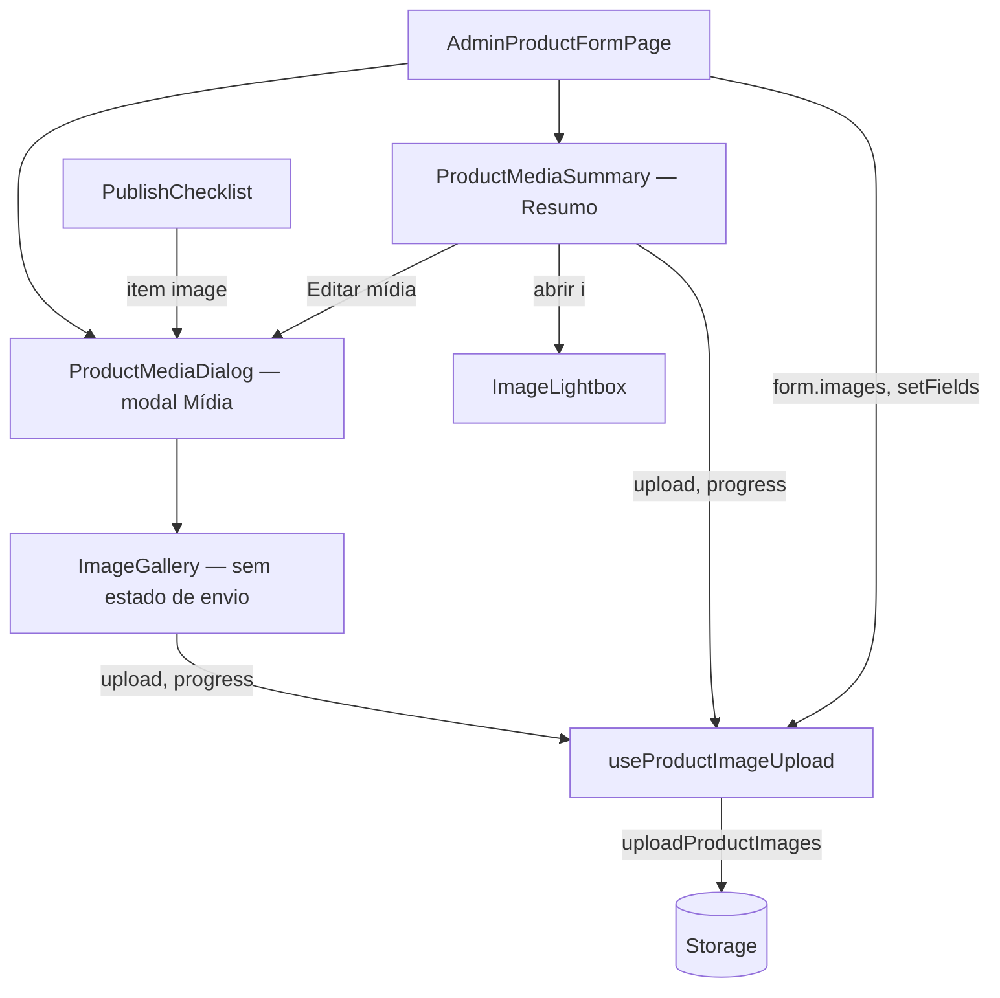

# 85 — O Resumo com as imagens do produto · Design

**Spec**: `.specs/features/85-resumo-com-imagens-do-produto/spec.md`
**Protótipo**: Claude Design, "Uma Estrelinha - Backoffice" → `Produto - Resumo com imagens.html`
**Status**: Approved

---

## Abordagens consideradas

Todas entregam o mesmo escopo. A diferença é **quem é dono do envio de imagens**, porque agora há
DUAS superfícies que enviam (o Resumo e o modal), e a spec exige o mesmo progresso nas duas
(edge case "o envio está em curso e o modal é aberto").

| | Abordagem | Custo | Veredito |
| --- | --- | --- | --- |
| **A** | **Subir o envio para um hook da página** (`useProductImageUpload`), e o `ImageGallery` e o Resumo recebem `upload(files)` + `progress` por prop | Mexe na interface do `ImageGallery` (os testes dele passam a montar com o hook real) | **Recomendada.** Um dono do envio, um progresso, um `onUploadingChange`. É o "defeito 01" evitado antes de nascer |
| B | O Resumo ganha o seu próprio `uploadProductImages` + estado | Zero mudança no `ImageGallery` | Recusada: dois estados de envio. Enviar pelo Resumo e abrir o modal mostraria o modal sem progresso, e dois `onUploadingChange` brigariam pelo `uploading` da página (o último a terminar destrava o salvar com o outro ainda no ar) |
| C | O Resumo abre o modal e dispara o `<input>` do `ImageGallery` por `ref` | Pouca linha | Recusada: soltar arquivo no Resumo com o modal fechado não teria onde cair, e o acoplamento por `ref` é invisível ao `tsc` |

---

## Architecture Overview



O Resumo existe **uma vez no DOM**. A posição muda por `grid-template-areas` (RES-06):

```
< lg          ≥ lg
res           main | pub
main          main | res
pub           main | chk
chk           main | sup
sup
```

A ordem do DOM é a do celular (Resumo primeiro), o caso principal. No computador, o Tab passa
pelo Resumo antes das abas. É a mesma ordem de leitura do celular, e é aceita (ver Tech Decisions).

---

## Code Reuse Analysis

| Existente | Onde | Uso |
| --- | --- | --- |
| `uploadProductImages`, `UploadProgress` | `features/product-form/lib/uploadProductImage.ts` | o motor de envio, sem mudança (ADI-06) |
| `uploadFailureMessage` | `shared/lib/uploadImage.ts` | a mensagem do toast de falha (ADI-05) |
| `ImageGallery` | `features/product-form/ui/ImageGallery.tsx` | vira o corpo do modal. Perde o estado de envio e mantém ordenar, remover, alt, Gerar, selo e colar (MOD-02) |
| `clearMissingVariantImages` | `features/product-form/lib/variantImages` | segue no `onChange` das imagens (MOD-03) |
| `imagesFact`, `weightFact`… | `features/product-form/model/summaryFacts.ts` | os fatos do Resumo, sem mudança (RES-08). Ganha `videoFact` |
| `renditionUrl`, `renditionSrcSet` | `@estrelinha/core/media` | a principal em `srcset` 360/480/720 e as miniaturas em 144px (72 @2x). `renditionSingleOwner` proíbe montar a URL à mão |
| `Dialog` (Radix) | `@estrelinha/ui/dialog` | o modal Mídia **e** o visualizador: prende o foco, fecha com `Esc` e devolve o foco a quem abriu (ZOM-05) |
| `storeUrlFor` / `previewUrl` | `AdminProductFormPage.tsx:190` | o "Abrir na loja ↗" do Resumo (RES-07) |
| `FormCard` | `shared/ui/FormCard.tsx` | a casca do Resumo, que já tem `action` no cabeçalho |

**Não reutilizado, de propósito**: `apps/store/src/entities/product/ui/ImageZoom.tsx`, o zoom da
loja. Importar de outro app é proibido pelo FSD e pelo alias, e ele é um zoom de lupa por cima da
foto, não um visualizador com navegação. Se um dia os dois convergirem, o lugar é `packages/ui`.

---

## Components

### `useProductImageUpload` (novo)
- **Purpose**: o único dono do envio de imagens da página.
- **Location**: `features/product-form/model/useProductImageUpload.ts`
- **Interface**:
  ```ts
  useProductImageUpload(opts: {
    onUploaded: (urls: string[]) => void       // a página anexa no FIM (ADI-04)
    onUploadingChange?: (busy: boolean) => void // o mesmo contrato de hoje
  }): { upload(files: FileList | File[]): Promise<void>; progress: UploadProgress[]; uploading: boolean }
  ```
- **Reuses**: o corpo de `handleFiles` do `ImageGallery`, movido sem mudar o comportamento: toast
  por falha, toast de sucesso, lote parcial segue.
- **Concorrência**: dois lotes ao mesmo tempo (Resumo e modal) somam no `progress`, e `uploading`
  só volta a `false` quando o **último** lote termina (contador, não booleano).

### `ImageGallery` (alterado)
- Recebe `upload`, `progress` e `uploading` por prop, e perde `useState` de envio e `onUploadingChange`.
- O ouvinte de `paste` no `window` continua, e "montado" passa a ser "modal aberto" (é o que o
  comentário de hoje já diz sobre a aba).

### `ProductMediaSummary` (novo, o bloco de imagens do Resumo)
- **Location**: `features/product-form/ui/ProductMediaSummary.tsx`
- **Props**: `images`, `upload`, `progress`, `onOpenMedia()`, `onOpenImage(i)`
- **Desenho**: principal 1:1 `object-cover` (`renditionSrcSet`, `sizes` da coluna); até
  `SUMMARY_THUMB_LIMIT = 7` miniaturas 72×72 (`renditionUrl(url, 144)`); o ladrilho "+N"
  (RES-09) quando `images.length > 8`; o ladrilho "+ Adicionar"; e o vazio "Nenhuma imagem ainda"
  (RES-05).
- **Soltar arquivo** (ADI-02): `dragover`/`drop` no card inteiro, só quando
  `dataTransfer.types` contém `Files`. O véu "Solte para enviar" é `pointer-events:none`.
- **Botão** "Editar mídia" (+ "· N sem descrição" quando houver alt faltando).
- Cada imagem é `<button>` com `aria-label="Ampliar imagem n de N"` (ZOM-01).
- **Erro de carga** da imagem: um fundo neutro com o número dela, e a grade não quebra (edge case).

### `ImageLightbox` (novo)
- **Location**: `features/product-form/ui/ImageLightbox.tsx`
- **Props**: `images`, `index: number | null`, `onIndexChange`, `onClose`
- Radix `Dialog` com `DialogContent` em tela cheia escura, `object-contain`, contador `n / N`
  (`aria-live="polite"`), alt-text embaixo, setas ≥ 44px só com N > 1, laço circular, `←`/`→`
  e gesto por `pointerdown/up` com limiar `SWIPE_PX = 48` (ZOM-02..06).
- **Fecha sozinho** quando `index >= images.length` (a imagem aberta foi removida, edge case).

### `ProductMediaDialog` (novo)
- **Location**: `features/product-form/ui/ProductMediaDialog.tsx`
- Radix `Dialog`: título "Mídia", corpo com `ImageGallery` + o campo de vídeo, e rodapé "Concluir"
  com a frase "As mudanças entram no formulário…" (MOD-04). Em < lg, tela cheia (MOD-07).

### `AdminProductFormPage` (alterado)
- `TABS` sem `midia` (MOD-01). `TabId`/`TAB_IDS` perdem `'midia'`.
- Remove o card "Prévia na loja" e o import de `StorefrontPreview` (RES-02). O componente e o teste
  dele são apagados, porque ficam sem consumidor.
- A coluna lateral vira áreas de grade (RES-06), com o Resumo antes de "Pronto para publicar" (RES-01).
- Estado novo: `mediaOpen`, `lightboxIndex`.
- `focusField` ganha o caso `field === 'images'`, que abre o modal em vez da aba (MOD-06).

### `checklist.ts` (alterado)
- O item `image` deixa de apontar para uma aba: `tab: null`, e `ChecklistItem.tab` passa a ser
  `TabId | null`. O `PublishChecklist` não muda: ele chama `onFocusField(item)`, e quem decide é a
  página.

### `summaryFacts.ts` (alterado)
- `videoFact(form) => form.video_url.trim() ? 'sim' : 'não'` (MOD-05).

---

## Data Models

Nenhum. `images: ProductImage[]` (`{url, alt, source}`) e `video_url` ficam iguais. Sem migration.

---

## Error Handling Strategy

| Cenário | Tratamento | O que a Adri vê |
| --- | --- | --- |
| Arquivo recusado ou que falhou no lote | `uploadFailureMessage`, um toast por arquivo | o motivo, e os outros entram |
| Soltar algo que não é arquivo (texto, link) | ignorado: o card só reage a `types` com `Files` | nada |
| Imagem do Resumo não carrega | `onError` troca pelo fundo neutro com o número | a grade inteira, sem buraco |
| Salvar com envio no ar | `saving || uploading` (já existe) | salvar desabilitado |

---

## Risks & Concerns

| Concern | Location | Impact | Mitigation |
| --- | --- | --- | --- |
| `focusField` usa `scrollIntoView` + `[data-field]`, e o `data-field="images"` some da página com o modal fechado | `AdminProductFormPage.tsx:199` | a pendência do checklist não faria nada | caso explícito para `images`, que abre o modal; teste pela página real |
| Testes que contam as abas e a ordem dos cards | `AdminProductFormPage.test.tsx:106,130,181` | reprovam, e reprovam **certo** | reescritos para a nova verdade, com vizinhas novas, nunca afrouxados |
| `variacoes.test.tsx` abre a aba Mídia para achar a foto | `AdminProductFormPage.variacoes.test.tsx:462,496` | reprova | passa a abrir pelo "Editar mídia" do Resumo; a asserção (a foto existe na galeria) fica |
| Dois `onUploadingChange` (galeria e `VariantImagePicker`) | `AdminProductFormPage.tsx:768,834` | o `VariantImagePicker` segue chamando `setUploading` direto, e o hook também: o último a terminar destrava | o hook expõe `uploading`, e a página calcula `uploading = hook.uploading \|\| variantUploading` (dois booleanos com nome, não um compartilhado). Teste: envio da variação no ar + galeria termina ⇒ salvar continua desabilitado |
| jsdom mede 0 de layout | — | 72px, 1:1, "acima da dobra" e o "sem rolagem" não são provados pela suíte | token exato de classe nos testes (`h-[72px] w-[72px]`), e **prova em navegador** em 390/1024/1440 como task |
| A galeria aberta com 28 fotos | modal | rolagem longa | o corpo do modal rola sozinho, com cabeçalho e rodapé fixos (`grid-rows: auto 1fr auto`) |
| `animacaoRespeitaMovimento` tem escopo literal | `shared/lib/__tests__/animacaoRespeitaMovimento.test.ts` | arquivos novos com `transition-*` ficam fora | os 3 arquivos novos de UI entram no escopo, com as âncoras subindo junto (precedente da `51`/`56`) |

---

## Tech Decisions

| Decisão | Escolha | Por quê |
| --- | --- | --- |
| Dono do envio | hook da página (Abordagem A) | um progresso, um "envio no ar" |
| Ordem do DOM | a do celular (Resumo antes das abas) | mobile é o caso principal; uma única ordem para leitura e Tab |
| Zoom | `Dialog` do Radix, sem biblioteca | foco, `Esc` e devolução do foco de graça; nenhuma dependência nova |
| Miniaturas | `renditionUrl(url, 144)` | 8 imagens de 1600px numa coluna de 330px pesariam MB à toa; o guarda de rendição já é o dono |
| `StorefrontPreview` | apagado | sem consumidor depois de RES-02 |
| Constantes | `SUMMARY_THUMB_LIMIT = 7`, `SWIPE_PX = 48` em `features/product-form/model/mediaSummary.ts` | o teste lê a constante **e** uma asserção crava o número da spec (7, 48) — sem a segunda, o teste mediria a constante contra ela mesma |
