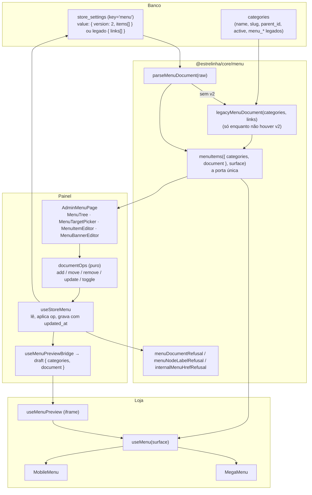

# 86 — O menu montado pela dona: Design

**Spec**: `.specs/features/86-menu-montado-pela-dona/spec.md`
**Protótipo**: Claude Design, `Menu da loja - montagem.html` (projeto "Uma Estrelinha - Backoffice")
**Status**: Approved (abordagem A confirmada em 2026-10-28)

---

## As três abordagens

Todas entregam a mesma spec. A diferença é **onde a montagem mora**.

| | A — documento em `store_settings.menu` (**recomendada**) | B — tabela `menu_items` | C — mais colunas em `categories` |
| --- | --- | --- | --- |
| Forma | um jsonb `{ version: 2, items: [...] }` na linha `menu`, que já existe e já é lida pela loja | uma linha por item, `parent_id`, `position`, FK para `categories` | `menu_label`, `menu_position`, `menu_parent_id` na categoria |
| Migration | **nenhuma** | tabela, RLS, índices, RPC de reordenar | 3 colunas + backfill |
| Ordem independente do catálogo (`MNM-18`) | sim | sim | sim, mas é mais uma coluna de ordem na mesma linha |
| Link interno com submenu, mesmo item em dois submenus | sim | sim | **não** — uma categoria só tem uma linha |
| Concorrência (`MNM-37`) | `updated_at` da linha, que o gatilho já mantém: `update … where updated_at = visto` | precisa de versão própria ou RPC | idem B |
| Gravação atômica (reordenar 6 itens) | 1 `update` | RPC ou 6 `update` | 6 `update` |
| Categoria apagada (`MNM-36`) | resolvida na leitura (id ausente) — o mesmo que `resolveMenuBanners` já faz | FK `on delete set null` | some sozinha |
| Leitura da loja | **zero requisição nova** (`useStoreSettings` já traz a linha) | uma consulta nova no header | a que já existe |

**Recomendo A.** C não cumpre a spec (o mesmo item em dois submenus é impossível), e B paga uma
migration, uma RPC e uma consulta nova no header para comprar uma FK cujo efeito (`MNM-36`) A obtém
na leitura, como os banners da `39` já obtêm. O documento inteiro também é a unidade natural da
prévia — a ponte da `39` já manda "o menu inteiro" a cada mudança.

**O que A não compra**: integridade referencial no banco. Um `category_id` apagado continua no
jsonb até a dona tirar o item (é exatamente o estado "Categoria apagada" da spec, com a única ação
"Remover do menu"). A loja nunca o mostra.

---

## Architecture Overview



### O primeiro menu, sem migration (substitui uma assunção da spec)

A spec dizia "a migration monta o menu novo a partir do que a loja mostra hoje". Montá-lo **em SQL**
seria reescrever `menuItems` (o papel derivado da árvore, as duas superfícies, o desempate `pt-BR`)
numa segunda linguagem — o "defeito 01" na véspera de apagá-lo. Em vez disso:

- enquanto `store_settings.menu` **não tem `version: 2`**, `parseMenuDocument` devolve `null` e a
  porta chama `legacyMenuDocument(categories, links)`, que é **a regra de hoje** (`menuItems` legado,
  chamado nas duas superfícies e unido) convertida em documento;
- a loja desenha esse documento — **idêntica** à de hoje, por construção (Success Criterion 3);
- o painel abre mostrando o mesmo documento, e **a primeira ação da dona grava o v2 inteiro**. Daí em
  diante as colunas `menu_desktop`, `menu_mobile`, `menu_banners` e os `links` legados deixam de ser
  lidos.

`MNM-34` (banners passam ao item) e `MNM-40` (idempotência) viram verdade por construção. A spec
ganha a nota correspondente na tabela de assunções (T01).

---

## Code Reuse Analysis

### Existing Components to Leverage

| Componente | Onde | Como |
| --- | --- | --- |
| `menuItems` de hoje | `packages/core/src/menu/menu.ts:399` | renomeado `legacyMenuItems`, vira o motor de `legacyMenuDocument`; sai junto com o legado (`BL` novo) |
| `bySortOrder`, `categoryHref`, `pathLabel`, `normalizeMenuHref`, `menuHrefIsExternal` | `core/menu/menu.ts` | intactos; o href de cada nó de categoria é `categoryHref` |
| `menuTargetRefusal` | `core/menu/target.ts:113` | a régua de endereço; `internalMenuHrefRefusal` é ela + "externo não" |
| `resolveMenuBanners`, `menuBannerRefusal`, `MENU_BANNER_LIMIT` | `core/menu/banners.ts` | intactos; o `raw` passa a vir do nó, não da categoria |
| `menuIconKey`, `MENU_ICON_KEYS`, `MENU_ICON_LABELS` | `core/menu/icons.ts` | intactos |
| `menuPanelColumns` | `core/menu/menu.ts:470` | fica genérico (`<T>`), recebe os filhos novos |
| `MenuIconPicker` | `backoffice/features/store-menu/ui/MenuIconPicker.tsx` | dentro do `MenuItemEditor` |
| `MenuBannerEditor` | idem | muda a fonte (`item.banners`) e o destino da gravação (op do documento) |
| `MenuLivePreview`, `useMenuPreviewBridge` | idem | o rascunho muda de forma; o palco não |
| `useAdminCategories` | `backoffice/entities/category` | **só leitura** (seletor e nomes); a tela deixa de chamar `updateCategory`/`updateSortOrders` |
| `useStoreSettings` | `core/hooks` | a loja já lê `menu`; nada novo na rede |
| Selo `Salvando…`/`Salvo` (`SALVO_MS`) | `AdminMenuPage.tsx` | mesmo padrão `VIV-04` |
| `ProductSearchField`-style busca sem acento | `backoffice/shared/lib/texto.ts` (`dobrarTexto`) | busca do seletor de categoria |
| `ROUTE_SLUGS`/rotas fixas | `core/routes` | lista "Página da loja" sai de `SITEMAP_STATIC_PATHS` + nomes de `staticPageMeta` (`core/seo`) |

### Integration Points

| Sistema | Como |
| --- | --- |
| `store_settings` | lê/grava a chave `menu`; RLS existente (leitura pública, escrita `has_role(admin)`) — **sem mudança** |
| `categories` | só leitura; o menu referencia por `id` |
| Ponte da prévia (`core/menu/preview.ts`) | `MenuPreviewDraft` muda de `{ categories, links }` para `{ categories, document }`; `open` passa a carregar o **id do nó** |
| Deno | `core/menu/menu.ts` é alcançado pelo sitemap e por `core/page` — **o arquivo novo não é importado por ele** (ver Riscos) |

---

## Components

### `core/menu/structure.ts` (novo)
- **Purpose**: a forma do documento, a leitura tolerante, a conversão do legado e a porta `menuItems`.
- **Interfaces**:
  - `parseMenuDocument(raw: unknown): MenuDocument | null` — `null` sem `version: 2`; nó inválido é descartado, nó com destino sumido **fica** (o painel precisa vê-lo)
  - `legacyMenuDocument(categories, links): MenuDocument`
  - `menuItems(input: { categories; document?: MenuDocument | null; links? }, surface): MenuItem[]` — `document` ausente ⇒ legado
  - `menuNodeName(node, categories): string`, `menuNodeState(node, categories): 'ok' | 'inactive' | 'deleted'`
- **Dependencies**: `./menu.ts`, `./icons.ts` (com `.ts` explícito)
- **Reuses**: `categoryHref`, `pathLabel`, `menuIconKey`, `menuBannerSlots`

### `core/menu/refusals.ts` (novo)
- `MENU_LABEL_MAX = 40`, `MENU_SUBMENU_LIMIT = 24`
- `menuNodeLabelRefusal(label: string | null): string | null` — `null` = "usar o nome da categoria"
- `internalMenuHrefRefusal(href): string | null` — `menuTargetRefusal` + recusa `http(s)://` e `//`
- `menuDocumentRefusal(doc): string | null` — rótulos, teto do submenu, categoria repetida na raiz e no mesmo submenu, banners (`menuBannerRefusal`)

### `core/menu/preview.ts` (alterado)
- `MenuPreviewDraft = { categories: MenuCategory[]; document: MenuDocument }`; `parseMenuPreviewMessage` recusa o rascunho sem `document` válido (devolve `null`), para um painel e uma loja em versões diferentes não derrubarem o header.

### Painel — `features/store-menu/model/documentOps.ts` (novo, puro)
- `addRootNode(doc, target, categories)` (`MNM-08`, `MNM-09`: filhas ativas viram filhos), `addChildNode`, `moveNode(doc, parentId|null, from, to)`, `removeNode`, `updateNode`, `toggleSurface`. Toda op devolve documento novo; nenhuma toca categoria.

### Painel — `features/store-menu/model/useStoreMenu.ts` (novo; substitui `useMenuLinks`)
- **Interfaces**: `{ document, categories, state: 'loading'|'error'|'ready', saving: 'idle'|'saving'|'saved', apply(op): Promise<Refusal|null>, reload() }`
- Grava `update store_settings set value = doc where key = 'menu' and updated_at = visto … select('updated_at')`; **zero linhas ⇒ conflito** (`MNM-37`); falha ⇒ volta ao documento anterior (`MNM-38`). Linha ausente ⇒ `insert` (conflito de chave = conflito).
- Recusa local antes da rede (`menuDocumentRefusal`).

### Painel — UI
| Componente | Requisitos | Substitui |
| --- | --- | --- |
| `MenuTree.tsx` | `MNM-01..06`, `18..19`, `23`, `27..30`, `35..36` | `MenuSlotList.tsx`, `MenuPanelEditor.tsx` |
| `MenuTargetPicker.tsx` | `MNM-07`, `10..12`, `22`, `25` | `MenuLinkDialog.tsx` |
| `MenuItemEditor.tsx` | `MNM-14..17`, `26`, `33` (abre o `MenuBannerEditor`) | `MenuEntryEditor.tsx` |
| `MenuRemoveConfirm.tsx` | `MNM-20..21` | — |
| `AdminMenuPage.tsx` (reescrita) | compõe tudo, alternador só da prévia (`MNM-32`), vista Itens/Prévia no celular | — |

### Loja
- `entities/category/api/useMenu.ts`: `menuItems({ categories, document: parseMenuDocument(settings?.menu), links: settings?.menu?.links }, surface)`; com rascunho, `draft.document`.
- `entities/menu/api/useMenuTargets.ts` → `useMenuBanners(item, surface)`: o `raw` vem de `item.banners`.
- `MegaMenu`/`MobileMenu`: filho usa `child.href` e `child.name`; `abrePainel = item.hasPanel` (link pode ter painel); `useMenuBanners(item)`.

---

## Data Models

```typescript
// core/menu/structure.ts
export type MenuNodeTarget =
  | { kind: 'category'; category_id: string }
  | { kind: 'link'; href: string }

export interface MenuNode {
  id: string                 // estável, gerado no painel
  target: MenuNodeTarget
  label: string | null       // null = nome da categoria (MNM-15); link sempre tem label
  desktop: boolean
  mobile: boolean
}

export interface MenuRootNode extends MenuNode {
  icon: string | null        // chave de MENU_ICON_KEYS
  banners: MenuBanners | null // forma da 39, intacta
  children: MenuNode[]       // até MENU_SUBMENU_LIMIT
}

export interface MenuDocument { version: 2; items: MenuRootNode[] }

// O que a loja desenha (substitui MenuCategoryItem/MenuLinkItem)
export interface MenuChild { id: string; name: string; href: string; external: boolean }
export interface MenuItem {
  id: string                 // id do NÓ (a ponte `open` usa este)
  kind: 'category' | 'link'
  name: string
  href: string
  external: boolean
  icon: MenuIconKey | null
  children: MenuChild[]      // só os visíveis nesta superfície
  banners: unknown           // raw para resolveMenuBanners
  hasPanel: boolean          // children.length > 0 || banner na superfície (MNM-27)
}
```

`store_settings.menu` passa a ser `{ version: 2, items: MenuRootNode[] }`. `MenuSettings` ganha
`version?: 2; items?: MenuRootNode[]` ao lado de `links` (legado, lido só pela conversão).

**Visível na superfície** = `node[surface] && estado === 'ok'`; item principal sem filho visível e sem
banner é link direto. Item principal de categoria **inativa** some com o submenu inteiro.

---

## Error Handling Strategy

| Cenário | Tratamento | O que a dona vê |
| --- | --- | --- |
| Leitura de `store_settings` falha | `state: 'error'` | faixa "Não foi possível carregar o menu" + "Tentar de novo" (`MNM-05`) |
| Leitura de `categories` falha | idem, faixa própria | nomes não resolvem; a lista não é desenhada (sem nome não há o que mostrar) |
| Recusa local (`menuDocumentRefusal`) | nada vai à rede | motivo no campo / toast |
| `update` com zero linhas | conflito | "O menu mudou em outra janela — recarregue", documento local volta (`MNM-37`) |
| `update` com erro (rede, RLS) | rollback | "Não salvou", sem `Salvo` (`MNM-38`) |
| Documento com nó inválido no banco | `parseMenuDocument` descarta o nó | — (SQL na mão; a loja não quebra) |
| Rascunho da prévia em forma antiga/nova | `parseMenuPreviewMessage` → `null` | a prévia mostra o menu publicado |

---

## Risks & Concerns

| Preocupação | Onde | Impacto | Mitigação |
| --- | --- | --- | --- |
| **Alcance do Deno**: `menu.ts` é importado por `core/page/categoryRoute.ts` e pelo sitemap, que rodam fora do Vite; os guardas `denoReach` têm âncoras **cravadas** de contagem (o de `seo` exige exatamente 15) | `packages/core/src/menu/menu.ts`, `packages/core/src/page/categoryRoute.ts`, `packages/core/src/*/__tests__/*denoReach*.test.ts` | importar `structure.ts` em `menu.ts` aumentaria os grafos e mudaria as contagens | `structure.ts` importa `menu.ts`, **nunca o contrário**; `.ts` explícito em todo especificador (inclusive `import type`); T02 confere o guarda |
| `menuItems` muda de forma de saída (filhos não são mais `MenuCategory`) | `MegaMenu.tsx:188`, `MobileMenu.tsx:362`, `MenuSlotList.tsx` | `tsc` quebra nos consumidores | T04 muda core **e** os dois widgets da loja na mesma task; o painel antigo sai na fase da UI |
| **Defeito 01 temporário**: legado e documento convivem | `legacyMenuDocument` | duas regras lidas | convivência é **sequencial**, não paralela: com v2 gravado o legado não é lido. `BL` novo: apagar `legacyMenuDocument`, as colunas e `links` depois que a produção tiver v2 |
| `L-037`: constante do bundle como estado de carga | `DEFAULT_MENU` | o header desenharia "menu vazio" antes do `store_settings` chegar | `useMenu` não troca a ausência de dados por documento vazio; mantém o comportamento atual (sem menu até a leitura) — teste em T07 |
| Ponte da prévia entre versões | `core/menu/preview.ts` | painel novo + loja velha no mesmo deploy | `parseMenuPreviewMessage` recusa a forma desconhecida; prévia cai no publicado |
| Escrita sem RPC: o `check` de forma só existe no TypeScript | `useStoreMenu` | um `PATCH` direto grava jsonb torto | `parseMenuDocument` tolera tudo na leitura (a loja nunca quebra); o banco já protege **quem** escreve (`has_role`) |
| Guardas que leem `menu_desktop/menu_mobile/menu_banners` e `MenuSlotList` | `menuSurfaceSingleOwner`, `menuSemTeto`, `MenuPanelEditor.test.tsx` etc. | reprovam ao apagar a UI antiga | T21 revisa **cada um** com sensor; nenhum é afrouxado, os de arquivo apagado mudam de alvo |
| Teste que monta a própria árvore | memória do projeto | fiação da página sem prova | os casos de fiação rodam pela `AdminMenuPage` real e pelo `Header` real |
| Busca de categoria sem acento | `texto.ts` do painel | "anel" não acha "Anéis" | `dobrarTexto`, o dono da dobra (`AD-036`) |

---

## Tech Decisions

| Decisão | Escolha | Por quê |
| --- | --- | --- |
| Onde mora a montagem | documento jsonb v2 em `store_settings.menu` | ver tabela das abordagens |
| Primeiro menu | convertido na leitura, gravado na 1ª ação | evita reescrever `menuItems` em SQL |
| Concorrência | `updated_at` como versão, `update … eq('updated_at', visto)` | o gatilho já existe; zero migration |
| Operações do documento | puras, no painel | um consumidor só; `core` fica com forma, leitura, regra e recusa (dois consumidores) |
| `id` de nó | `crypto.randomUUID()` no painel | a ponte `open` e as chaves React precisam de id estável |
| Nome padrão | `label: null` (nunca copiar o nome) | cópia divergiria no primeiro rename — a objeção da `AD-014` |

**Decisão de projeto**: `AD-068` (proposta) em `.specs/STATE.md` — supersede as partes (1) e (2) da
`AD-028` e o "o menu é um recorte de `categories`" da `AD-014`.
