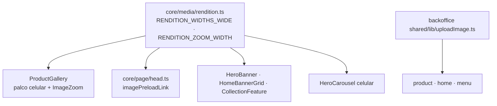

# 87 — Design

**Spec**: `.specs/features/87-qualidade-das-imagens/spec.md` · **Status**: Approved (abordagem decidida na avaliação de 2026-10-29)

## Abordagem

Três mudanças independentes, nenhuma com migration, nenhuma com rede nova:

### Alternativa recusada: só trocar `RENDITION_WIDTHS` para quatro larguras

Pelo critério de escolha do navegador, o card (que precisa de 513–720) continuaria pegando 720, então
seria seguro **onde o `sizes` é preciso**. Foi recusada porque toda superfície com `sizes` folgado
(o `ProductCarousel` diz `220px`, o default de `HomeBannerGrid` diz `100vw`) passaria a poder pedir
1080 sem ninguém decidir, e IMG-06 ("idêntico ao de hoje") deixaria de ser verificável. Opt-in
explícito por superfície, com o conjunto num dono só, é o que a spec pede.

## Componentes

### `packages/core/src/media/rendition.ts`

- `RENDITION_WIDTHS_WIDE = [360, 480, 720, 1080] as const` — **derivado** de `RENDITION_WIDTHS`
  (`[...RENDITION_WIDTHS, 1080]`), para os dois conjuntos não divergirem nas três primeiras.
- `RENDITION_WIDE_MAX = 1080` (a última de `WIDE`, derivada) — o `src` de recuo das vagas largas.
- `RENDITION_ZOOM_WIDTH = 1600`.
- Continua sem `import` (Deno, guarda de `rendition.test.ts`).

### Galeria do produto (`apps/store/src/entities/product/ui/`)

- `ProductGallery.tsx`: `PALCO_PX` passa a ser `RENDITION_WIDE_MAX`; o palco do celular chama
  `renditionSrcSet(url, RENDITION_WIDTHS_WIDE)`. O palco do computador passa a receber o MESMO par
  `srcSet`/`sizes` (IMG-02): as duas `` coexistem no DOM e, com o mesmo par, o navegador
  escolhe o mesmo candidato e baixa **uma** foto (o comentário do arquivo já exige isso para o `src`).
- `ImageZoom.tsx`: props novas `srcSet?`, `sizes?`, `zoomSrc`. A camada de zoom já só existe com o
  ponteiro em cima (`zooming`), e o `background-image` dela é `zoomSrc` — por isso não precisa de
  estado novo: antes da primeira entrada nada nomeia a URL (IMG-15). (Um estado `armado` foi escrito e
  removido na implementação: era redundante com `zooming`.) Trocar de foto troca `zoomSrc` pela prop
  (IMG-16) — sem cache interno de URL.

### `packages/core/src/page/head.ts`

`PALCO_PX` passa a ser `RENDITION_WIDE_MAX` e `imagesrcset` sai de
`renditionSrcSet(url, RENDITION_WIDTHS_WIDE)` — o mesmo par da galeria (IMG-03).

### Banners da Home (`apps/store/src/widgets/`)

- `hero-banner/HeroBanner.tsx`, `home-banners/HomeBannerGrid.tsx`,
  `collection-feature/CollectionFeature.tsx`: `srcSet={renditionSrcSet(x, RENDITION_WIDTHS_WIDE)}`.
  O `src` de recuo continua 480 (só vale para quem não entende `srcset`). `sizes` não muda.
- `hero-carousel/HeroCarousel.tsx`: `LARGURAS_CELULAR` vira `[360, 720, RENDITION_WIDE_MAX]`
  (as duas primeiras continuam derivadas da vaga).

### Envio do painel (`apps/backoffice/src/shared/lib/uploadImage.ts`)

- `MAX_DIMENSION = 2400`, `WEBP_QUALITY = 0.92`.
- `compressImage` vira `prepareImage(blob, max, format)`: carrega o `Image` (mesmo stub dos testes)
  para ler as dimensões; se `blob.type === format` e os dois lados ≤ `max`, devolve **o próprio
  `blob`** (IMG-12); senão, canvas com `imageSmoothingEnabled = true` e
  `imageSmoothingQuality = 'high'` antes do `drawImage` (IMG-10, IMG-13). A falha de carga continua
  rejeitando ⇒ `null` nos dois caminhos.
- O `contentType` gravado continua `format` — no caminho sem canvas ele é igual ao `blob.type` por
  construção.
- `ImageGallery.tsx:241`: a copy de IMG-18. `uploadHomeImage.ts:73` e `AdminQuickGridPage.tsx:72`:
  só os comentários que citam 1600.

## Code reuse

| O quê | Onde | Uso |
| --- | --- | --- |
| `renditionSrcSet(url, widths)` | `core/media/rendition.ts` | já aceita larguras explícitas (`MegaMenu`, `CategoryList`) |
| `GALLERY_STAGE_SIZES` | idem | continua o único `sizes` do palco e do preload |
| stubs de `Image`/canvas | `uploadImage.test.ts` | o caminho sem canvas é provado pelo `toBlob` **não** chamado e o `upload` recebendo o mesmo objeto |

## Testes (derivados das ACs)

- `rendition.test.ts`: IMG-01 (valores, as três primeiras iguais a `RENDITION_WIDTHS`), IMG-08,
  sem import.
- `ProductGallery.test.tsx`: o `vi.mock` de `ImageZoom` passa a registrar as props, para provar que o
  palco do computador recebe o mesmo `srcSet`/`sizes` do celular (IMG-02). As asserções antigas de
  "três larguras" **são reescritas para quatro** — a spec mudou o valor; não é afrouxamento.
- `ImageZoom.test.tsx` (novo): IMG-15 (nenhuma URL de zoom antes do `mouseenter`, presente depois,
  e de novo ao voltar depois do `mouseleave`), IMG-16 (troca de `zoomSrc`), IMG-17.
- `head.test.ts`: IMG-03 por igualdade com o `srcset` montado pela mesma chamada da galeria
  (`renditionSrcSet(url, RENDITION_WIDTHS_WIDE)`), e o `href` de 1080.
- Testes de `HeroBanner`, `HomeBannerGrid`, `CollectionFeature`, `HeroCarousel`: IMG-04/05 por
  descritores do `srcset`; IMG-07 nos que já têm o caso externo.
- IMG-06: os testes existentes das superfícies não tocadas continuam **sem edição** (é a prova).
- `uploadImage.test.ts`: IMG-09 (`toBlob` com 0.92), IMG-10 (o contexto stub registra
  `imageSmoothingQuality = 'high'` **antes** do `drawImage` — ordem conferida no próprio stub),
  IMG-11 (4000×3000 ⇒ 2400×1800; 1024 não amplia), IMG-12 (WebP 1024 ⇒ sem `toBlob`, `upload`
  recebe o MESMO `Blob` por `toBe`), IMG-13 (JPEG pequeno, Blob sem tipo e WebP grande passam pelo
  canvas), IMG-14 (falha de carga ⇒ `null` também no caminho sem canvas). Os casos antigos "1600"
  são reescritos para o teto novo.
- `ImageGallery` (painel): IMG-18 pela frase inteira (`L-009`).

## Risks & Concerns

| Risco | Mitigação |
| --- | --- |
| Palco do computador com `srcset` diferente do celular ⇒ duas fotos baixadas | IMG-02 exige igualdade; teste compara as duas props; prova em navegador conta as requisições |
| Preload e galeria divergirem ⇒ foto baixada duas vezes | IMG-03 por igualdade com a mesma chamada |
| Peso do LCP do produto em DPR 3 (~1,85× medido: 103→190 KB no pior caso) | Aceito pelo usuário; medido na prova em navegador (Success Criteria) |
| Zoom carregado antes do hover desperdiça bytes | IMG-15 provado em teste e na rede |
| WebP grande (2400 @ 0.92) pode passar de 1 MB no Storage | Não é servido à cliente; o bucket não tem teto além dos 50 MiB do projeto |
| Imagem enviada sem recompressão com EXIF de rotação | Só WebP→WebP e PNG→PNG pulam o canvas; JPEG (onde o EXIF mora na prática) sempre passa pelo canvas |
| `renditionSingleOwner` recusa largura cravada em JSX | As larguras novas moram em `core`; as superfícies importam as constantes |
| Guardas da loja que varrem `apps/**` | O gate roda a suíte da loja mesmo nas tasks do painel |
