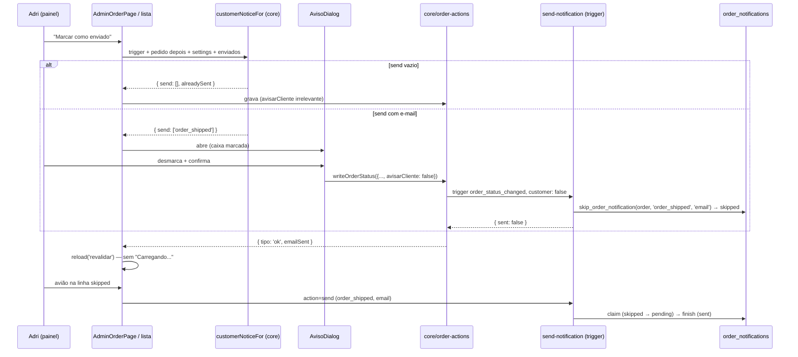

# 88 — Design

**Spec**: `.specs/features/88-aviso-opcional-nas-acoes-do-pedido/spec.md`
**Desenho de tela**: Claude Design, projeto *Uma Estrelinha - Backoffice* — `Pedidos - Lista.html` e
`Pedido - Edição.html` (protótipos navegáveis, com o painel "Protótipo" para ligar e-mails, simular
rede lenta e falha, e o cenário "Ajuste · já foi postado antes")
**Status**: Approved (2026-10-29)

**Decisões que este design segue** (`STATE.md`): `AD-008` (aviso contido, nunca em background),
`AD-012` (provar gravação contra o banco, não por tipo), `AD-017` (migration aplicada é imutável),
`AD-032` (gatilho nomeia o fato; **uma** memória, `order_notifications`), `AD-059` (escrita do pedido
tem um dono, `core/order-actions`). Nenhuma é substituída; `AD-069` (abaixo) é nova e estende a
`AD-032`.

---

## Architecture Overview

Três camadas mudam, e cada uma tem um dono só:

1. **A previsão** — `customerNoticeFor` em `core/notifications` decide se um gesto **perguntaria**.
   É a mesma regra que o motor aplica (`eventsForTrigger` + público + ligado + pré-condição + "já
   enviado"), lida no navegador antes da escrita.
2. **A escolha** — o painel abre o diálogo com a caixa marcada; a resposta viaja como
   `avisarCliente: boolean` até `core/order-actions`, que a repassa à notificadora como
   `{ cliente: false }`. O gatilho **continua saindo** (o aviso à dona não depende da caixa).
3. **A memória** — o motor recebe `customer: false` e, para cada evento de público `customer` que
   teria saído, grava a linha `skipped` em `order_notifications` em vez de enviar. O histórico lê a
   linha; o avião usa a porta `send` que já existe, que reivindica `skipped` como hoje reivindica
   `failed`.



### Abordagens consideradas para A-05 (o registro do "não avisei")

| | Abordagem | Veredito |
| --- | --- | --- |
| **A — recomendada** | Status `skipped` em `order_notifications`, gravado pelo motor; avião = porta `send` | Uma memória só (`AD-032`); o avião não precisa de porta nova; a retentativa futura (`AVS-24`) é a regra que `claim` já tem |
| B | Nota interna automática em `order_notes` | A nota não carrega o evento: o avião teria de interpretar texto. E duas fontes respondendo "a cliente foi avisada?" |
| C | Tabela nova `order_notice_skips` | Segundo dono da mesma pergunta, com a mesma tripla `(order, event, channel)` |

### Abordagens para A-04 (só a cliente fica sem e-mail)

| | Abordagem | Veredito |
| --- | --- | --- |
| **A — recomendada** | Opção `customer: false` no gatilho; o motor filtra por `EVENT_AUDIENCE` | Quem decide "quais eventos e para quem" continua sendo `core` + motor (`AD-032`) |
| B | O painel chama `action=send` para cada evento de dona | O painel passaria a nomear mensagens, que é exatamente o que a `AD-032` proibiu |
| C | Reaproveitar `avisar: false` | Mudaria o significado para o app do ateliê, que usa `avisar: false` em `runAppAction` para não disparar o gatilho duas vezes numa ação composta (`appAction.ts:120` e `:130`) |

---

## Code Reuse Analysis

### Existing Components to Leverage

| Componente | Onde | Como |
| --- | --- | --- |
| `eventsForTrigger`, `EVENT_AUDIENCE`, `orderStateFailure`, `resolveEventSettings` | `packages/core/src/notifications/` | A previsão compõe estas quatro; não reescreve nenhuma |
| `NOTIFICATION_EVENT_NAMES` | `core/notifications/catalog.ts` | Nome do e-mail no diálogo e na linha do histórico (`A-06`) |
| `useNotificationSettings` | `core/hooks/useStoreSettings.ts:142` | Settings da previsão; cai em `DEFAULT_NOTIFICATIONS` sem leitura (edge case da spec) |
| `writeOrderStatus` / `writeTrackingCode` / `writeMaterialStatus` / `writeMaterialTracking` | `core/order-actions/` | Ganham `avisarCliente?: boolean` (padrão `true`), repassado à notificadora |
| `triggerOrderNotification` | `core/order-actions/notify.ts` | Ganha `opcoes?: { cliente?: boolean }` → `customer: false` no corpo |
| `resendNotification` (porta `send`) | `apps/backoffice/src/entities/order/api/notifyOrder.ts` | É o avião. Nenhuma porta nova |
| `claim_order_notification` | migration `42` | Já reivindica qualquer linha `<> 'sent'` — `skipped` incluído, sem mudar a RPC |
| `deliver` (checagens antes do claim) | `send-notification/dispatch.ts:~260` | O modo "pular" reaproveita as mesmas checagens (ligado, destinatário) e troca só o passo do claim |
| `buildHistory` | `core/orders/history.ts:190` | Ganha o ramo `skipped`; o painel e o app leem a mesma linha |
| `FetchMode` | `apps/backoffice/src/shared/lib/fetchMode.ts` | `reload('revalidar')` do pedido e `refetch('revalidar')` da lista (`CRG-03`, `CRG-12`) |
| `TableSkeleton`, `CardSkeleton` | `apps/backoffice/src/shared/ui/Skeletons.tsx` | Primeira carga da lista; o esqueleto do pedido é novo, com a mesma grade |
| `runMaterialBulk`, `bulkSummary` | `features/order-list/model/bulkMaterial.ts` | Ganham `onProgress` e a contagem de e-mails/pulados |

### Integration Points

| Sistema | Como a feature conecta |
| --- | --- |
| `send-notification?action=trigger` (admin) | Aceita `customer: false` no corpo; repassa a `dispatchTrigger` |
| `send-notification?action=notify` (cliente) | **Ignora** `customer` — a cliente não pode suprimir o próprio e-mail nem gravar `skipped` |
| `mercado-pago` (`dispatchTrigger` direto) | Sem mudança: a opção nasce `undefined` |
| `order_notifications` | Novo valor `skipped` no `check` de `status`; RPC nova `skip_order_notification` |
| App do ateliê (`mobile-adm`) | Lê `buildHistory` de `core` e passa a mostrar a linha `skipped` como texto (sem avião — fora do escopo). Nenhuma escrita muda |

---

## Components

### C1 — `customerNoticeFor` (core)

- **Purpose**: responder, antes da escrita, quais e-mails à cliente este gesto mandaria.
- **Location**: `packages/core/src/notifications/notice.ts` (folha; todo import relativo com `.ts`)
- **Interface**:
  ```ts
  export interface CustomerNotice { send: NotificationEvent[]; alreadySent: NotificationEvent[] }
  export function customerNoticeFor(
    trigger: NotificationTrigger,
    orderAfter: OrderSnapshot & { customer_email?: string | null },
    settings: NotificationSettings,
    sentEvents: ReadonlySet<NotificationEvent>,
  ): CustomerNotice
  /** As linhas de order_notifications que contam como "já enviado": email + sent. */
  export function sentCustomerEvents(rows: { event: string; channel: string | null; status: string }[]): Set<NotificationEvent>
  ```
- **Regra**: `eventsForTrigger(trigger, orderAfter)` → `EVENT_AUDIENCE[e] === 'customer'` →
  `resolveEventSettings(...).enabled` no e-mail → `orderStateFailure(e, orderAfter) === null` →
  `customer_email` não vazio → separa `alreadySent` de `send` por `sentEvents`.
- **Reuses**: os quatro módulos de `core/notifications`. Não importa React nem Supabase.

### C2 — Opção "sem e-mail à cliente" no dono da escrita (core)

- **Location**: `packages/core/src/order-actions/{types,notify,status,tracking,material,materialTracking}.ts`
- **Interfaces**:
  ```ts
  export interface NotifyOptions { cliente?: boolean }   // false ⇒ corpo leva customer: false
  notify: (orderId: string, trigger: NotificationTrigger, opcoes?: NotifyOptions) => Promise<boolean>
  // cada Write*Input ganha:
  avisarCliente?: boolean  // padrão true. Só tem efeito com avisar !== false.
  ```
- **Regra**: `avisar` continua "dispare o gatilho?"; `avisarCliente` é "a cliente recebe?". Com
  `avisarCliente === false` a chamada vira `notify(id, trigger, { cliente: false })`; com `true` a
  chamada é **byte a byte a de hoje** (sem terceiro argumento), para os testes de `runAppAction` e
  do painel não mudarem.
- `triggerOrderNotification` só acrescenta `customer: false` ao corpo quando `cliente === false`.

### C3 — O motor pula e registra (edge function)

- **Location**: `supabase/functions/send-notification/{handlers,dispatch}.ts`
- **Interfaces**:
  ```ts
  interface DispatchTriggerOptions { orderId; trigger; budgetMs?; customer?: boolean }
  // SendResult ganha o motivo `skipped: 'admin_opt_out'`
  ```
- **Regra**:
  - `trigger` (admin) lê `body.customer === false` e passa `customer: false`; `notify` (cliente)
    **não** lê o campo. `runTrigger(deps, body, { podePularCliente })`.
  - Em `dispatchTrigger`, para cada evento: se `customer === false` e
    `EVENT_AUDIENCE[evento] === 'customer'`, a metade do e-mail roda em **modo pular**; os eventos
    `owner` seguem iguais (e-mail e push).
  - **Modo pular = o mesmo `forEmail`/`deliver` até a checagem do destinatário**, e no lugar do
    `claim` chama `skip_order_notification`. Uma função com um parâmetro de modo, não uma cópia:
    duas cópias das checagens seriam o defeito 01 no motor.
  - O `skip` devolve o id gravado ou `null` (linha `sent` ou `pending`); `null` vira
    `skipped: 'already_sent'`, como o claim faz hoje.
  - Log `{ action, order_id, event, status: 'skipped', skipped: 'admin_opt_out' }`, sem e-mail nem
    texto da cliente.
- **Reuses**: `deliver`, `preconditionFailure`, `resolveOwnerEmail`, `EVENT_AUDIENCE`.

### C4 — Migration `20261102120000_88-aviso-pulado.sql`

- `order_notifications_status_check` recriado com `('pending','sent','failed','skipped')` — derruba
  antes de recriar (molde da `57`/`79`).
- `skip_order_notification(p_order_id uuid, p_event text, p_channel text) returns uuid`,
  `security definer`, `search_path = ''`, `execute` só a `service_role` (revoke de `public`, `anon`,
  `authenticated`):
  ```sql
  insert into public.order_notifications as n (order_id, event, channel, status)
  values (p_order_id, p_event, p_channel, 'skipped')
  on conflict (order_id, event, channel) do update
    set status = 'skipped', error = null
    where n.status in ('failed', 'skipped')
  returning n.id;
  ```
  `sent` e `pending` ficam intocados (`AVS-11`). Zero escrita de dado fora da função.
- `claim_order_notification` **não muda**: o `where n.status <> 'sent'` já reivindica `skipped`.

### C5 — Histórico com a linha pulada (core + painel)

- `core/orders/history.ts`: `EmailRow.status` aceita `'skipped'`; novo ramo antes do de falha:
  título `Aviso à cliente não enviado: ${nomeDoEvento}`, detalhe `Você escolheu não avisar`,
  `emailSent: false`, **`emailSkipped: true`**, `emailType`, `emailChannel`. O ramo de falha não
  muda (frase, `emailSent: false`).
- `features/order-detail/ui/OrderHistory.tsx`: linha com `emailSkipped` desenha o botão do avião
  (`Send` do lucide, 44 × 44, `aria-label` com o nome do e-mail), que chama o mesmo `onResendEmail`;
  linha de falha continua com "Reenviar". Estado do botão por linha (`CRG-08`).

### C6 — O diálogo de aviso (painel)

- **Location**: `apps/backoffice/src/features/order-notice/` — `ui/NoticeDialog.tsx`,
  `model/useNoticeGate.ts`, `index.ts`
- **Interface**:
  ```ts
  interface NoticeRequest {
    titulo: string; mudanca: string; confirmar: string; gerundio: string
    cliente?: string                 // ausente no lote
    eventos: { event: NotificationEvent; quantos?: number }[]
    jaRecebeu?: string | null        // linha "1 pedido já recebeu ... antes"
    notaDaDona?: string | null       // "o aviso para você sai de qualquer forma" (só material_tracking_set)
    lote?: { comEmail: number }
    extra?: ReactNode                // a lista do lote
    executar: (avisarCliente: boolean) => Promise<string | null>  // null = ok; string = erro, diálogo fica aberto
  }
  function useNoticeGate(): { pedir(req: NoticeRequest): void; dialogo: ReactNode; ocupado: boolean }
  ```
- **Regra**: caixa nasce **marcada** a cada abertura; um botão confirma; `Esc`/fora/"Voltar"
  desabilitados enquanto `executar` corre (`CRG-07`); erro devolvido fica dentro do diálogo; o foco vai
  ao título ao abrir e volta ao botão de origem ao fechar.
- Sem previsão de e-mail, quem chama **não** usa o gate: grava direto (`AVS-06`).

### C7 — Botão que mostra trabalho e releitura sem piscar (painel)

- `shared/ui/ActionButton.tsx`: `{ pending, pendingLabel, ...ButtonProps }` → `Loader2` com
  `animate-spin` + gerúndio + `aria-busy` + `disabled`. Dono único do padrão (`CRG-01`).
- `shared/lib/usePendingAction.ts`: `{ pendente: string | null, rodar(chave, fn) }` — uma gravação
  por vez no pedido; segundo `rodar` enquanto há pendente é ignorado (`CRG-02`). Região viva
  `aria-live="polite"` anuncia gerúndio e resultado (`CRG-09`).
- `useAdminOrder.reload(modo: FetchMode = 'inicial')`: `'revalidar'` não liga `loading`, e em falha
  grava `staleError` mantendo `order` (`CRG-03`, `CRG-04`).
- `useAdminOrderList.refetch(modo)`: mesma coisa, mais `revalidando: boolean` para o selo
  "Atualizando…" (`CRG-12`).
- `pages/admin/OrderPageSkeleton` (ou em `shared/ui/Skeletons.tsx`): grade principal + lateral 330
  (`CRG-06`). A lista troca o "Carregando..." por `TableSkeleton` / cartões-esqueleto (`CRG-13`).

### C8 — Os pontos de entrada (painel)

| Gesto (inventário) | Arquivo | O que muda |
| --- | --- | --- |
| 1, 2 Próximo passo / Outro status | `features/order-detail/ui/OrderNextStep.tsx`, `AdminOrderPage.tsx` | `onAdvance` passa pelo gate; `Select` desabilitado com `pendente`; volta ao vazio ao cancelar |
| 3 Salvar rastreio | `AdminOrderPage.tsx` | gate só quando o pedido já está `shipped` e o e-mail sairia |
| 4, 5 Material | `features/order-management/ui/OrderMaterialCard.tsx` | `onSetStatus(id, status, avisarCliente)` |
| 6 Código do envelope | idem | gate com `notaDaDona` |
| 7 Cancelar | `OrderCancelDialog.tsx`, `useAdminOrders.cancelOrder(id, motivo, avisarCliente)` | caixa dentro do diálogo; fica aberto até o desfecho; erro não apaga o motivo |
| 8, 9 Lote | `AdminOrdersPage.tsx`, `OrderBulkBar.tsx`, `bulkMaterial.ts` | uma leitura de `order_notifications` dos selecionados; gate de lote; progresso na barra; resumo |
| 10 Cartão do celular | `AdminOrdersPage.tsx` | gate de um pedido; `ActionButton` só no cartão; trata o desfecho |

`useAdminOrders` (`updateStatus`, `addTrackingCode`, `setMaterialStatus`, `setMaterialTracking`,
`cancelOrder`) ganha o parâmetro `avisarCliente` e o repassa ao dono. Nenhuma escrita nova fora do
dono (`pedidoGravadoSoPeloDono`).

---

## Data Models

```ts
// order_notifications.status
type NotificationStatus = 'pending' | 'sent' | 'failed' | 'skipped'

// core/orders/history.ts — HistoryEvent ganha um campo
interface HistoryEvent { /* … */ emailSkipped?: boolean }
```

Transições da linha `(order, event, 'email')`:

| De | Por | Para |
| --- | --- | --- |
| (nenhuma) / `failed` / `skipped` | gatilho com `customer: false` | `skipped` |
| `skipped` / `failed` | gatilho normal ou avião (`claim`) | `pending` → `sent` \| `failed` |
| `sent` | qualquer | `sent` (nada muda) |
| `pending` | `skip` | `pending` (envio em curso vence) |

---

## Error Handling Strategy

| Cenário | Tratamento | O que a Adri vê |
| --- | --- | --- |
| Escrita falha com o diálogo aberto | `executar` devolve a frase; diálogo fica aberto, caixa como estava | "Não foi possível mudar o status. Nada foi alterado — tente de novo." dentro do diálogo |
| Escrita ok, motor fora do ar | `notify` devolve `false` (contrato de nunca lançar) | "Status: Enviado — o e-mail não saiu; o pedido foi alterado" (caixa marcada) / com a caixa desmarcada não há linha `skipped`, e o resultado diz "sem e-mail à cliente" — **lacuna aceita**: o registro do pulo depende do motor responder |
| `skip_order_notification` falha | log `skip_failed`, resultado `{ ok:false, reason:'skip_failed' }`; a escrita do pedido já valeu | igual à linha de cima; nada é enviado à cliente |
| Releitura `revalidar` falha | mantém o pedido na tela, `staleError` | faixa "Não consegui atualizar o pedido…" + "Tentar de novo" |
| Avião com evento desligado | `deliver` devolve `skipped: 'disabled'` | "Este e-mail está desligado em Configurações → Notificações." e a linha continua |
| Avião com pré-condição que deixou de valer (ex.: status voltou) | `precondition` | "O pedido não está mais no estado deste e-mail." e a linha continua |
| Lote: um pedido falha no meio | segue os outros; conta `falhou` | resumo "7 avançaram · 1 falhou — tente de novo · 3 e-mails enviados" |
| Leitura dos envios do lote falha | não abre o lote; erro | "Não consegui conferir os e-mails já enviados. Nada foi alterado." |

---

## Risks & Concerns

| Concern | Local | Impacto | Mitigação |
| --- | --- | --- | --- |
| O guarda da migration `42` asserta o `check` de status de três valores | `apps/store/src/shared/lib/__tests__/orderNotificationsSchema.test.ts:185` | Com o `check` recriado na `88`, o guarda continuaria medindo a migration antiga — peça certa, endereço errado (`PRF-05`) | Guarda novo `avisoPuladoSchema.test.ts` mede o `check` **vigente** (a `88`) e assere que o da `42` não é mais o vigente; uma régua por comando, `mutar()` que lança |
| A porta da cliente usa o mesmo `runTrigger` | `send-notification/handlers.ts:157` | Uma cliente logada poderia suprimir o próprio e-mail e gravar `skipped` | `runTrigger(deps, body, { podePularCliente })`; só `trigger` passa `true`. Teste: `notify` com `customer:false` envia normalmente |
| A RPC nova é chamada pela function | `marcacaoSoPorAcao.test.ts` (loja) | O guarda reprova RPC chamada fora da lista literal | Acrescentar `skip_order_notification` à lista, com o `it.each` que confere o `create function` na migration |
| Literal de evento no painel | `notificationSingleOwner.test.ts` | O diálogo e a nota da dona tentariam escrever `'material_tracking_registered'`/`'owner_material_incoming'` | Nomes por `NOTIFICATION_EVENT_NAMES`; a nota da dona decidida por `eventsForTrigger(...).some(e => EVENT_AUDIENCE[e]==='owner')`, nunca por nome |
| `reload()` liga `loading` em toda gravação | `entities/order/api/useAdminOrder.ts:118-128` | É a causa do "Carregando..." que apaga a página (inventário da spec) | `reload(modo)`; todas as chamadas pós-escrita passam `'revalidar'`; teste pela página real: o campo da transportadora sobrevive |
| O cartão do celular ignora o desfecho da RPC | `pages/admin/AdminOrdersPage.tsx:730-734` | Falha silenciosa e duplo toque | `ActionButton` + desfecho com toast (`AVS-21`) |
| O cancelamento fecha e apaga o motivo em falha | `OrderCancelDialog.tsx:30-37` | Perda do texto digitado | `onConfirm` devolve `boolean`; só fecha no sucesso (`CRG-07`) |
| Sem `customer_email` a previsão diz "nada" e o motor `skipped:no_email` | `notice.ts` | Coerente: nada perguntado, nada gravado | Caso de teste explícito (edge case da spec) |
| `mobile-adm` passa a receber linhas `skipped` | `apps/mobile-adm/src/widgets/order-detail/ui/Historico.tsx` | Mostrava "Falha ao enviar" para qualquer não-`sent` | O ramo novo em `buildHistory` (core) já corrige o texto; teste do app ganha um caso de leitura |
| Ordem de publicação | migration × function × bundle | Bundle novo com motor velho: `customer:false` ignorado ⇒ e-mail sai mesmo desmarcado | **Ordem: migration → function `send-notification` → bundle do painel.** O motor novo com bundle velho é inofensivo (campo ausente) |

---

## Tech Decisions

| Decisão | Escolha | Por quê |
| --- | --- | --- |
| Nome da opção no corpo HTTP | `customer: false` (ausente = true) | Positivo e opcional: ausência mantém o comportamento de hoje em todo chamador existente (`mercado-pago`, app, cliente) |
| Nome no TypeScript | `avisarCliente` (painel/core) ao lado de `avisar` | Os dois nunca têm o mesmo significado; `avisar` segue "dispare o gatilho?" (`AD-059`) |
| "Já enviado" na previsão | por `status = 'sent'` no canal e-mail | É exatamente o recorte do `claim` (`where status <> 'sent'`) |
| Lote: leitura dos envios | uma consulta `order_notifications in (ids) and channel = 'email' and status = 'sent'`, só ao abrir o gate | Uma ida ao servidor por lote, não por linha; nada é lido sem o clique |
| Onde mora o diálogo | `features/order-notice` (painel) | Ação do usuário, usada por duas páginas e dois diálogos do mesmo app (`AD-033`: mesmo app ⇒ não sobe a `core`) |
| Spinner | `Loader2` + `animate-spin` | Indicador de progresso, dispensado pela régua de movimento (`A-11`) |

> **Project-level:** `AD-069` registrada em `.specs/STATE.md`.

---

## Testes que provam (para Tasks)

- **core**: `notice.test.ts` — matriz gatilho × status × ligado × já enviado × sem e-mail × retirada;
  sensor: a previsão sem o filtro de "já enviado" reprova o caso do ajuste. `history.test.ts` — o ramo
  `skipped` e a falha intacta. `order-actions` — `avisarCliente:false` leva o terceiro argumento;
  `true`/ausente chama a notificadora **com dois** argumentos (paridade).
- **functions**: `dispatch.test.ts` — `customer:false` pula só `customer`, grava pela RPC, `owner`
  sai; `handlers.test.ts` — `trigger` aceita, `notify` ignora; o reenvio a partir de `skipped`.
- **loja (guardas)**: `avisoPuladoSchema.test.ts`; `marcacaoSoPorAcao` com a RPC nova.
- **painel**: pela **página real** (`AdminOrderPage`, `AdminOrdersPage`) com o client dublado
  registrando o corpo de `functions.invoke` — os dez gestos; o campo e a rolagem sobrevivem ao
  `revalidar`; o avião chama `action=send`; o lote conta e mostra progresso.
- **Probe** contra o banco local (`.specs/features/88-…/probes/`): o motor servido com
  `customer:false` grava `skipped`, deixa `sent` intacto, e o `send` converte `skipped → sent`
  (`AD-012`).
- **Navegador**: 390×844 e 1440, Slow 3G — o diálogo, o avião, o lote com progresso, e nenhuma
  página trocada por "Carregando..." depois de gravar.
