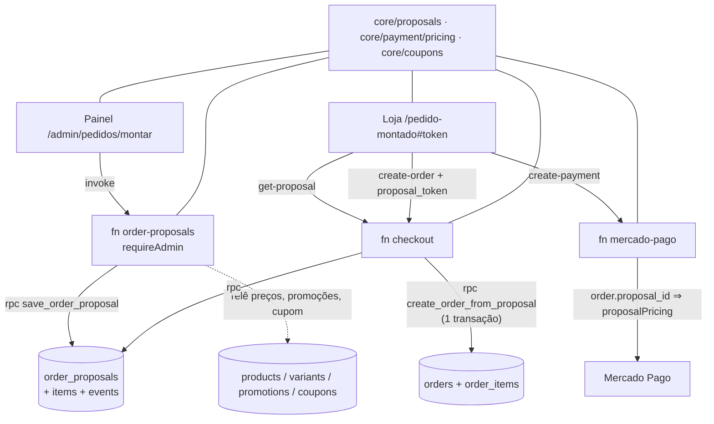

# 89 — Design

**Spec**: `.specs/features/89-pedido-montado-pelo-painel/spec.md` · **Status**: Approved (2026-10-31, execução ponta a ponta autorizada)
**Decisão de projeto nova**: `AD-070` (abaixo e em `STATE.md`).

## Architecture Overview

A proposta é **um registro do servidor, não um pedido**. O painel nunca escreve nas tabelas dela:
fala com a function de admin `order-proposals` (porta única, `AD-034`). A loja fala com a function
`checkout` (`get-proposal`, `create-order` com `proposal_token`). O pedido nasce por uma RPC atômica
chamada **só** pela function `checkout`, que grava `orders` + `order_items` **a partir das linhas
travadas da proposta** e marca a proposta concluída na mesma transação. O `create-payment` reconhece
`orders.proposal_id` e cobra pelo **mesmo** cálculo que a página do link desenhou (`proposalPricing`, em
`core`).

### Abordagens consideradas

| | Abordagem | Veredito |
| --- | --- | --- |
| **A** | Proposta em tabelas próprias; o pedido nasce na conclusão por RPC atômica dentro da function `checkout`; o `create-payment` cobra pelo cálculo travado | **Escolhida.** Cumpre `A-01`, `CON-06` ("mesma transação") e mantém um autor de pedido |
| B | Gravar o pedido já no painel com status `draft` | Recusada: entra em fila, Dashboard, estoque e quebra `pedidoComDonoUnico` |
| C | Link de carrinho (`?itens=…`) que repovoa a sacola da loja | Recusada: não trava preço nem desconto avulso, e o `create-payment` desfaria tudo |

## Code Reuse Analysis

| Peça | Onde | Uso |
| --- | --- | --- |
| `resolveOrderPricing` | `core/payment/pricing.ts:433` | ganha `manualDiscount` (depois de cupom, antes do PIX — `PRC-04`) |
| `newAccessToken`/`hashAccessToken`/`accessGrant`/`GUEST_ACCESS_DAYS` | `core/checkout/guestAccess.ts` | token do link (`SEG-01`), prazo de 7 dias |
| `requireAdmin`, `json`, `preflight`, `createRateLimiter`/`clientIp` | `supabase/functions/_shared/*` | function de admin e teto de `get-proposal` |
| `createFakeSupabase` | `_shared/testing/fakes.ts:339` | testes das functions |
| `ProductSearchField`/`useProductPool` | backoffice `entities/product` | busca de peça (`MON-05`, `AD-036`) |
| `buildCustomerSearchCondition` | `core/customers/search.ts:32` | busca de cliente em `customer_list` (`MON-02`) |
| `directoryEmailCondition` | `core/customers/link.ts` | ficha existente pelo e-mail (`MON-03`) |
| `maskCep`/`stripCep`; `useCepLookup` | `core/validators/cep.ts`; store `entities/address/api` | sobe para `core/hooks` (dois apps), loja reexporta por referência |
| `toQuoteProducts`, `pickupAvailable` | `core/shipping` | prévia do frete no painel (molde `MelhorEnvioTab.tsx:73`) |
| `hasEngraving`/`engravingLimit`/`engravingRefusal`/`requiresMaterial` | `core/material/material.ts` | linha da peça |
| `normalizeBrPhone`, `whatsappChatUrl` | `core/notifications/phone.ts` | ganha o `text` opcional (`LNK-02`) |
| `freeShippingState` | `core/shipping` | frete grátis na conclusão (`A-11`) |
| `ContactBlock`/`DeliveryBlock`/`PaymentBlock` | store `features/checkout/ui` | reaproveitados com props novas (`CON-01`) |
| `rememberAccess` | store `entities/order/model/orderAccess.ts` | acesso ao pedido depois da conclusão (`CON-07`) |
| `ActionButton`, `RecordPageHeader`, `FormCard`, `FieldGroup`, `CharCounter`, `MoneyInput`, `storeOrigin`, `foco.ts` | backoffice `shared/*` | telas novas |

## Components

### Banco — `supabase/migrations/20261103120000_89-pedido-montado.sql`
- `order_proposal_seq` + `order_proposals`: `id`, `number` (`'P-' || lpad(nextval,4,'0')`, único), `status` (`open|completed|cancelled` — **expirada é derivada** de `expires_at`, não gravada), `version int`, `token_hash text` (único), `expires_at`, `viewed_at`, `order_id` → `orders` (único, nulo), `customer_id` → `customers` (nulo), contato (`customer_name/email/phone/document`), endereço (`address_*`, todos nulos possíveis), cupom travado (`coupon_id`, `coupon_code`, `coupon_discount`, `coupon_free_shipping`), avulso (`manual_discount_kind 'amount'|'percent'`, `manual_discount_value`, `manual_discount_reason` ≤ 120, `manual_discount` resolvido), `subtotal`, `promotion_discount`, `items_total` (`check ≥ 1.00`, `A-12`), `idempotency_key` (único), `created_by`, `created_at`, `updated_at`.
- `order_proposal_items`: `proposal_id` (cascade), `position`, `product_id uuid`, `variant_id`, `product_name`, `product_image`, `variant_label`, `variant_options jsonb`, `quantity` (`1..99`), `list_price`, `unit_price` (travado, já com promoção), `engraving_text`, `requires_material`, `material_kinds`. Até 30 por proposta (na RPC).
- `order_proposal_events`: `kind` (`created|edited|link_sent|viewed|renewed|cancelled|completed`), `channel` (`whatsapp|copy`), `actor`, `created_at`.
- `orders.proposal_id uuid unique references order_proposals` e `orders.manual_discount numeric not null default 0`.
- RLS ligada nas três, `revoke all` de `anon`/`authenticated`/`public`, **nenhuma policy** (`SEG-05`).
- RPCs `security definer`, `search_path = ''`, `execute` só `service_role`:
  - `save_order_proposal(p jsonb) returns jsonb` — cria/edita numa transação, confere `version` (`CON-10`, duas abas), dedupe por `idempotency_key`, versão não sobe se nada mudou, cria a ficha `customers` (`user_id` nulo) só quando não existe outra por `lower(trim(email))` (`MON-03`), grava o evento.
  - `create_order_from_proposal(p_proposal_id uuid, p_version int, p_order jsonb) returns jsonb` — trava a linha (`for update`), recusa expirada/cancelada/versão velha, devolve o pedido existente se já concluída (`CON-06`), insere `orders` e `order_items` **a partir das linhas da proposta**, marca concluída e grava o evento.
  - `mark_order_proposal_viewed(p_proposal_id uuid)` — uma vez (`CON-11`).
  - `handle_new_customer` **recriada** para adotar a ficha `user_id is null` do mesmo `lower(email)` antes de inserir (`A-09`).

### `core/proposals/` (folhas com `.ts` explícito, alcançáveis pelo Deno)
- `limits.ts`: `PROPOSAL_MAX_LINES = 30`, `PROPOSAL_MAX_QTY = 99`, `MANUAL_REASON_MAX = 120`, `PROPOSAL_MIN_ITEMS_TOTAL = 1`.
- `number.ts`: `formatProposalNumber(n)`.
- `state.ts`: `proposalState(row, now) → 'open'|'viewed'|'completed'|'expired'|'cancelled'`, `PROPOSAL_STATE_LABELS`, `proposalActions(state)` (`LNK-05`/`LNK-06`).
- `pricing.ts`:
  - `priceProposalDraft({ lines, coupon, promotions, manualDiscount })` → `{ lockedLines, subtotal, promotionDiscount, couponDiscount, manualDiscount, itemsTotal, refusal }`. Chama `resolveOrderPricing`; a recusa `A-12` é "O desconto não pode zerar o pedido.". **Painel e function `order-proposals` chamam igual** (`MON-09`, `PRC-01`).
  - `proposalPricing(locked, { shipping, method, pixDiscountPercent, freeShippingThreshold })` → `OrderTotals`. **Página do link, `create-order` e `create-payment` chamam igual** (`PRC-06`).
- `link.ts`: `PROPOSAL_PATH = '/pedido-montado'`, `proposalLink(origin, token)` (token no fragmento), `proposalWhatsappText({ firstName, link, expiresAt })` (`LNK-02`).
- `types.ts`: `ProposalLine`, `LockedProposal`, `PublicProposal` (o que `get-proposal` devolve, **sem** motivo, hash nem notas — `SEG-04`).

### `core/payment/pricing.ts`
`OrderPricingInput.manualDiscount?: { kind: 'amount' | 'percent'; value: number } | null`. Aplicado sobre `subtotal − cupom`, com piso em 0 e arredondamento `round2`; `totals.manualDiscount`. Base do PIX = `subtotal − cupom − avulso`. Sem `manualDiscount`, saída **byte a byte igual** à de hoje (guarda: os testes atuais intocados).

### `core/coupons/rules.ts` (puro, novo)
`couponRefusal(coupon, { subtotal, now, hasPriorOrder }) → string | null` com os textos da loja, e `couponRuleOf(coupon)`. `validateCoupon` (`core/hooks/useCoupons.ts`) passa a delegar (dono único). A function `order-proposals` chama a mesma regra lendo `coupons` e `orders` com o client dela (`MON-07`, `PRC-01`).

### Function `supabase/functions/order-proposals/` (nova)
`index.ts` (wiring) + `handlers.ts` (`route(deps, req)`): `list`, `get`, `save` (recalcula com `priceProposalDraft` sobre o banco; total diferente do enviado ⇒ `409 prices_changed` com a frase de `PRC-02`; gera token **só** ao criar e devolve-o uma vez), `renew` (token novo, versão +1, preços relidos), `cancel`, `log-sent` (`LNK-03`), `quote` não — a prévia do frete usa a `melhor-envio?action=quote` que o painel já chama. `requireAdmin` em toda ação. `verify_jwt = false` no `config.toml` (padrão `admin-users`).

> **O token só existe na resposta do `save`/`renew`.** O banco guarda o hash; reabrir a proposta no painel não consegue remontar o link. Por isso a página da proposta guarda o link em `sessionStorage` do painel (`estrelinha.admin.proposal-link.<id>`) e, se não tiver, oferece **"Gerar link novo"** (= renovar). Trade-off aceito: segurança de credencial (`SEG-01`) acima de conveniência.

### Function `checkout` (alterada)
- `get-proposal`: corpo `{ token }`; teto por IP (limitador próprio, 30/5 min); hash → proposta; inválido/expirada/cancelada ⇒ `404 unavailable` sem dado (`CON-08`); concluída ⇒ `{ completed: true, order_id, access_token }` (token de convidada **reemitido**, como a idempotência de hoje — `CON-07`); aberta ⇒ `PublicProposal` com disponibilidade por linha (`CON-09`) + `mark_order_proposal_viewed`.
- `create-order` com `proposal_token` + `proposal_version`: ignora itens e preços do corpo; aceita do corpo só contato editável (nome, telefone, CPF), endereço, entrega escolhida e meio; **e-mail vem da proposta** (`A-07`); identidade **sem desafio** (`A-08`); confere estoque/ativo (`CON-09`, 422 `item_unavailable`); calcula frete com `proposalPricing` (cupom `free_shipping` e `freeShippingState`); chama `create_order_from_proposal`; depois segue o caminho de hoje (`ensureGuestCustomer`, conveniências, token de convidada). `409 proposal_changed` em versão velha (`CON-10`).

### Function `mercado-pago` (alterada)
Em `createPayment`, quando `order.proposal_id` existe: **não** relê catálogo, promoções nem cupom; monta o `LockedProposal` das linhas de `order_items` (`unit_price` travado) + `orders.discount` + `orders.manual_discount` e chama `proposalPricing` (`PRC-03`). O teto de promoção (`:663`) não se aplica a esse ramo.

### Painel (`apps/backoffice`)
- `entities/product/api/useProductVariants(productId)` + `entities/product/ui/VariantPicker` (por id, nunca por nome — `buscaDeProdutoComDonoUnico` intocado).
- `entities/customer/api/useCustomerSearch(term)` (sobre `customer_list`, `buildCustomerSearchCondition`) e `useCustomerAddresses(customerId)`.
- `features/order-proposal/`: `api/proposalsApi.ts` (invoke, `motivoDaFalha`), `model/draft.ts` (rascunho puro + `toSavePayload`), `model/useProposalDraft.ts`, `ui/CustomerSection`, `ui/AddressSection`, `ui/ItemsSection`, `ui/CouponField`, `ui/ManualDiscountField`, `ui/ProposalSummary`, `ui/ShippingPreview`, `ui/ProposalLinkCard`, `ui/ProposalHistory`.
- Páginas: `pages/admin/AdminProposalBuilderPage.tsx` (`/admin/pedidos/montar` e `/admin/pedidos/montar/:id` para editar; `?duplicar=<id>` para `DUP-01`), `pages/admin/AdminProposalPage.tsx` (`/admin/pedidos/montados/:id`).
- Lista de Pedidos: aba **"Montados"** local do painel (`?visao=montados`, tratado em `queryUrl.ts` nos dois sentidos), **fora** de `ORDER_VIEWS` de `core` (que contam `orders`).
- `AdminOrderPage`: "Montado pelo painel · P-0001" no subtítulo e a linha "Desconto combinado — {motivo}" no Pagamento (`HIS-02`).

### Loja (`apps/store`)
- `features/checkout/model/checkoutStore.ts` vira **fábrica** `createCheckoutStore(storageKey)` + `CheckoutStoreProvider`; os blocos leem pelo contexto, com o store de hoje como padrão (nada muda em `/checkout`). A proposta usa outra instância (`estrelinha-proposal-checkout`, `sessionStorage`) — **pagar o pedido montado nunca limpa a sacola** (`OrderPaymentPage` confere o store global).
- `ContactBlock`: prop `emailReadOnly` (sem `onBlur` de lookup, sem desafio, sem `setGuestEmail`). `DeliveryBlock`: props `quoteItems`/`subtotal` opcionais (padrão = sacola).
- `features/proposal-checkout/`: `model/proposalToken.ts` (**dono único** da chave `estrelinha-proposal-token`, `sessionStorage`; lê o fragmento e faz `history.replaceState`), `api/useProposal.ts`, `api/useCreateProposalOrder.ts`, `ui/ProposalItems` (só leitura, "Indisponível no momento"), `ui/ProposalSummary`, `ui/ProposalUnavailable`.
- `pages/ProposalCheckoutPage.tsx` (`lazy`, fora do `StoreLayout`, `<h1>Seu pedido</h1>`, `<title>` "Pedido montado").
- `app/PageViewTracker.tsx`: `page_location` sem o fragmento (`SEG-02` — hoje vaza o `#`).
- `core/routes`: `pedido-montado` em `ROUTE_SLUGS` e `NON_INDEXABLE_PATHS`; `core/seo/pages.ts` ganha a entrada (título distinto de "Seu pedido").

## Data flow da conclusão

1. Página lê o token do fragmento, guarda, apaga da barra → `get-proposal`.
2. Desenha itens travados + resumo (`proposalPricing` com a entrega escolhida e o meio).
3. "Concluir" → `create-order { proposal_token, proposal_version, contato, endereço, entrega, meio, client_request_id }`.
4. Servidor: confere, `create_order_from_proposal` (1 transação), conta/ficha, token de convidada → `{ order_id, access_token }`.
5. `rememberAccess` → PIX: `/pedido/:id/pagamento`; cartão: Brick + `create-payment` (ramo travado).

## Error Handling Strategy

| Cenário | Tratamento | O que a pessoa vê |
| --- | --- | --- |
| Preço mudou entre montar e gravar | `409 prices_changed`, relê | `PRC-02` |
| Duas abas da Adri | versão velha ⇒ `409 version_conflict` | "Esta proposta mudou em outra aba. Recarreguei." |
| Duplo clique em "Criar link" | `idempotency_key` | uma proposta |
| Cotação falhou no painel | prévia diz "Não consegui cotar o frete agora." | gravar segue liberado (`MON-10`) |
| Token inválido/expirado/cancelado | `404 unavailable`, sem dado | `CON-08` |
| Peça sem estoque/inativa | página marca; servidor `422 item_unavailable` | `CON-09` |
| Versão nova enquanto a página estava aberta | `409 proposal_changed` ⇒ relê | `CON-10` |
| Concluída aberta de novo / 2º aparelho | devolve o pedido | vai para `/pedido/:id` (`CON-07`) |
| Expira no meio (relógio do servidor) | `404 unavailable` | `CON-08` |
| Falha de conta/conveniência depois do pedido | engolida (como hoje) | pedido segue |

## Risks & Concerns

| Concern | Location | Impact | Mitigation |
| --- | --- | --- | --- |
| `create-order` grava pedido e itens sem transação | `checkout/handlers.ts:378-390` | pedido sem item em falha parcial | o ramo da proposta usa a RPC atômica; o ramo de hoje fica igual (fora de escopo) |
| `create-payment` derruba cupom vencido em silêncio | `mercado-pago/handlers.ts:601-618` | desfaria `A-06` | ramo `proposal_id` com `proposalPricing` + teste de paridade |
| `ensureGuestCustomer` lê `customers` por `eq('email')` com `maybeSingle` | `checkout/handlers.ts:440` | duas fichas do mesmo e-mail ⇒ não liga o pedido | a RPC de save nunca cria segunda ficha (`MON-03`) e a adoção por e-mail no trigger; o ramo da proposta liga pelo `customer_id` da proposta |
| `guard_customer_identity` pode recusar mudar `user_id` | migration `59` | adoção falharia | `handle_new_customer` é `security definer`; provado por probe SQL (T02) |
| `validateCoupon` não é puro, e calcula desconto à parte (3ª cópia) | `core/hooks/useCoupons.ts:61` | painel e servidor divergiriam | regra pura em `core/coupons/rules.ts`, hook delega |
| GA4 manda o fragmento | `store app/PageViewTracker.tsx:56` | token vaza para o Google | `page_location` sem hash + teste |
| `checkoutStore` global limpa a sacola na aprovação | `store OrderPaymentPage.tsx:106` | sacola da cliente some | store próprio por instância |
| Título "Seu pedido" já é de `/pedido/:id` | `core/seo/pages.ts:97` | `seo.test.ts` reprova | `<title>` "Pedido montado"; `h1` segue a spec |
| `marcacaoSoPorAcao` compara o conjunto de RPCs por igualdade | store `shared/lib/__tests__` | reprova a cada RPC nova | a task de cada function acrescenta as dela |
| Âncoras de contagem de rota (8 arquivos) | ver T07 | suíte reprova | T07 sobe todas juntas |

## Tech Decisions

| Decisão | Escolha | Por quê |
| --- | --- | --- |
| Estado "expirada" | derivado de `expires_at` | sem cron, sem segundo dono de "venceu?" |
| Cupom travado | gravado como valor (`coupon_discount`) + flag `free_shipping` | `A-06`; o `create-payment` cobra o valor, não relê a regra |
| Promoção travada | dentro do `unit_price` da linha | `A-05`; `promotion_discount` só para mostrar |
| Token do link | gerado só em criar/renovar, devolvido uma vez | hash no banco, como a convidada |
| Aba "Montados" | local do painel | `ORDER_VIEWS` conta `orders` e é lido pelo app do ateliê |
