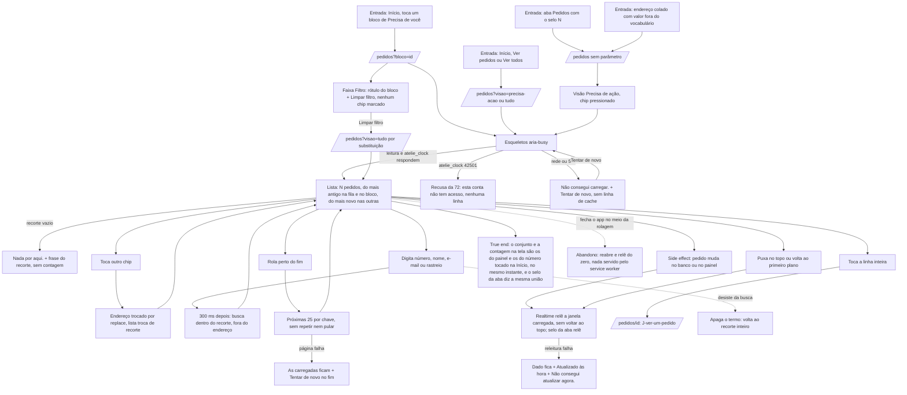

# J-achar-um-pedido — Achar um pedido pela lista do ateliê

Feature `74` (`MAP-01`..`MAP-19`, `MAP-31`..`MAP-46`). A pergunta da Adri: *"quais pedidos esperam por
mim?"* ou *"onde está o pedido que esta cliente me mandou no WhatsApp?"*. A lista obedece aos endereços
que a Início monta (`lerDestinoDePedidos`) e responde o mesmo conjunto de `/admin/pedidos`, pelo mesmo
predicado de `core` (`AD-057`). Só leitura: nenhum botão de ação.



```yaml
journey:
  id: J-achar-um-pedido
  name: Achar um pedido pela lista do ateliê
  value_statement: "A Adri acha pelo celular o pedido que espera por ela, ou o que a cliente citou, vendo o mesmo conjunto que o painel mostraria"
  personas: [Adri no celular, Equipe com TalkBack, Cliente com conta da loja]
  entry_points:
    - url: /pedidos?bloco=<id> (toque num bloco de Precisa de você)
      origin: in-app-nav
    - url: /pedidos?visao=precisa-acao; /pedidos?visao=tudo (Ver pedidos, Ver todos)
      origin: in-app-nav
    - url: /pedidos (aba com o selo)
      origin: in-app-nav
    - url: /pedidos?visao=<valor estranho> colado
      origin: direct
  actions:
    - step: 1
      verb: toca um número da Início
      expected_observable: a lista abre com a faixa do bloco e a mesma contagem do número tocado
    - step: 2
      verb: limpa o filtro ou troca de chip
      expected_observable: a lista troca de recorte, só um chip marcado, o endereço muda sem empilhar histórico
    - step: 3
      verb: busca pelo número que a cliente mandou (#0244, 0244, 244), pelo nome ou pelo e-mail
      expected_observable: o pedido aparece dentro do recorte; sem resultado, Nada por aqui. com o termo
    - step: 4
      verb: rola até o fim de um recorte longo
      expected_observable: as próximas páginas chegam sozinhas, nenhuma linha repetida
    - step: 5
      verb: lê a linha (número, situação, cliente, compra e idade, total, frase de bloqueio)
      expected_observable: nenhuma linha manda agir; a idade vem do relógio do servidor
    - step: 6
      verb: toca a linha
      expected_observable: abre o detalhe daquele pedido
  goal:
    observable: a lista do recorte com o mesmo conjunto de ids e a mesma contagem de /admin/pedidos e de store_overview
    side_effects: [nenhuma escrita; um canal Realtime de orders por montagem; selo da aba lido pela mesma chave da Início]
  true_end_state: depois de recarregar a página no mesmo endereço, o recorte, a contagem e o selo continuam iguais aos do painel; uma conta sem papel nunca viu linha nenhuma
  exit:
    natural: abre um pedido (J-ver-um-pedido) ou volta à Início
  abandonment:
    - at_step: 4
      how: fecha o app no meio da rolagem
      resume: reabre no endereço do recorte, relê do zero
    - at_step: 3
      how: desiste da busca e apaga o termo
      resume: o recorte inteiro volta, sem trocar de chip
  crosses: [PostgREST view order_list, RPC atelie_clock (has_role), RPC store_overview (selo), Supabase Realtime, painel /admin/pedidos (mesmo predicado de core), service worker]
```

## Varredura da taxonomia

| Dimensão | Onde |
| --- | --- |
| Jornada | `MAD-pedidos-bloco-da-inicio-filtra-a-lista`, `MAD-pedidos-trocar-de-visao` |
| Funcional | `MAD-pedidos-buscar-por-numero-ou-nome`, `MAD-pedidos-rolar-sem-repetir`, `MAD-pedidos-endereco-sem-ou-invalido`, `MAD-pedidos-selo-da-aba` |
| Experiencial | `MAD-pedidos-com-leitor-de-tela`; tom memorial e nenhum CTA morto (a linha não manda agir, `MAP-18`) dentro de `MAD-pedidos-trocar-de-visao` |
| Borda/erro/vazio | `MAD-pedidos-recorte-vazio`, `MAD-pedidos-leitura-falha`, `MAD-pedidos-conta-sem-papel-nao-ve-pedidos` |
| Transversal | `MAD-pedidos-fonte-grande-e-telas-estreitas` (360/390/412, 130/200 %), `MAD-pedidos-lista-ao-vivo` (painel em outra aba); canary `MAD-navegar-pelas-quatro-abas` |
