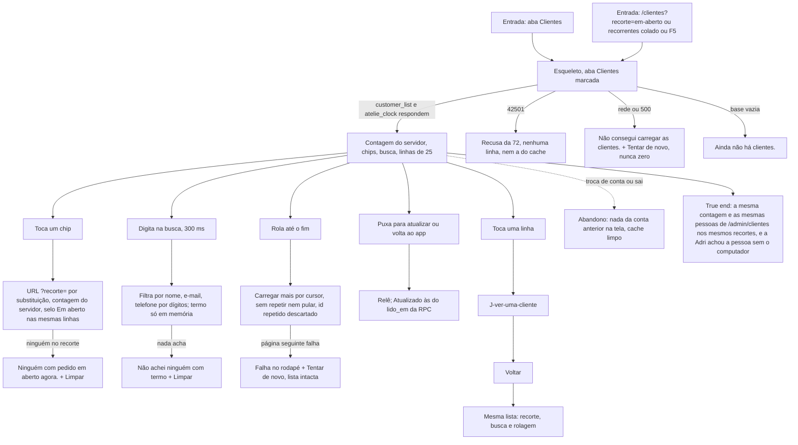

# J-achar-uma-cliente — Achar uma cliente na lista do ateliê

Feature `76` (`MAC-01`..`MAC-13`, `MAC-28`..`MAC-38`). A pergunta da Adri: *"quem é esta pessoa que me escreveu, e como falo com ela?"*. A lista lê `customer_list` pareada com `atelie_clock` (`lerComPapel`), ordena por atividade (não por gasto), tem dois recortes além de Todas e busca por nome, e-mail ou telefone (dígitos). **Só leitura.** Tom memorial: nenhum ranking, nenhum "VIP", o material que a pessoa confiou não aparece.



```yaml
journey:
  id: J-achar-uma-cliente
  name: Achar uma cliente no celular
  value_statement: "A Adri acha quem lhe escreveu pelo nome, e-mail ou telefone, sem abrir o notebook, e sem que o app diga um número falso"
  personas: [Adri no celular, Equipe com TalkBack, Cliente com conta da loja]
  entry_points:
    - url: /clientes
      origin: in-app-nav
    - url: /clientes?recorte=em-aberto
      origin: external-share
  actions:
    - step: 1
      verb: abre Clientes
      expected_observable: contagem do servidor, 25 linhas, ordem por atividade mais recente, nulos por último
    - step: 2
      verb: busca por pedaço do telefone digitado com máscara
      expected_observable: acha a pessoa pelos dígitos; o termo não vai à URL
    - step: 3
      verb: troca de recorte
      expected_observable: contagem e linhas batem com o painel; selo Em aberto nas mesmas linhas
    - step: 4
      verb: rola e carrega mais
      expected_observable: nenhum id repetido, falha de página só no rodapé
    - step: 5
      verb: abre uma linha e volta
      expected_observable: mesmo recorte, busca e rolagem
  goal:
    observable: lista e contagens iguais às de /admin/clientes nos recortes equivalentes
    side_effects: [nenhuma escrita; nenhum dado da cliente em URL, history.state, armazenamento ou console]
  true_end_state: depois de recarregar, o recorte da URL vale e a busca recomeça vazia; voltar da ficha devolve ao ponto
  exit:
    natural: abre uma ficha ou sai do app
  abandonment:
    - at_step: 4
      how: perde a rede no meio da rolagem
      resume: Tentar de novo no rodapé continua sem repetir linha
  crosses: [PostgREST customer_list, RPC atelie_clock, painel /admin/clientes]
```

## Varredura da taxonomia

| Dimensão | Onde |
| --- | --- |
| Jornada | `MAD-clientes-abrir-a-lista`, `MAD-clientes-voltar-mantem-lista` |
| Funcional | `MAD-clientes-buscar-nome-email-telefone`, `MAD-clientes-recortes-e-selo`, `MAD-clientes-carregar-mais-sem-repetir`, `MAD-clientes-bate-com-o-painel` |
| Experiencial | `MAD-clientes-tom-memorial`, `MAD-clientes-com-leitor-de-tela` |
| Borda/erro/vazio | `MAD-clientes-estados-vazios`, `MAD-clientes-leitura-falha-sem-zero`, `MAD-clientes-linha-sem-nome-sem-compra` |
| Transversal | `MAD-clientes-conta-sem-papel-nao-ve`, `MAD-clientes-privacidade-nada-no-aparelho`, `MAD-clientes-fonte-grande-e-telas-estreitas`, `MAD-clientes-teclado-e-voltar-do-android`, `MAD-clientes-troca-de-conta-limpa-tela` |
