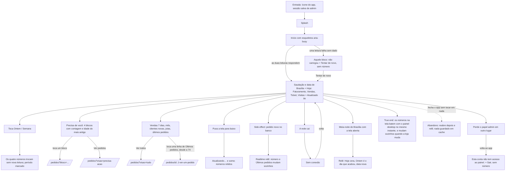

# J-acompanhar-a-loja — Abrir a Início e saber como está a loja hoje

Feature `73` (`AD-057`). A pergunta da Adri ao abrir o app: *"como está a loja hoje, e o que precisa
de mim?"*. Todo número vem do banco (dia de Brasília), nunca do relógio do aparelho.



```yaml
journey:
  id: J-acompanhar-a-loja
  name: Acompanhar a loja pela Início
  value_statement: "Ao abrir o app, a Adri sabe em uma tela quanto a loja vendeu e o que espera por ela, com número sempre certo"
  personas: [Adri no celular, Equipe com TalkBack]
  entry_points:
    - url: ícone instalado (start_url /)
      origin: push
    - url: http://localhost:<porta-do-preview>/
      origin: direct
  actions:
    - step: 1
      verb: abre o app já entrada
      expected_observable: esqueleto e depois os quatro números de Hoje, com a saudação e a data de Brasília
    - step: 2
      verb: toca Ontem e Semana
      expected_observable: os números trocam e o período fica marcado
    - step: 3
      verb: lê Precisa de você e toca um bloco
      expected_observable: abre /pedidos com o bloco no endereço
    - step: 4
      verb: puxa a tela para baixo
      expected_observable: Atualizando… e os números relidos, sem recarregar a página
    - step: 5
      verb: deixa o app aberto enquanto chega um pedido
      expected_observable: o número e Últimos pedidos mudam sozinhos
  goal:
    observable: os números de Hoje, da fila e do mês, iguais aos do banco no mesmo instante
    side_effects: [nenhuma escrita; um canal Realtime de orders enquanto a Início está aberta]
  true_end_state: os números batem com store_movement/store_overview e com /admin/pedidos, e mudam sem ação quando a loja muda
  exit:
    natural: toca um bloco e vai a /pedidos, ou fecha o app
  abandonment:
    - at_step: 1
      how: fecha o app antes de os números chegarem
      resume: reabre e relê do zero, sem número de cache
  crosses: [Supabase RPC store_movement e store_overview, Supabase Realtime, Supabase Auth (has_role), service worker]
```

## Varredura da taxonomia

| Dimensão | Onde |
| --- | --- |
| Jornada | `MAD-inicio-abrir-e-entender-o-dia`, `MAD-inicio-precisa-de-voce-leva-a-pedidos`; a chegada a Pedidos continua em `J-achar-um-pedido` e `J-ver-um-pedido` (feature `74`) |
| Funcional | `MAD-inicio-trocar-periodo`, `MAD-inicio-puxar-para-atualizar`, `MAD-inicio-pedido-novo-ao-vivo` |
| Experiencial | `MAD-inicio-com-leitor-de-tela`; tom memorial (nada festivo nos zeros) dentro de `MAD-inicio-loja-sem-venda` |
| Borda/erro/vazio | `MAD-inicio-loja-sem-venda`, `MAD-inicio-numeros-grandes`, `MAD-inicio-leitura-falha-sem-numero`, `MAD-inicio-virada-do-dia` |
| Transversal | `MAD-inicio-rede-cai-e-volta` (sobrepõe `MAD-rede-cai-com-app-aberto`), `MAD-inicio-perder-acesso-com-app-aberto` (a recusa da `72`) |
