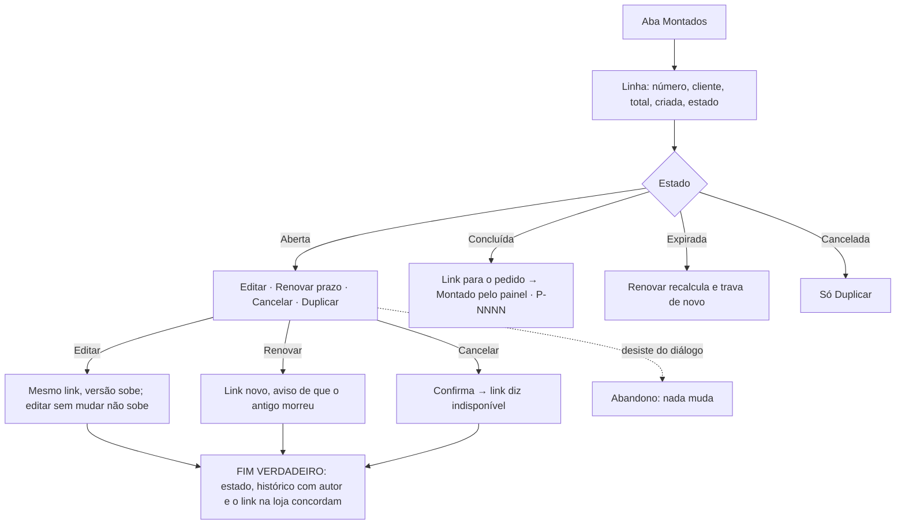

# J-acompanhar-pedidos-montados: a Adri acompanha, edita, renova e cancela o que montou

Feature `89` (`LNK-04`..`LNK-06`, `HIS-01`, `HIS-02`, `DUP-01`). Superfície: `apps/backoffice`,
`/admin/pedidos?visao=montados`, `/admin/pedidos/montados/:id`, `/admin/pedidos/:id` do pedido nascido. Área `PNL`.

```yaml
journey:
  id: J-acompanhar-pedidos-montados
  entry: [/admin/pedidos?visao=montados]
  goal: saber em que pé está cada proposta e agir sobre ela
  exit: o estado da aba bate com o banco; editar sobe a versão no mesmo link; renovar mata o link antigo; cancelar faz o link dizer indisponível; o pedido nascido mostra a origem e o desconto com motivo
  side_effects: [order_proposals version/expires_at/state, order_proposal_events, novo token na renovação]
```

## Fluxo



## Dimensões (taxonomia)

| Dimensão | Coberto por |
| --- | --- |
| Caminho feliz | ver a aba, abrir a proposta concluída e o pedido |
| Erro e borda | renovar com a cliente com o link antigo aberto, cancelar, editar sem mudar, F5 na aba |
| Dado | estado × banco, histórico com e-mail do autor (nunca uuid), desconto com motivo só no painel |
| Ambiente | 1440; 390 a 200 % na aba e na proposta |
| Acesso | teclado nos diálogos de cancelar/renovar, foco devolvido |
