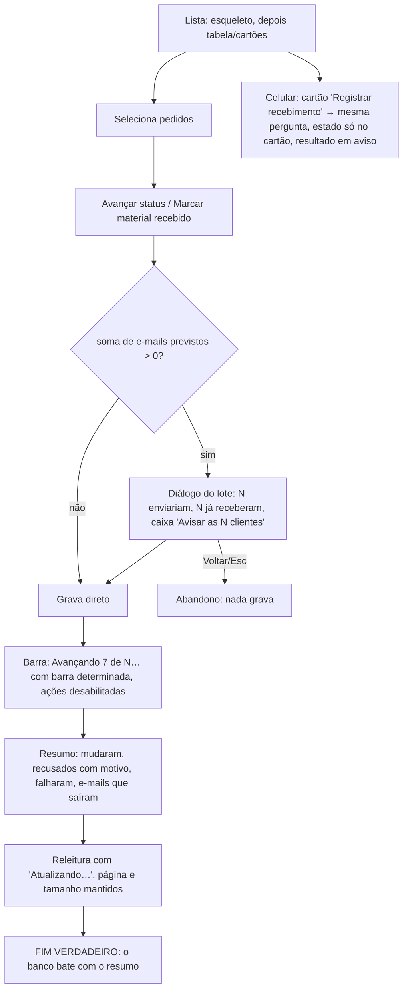

# J-avancar-pedidos-em-lote: a dona avança vários pedidos de uma vez e decide os e-mails uma vez só

Feature `88` (`AVS-19`..`AVS-21`, `CRG-10`..`CRG-13`). Superfície: `apps/backoffice`, `/admin/pedidos`
(barra de lote, cartão do celular). Área `PNL`. Persona: Adri despachando pedidos.

```yaml
journey:
  id: J-avancar-pedidos-em-lote
  entry: [/admin/pedidos]
  goal: avançar status ou registrar material de vários pedidos sabendo quantos e-mails saem
  exit: resumo com mudados, recusados (motivo), falhas e e-mails que saíram; a tabela continua na tela
  side_effects: [orders × N, order_notifications sent/skipped × N]
```

## Fluxo



## Dimensões (taxonomia)

| Dimensão | Coberto por |
| --- | --- |
| Caminho feliz | lote de 3 avançando com aviso |
| Erro e borda | lote misto (já enviados, recusados), mais de 50 selecionados (teto) |
| Dado | o número de e-mails do resumo bate com `order_notifications` |
| Ambiente | 390 (cartões) e 1440 (tabela), fonte 200 % na barra de lote |
| Acesso | barra de progresso com valor, região viva do resumo. Concorrência: ações desabilitadas durante o lote |
