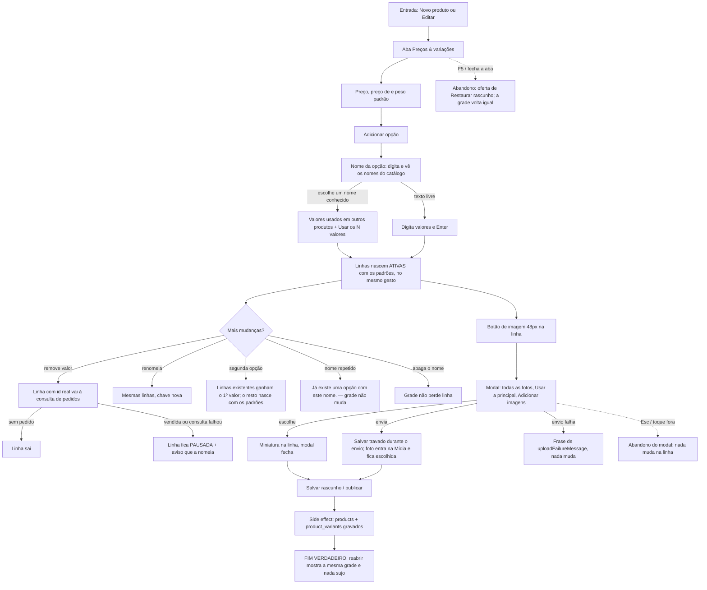

# J-cadastrar-peca-com-variacoes: cadastrar uma peça que repete um padrão do catálogo

Feature `81` (`.specs/features/81-opcoes-e-variacoes-do-produto/`, `AD-063`). Superfície: `apps/backoffice`,
aba **Preços & variações** de `/admin/produtos/novo` e `/admin/produtos/:id/editar`. Área `PNL`.

## Persona desta jornada

> A persona abaixo ainda não está em `personas.md` (que mora na branch `feature/mobile-adm`); entra lá
> no merge. Fica aqui para a jornada não depender do arquivo de outra branch.

```yaml
persona:
  name: Adri cadastrando peças
  base: Power User
  goal: cadastrar várias peças parecidas seguidas (mesmas opções, mesmos tamanhos) sem digitar tudo de novo
  device: desktop (1440) e phone-large (390), com a fonte do sistema às vezes em 130 % ou 200 %
  network: wifi-fast
  modality: mouse + teclado no notebook; toque no celular
  locale: pt-BR
  patience_seconds: 20
```

Faz a peça, fotografa e cadastra na mesma tarde. O que mais custa é repetir: o nome da opção, os
valores e o preço de cada linha. O que mais assusta é a grade apagar uma linha que já foi vendida.

## Mapa

```yaml
journey:
  id: J-cadastrar-peca-com-variacoes
  entry: [/admin/produtos/novo, /admin/produtos/:id/editar → aba Preços & variações]
  goal: a peça salva com as opções certas e uma linha ATIVA por combinação, com preço, preço "de" e peso padrão, e a foto de cada variação
  exit: reabrir o produto mostra a mesma grade, sem "Alterações não salvas"
  side_effects: [products.options, product_variants (insert/update/delete), fotos no bucket product-images, consulta a order_items por variação que sai]
```

## Fluxo



## Cenários derivados

`PNL-variacoes-*` em `../scenarios/`. As dimensões da taxonomia, por jornada: caminho feliz (nascer
ativa, sugestão, imagem), erro e borda (OPV-23..27), dado (linha vendida, posição), ambiente (390, 1440,
fonte 130/200 %) e acesso (alvo de toque, nome acessível). Leitor de tela real e Android real não foram
cobertos neste ciclo — registrado no relatório.
