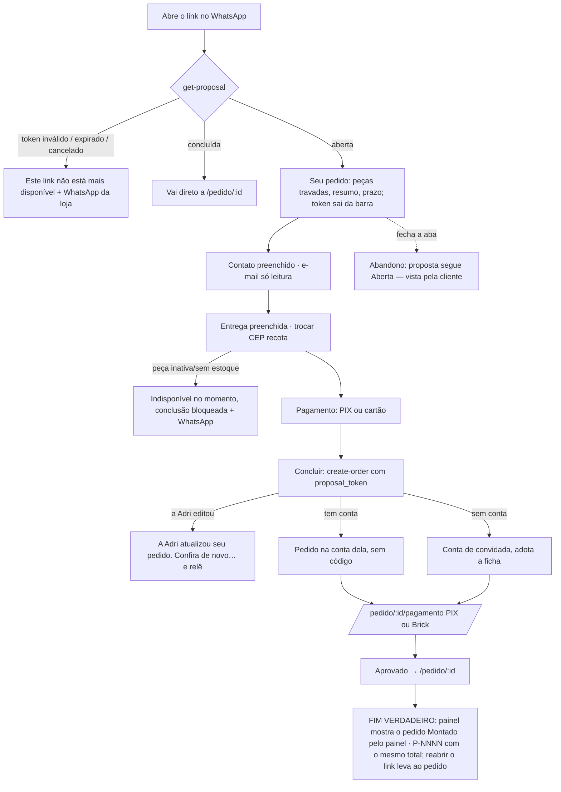

# J-concluir-pedido-montado: a cliente abre o link no celular, confere, escolhe entrega e pagamento e paga

Feature `89` (`CON-01`..`CON-12`, `PRC-03`..`PRC-06`, `SEG-02`, `SEG-03`). Superfície: `apps/store`,
`/pedido-montado#<token>` → `/pedido/:id/pagamento` → `/pedido/:id`. Área `LOJA`. Personas: Cliente de luto
pelo link (sem conta) e Cliente com conta pelo link.

```yaml
journey:
  id: J-concluir-pedido-montado
  entry: [/pedido-montado#<token> (vindo do WhatsApp)]
  goal: conferir o pedido montado, ajustar contato/endereço, escolher a entrega e o pagamento, pagar
  exit: o pedido nasce com proposal_id, total = o do link = o cobrado; a proposta vira Concluída; reabrir o link leva ao pedido
  side_effects: [orders + order_items, order_proposals completed, conta de convidada ou pedido na conta existente, e-mails do pedido, sacola da loja intocada]
```

## Fluxo



## Dimensões (taxonomia)

| Dimensão | Coberto por |
| --- | --- |
| Caminho feliz | sem conta, troca o número da casa, PAC/SEDEX + PIX, até a tela do PIX |
| Erro e borda | link inválido, cancelado, renovado (o antigo morre), editado com a página aberta, duplo clique em concluir, dois aparelhos |
| Dado | `orders.proposal_id`, total igual nos três lugares, sacola `estrelinha-cart` intocada, e-mail fixo |
| Ambiente | 390×844 a 100/130/200 %; 1440 de controle |
| Acesso | só teclado, foco nos blocos e no erro; token fora de URL/analytics/localStorage; `noindex` |
