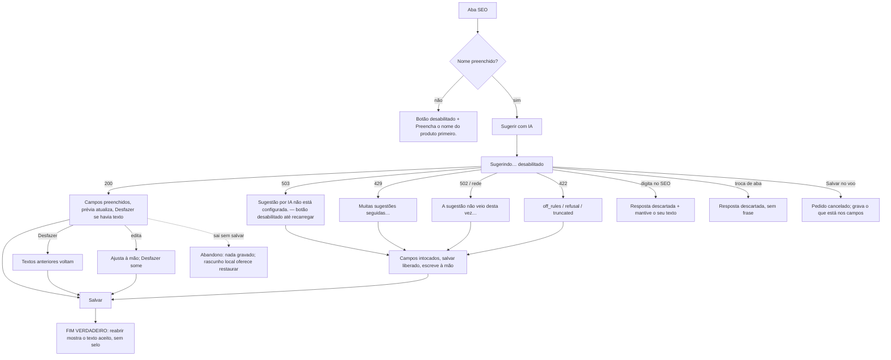

# J-curar-seo-com-ia: curar o SEO de uma peça com "Sugerir com IA"

Feature `84` (`SIA-10`..`SIA-25`). Superfície: aba SEO de `/admin/produtos/:id/editar` (e de `/novo`), a
edge function `seo-suggest`. Área `PNL`. Persona: Adri cadastrando peças.

```yaml
journey:
  id: J-curar-seo-com-ia
  entry: [/admin/produtos/:id/editar → aba SEO]
  goal: título e descrição curados no tom da loja, revisados por ela, gravados só no Salvar
  exit: reabrir a peça mostra os dois campos com o texto aceito, sem selo "automático"
  side_effects: [POST functions/v1/seo-suggest (não grava), products.seo_title/seo_description no Salvar]
```



Dimensões: caminho feliz (sugerir, desfazer, salvar), erro (503 real, 429/502/422 interceptados, rede
abortada), concorrência (digitar, trocar de aba, salvar com o pedido no ar, toque duplo), acesso (região
`aria-live`, foco depois de Desfazer, teclado, fonte 200 % — D1/D2), dado (texto curado substituído e
devolvido; sugestão longa).
