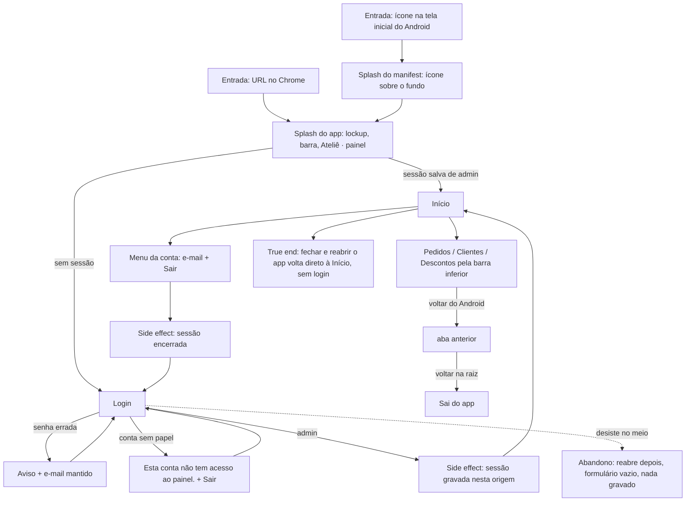

# J-entrar-no-atelie — Abrir o ateliê no celular e chegar às abas



```yaml
journey:
  id: J-entrar-no-atelie
  name: Entrar no ateliê e navegar pelas abas
  value_statement: "A Adri abre o painel da loja como um app e chega às quatro áreas em segundos"
  personas: [Adri no celular, Cliente com conta da loja, Equipe com TalkBack]
  entry_points:
    - url: ícone instalado (start_url /)
      origin: push
    - url: http://localhost:8084/
      origin: direct
  actions:
    - step: 1
      verb: abre o app
      expected_observable: splash com o lockup; nunca uma tela branca nem o formulário piscando
    - step: 2
      verb: entra com e-mail e senha
      expected_observable: a Início, sem passar pela recusa
    - step: 3
      verb: toca nas abas da barra inferior
      expected_observable: cada aba abre com o título dela e a marcação de aba atual
    - step: 4
      verb: usa o voltar do Android
      expected_observable: volta à aba anterior; na raiz, sai do app
    - step: 5
      verb: sai pelo menu da conta
      expected_observable: volta ao Login
  goal:
    observable: a Início aberta, com as quatro abas e o rodapé do Backoffice
    side_effects: [sessão gravada no localStorage desta origem]
  true_end_state: fechar e reabrir o app leva direto à Início (a sessão sobreviveu), e depois de Sair reabrir leva ao Login
  exit:
    natural: a Adri fecha o app pela tela inicial
  abandonment:
    - at_step: 2
      how: desiste no meio do login (fecha o app)
      resume: reabre e encontra o Login vazio, sem sessão parcial
  crosses: [Supabase Auth, user_roles (papel admin), service worker]
```

## Varredura da taxonomia

| Dimensão | Onde |
| --- | --- |
| Jornada | `MAD-entrar-e-chegar-ao-inicio`, `MAD-reabrir-com-sessao-salva` |
| Funcional | `MAD-senha-errada-mantem-email`, `MAD-conta-sem-acesso-recusada`, `MAD-sair-volta-ao-login` |
| Experiencial | `CH-entrar-no-atelie-pelo-celular` (Feature Tour): splash, copy memorial, alvos de toque |
| Borda/erro/vazio | `MAD-conta-sem-acesso-recusada`; abandono no login dentro do charter |
| Transversal | 390 × 844 e 360 × 800 (Android pequeno) no charter; regressão: o Backoffice continua igual (fora do app, sem charter: a suíte do painel cobre) |
