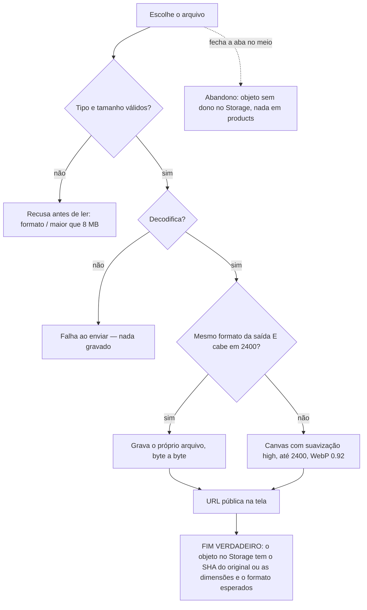

# J-enviar-foto-pelo-painel: a dona envia a foto e ela fica guardada como foi enviada

Feature `87` (`IMG-09`..`IMG-14`, `IMG-18`). Superfície: `apps/backoffice` — o motor
`shared/lib/uploadImage.ts`, alcançado pela galeria do produto (Resumo e modal Mídia), pela arte da
Home (`/admin/home`) e pelo banner do menu (`/admin/menu`). Área `PNL`. Persona: Adri cadastrando peças.
Sobrepõe `J-ver-e-cuidar-das-fotos-da-peca` (o envio é o ramo F dela); esta jornada olha o ARQUIVO gravado.

```yaml
journey:
  id: J-enviar-foto-pelo-painel
  entry: [/admin/produtos/:id/editar (Adicionar imagens), /admin/home (arte de seção), /admin/menu (banner)]
  goal: enviar a foto do celular ou a arte pronta sem perder nitidez
  exit: o objeto gravado no Storage é o próprio arquivo (WebP/PNG que já cabe) ou um WebP 0.92 de no máximo 2400px no maior lado; a dica da área de envio diz o teto
  side_effects: [objeto novo em product-images ou home-images]
```

## Fluxo



## Dimensões (taxonomia)

| Dimensão | Coberto por |
| --- | --- |
| Caminho feliz | WebP do catálogo enviado intacto; foto de celular JPEG 4000px reduzida a 2400 |
| Erro e borda | arquivo corrompido com extensão válida; exatamente 2400; 2401; PNG transparente da Lista de categorias |
| Dado | PNG com alfa na arte da Home (não pode perder transparência); render do estúdio (Blob sem tipo) |
| Ambiente | painel em 390 e 1440; a dica da área de envio com fonte 200 % |
| Acesso | a dica é texto lido pelo leitor de tela dentro da área "Enviar imagens" |
