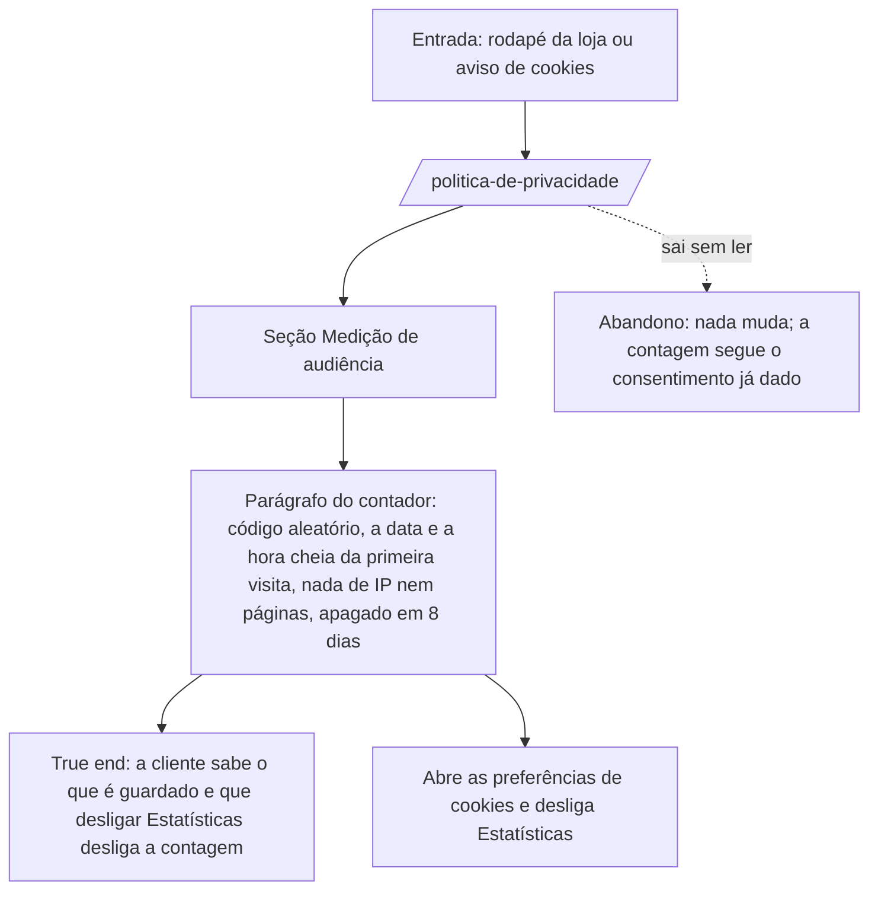

# J-ler-a-politica-de-privacidade — Saber o que a loja guarda sobre a visita

Loja pública. Desde a feature `83` a contagem de visitas guarda também a **hora cheia** da primeira
visita do dia, e a política tem de dizer isso antes do deploy (`LAV-66`).



```yaml
journey:
  id: J-ler-a-politica-de-privacidade
  name: Ler a política de privacidade
  value_statement: "Quem visita a loja sabe, em linguagem simples, o que o contador de visitas guarda"
  personas: [Cliente com conta da loja]
  entry_points:
    - url: /politica-de-privacidade
      origin: navigation
  actions:
    - step: 1
      verb: abre a política pelo rodapé
      expected_observable: a página com a seção Medição de audiência
    - step: 2
      verb: lê o parágrafo do contador
      expected_observable: o texto do Apêndice A da spec da 83, com a hora cheia
  goal:
    observable: o parágrafo novo, palavra por palavra
    side_effects: []
  true_end_state: a página servida contém o texto do Apêndice A e nenhum resto do parágrafo da 71
  exit:
    natural: volta à loja
  abandonment:
    - at_step: 1
      how: sai sem ler
      resume: nada a retomar
  crosses: [aviso de cookies (estrelinha-cookie-consent)]
```

## Varredura da taxonomia

| Dimensão | Onde |
| --- | --- |
| Jornada / Funcional | `LOJA-politica-hora-cheia` |
| Experiencial | legibilidade em 390 dentro de `LOJA-politica-hora-cheia` |
| Borda/erro/vazio | não se aplica: página estática, sem leitura |
| Transversal | o consentimento de cookies não muda nesta feature; fora de escopo |
