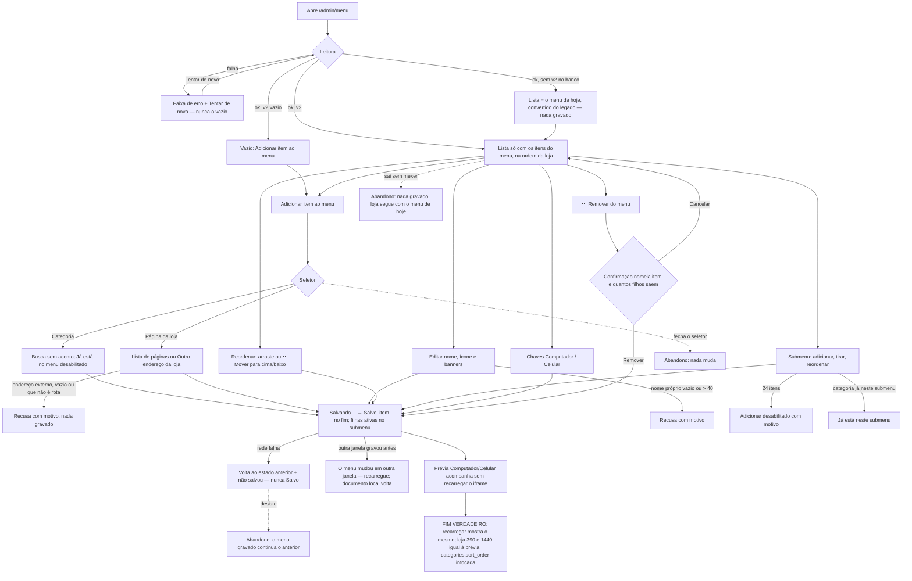

# J-montar-o-menu-da-loja: a dona monta o menu da loja item por item

Feature `86` (`MNM-01`..`MNM-41`, `AD-068`). Superfície: `/admin/menu` (`MenuTree`, `MenuTargetPicker`,
`MenuItemEditor`, `MenuBannerEditor`, `MenuRemoveConfirm`, `MenuLivePreview`), gravando
`store_settings.menu` `{ version: 2, items }`. Área `PNL`. Persona principal: Adri montando o menu.

```yaml
journey:
  id: J-montar-o-menu-da-loja
  entry: [/admin/menu (sidebar Loja → Menu da loja), /admin/menu aberto em duas abas]
  goal: o menu gravado tem os itens, a ordem, os nomes, os ícones, os submenus e as chaves por dispositivo que ela escolheu
  exit: recarregar /admin/menu mostra o mesmo documento, e a loja (8082) desenha o mesmo que a prévia
  side_effects: [update store_settings where key='menu' and updated_at=visto, upload de arte em home-images/menu (banners), nenhuma escrita em categories]
```



Ramos de ciclo de vida: categoria referenciada **desativada** ⇒ selo "Categoria inativa — não aparece na
loja"; **apagada** ⇒ "Categoria apagada" com a única ação "Remover do menu"; link externo gravado antes da
`86` ⇒ editável (nome, ordem, remover), mas não se cria outro.

Dimensões (taxonomia): caminho feliz (montar do zero, primeiro acesso legado, editar); erro (leitura que
falha, gravação que falha, endereço inválido, nome vazio); concorrência (duas abas, toque duplo em
Adicionar/Remover, ações seguidas na fila); acesso (teclado, foco nos diálogos e na folha de baixo, nomes
acessíveis das chaves e do "⋯", fonte 130/200 %, `prefers-reduced-motion`); dado (categoria inativa/apagada,
repetida, submenu de 24, nome de 40, link externo legado, banners vindos de `categories.menu_banners`).
