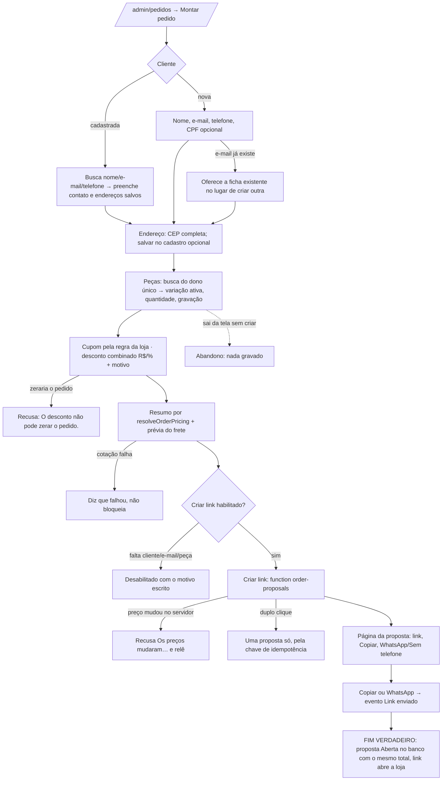

# J-montar-pedido-para-a-cliente: a Adri monta no painel a venda que combinou no WhatsApp e manda o link

Feature `89` (`MON-01`..`MON-12`, `PRC-01`, `PRC-02`, `LNK-01`..`LNK-03`, `SEG-05`). Superfície:
`apps/backoffice`, `/admin/pedidos` → "Montar pedido" → `/admin/pedidos/montar` → `/admin/pedidos/montados/:id`.
Área `PNL`. Persona: Adri montando uma venda. Sobrepõe `J-concluir-pedido-montado` (o link) e
`J-acompanhar-pedidos-montados` (a aba Montados).

```yaml
journey:
  id: J-montar-pedido-para-a-cliente
  entry: [/admin/pedidos, /admin/pedidos/montar]
  goal: montar cliente, endereço, peças, cupom e desconto combinado e gerar o link
  exit: a proposta P-NNNN existe Aberta, o total do resumo é o gravado em order_proposals, e o link copiado/WhatsApp abre a loja
  side_effects: [order_proposals + itens, customers (cliente nova, user_id nulo), endereço salvo opcional, order_proposal_events created/link_sent]
```

## Fluxo



## Dimensões (taxonomia)

| Dimensão | Coberto por |
| --- | --- |
| Caminho feliz | Cliente nova, duas peças (uma com variação e gravação), cupom 10 % e R$ 20 combinados |
| Erro e borda | e-mail repetido, desconto que zera, cotação falhando, Criar link sem cliente/peça, duplo clique |
| Dado | total do resumo × `order_proposals.items_total`; ficha nova sem `user_id`; nenhum `orders` nasce aqui |
| Ambiente | 1440 (principal); 390 a 100/130/200 % na montagem e na página da proposta |
| Acesso | teclado do começo ao fim, foco nos diálogos, rótulos; autorização: function exige admin (provada por teste, não remedida) |
