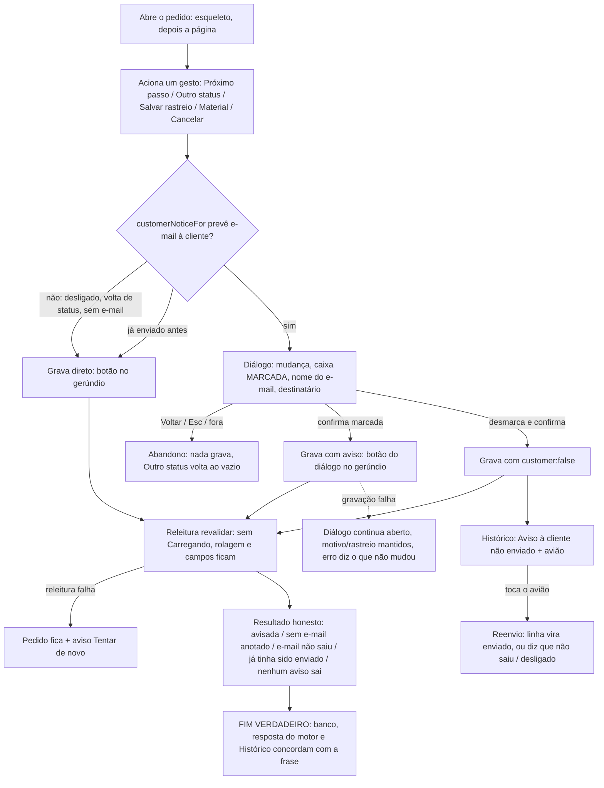

# J-mudar-pedido-com-ou-sem-aviso: a dona muda algo no pedido e escolhe se a cliente recebe e-mail

Feature `88` (`AVS-01`..`AVS-18`, `AVS-22`..`AVS-24`, `CRG-01`..`CRG-09`). Superfície: `apps/backoffice`,
`/admin/pedidos/:id` (Próximo passo, Outro status, Entrega, Material, Cancelar, Histórico). Área `PNL`.
Persona: Adri despachando pedidos. Sobrepõe `J-ver-um-pedido` (app do ateliê, que lê a mesma linha `skipped`).

```yaml
journey:
  id: J-mudar-pedido-com-ou-sem-aviso
  entry: [/admin/pedidos/:id]
  goal: mudar status, rastreio ou material, avisando a cliente só quando faz sentido
  exit: o pedido mudou, o resultado diz o desfecho real do e-mail, e o Histórico mostra o e-mail enviado ou a linha "não enviado" com o avião
  side_effects: [orders atualizado, order_status_history, order_notifications sent/skipped/failed, aviso à dona]
```

## Fluxo



## Dimensões (taxonomia)

| Dimensão | Coberto por |
| --- | --- |
| Caminho feliz | Marcar como enviado com rastreio, avisando; desmarcar e o avião enviar depois |
| Erro e borda | Releitura falhando, gravação falhando, já enviado, evento desligado, cliente sem e-mail, retirada |
| Dado | linha `skipped` em `order_notifications` vira `sent`/`failed` pelo avião; o aviso à dona sai mesmo desmarcado |
| Ambiente | 390 e 1440, fonte 130 % e 200 %, Slow 3G |
| Acesso | foco entra/volta no diálogo, região viva, nome do avião, alvos 44px. Autorização N/A (nada muda em quem grava) |
