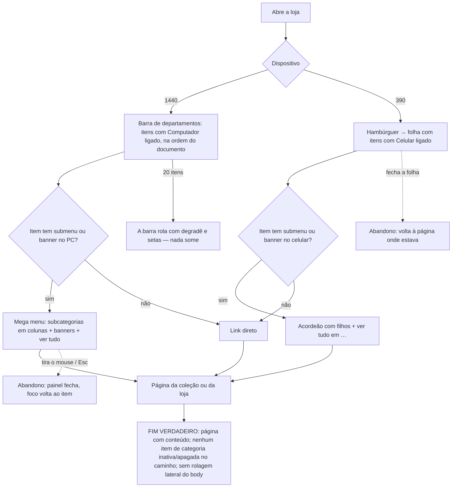

# J-navegar-pelo-menu-da-loja: a cliente acha a joia pelo menu montado pela dona

Feature `86` (`MNM-15`, `17`, `27..31`, `35..36`, `39..40`). Superfície: header da loja (barra de
departamentos e `MegaMenu` em ≥ lg, `MobileMenu` em < lg), lendo `store_settings.menu` por `useMenu`.
Área `LOJA`. Persona: Cliente navegando pelo menu.

```yaml
journey:
  id: J-navegar-pelo-menu-da-loja
  entry: [http://localhost:8082/ (qualquer página da loja), folha do menu no celular]
  goal: chegar a uma coleção ou página de verdade pelo menu, com os nomes e a ordem que a dona escolheu
  exit: a página de destino abre com conteúdo (nunca 404), e o menu é o mesmo em 390 e 1440 que a prévia do painel mostra para cada dispositivo
  side_effects: [nenhum — só leitura de store_settings e categories]
```



Ramo "sem v2": enquanto o documento novo não foi gravado, a loja desenha o menu de antes (o legado
convertido) — idêntico, item a item, ao de hoje.

Dimensões: caminho feliz (navegar após gravação, em 390 e 1440); erro (categoria inativa ou apagada não
aparece; link externo legado continua levando); concorrência (N/A — leitura; a única corrida é a página
aberta durante uma gravação, coberta por recarregar); acesso (teclado no mega menu, foco e Esc, nomes
acessíveis da folha, fonte 200 % — ver `BUG-20261027-rodape-da-loja-rola-de-lado-com-fonte-200`, o cabeçalho a
390/200 % ainda rola, anterior à `86`); dado (nome próprio × nome da categoria renomeada, ícone, barra com 20 itens).
