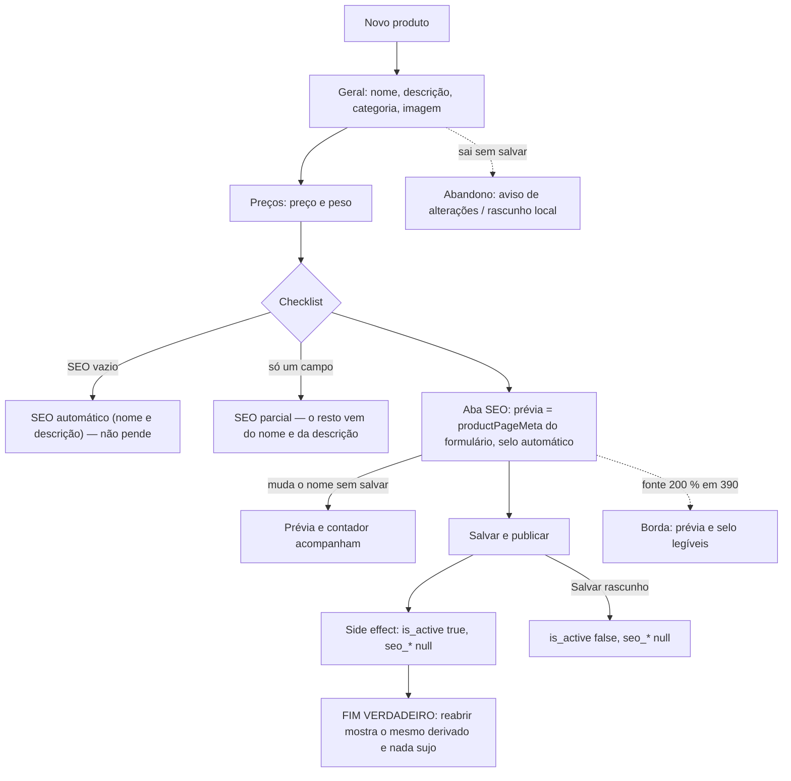

# J-publicar-peca-sem-escrever-seo: cadastrar uma peça e publicar sem escrever o SEO

Feature `84` (`.specs/features/84-seo-do-produto-com-ia/`, `SIA-01`..`SIA-09`). Superfície: `apps/backoffice`,
`/admin/produtos/novo` e `/admin/produtos/:id/editar` (checklist "Pronto para publicar", aba SEO). Área `PNL`.
Persona: Adri cadastrando peças (`../personas.md`).

```yaml
journey:
  id: J-publicar-peca-sem-escrever-seo
  entry: [/admin/produtos/novo]
  goal: a peça vai ao ar com o título e a descrição derivados do nome e da descrição, e a Adri viu antes o que o Google vai mostrar
  exit: reabrir a peça mostra seo_title/seo_description vazios, a prévia com o derivado e o selo "automático"
  side_effects: [products (is_active, seo_title = null, seo_description = null), imagem em product-images]
```



Dimensões: caminho feliz (publicar/rascunho sem SEO), dado (nome longo passa de 60 com a marca; só um
campo), ambiente (360/390/412/1440, fonte 130/200 %), acesso (selo e contador lidos pelo leitor de tela),
erro (preço 0 — anterior à `84`, fora).
