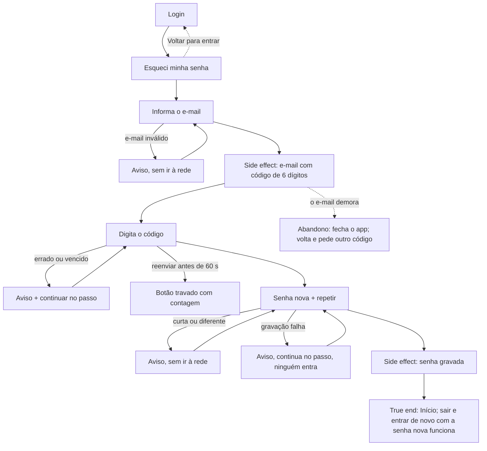

# J-recuperar-acesso — Voltar a entrar com o código de 6 dígitos



```yaml
journey:
  id: J-recuperar-acesso
  name: Recuperar o acesso por código
  value_statement: "A Adri volta a entrar sozinha, com a instrução batendo com o e-mail que chegou"
  personas: [Adri recuperando o acesso]
  entry_points:
    - url: /login → Esqueci minha senha
      origin: in-app-nav
  actions:
    - step: 1
      verb: pede o código para o e-mail dela
      expected_observable: "Enviamos um código de 6 dígitos para <e-mail>"; nunca a palavra link
    - step: 2
      verb: digita o código
      expected_observable: o passo da senha nova
    - step: 3
      verb: grava a senha nova
      expected_observable: a Início
  goal:
    observable: a Início aberta depois da senha nova
    side_effects: [e-mail de recuperação com {{ .Token }}, senha atualizada no GoTrue]
  true_end_state: sair e entrar de novo com a senha NOVA funciona, e a antiga não
  exit:
    natural: a Início
  abandonment:
    - at_step: 1
      how: o e-mail demora; ela fecha o app
      resume: volta ao Login e pede outro código (o reenvio respeita 60 s)
  crosses: [Supabase Auth (GoTrue), template de e-mail de recovery, Resend/SMTP]
```

## Varredura da taxonomia

| Dimensão | Onde |
| --- | --- |
| Jornada | `MAD-recuperar-acesso-por-codigo` (o código real chegando é `blocked-verify`: e-mail externo) |
| Funcional | `MAD-codigo-errado-ou-vencido` |
| Experiencial | copy de código (o protótipo falava em link) no charter |
| Borda/erro/vazio | código errado, reenvio antes de 60 s, gravação que falha |
| Transversal | o template de auth do hospedado é o mesmo da loja (`supabase/templates/recovery.html`); sem charter próprio: já provado pela `54` |
