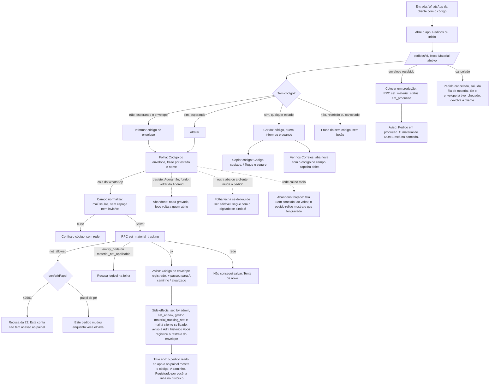

# J-registrar-envelope-da-cliente — Registrar e consultar o código do envelope da cliente

Feature `82` (`ENV-01`..`ENV-27`). A cliente posta o envelope com o material (cinzas, leite, cabelo…) e
manda o código pelo WhatsApp. A Adri, no celular, abre o pedido, registra o código no bloco "Material
afetivo" → "Envelope da cliente", e o pedido passa para "A caminho". Depois ela consulta: copia o código,
abre nos Correios, vê quem informou e quando. Quando o envelope chega, "Colocar em produção" leva o
material à bancada. É a remessa de **entrada** (`material_tracking_code`), nunca o rastreio de saída da
joia (`J-registrar-material-e-envio`).

A escrita tem um dono (`writeMaterialTracking`, `core/order-actions`), o mesmo do card do painel; a RPC
`set_material_tracking` grava `material_tracking_set_by`/`_set_at` e move `aguardando → enviado`.



```yaml
journey:
  id: J-registrar-envelope-da-cliente
  name: Registrar e consultar o código do envelope da cliente
  value_statement: "A Adri registra pelo celular o código que a cliente mandou, o pedido passa para A caminho, e ela consegue conferir o envelope nos Correios e saber quem informou e quando"
  personas: [Adri no celular, Equipe com TalkBack, Cliente com conta da loja]
  entry_points:
    - url: /pedidos/<id> (bloco Material afetivo)
      origin: in-app-nav
    - url: /pedidos?bloco=aguardando-material (vindo da Início)
      origin: in-app-nav
  actions:
    - step: 1
      verb: abre o pedido da cliente que mandou o código
      expected_observable: bloco Material com os materiais, há quanto tempo espera e o Envelope da cliente
    - step: 2
      verb: toca Informar código do envelope (ou Alterar)
      expected_observable: folha com a frase do estado e o nome da cliente, foco no campo
    - step: 3
      verb: cola o código que veio no WhatsApp e salva
      expected_observable: código limpo no campo; a folha fecha só no sucesso; aviso de registro
    - step: 4
      verb: confere o envelope
      expected_observable: cartão com o código, Registrado por você agora; Copiar e Ver nos Correios
    - step: 5
      verb: quando o envelope chega, coloca em produção
      expected_observable: Pedido em produção. com o nome da cliente
  goal:
    observable: o código no pedido, A caminho, autoria e data certas, iguais no app e no painel
    side_effects: [orders.material_tracking_code/_set_by/_set_at; material_status aguardando→enviado; gatilho material_tracking_set em order_notifications; releitura do detalhe, lista e Início]
  true_end_state: depois de recarregar o app e abrir /admin/pedidos/<id>, os dois mostram o mesmo código e estado, o histórico do app tem a linha Você registrou o rastreio do envelope, e o link dos Correios abre o código exato
  exit:
    natural: aviso de confirmação e volta à lista
  abandonment:
    - at_step: 2
      how: abre a folha e desiste (Agora não, fundo, voltar do Android)
      resume: nada gravado; reabrir começa do valor salvo
    - at_step: 3
      how: a rede cai no meio do Salvar
      resume: ao voltar, o pedido relido mostra o que de fato foi gravado
  crosses: [RPC set_material_tracking, RPC set_material_status, RPC atelie_clock, edge function send-notification, Resend, Supabase Realtime, Correios (link externo), painel /admin/pedidos/<id>, loja (a cliente informa pelo OrderMaterialBlock)]
```

## Varredura da taxonomia

| Dimensão | Onde |
| --- | --- |
| Jornada | `MAD-envelope-informar-codigo`, `MAD-envelope-alterar-duas-vezes`, `MAD-envelope-colocar-em-producao`; o true end em `MAD-envelope-painel-grava-o-mesmo` |
| Funcional | `MAD-envelope-colar-do-whatsapp`, `MAD-envelope-copiar-e-ver-nos-correios`, `MAD-envelope-cancelado` |
| Experiencial | tom e gramática das frases (`MAD-envelope-sem-nome-e-sem-materiais`); `MAD-envelope-com-leitor-de-tela`; A3/ENV-17/ENV-20 lidos por quem usa (`MAD-envelope-varios-materiais-e-espera`) |
| Borda/erro/vazio | `MAD-envelope-rede-cai-ao-salvar`, `MAD-envelope-erro-fica-na-acao-certa`, `MAD-envelope-queda-curta-com-folha-aberta`, `MAD-envelope-sem-nome-e-sem-materiais` |
| Transversal | `MAD-envelope-outra-aba-com-folha-aberta`, `MAD-envelope-voltar-e-f5-com-folha`, `MAD-envelope-conta-sem-papel`; layout em 360/390/1440 × 100/130/200 % já medido pela prova da feature (45 combinações) — não repetido |

O que só o aparelho prova (fica `blocked-verify`): o colar do teclado do Android a partir do WhatsApp de
verdade, o "toque e segure" do código, a aba dos Correios no app instalado, o voltar do sistema e o TalkBack.
