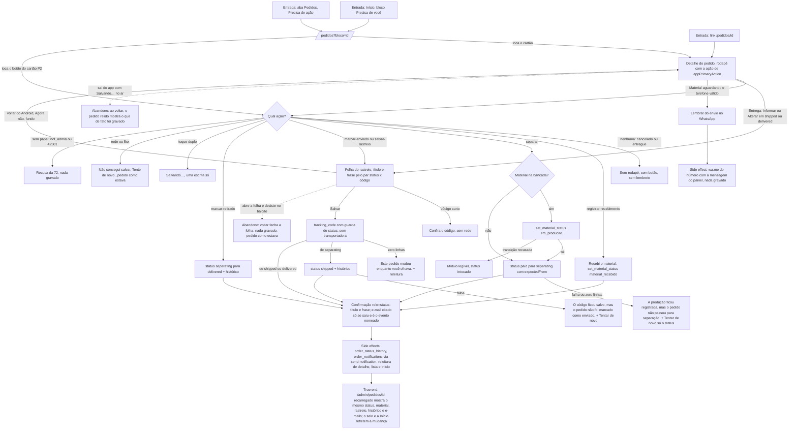

# J-registrar-material-e-envio — Registrar o material e o envio pelo celular

Feature `75` (`MAA-01`..`MAA-41`, `AD-056`). A Adri resolve o pedido onde ela está: na caixa do
correio ("o envelope chegou"), na bancada ("comecei a peça"), no balcão do correio ("está aqui o
código") ou no balcão do escritório ("a cliente buscou"). Cada ação grava pelo **mesmo** dono do
painel (`@estrelinha/core/order-actions`), confere o efeito, avisa a cliente pelo motor de e-mail e
relê o pedido, a lista e a Início. O lembrete do WhatsApp não grava nada.

A ação que aparece é decidida por `appPrimaryAction(row)` (`core/orders`): cancelado e entregue não
têm ação; retirada em separação é "Marcar como retirado"; senão, a ação de `rowSummary`.



```yaml
journey:
  id: J-registrar-material-e-envio
  name: Registrar o material e o envio pelo celular
  value_statement: "A Adri registra a chegada do material, o início da peça, o rastreio e a retirada sem abrir o computador, e a cliente é avisada como seria pelo painel"
  personas: [Adri no celular, Equipe com TalkBack, Cliente com conta da loja]
  entry_points:
    - url: /pedidos/<id> (rodapé do detalhe)
      origin: in-app-nav
    - url: /pedidos?visao=precisa-acao (botão do cartão)
      origin: in-app-nav
    - url: /pedidos?bloco=<id> (vindo da Início)
      origin: in-app-nav
  actions:
    - step: 1
      verb: abre o pedido que espera por ela
      expected_observable: rodapé com a ação do estado (Recebi o material, Iniciar separação, Marcar como enviado, Salvar rastreio, Marcar como retirado) ou nenhum
    - step: 2
      verb: toca a ação
      expected_observable: Salvando… e o controle travado até a resposta
    - step: 3
      verb: no rastreio, digita ou cola o código e salva
      expected_observable: maiúsculas sem espaço; código curto recusado sem rede; a folha fecha só no sucesso
    - step: 4
      verb: lê a confirmação
      expected_observable: título e frase; e-mail citado só quando saiu de verdade
    - step: 5
      verb: volta à lista
      expected_observable: o pedido saiu do recorte se deixou de pertencer a ele, mesma posição de rolagem
  goal:
    observable: o pedido no estado novo, igual no app e em /admin/pedidos/<id>
    side_effects: [orders.status/material_status/tracking_code; order_status_history; order_notifications pela send-notification; releitura de detalhe, lista e STORE_OVERVIEW; wa.me aberto no lembrete]
  true_end_state: depois de recarregar o app e o painel, os dois mostram o mesmo status, material, rastreio, histórico e e-mails; nenhuma linha de histórico ou aviso duplicada
  exit:
    natural: confirmação e volta à lista ou à Início
  abandonment:
    - at_step: 3
      how: abre a folha do rastreio e desiste (voltar, Agora não, toque no fundo)
      resume: nada gravado; reabrir a folha começa vazia (ou com o código salvo, em Alterar)
    - at_step: 2
      how: sai do app ou perde a rede com a ação no ar
      resume: ao voltar, o pedido relido mostra o que de fato foi gravado; nada é reenviado sozinho
  crosses: [PostgREST orders/order_status_history, RPC set_material_status, RPC atelie_clock, edge function send-notification, Resend, Supabase Realtime, wa.me, painel /admin/pedidos/<id>, Início do ateliê]
```

## Varredura da taxonomia

| Dimensão | Onde |
| --- | --- |
| Jornada | `MAD-acao-recebi-o-material`, `MAD-acao-iniciar-separacao`, `MAD-acao-marcar-como-enviado`, `MAD-acao-marcar-como-retirado`, `MAD-acao-no-cartao-da-lista`; o true end em `MAD-acao-painel-ve-o-que-o-app-gravou` |
| Funcional | `MAD-acao-rastreio-informar-ou-alterar` (os quatro pares), `MAD-acao-lembrete-whatsapp` (o destino e a mensagem byte a byte), `MAD-acao-aviso-falha-gravacao-vale` |
| Experiencial | tom memorial e primeira pessoa nas confirmações e no lembrete (`MAD-acao-lembrete-whatsapp`, `BL-015`); nenhuma promessa de e-mail falsa (`MAD-acao-rastreio-informar-ou-alterar`); `MAD-acao-com-leitor-de-tela` |
| Borda/erro/vazio | `MAD-acao-codigo-de-rastreio-recusado`, `MAD-acao-separacao-falha-no-meio`, `MAD-acao-rastreio-salvo-sem-status`, `MAD-acao-falha-de-rede-ao-salvar`, `MAD-acao-sem-acao-cancelado-ou-entregue` |
| Transversal | `MAD-acao-toque-duplo-trava`, `MAD-acao-pedido-mudou-enquanto-olhava` (painel em outra aba), `MAD-acao-conta-sem-papel-nao-grava`, `MAD-acao-folha-e-voltar-do-android`, `MAD-acao-fonte-grande-e-telas-estreitas` |

O que só o aparelho prova (fica `blocked-verify` nos cenários): o WhatsApp abrindo de verdade, o
teclado virtual sobre a folha, o gesto de voltar do sistema e o TalkBack real.
