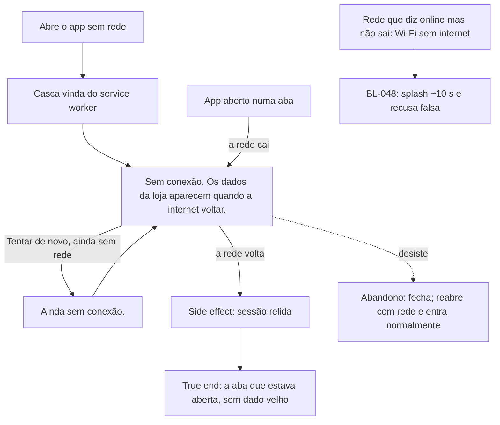

# J-sem-conexao — O ateliê sem internet



```yaml
journey:
  id: J-sem-conexao
  name: Abrir o ateliê sem internet e voltar quando a rede volta
  value_statement: "Sem internet, o app nunca mostra número velho da loja e volta sozinho quando a rede volta"
  personas: [Adri no celular]
  entry_points:
    - url: ícone instalado, modo avião
      origin: push
  actions:
    - step: 1
      verb: abre o app sem rede
      expected_observable: a tela Sem conexão, sem Login nem aba atrás
    - step: 2
      verb: toca Tentar de novo
      expected_observable: Ainda sem conexão.
    - step: 3
      verb: liga a rede
      expected_observable: o app sai da tela sozinho
  goal:
    observable: nenhum dado da loja na tela sem rede
    side_effects: [zero requisições ao Supabase enquanto offline]
  true_end_state: com a rede de volta, a aba abre e a sessão é relida do servidor
  exit:
    natural: a aba que ela queria
  abandonment:
    - at_step: 1
      how: fecha o app
      resume: reabre com rede e entra normalmente
  crosses: [service worker (workbox), navigator.onLine, Supabase Auth]
```

## Varredura da taxonomia

| Dimensão | Onde |
| --- | --- |
| Jornada | `MAD-abrir-sem-conexao`, `MAD-rede-cai-com-app-aberto` |
| Funcional | zero chamadas ao Supabase offline, dentro dos cenários |
| Experiencial | a frase única, sem título repetido; `CH-atelie-com-rede-ruim` |
| Borda/erro/vazio | `MAD-rede-inutil-recusa-falsa` (`BL-048`, bug aberto) |
| Transversal | abrir offline em `/pedidos` (o `navigateFallback`) dentro do charter |
