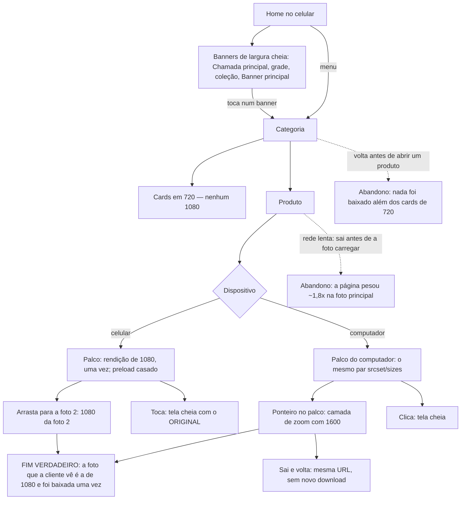

# J-ver-a-joia-nitida: a cliente vê a joia e os banners nítidos no celular, sem a loja pesar mais

Feature `87` (`.specs/features/87-qualidade-das-imagens/`, `IMG-01`..`IMG-08`, `IMG-15`..`IMG-17`).
Superfície: `apps/store` — palco da galeria do produto (celular e computador), zoom do computador, tela
cheia, banners da Home e a listagem de categoria (que **não** pode pesar mais). Área `LOJA`. Persona:
Cliente navegando pelo menu (`../personas.md`) — no celular de densidade 3 e, às vezes, no notebook.

```yaml
journey:
  id: J-ver-a-joia-nitida
  entry: [/, /<categoria>, /produtos/:slug]
  goal: enxergar o detalhe da peça (a resina, a mecha, a gravação) e a arte da campanha sem borrão, no celular
  exit: a foto principal e os banners de largura cheia chegam numa rendição de 1080, uma vez cada; a categoria segue em 720; o zoom do computador mostra uma foto de 1600 só depois do ponteiro
  side_effects: [nenhum dado gravado; só requisições ao render/image do Storage]
```

## Fluxo



## Dimensões (taxonomia)

| Dimensão | Coberto por |
| --- | --- |
| Caminho feliz | abrir produto no celular @3x; banners da Home; zoom no computador |
| Erro e borda | foto de fora do Storage (sem `srcset`, zoom com a URL inalterada); origem de 1024 pedida a 1080; produto sem foto |
| Dado | foto da Nuvemshop (1024) × foto enviada pelo painel (até 2400); arte de celular separada no Banner principal |
| Ambiente | DPR 1/2/3, 360/390/1440, 4G lento (o peso extra do LCP) |
| Acesso | sem mudança de nó; leitor de tela segue lendo o `alt` de antes — conferir que nada mudou |

**Limite do ambiente**: as artes de `home_sections` do banco local apontam para o Storage hospedado,
bloqueado por regra. Os banners são exercitados interceptando a leitura de `home_sections`/`home_section_items`
e trocando a URL por uma imagem do Storage local.
