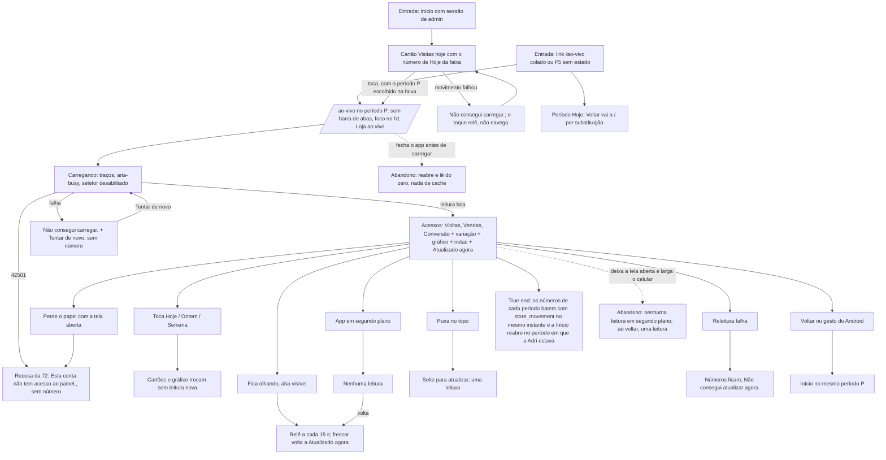

# J-ver-a-loja-ao-vivo — Ver os acessos de hoje, de ontem e da semana

Feature `83`, Fase 1 (Acessos). A pergunta da Adri: *"quanta gente olhou a loja hoje, a que horas, e
quantas compraram?"*. Tudo vem de **uma** leitura (`store_movement`, chave `acessos`) e do relógio do
servidor (`LAV-61`); o aparelho só mede há quanto tempo a resposta chegou.



```yaml
journey:
  id: J-ver-a-loja-ao-vivo
  name: Ver a Loja ao vivo
  value_statement: "Em uma tela, a Adri sabe quantas visitas e vendas a loja teve hoje, ontem e na semana, e a que horas, sem número falso"
  personas: [Adri no celular, Equipe com TalkBack]
  entry_points:
    - url: / (cartão Visitas hoje)
      origin: navigation
    - url: /ao-vivo
      origin: direct
  actions:
    - step: 1
      verb: toca o cartão Visitas hoje na Início
      expected_observable: /ao-vivo abre no período da faixa, com o h1 focado
    - step: 2
      verb: lê os três cartões e o gráfico
      expected_observable: Visitas, Vendas, Conversão e a variação; 8 faixas de 3 horas ou um dia por coluna
    - step: 3
      verb: toca Ontem e Semana
      expected_observable: cartões e gráfico trocam sem leitura nova
    - step: 4
      verb: deixa a tela aberta
      expected_observable: relê a cada 15 s só com a aba visível; o frescor diz há quanto tempo
    - step: 5
      verb: volta à Início
      expected_observable: a faixa no mesmo período
  goal:
    observable: os números de cada período iguais aos de store_movement no mesmo instante
    side_effects: [nenhuma escrita; leituras de store_movement a cada 15 s (tela) e 30 s (Início), só visível]
  true_end_state: o que a tela mostra bate com store_movement/le-movimento.sql, e a Início reabre no período de antes
  exit:
    natural: Voltar à Início
  abandonment:
    - at_step: 1
      how: fecha o app antes de os números chegarem
      resume: reabre e lê do zero
    - at_step: 4
      how: larga o celular com a tela aberta
      resume: nenhuma leitura enquanto oculta; uma ao voltar
  crosses: [Supabase RPC store_movement (has_role), function visit (record_store_visit com first_hour), RequireAdmin, history.state]
```

## Varredura da taxonomia

| Dimensão | Onde |
| --- | --- |
| Jornada | `MAD-aovivo-abrir-pelo-cartao`, `MAD-aovivo-voltar-mantem-periodo` |
| Funcional | `MAD-aovivo-numeros-batem-com-o-banco`, `MAD-aovivo-trocar-periodo-sem-ler`, `MAD-aovivo-grafico-por-faixas`, `MAD-aovivo-linha-de-frescor`, `MAD-aovivo-releitura-15s-so-visivel`, `MAD-aovivo-puxar-para-atualizar` |
| Experiencial | `MAD-aovivo-tom-memorial`, `MAD-aovivo-com-leitor-de-tela`, `MAD-aovivo-fonte-grande-e-telas-estreitas` |
| Borda/erro/vazio | `MAD-aovivo-contador-recente-parado-ou-antigo`, `MAD-aovivo-leitura-falha-tentar-de-novo` |
| Transversal | `MAD-aovivo-conta-sem-papel-recusada` (a recusa da `72`); privacidade em `J-ler-a-politica-de-privacidade` |
