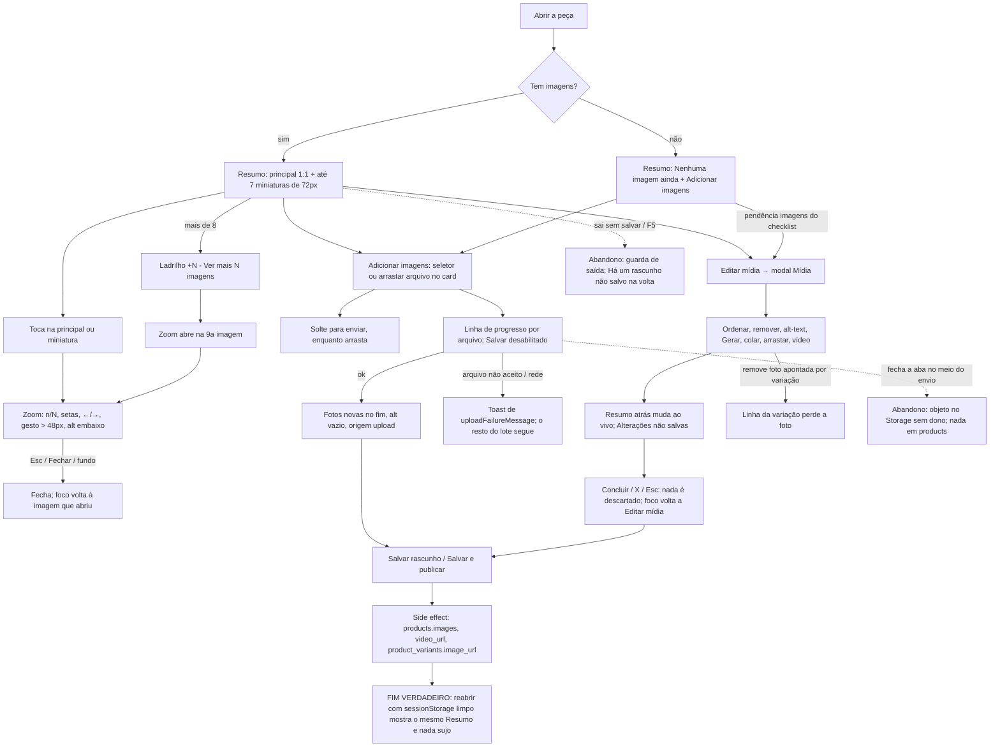

# J-ver-e-cuidar-das-fotos-da-peca: abrir uma peça, reconhecê-la pela foto e cuidar das fotos sem trocar de aba

Feature `85` (`.specs/features/85-resumo-com-imagens-do-produto/`, `RES-01`..`RES-09`, `ZOM-01`..`ZOM-06`,
`ADI-01`..`ADI-06`, `MOD-01`..`MOD-07`). Superfície: `apps/backoffice`, card **Resumo** da coluna lateral de
`/admin/produtos/:id/editar` (e de `/novo`), o visualizador de zoom e o modal **Mídia** (que substituiu a aba
Mídia). O card "Prévia na loja" saiu. Área `PNL`. Personas: Adri cadastrando peças (principal) e Equipe com
TalkBack (`../personas.md`).

```yaml
journey:
  id: J-ver-e-cuidar-das-fotos-da-peca
  entry: [/admin/produtos/:id/editar, /admin/produtos/novo, pendência "imagens" do checklist Pronto para publicar]
  goal: ver a foto principal sem rolar nem trocar de aba (390×844), conferir detalhe no zoom, acrescentar/ordenar/descrever/remover fotos e o vídeo, e gravar no Salvar
  exit: reabrir a peça mostra no Resumo as mesmas fotos, na mesma ordem, com o alt-text e o "Vídeo · sim/não" salvos, e nada sujo
  side_effects: [objeto novo no bucket product-images (na hora do envio), products.images e products.video_url (no Salvar), product_variants.image_url limpo quando a foto apontada sai (clearMissingVariantImages)]
```

## Fluxo



## Dimensões (taxonomia)

| Dimensão | Coberto por |
| --- | --- |
| Caminho feliz | ver a peça, zoom, adicionar pelo botão, editar no modal, salvar e reabrir |
| Erro e borda | arquivo não aceito, rede caindo no envio, produto sem imagem, 9 e 28 fotos, imagem que não carrega |
| Dado | ordem após remover a principal, foto apontada por variação, `alt` vazio ("Imagem 1"), vídeo sim/não, "+N" com N = 1 |
| Ambiente | 360/390/412 e 1024/1440, fonte 100/130/200 %, arrasto nativo do sistema (só humano), gesto com dedo real (Android) |
| Acesso | nomes acessíveis ("Ampliar imagem n de N", "Ver mais N imagens"), foco devolvido pelo zoom e pelo modal, alvos de 44px (MOD-07, ZOM-06) |

Pré-existente, registrado como bug e não da `85`: `BUG-20261028-produto-abre-com-alteracoes-nao-salvas`.
