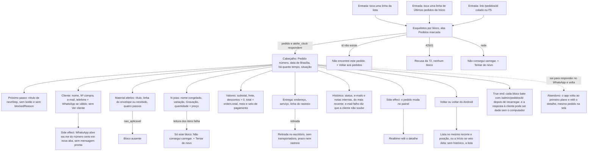

# J-ver-um-pedido — Abrir um pedido e saber em que pé ele está

Feature `74` (`MAP-20`..`MAP-30`, `MAP-52`, `MAP-55`). A pergunta da Adri, com a cliente esperando
resposta no WhatsApp: *"o que ela comprou, com que gravação, o material chegou, já saiu?"*. Uma tela só,
o próximo passo dito por `nextStep` (o mesmo do painel), **sem botão de ação** (as escritas são da `75`). **Desde a `75`** o detalhe ganha o rodapé de ação, a folha do rastreio e o lembrete: essa jornada é `J-registrar-material-e-envio`.



```yaml
journey:
  id: J-ver-um-pedido
  name: Ver um pedido no celular
  value_statement: "A Adri responde a cliente pelo celular sabendo o que foi comprado, o estado do material, como sai e o que já aconteceu"
  personas: [Adri no celular, Equipe com TalkBack, Cliente com conta da loja]
  entry_points:
    - url: /pedidos/<id> (linha da lista)
      origin: in-app-nav
    - url: /pedidos/<id> (linha de Últimos pedidos da Início)
      origin: in-app-nav
    - url: /pedidos/<id> colado
      origin: external-share
  actions:
    - step: 1
      verb: abre o pedido
      expected_observable: número, data, idade e situação no topo; foco no h1
    - step: 2
      verb: lê o próximo passo e o bloqueio
      expected_observable: texto sem botão, nenhuma frase que mande avançar
    - step: 3
      verb: confere cliente, material, joias com gravação e valores
      expected_observable: os blocos iguais aos do painel; o total é o do pedido, sem recalcular
    - step: 4
      verb: toca WhatsApp
      expected_observable: abre a conversa com o número da cliente, sem texto pronto
    - step: 5
      verb: volta
      expected_observable: a lista no mesmo recorte e posição, ou a Início
  goal:
    observable: os blocos do detalhe iguais aos de /admin/pedidos/<id>
    side_effects: [wa.me aberto em nova aba; um canal Realtime de orders; nenhuma escrita]
  true_end_state: depois de recarregar /pedidos/<id>, os mesmos blocos; o voltar devolve a Adri ao ponto de onde veio
  exit:
    natural: volta à lista ou à Início, ou sai para o WhatsApp
  abandonment:
    - at_step: 4
      how: sai para o WhatsApp e só volta minutos depois
      resume: o detalhe relê ao voltar ao primeiro plano
  crosses: [PostgREST orders/order_items/order_status_history/order_notes/order_notifications, RPC atelie_clock, Supabase Realtime, wa.me, painel /admin/pedidos/<id>]
```

## Varredura da taxonomia

| Dimensão | Onde |
| --- | --- |
| Jornada | `MAD-pedido-abrir-e-entender`, `MAD-pedido-ultimos-pedidos-abre-detalhe` |
| Funcional | `MAD-pedido-whatsapp-da-cliente` (o side effect no destino), `MAD-pedido-retirada-no-escritorio` |
| Experiencial | sem CTA morto e tom memorial dentro de `MAD-pedido-abrir-e-entender`; leitor de tela no detalhe dentro de `MAD-pedidos-com-leitor-de-tela` |
| Borda/erro/vazio | `MAD-pedido-inexistente`, `MAD-pedido-bloco-secundario-falha` |
| Transversal | `MAD-pedido-voltar-mantem-recorte` (voltar do Android), `MAD-pedido-muda-com-a-tela-aberta` (painel em outra aba); a fonte grande e 360 px dentro de `MAD-pedidos-fonte-grande-e-telas-estreitas` |
