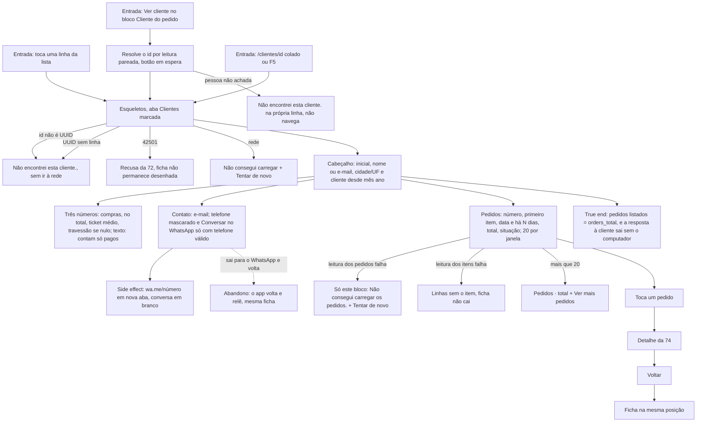

# J-ver-uma-cliente — Abrir a ficha de uma cliente e falar com ela

Feature `76` (`MAC-14`..`MAC-22`, `MAC-26`, `MAC-37`). A pergunta da Adri, com a mensagem da cliente aberta: *"o que ela já levou, tem peça minha em andamento, e como respondo?"*. Alcançada pela lista **ou** pelo "Ver cliente" do detalhe do pedido (`J-ver-um-pedido`). Números contam só pedidos pagos, e a ficha diz isso. **Só leitura.**



```yaml
journey:
  id: J-ver-uma-cliente
  name: Ver a ficha de uma cliente no celular
  value_statement: "A Adri responde a cliente com o contexto na mão: contato, o que ela levou e se há peça em andamento"
  personas: [Adri no celular, Equipe com TalkBack, Cliente com conta da loja]
  entry_points:
    - url: /clientes/<id> (linha da lista)
      origin: in-app-nav
    - url: /clientes/<id> (Ver cliente do pedido)
      origin: in-app-nav
    - url: /clientes/<id> colado
      origin: external-share
  actions:
    - step: 1
      verb: abre a ficha
      expected_observable: nome, cidade/UF, cliente desde, foco no título
    - step: 2
      verb: confere os três números e a frase dos pagos
      expected_observable: iguais a customer_list e ao painel; ticket médio com travessão se nunca pagou
    - step: 3
      verb: toca Conversar no WhatsApp
      expected_observable: wa.me com 55 e o número certo, nova aba, sem texto pronto
    - step: 4
      verb: abre um pedido dela e volta
      expected_observable: detalhe da 74; voltar traz a ficha na mesma posição
    - step: 5
      verb: pede mais pedidos
      expected_observable: 20 → 22 linhas, sem repetir, botão some ao cobrir orders_total
  goal:
    observable: ficha igual à de /admin/clientes/<id> nos números e nos pedidos
    side_effects: [wa.me em nova aba; nenhuma escrita; nenhum dado da cliente em URL, history.state, armazenamento ou console]
  true_end_state: pedidos listados = orders_total de customer_list, inclusive convidada e e-mail com underscore
  exit:
    natural: volta à lista ou ao pedido de onde veio, ou sai para o WhatsApp
  abandonment:
    - at_step: 3
      how: sai para o WhatsApp e só volta minutos depois
      resume: a ficha relê ao voltar ao primeiro plano
  crosses: [PostgREST customer_list, customer_directory, orders, order_items, RPC atelie_clock, wa.me, painel /admin/clientes/<id>]
```

## Varredura da taxonomia

| Dimensão | Onde |
| --- | --- |
| Jornada | `MAD-cliente-abrir-e-entender`, `MAD-cliente-ver-cliente-do-pedido`, `MAD-cliente-pedido-dela-e-voltar` |
| Funcional | `MAD-cliente-whatsapp-em-branco`, `MAD-cliente-pedidos-batem-com-o-total`, `MAD-cliente-email-com-underscore-nao-mistura`, `MAD-cliente-numeros-so-pagos` |
| Experiencial | `MAD-cliente-tom-memorial`, `MAD-cliente-com-leitor-de-tela` |
| Borda/erro/vazio | `MAD-cliente-inexistente-ou-id-ruim`, `MAD-cliente-sem-telefone-sem-pedido`, `MAD-cliente-bloco-de-pedidos-falha` |
| Transversal | `MAD-cliente-fonte-grande-e-telas-estreitas`, `MAD-cliente-perde-o-acesso-com-ficha-aberta`, `MAD-cliente-muda-com-a-ficha-aberta` |
